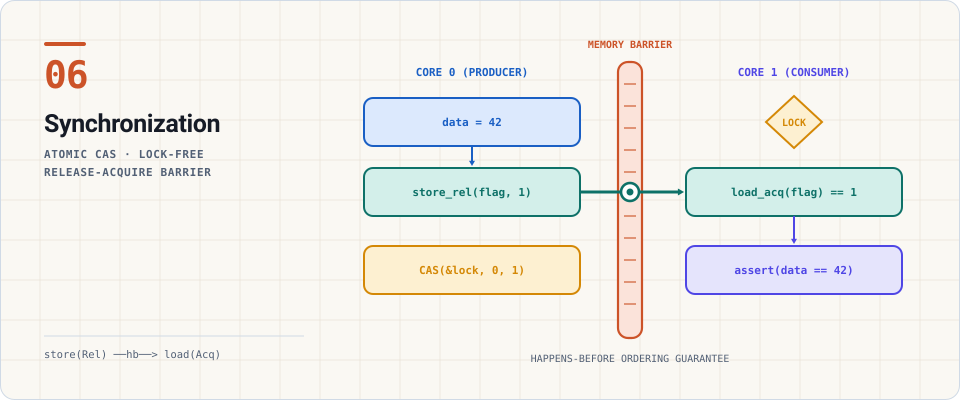
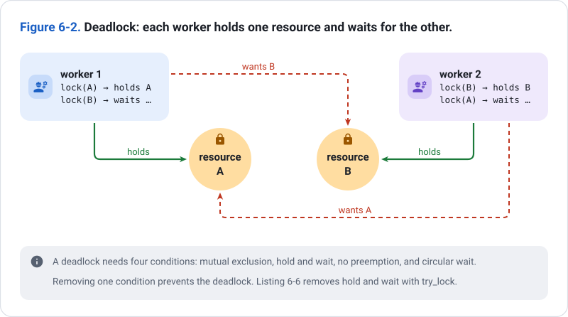
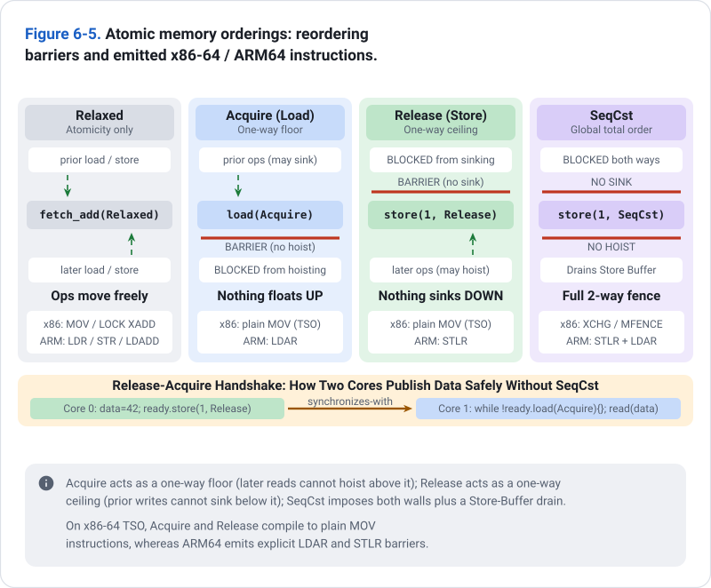

# 6. Synchronization and Memory Ordering



As seen in Chapters 2 and 4, a non-atomic Read-Modify-Write expression (`counter++`) decomposes into three discrete machine instructions (load, increment, and store), creating an **atomicity gap** through which concurrent threads lose updates. Single-word atomic instructions eliminate lost updates on isolated scalar variables. Systems software, however, routinely mutates composite data structures (linked lists, circular buffers, page-table hierarchies, file descriptor tables, and allocator free lists) whose structural invariants span multiple machine words and cache lines.

Preserving data integrity across concurrent threads requires enforcing two orthogonal properties:
1. **Mutual Exclusion and Predicate Coordination:** Serializing multi-instruction critical sections and suspending threads passively when a required logical precondition is unsatisfied.
2. **Memory Ordering and Cross-Core Visibility:** Constraining compiler instruction reordering and per-core hardware store buffers so that writes committed prior to a synchronization point become deterministically visible to peer cores observing that synchronization point.

## 6.1 Mutual Exclusion and Critical Sections

A **mutex** (mutual exclusion lock) enforces an exclusive ownership invariant: at most one thread may execute within the protected **critical section** at any instant. When a thread invokes `lock()` on a mutex currently owned by another thread, the synchronization runtime parks the contending thread in a kernel wait queue, allowing the physical core to execute other runnable threads rather than spinning idly.

The selection between atomic instructions and mutexes is governed by critical-section granularity and static safety guarantees:
- **Atomic Instructions** operate directly in user mode (`Ring 3` / `EL0`, ~5–20 ns uncontended) and are appropriate for isolated counters, state flags, bitmasks, and lock-free single-producer/single-consumer ring indices.
- **Mutexes** guard multi-object invariants of arbitrary complexity. In C++, `std::mutex` is declared independently of the variables it protects, relying on developer discipline to ensure every access acquires the lock. In Rust, `Mutex<T>` encapsulates the protected payload `T` inside the lock type itself: the type system enforces at compile time that `T` is accessible solely through an active `MutexGuard<'_, T>`, whose `Drop` implementation releases the lock deterministically upon scope exit or stack unwinding.

<figure>

</figure>

**Listing 6-1. The shared counter, protected by a mutex (C++20).**

```cpp
{{#include ../code/ch06/mutex_counter.cpp}}
```

**Output 6-1. The observed value equals the expected value in every run.**

```text
{{#include ../code/out/ch06_mutex.out}}
```

**Listing 6-2. The same counter in Rust.**

```rust
{{#include ../code/ch06/mutex_counter.rs}}
```

**Output 6-2.**

```text
{{#include ../code/out/ch06_mutex_rs.out}}
```

## 6.2 Condition Variables and Predicate-Based Synchronization

Mutexes enforce mutual exclusion, yet they provide no mechanism for suspending execution until a shared logical state (a **predicate**) becomes true (for example, awaiting non-empty occupancy or available buffer capacity in a bounded queue). Repeatedly acquiring a mutex, testing the predicate, and releasing the mutex in a polling loop wastes CPU cycles and saturates the cache coherence bus.

A **condition variable** resolves predicate waiting by pairing an internal wait queue with an associated mutex. Invoking `wait(lock)` performs two state transitions as a single **atomic operation**:
1. Releases the held mutex `M`.
2. Enqueues the calling thread onto the condition variable's sleep queue.

Atomicity across these two steps eliminates the **lost-wakeup hazard**. If releasing `M` and entering the sleep queue were separate, interruptible steps, a consumer could observe an empty queue and unlock `M`; prior to the consumer entering the wait queue, a producer could acquire `M`, append an item, invoke `notify_one()` on an empty wait queue, and unlock `M`. The consumer would subsequently enter the wait queue and remain blocked indefinitely despite an unread item residing in the buffer. Atomic unlock-and-sleep ensures that no peer thread can acquire `M` until the caller is already enrolled on the wait queue.

<div class="callout caution">
<span class="label">Watch out</span>

Every condition-variable wait must be enclosed within a **`while (!predicate)` loop** (or Rust's `Condvar::wait_while`), never a single `if (!predicate)` branch. Two distinct mechanisms invalidate a non-looping check:
1. **Spurious Wakeups:** **Portable Operating System Interface (`POSIX`)** (`pthread_cond_wait`) and operating system kernels permit a waiting thread to return from `wait` without a corresponding notification event.
2. **Post-Wakeup State Interception:** Returning from a condition wait moves the thread from the condition variable queue to the mutex acquisition queue rather than granting immediate ownership. An intervening thread may acquire the mutex first and invalidate the predicate before the awakened thread obtains lock ownership.

</div>

**Listing 6-3. A bounded buffer with two producers and two consumers (C++20).**

```cpp
{{#include ../code/ch06/prodcons.cpp}}
```

**Output 6-3. The three sums are equal.**

```text
{{#include ../code/out/ch06_prodcons.out}}
```

**Listing 6-4. The same buffer in Rust, with `Mutex` and `Condvar`.**

```rust
{{#include ../code/ch06/prodcons.rs}}
```

**Output 6-4.**

```text
{{#include ../code/out/ch06_prodcons_rs.out}}
```

## 6.3 Deadlock: Causes and Prevention

A **deadlock** occurs when a set of threads enters permanent suspension because every member of the set holds at least one exclusive resource while waiting indefinitely for a resource owned by another member of the same set. Coffman's theorem establishes that deadlock occurs if and only if four necessary conditions hold simultaneously:

| Coffman Condition | Formal Definition | Engineering Prevention Mechanism |
| :--- | :--- | :--- |
| **1. Mutual Exclusion** | At least one resource is held in non-shareable exclusive mode | Substitute lock-free atomics, immutable snapshots, or Seqlocks where applicable |
| **2. Hold and Wait** | A thread retains ownership of one lock while blocking to acquire another | Acquire lock sets atomically (`std::scoped_lock(a, b)`) or release held locks upon `try_lock` failure |
| **3. No Preemption** | The kernel cannot forcibly revoke a held mutex from its owning thread | Implement cooperative backoff protocols using non-blocking `try_lock()` |
| **4. Circular Wait** | A directed cycle exists in the resource wait-for graph (T<sub>1</sub> &rarr; B, T<sub>2</sub> &rarr; A) | Enforce a strict global acquisition hierarchy (for example, ascending lock address order `&a < &b`) |

Negating any single Coffman condition provably precludes deadlock. Production kernels (such as Linux's `lockdep` lock-order validator) rely primarily on enforcing a strict **global lock acquisition hierarchy** to eliminate circular wait statically and dynamically.

<figure>

</figure>

**Listing 6-5. A deliberate deadlock caused by inverted lock acquisition order (C++20).**

```cpp
{{#include ../code/ch06/deadlock.cpp}}
```

**Output 6-5. Each worker acquires its first mutex and blocks indefinitely on the second.**

```text
{{#include ../code/out/ch06_deadlock.out}}
```

**Listing 6-6. The same deliberate deadlock in Rust.**

```rust
{{#include ../code/ch06/deadlock.rs}}
```

**Output 6-6.**

```text
{{#include ../code/out/ch06_deadlock_rs.out}}
```

Where a global lock hierarchy cannot be established statically, breaking **Hold and Wait** via non-blocking `try_lock()` eliminates the deadlock cycle. When Worker 2 holds Mutex B and `a.try_lock()` fails, Worker 2 immediately releases Mutex B, pauses briefly to mitigate livelock, and retries acquisition.

**Listing 6-7. Deadlock elimination using `try_lock` backoff (C++20).**

```cpp
{{#include ../code/ch06/trylock.cpp}}
```

**Output 6-7. Worker 2 backs off until Worker 1 completes, and both threads finish.**

```text
{{#include ../code/out/ch06_trylock.out}}
```

**Listing 6-8. The same `try_lock` backoff protocol in Rust.**

```rust
{{#include ../code/ch06/trylock.rs}}
```

**Output 6-8.**

```text
{{#include ../code/out/ch06_trylock_rs.out}}
```

## 6.4 Atomic Compare-And-Swap (`compare_exchange` vs. `compare_exchange_weak`)

Lock-free data structures, spinlocks, atomic reference counters (`std::shared_ptr` and Rust's `Arc`), and uncontended mutex fast paths are built upon a single universal read-modify-write primitive: **Compare-And-Swap (CAS)**. Both C++20 and Rust expose two variants on atomic types: strong (`compare_exchange_strong` / `compare_exchange`) and weak (`compare_exchange_weak`).

### 6.4.1 Semantics of the Atomic Read-Modify-Write

Consider maintaining a shared atomic maximum (`max_val`) updated concurrently by multiple threads without a mutex. Evaluating `if (candidate > max_val) max_val = candidate;` is unsound: a peer thread may raise `max_val` to a higher value between the load and the store, causing the first thread to overwrite a strictly larger maximum with a stale candidate.

Compare-And-Swap closes this race by executing the equality check and conditional write as a single indivisible hardware transaction:

```text
// Indivisible hardware semantics of CAS(addr, expected, desired):
atomic {
    current = *addr;
    if (current == expected) {
        *addr = desired;
        return Success(current);
    } else {
        expected = current;   // reload current memory state for caller retry
        return Failure(current);
    }
}
```

Because failure automatically returns the current value stored at `addr`, arbitrary lock-free state transitions (such as computing a maximum, claiming a slot index, or updating a linked-list head pointer) are structured as a deterministic **read-compute-CAS retry loop**:
1. Load the current atomic word into a thread-local variable `prev`.
2. Compute the proposed `desired` value solely in local registers.
3. Execute `compare_exchange_weak(prev, desired, success_order, failure_order)`.
4. On success, the update committed atomically; on failure, another core mutated the word concurrently, so the loop reloads `prev` and recomputes `desired` against the updated state.

### 6.4.2 Hardware Realization: x86-64 `LOCK CMPXCHG` vs. ARM64 LL/SC

The coexistence of **strong** (`compare_exchange`) and **weak** (`compare_exchange_weak`) primitives reflects a fundamental microarchitectural divergence between x86-64 CISC cores and ARM64 / RISC-V cores:

```text
// x86-64 Single-Instruction CAS                 // ARM64 Load-Linked / Store-Conditional (LL/SC)
mov  rax, r_expected                             1: ldxr  x0, [x_addr]          // Load & set Exclusive Monitor
lock cmpxchg QWORD PTR [r_addr], r_desired          cmp   x0, x_expected        // Verify equality
// ZF=1 on commit; ZF=0 loads [r_addr]->rax         b.ne  2f                    // Mismatch: exit without store
                                                    stxr  w1, x_desired, [x_addr] // Store if Monitor intact
                                                    cbnz  w1, 1b                // Internal retry loop (STRONG only)
                                                 2:
```

- **x86-64 (`LOCK CMPXCHG`):** The processor executes the comparison and conditional store within a single micro-coded instruction while holding the target 64-byte cache line exclusively in the MESI **Modified (`M`)** state. Whenever `*addr == expected`, the store commits deterministically; **spurious failures do not occur**.
- **ARM64 / RISC-V (Load-Linked / Store-Conditional, `LDXR` / `STXR`):** RISC architectures split the atomic update into two distinct instructions coordinated by a hardware **Exclusive Reservation Monitor** associated with the target cache line (64 bytes on standard ARM64 cores; 128 bytes on Apple Silicon M-series cores):
  1. `LDXR` (Load-Exclusive Register) reads the target word and marks the cache line as exclusively reserved by the local core.
  2. `STXR` (Store-Exclusive Register) commits `desired` only if the local core's exclusive reservation remained undisturbed since `LDXR`, returning a status flag (`0` for commit, `1` for abort).
- **Spurious Failure Mechanics on LL/SC Hardware:** Between `LDXR` and `STXR`, any hardware event that invalidates the cache-line reservation clears the Exclusive Monitor, including an asynchronous timer interrupt, a thread preemption, or a sibling core writing to an unrelated variable occupying the same 64-byte or 128-byte cache line (false sharing). Consequently, `STXR` may abort and report failure even though `*addr` remains equal to `expected`.

<figure>

</figure>

This hardware divergence establishes an unambiguous engineering guideline:
- **Use `compare_exchange_weak` inside retry loops:** Because the enclosing loop already handles retry upon failure, emitting a single `LDXR`/`STXR` pair avoids the redundant nested retry branch generated by strong CAS. (ARMv8.1 Large System Extensions, `LSE`, add a single-instruction `CASAL` opcode that reduces contention overhead, yet `compare_exchange_weak` remains portable and optimal across all targets).
- **Use `compare_exchange` (strong) for single-attempt calls outside a loop:** In routines such as `try_lock()` or uncontended mutex fast paths, a spurious LL/SC abort would produce a false negative and unnecessarily divert execution onto a slow kernel path.

Both CAS primitives accept two ordering arguments: `(success_order, failure_order)`. Because a failed CAS neither modifies shared memory nor acquires resource ownership, specifying `Relaxed` for `failure_order` avoids unnecessary memory-barrier overhead on rejected iterations.

## 6.5 Hardware Memory Ordering, Store Buffers, and Litmus Tests

Atomicity guarantees that a single memory word is never observed in a torn, partially written state. Atomicity alone, however, provides **no guarantee** regarding the relative order in which reads and writes to distinct memory addresses become observable across separate CPU cores.

### 6.5.1 Microarchitectural Origins of Memory Reordering

Observable reordering of memory operations originates at two distinct layers of the execution stack:

1. **Compiler Optimization:** Optimizing compilers (`clang -O2`, `rustc -O`) assume single-threaded sequential semantics for non-atomic objects. Unless constrained by explicit atomic memory orderings, the compiler may reorder independent loads and stores, eliminate redundant memory reads, or cache values in registers across loop iterations.
2. **Per-Core Hardware Store Buffers and Weakly Ordered Pipelines:** Even when machine code emits store and load instructions in strict source order, modern out-of-order processors decouple core execution from cache-coherence latency through private microarchitectural queues:
   - **Per-Core FIFO Store Buffer:** When Core 0 executes a store (`x = 1`), stalling the pipeline for 40–100 cycles while awaiting MESI invalidation acknowledgments from sibling cores severely degrades instruction throughput. Core 0 instead enqueues `(addr: x, val: 1)` in its private **Store Buffer** and proceeds immediately to subsequent instructions. Core 0's own loads snoop its Store Buffer via *store forwarding*, preserving single-threaded program semantics; sibling cores, however, cannot observe `x = 1` until the buffer drains to the coherent L1 cache.
   - **x86-64 TSO vs. ARM64 Weak Ordering:** x86-64 enforces **Total Store Order (TSO)**, preserving `Store-Store`, `Load-Load`, and `Load-Store` order in silicon while permitting **`Store-Load` reordering** via the Store Buffer. Weakly ordered architectures such as **ARM64** (Apple Silicon, AWS Graviton) permit all four instruction reorderings (`Load-Load`, `Load-Store`, `Store-Store`, and `Store-Load`) unless constrained by explicit ordering opcodes (`LDAR`, `STLR`, `DMB ISH`).

### 6.5.2 Hardware Litmus Tests: Store Buffering vs. Message Passing

Concurrent memory models are verified using minimal two-thread specifications termed **litmus tests**. Two canonical litmus tests define the exact operational boundaries separating `Relaxed`, `Release`/`Acquire`, and `SeqCst`.

#### Litmus Test 1: Store Buffering (SB): `Store-Load` Reordering Under TSO

Assume coherent memory initially holds `x = 0` and `y = 0`. Core 0 and Core 1 execute concurrently:

```text
// Core 0                              // Core 1
1. x.store(1, ordering);               1. y.store(1, ordering);
2. r1 = y.load(ordering);              2. r2 = x.load(ordering);
```

Under sequential interleaving, one store must commit first, guaranteeing that at least one core observes `1`. On physical hardware executing with **`Relaxed` or `Release`/`Acquire`**, however, both cores may finish with **`r1 == 0 && r2 == 0`**:
- Core 0 buffers `x = 1` in its private Store Buffer and immediately executes `load(y)`, reading `0` from the coherent cache before Core 1's buffer drains.
- Simultaneously, Core 1 buffers `y = 1` in its private Store Buffer and immediately executes `load(x)`, reading `0` from the coherent cache before Core 0's buffer drains.
- Neither `Release` nor `Acquire` prohibits this outcome: a `Release` store prevents *prior* operations from floating below it, and an `Acquire` load prevents *subsequent* operations from floating above it; neither forbids a *subsequent* load (`y.load`) from executing ahead of a *prior* store (`x.store`).
- **Resolution (`SeqCst`):** Specifying `SeqCst` instructs the processor to drain its Store Buffer (`XCHG` / `MFENCE` on x86-64; `STLR` paired with `LDAR` on ARM64) before issuing the subsequent load, establishing a single global total order across all cores in which `r1 == 0 && r2 == 0` is strictly precluded.

#### Litmus Test 2: Message Passing (MP): Acquire-Release Synchronization

Assume coherent memory initially holds `payload = 0` and `ready = false`. Core 0 initializes a data payload and publishes a readiness flag; Core 1 waits for the flag and inspects the payload:

```text
// Producer (Core 0)                           // Consumer (Core 1)
1. payload = 0xCAFE;                           1. while (!ready.load(Acquire)) {}
2. ready.store(true, Release);                 2. assert(payload == 0xCAFE);
```

- **Architecture-Dependent Failure Under `Relaxed`:** Replacing `Release` and `Acquire` with `Relaxed` constitutes a data race in both C++20 and Rust. Because x86-64 TSO hardware preserves `Store-Store` and `Load-Load` order implicitly, a defective `Relaxed` implementation frequently passes empirical testing on x86-64 hosts. On weakly ordered **ARM64** processors, however, hardware may reorder the two stores on Core 0 or the two loads on Core 1, causing Core 1 to observe `ready == true` while reading stale `payload == 0`.
- **Formal Happens-Before Guarantee (`Release` / `Acquire`):**
  - **`Release` on `ready.store(true)`** guarantees that all memory writes sequenced prior to the store (`payload = 0xCAFE`) become globally visible before `ready = true` enters the coherence domain (compiled to `STLR` on ARM64).
  - **`Acquire` on `ready.load()`** guarantees that no memory read sequenced after the load (`read(payload)`) executes prior to observing `ready` (compiled to `LDAR` on ARM64).
  - When Core 1's `Acquire` load observes the `true` value written by Core 0's `Release` store, the two operations establish a **synchronizes-with** edge, inducing a transitive **happens-before** relationship that guarantees Core 1 observes `payload == 0xCAFE` across all architectures.

<figure>

</figure>

### 6.5.3 Complete Reference Table of C++20 and Rust 2024 Memory Orderings

| Ordering | Formal Visibility Contract | x86-64 Machine Code | ARM64 Machine Code | Canonical Engineering Usage |
| :--- | :--- | :--- | :--- | :--- |
| **`Relaxed`** | Single-word atomicity only; zero cross-address ordering | `MOV` / `LOCK XADD` | `LDR` / `STR` | Telemetry counters, unique ID allocation (`fetch_add`), failed CAS branch |
| **`Release`** *(stores)* | Prior reads/writes cannot float below this store | Plain `MOV` (TSO) | `STLR` | `mutex.unlock()`, publishing a payload flag, committing SPSC ring `tail` |
| **`Acquire`** *(loads)* | Subsequent reads/writes cannot float above this load | Plain `MOV` (TSO) | `LDAR` | `mutex.lock()`, polling a readiness flag, inspecting SPSC ring `head` |
| **`AcqRel`** *(RMW)* | Both `Acquire` (on read) and `Release` (on write) | Implicit in `LOCK` | `LDAXR`/`STLXR` or `CASAL` | Atomic reference-count decrements (`Arc::drop`), MPMC queue slot claims |
| **`SeqCst`** | Global total order across all `SeqCst` ops; drains Store Buffers | `XCHG` / `MFENCE` | `STLR` + `LDAR` / `DMB ISH` | Multi-variable Dekker mutual exclusion, Store-Buffering litmus invariants |

<figure>

</figure>

## 6.6 Synchronization Beneath the Primitives: Futexes and Seqlocks

Production operating systems combine user-mode atomic CAS instructions with kernel wait queues to achieve sub-10-nanosecond uncontended locking while avoiding CPU waste under contention.

### 6.6.1 Fast Userspace Mutexes (`futex` on Linux / `__ulock` on Darwin)

Executing a kernel system call upon every `lock()` and `unlock()` invocation would impose a 300–1,000 ns privilege-transition penalty on every critical section, whereas pure user-mode spinlocks waste processor cycles whenever contention persists beyond a few nanoseconds.

Contemporary mutex implementations (`std::mutex`, `pthread_mutex_t`, and Rust's `std::sync::Mutex`) resolve this trade-off through a **hybrid Ring 3 / Ring 0 architecture** built upon Linux's **`futex`** (Fast Userspace Mutex) or Darwin/macOS's **`__ulock_wait` / `__ulock_wake`**. The lock state is encoded in a single 32-bit atomic word possessing three discrete states:

- **State `0` (Unlocked):** No thread holds the mutex.
- **State `1` (Locked, Uncontended):** One thread owns the mutex; zero threads are parked in the kernel wait queue.
- **State `2` (Locked, Contended):** One thread owns the mutex, and one or more contending threads are parked (or entering the wait path) in Ring 0.

The protocol bifurcates into two execution paths:

1. **Uncontended Fast Path (Ring 3 Only, ~5 ns, Zero System Calls):**
   - `lock()` executes a single strong `compare_exchange(0, 1, Acquire, Relaxed)`. When the mutex is unlocked (`0`), ownership transfers immediately in user mode without crossing the kernel boundary.
   - `unlock()` executes `swap(0, Release)`. When the previous state is `1` (confirming no waiting threads exist), `unlock()` returns directly in Ring 3 with zero system calls.
2. **Contended Slow Path (Ring 0 Parking and Lost-Wakeup Prevention):**
   - When Thread B invokes `lock()` against a held mutex (state `1` or `2`), its fast-path CAS fails.
   - Thread B atomically swaps the lock word to **`2`** via `swap(2, Acquire)`, recording the presence of a contender. If `swap(2)` returns `0`, Thread A released the mutex concurrently and Thread B immediately acquires ownership.
   - Otherwise, Thread B issues the system call **`futex(&state, FUTEX_WAIT, 2)`**.
   - Within Ring 0, the kernel hashes the address `&state` to a wait-queue hash bucket, acquires the bucket spinlock, and **atomically re-verifies `*(&state) == 2`** prior to removing Thread B from the CPU runqueue. If Thread A invoked `unlock()` and stored `0` during the interval between Thread B's user-mode check and its kernel entry, the kernel detects `*(&state) != 2`, aborts the sleep immediately with `EAGAIN`, and returns Thread B to Ring 3 to re-attempt acquisition, eliminating the lost-wakeup race.
   - When Thread A invokes `unlock()` and its `swap(0, Release)` returns **`2`**, Thread A invokes **`futex(&state, FUTEX_WAKE, 1)`**, transitioning one parked TCB from the hash-bucket wait queue back onto a runnable core runqueue.

<figure>

</figure>

### 6.6.2 Sequence Locks (`Seqlock`) for Read-Mostly Kernel Data

Certain kernel data structures, such as the monotonic clock calibration parameters exported to user processes via the Linux `vDSO` / `vvar` page (Chapter 9), experience millions of concurrent reads per second across dozens of cores but infrequent single-writer updates. Standard reader-writer locks (`RwLock`) degrade severely under this access profile because every reader must execute an atomic increment and decrement on a shared `reader_count` word, forcing the MESI coherence protocol to bounce the cache line into Exclusive/Modified state across every reading core.

A **Sequence Lock (`Seqlock`)** eliminates all reader-side writes to shared memory by pairing the protected payload fields with an atomic 64-bit **sequence counter (`seq`)** initialized to `0` (even):

1. **Writer Protocol (Single Writer):**
   - Increments `seq` from an even value `2k` to the **odd** value `2k + 1` with `Release` ordering, indicating an active mutation window.
   - Stores the updated payload fields (`ticks`, `scaled_ns`).
   - Increments `seq` to the next **even** value `2k + 2` with `Release` ordering, publishing the consistent snapshot.
2. **Reader Protocol (Zero Shared Memory Writes):**
   - Loads `s1 = seq.load(Acquire)`. If `s1` is **odd** (`(s1 & 1) != 0`), a writer is actively mutating the structure; the reader retries immediately.
   - Copies the payload fields into thread-local registers using atomic `Relaxed` loads (satisfying C++20 and Rust data-race freedom rules even if a writer overlaps the read).
   - Executes an `Acquire` memory fence (`std::atomic_thread_fence(memory_order_acquire)` / `fence(Ordering::Acquire)`) so that payload loads cannot be reordered past the closing sequence verification, then loads `s2 = seq.load(Relaxed)`.
   - **Snapshot Verification:** If `s1 == s2`, no write commenced or completed during the read interval, proving that the local copy represents an untorn, consistent snapshot. If `s1 != s2`, a write overlapped the read; the reader discards the local copy and repeats the loop.

Because readers issue exclusively read transactions, all processor cores simultaneously retain the Seqlock cache line in the MESI **Shared (`S`)** state, achieving linear multi-core read throughput with zero coherence invalidation traffic while writers never block behind active readers.

<figure>

</figure>

**Listing 6-9. `compare_exchange_weak` CAS loop, Acquire-Release message passing, and a lock-free Seqlock (C++20).**

```cpp
{{#include ../code/ch06/cas_ordering.cpp}}
```

**Output 6-9. Peak CAS convergence, verified Acquire-Release visibility, and zero torn Seqlock reads.**

```text
{{#include ../code/out/ch06_cas_ordering.out}}
```

**Listing 6-10. The same CAS loop, Acquire-Release handoff, and Seqlock in Rust.**

```rust
{{#include ../code/ch06/cas_ordering.rs}}
```

**Output 6-10.**

```text
{{#include ../code/out/ch06_cas_ordering_rs.out}}
```

<div class="callout keyidea">
<span class="label">Key idea</span>

Production synchronization integrates three architectural layers: `compare_exchange_weak` drives lock-free retry loops and uncontended Ring 3 fast paths (~5 ns), `Release`/`Acquire` barriers enforce cross-core visibility across private Store Buffers without `SeqCst` pipeline drains, and `futex` / `__ulock` parks contended threads in Ring 0 only when exclusive ownership fails.

</div>

<div class="callout experiment">
<span class="label">Experiment</span>

In Listing 6-9 (`code/ch06/cas_ordering.cpp`), weaken the producer's `memory_order_release` store and consumer's `memory_order_acquire` load to `memory_order_relaxed` on an ARM64 machine (Apple Silicon or AWS Graviton) and run 10 million iterations to observe weakly ordered hardware reordering payload stores past the ready flag.

</div>
