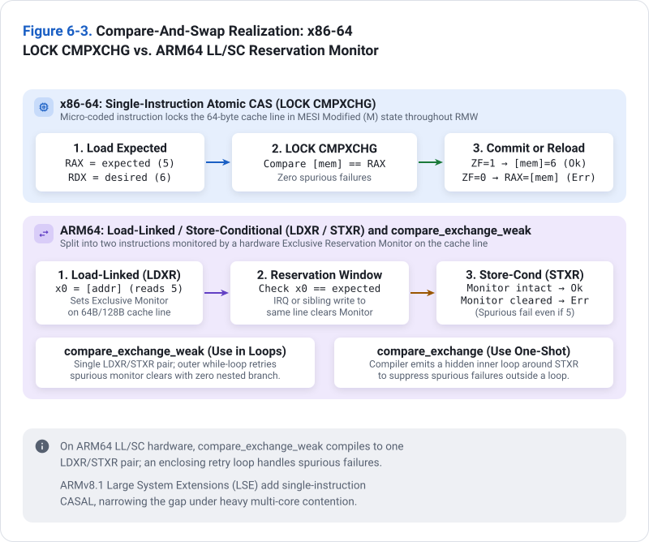
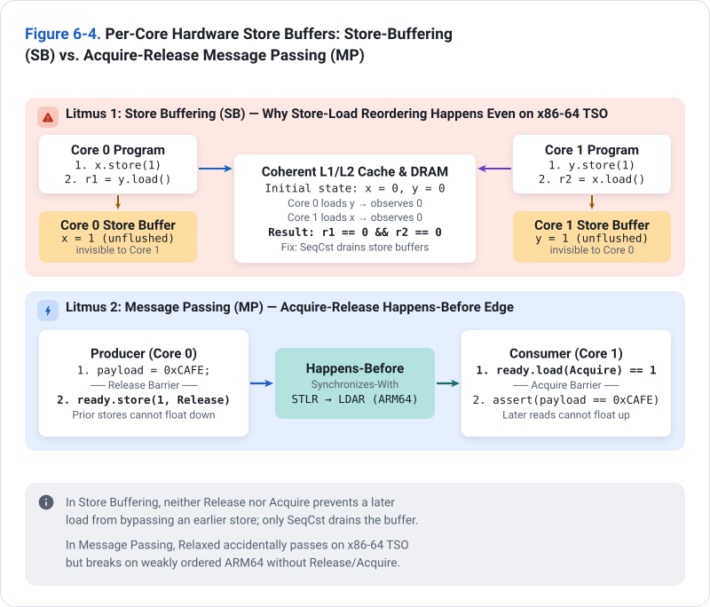
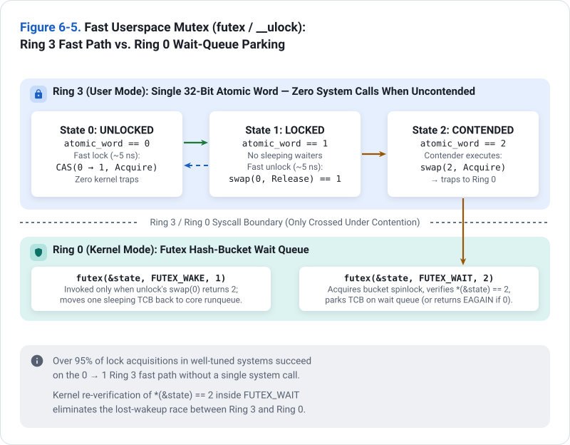
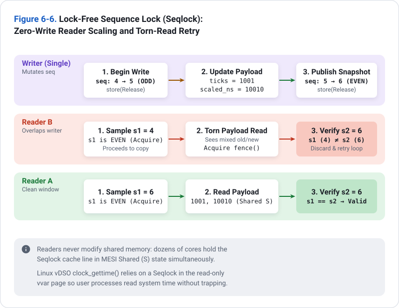

# 6. Synchronization and Memory Ordering

As seen in Chapters 2 and 4, a non-atomic **Read-Modify-Write (`RMW`)** expression (`counter++`) decomposes into three discrete machine instructions (load, increment, and store), creating an **atomicity gap** through which concurrent threads lose updates. Single-word atomic instructions eliminate lost updates on isolated scalar variables. Systems software, however, routinely mutates composite data structures (linked lists, circular buffers, page-table hierarchies, file descriptor tables, and allocator free lists) whose structural invariants span multiple machine words and cache lines.

Preserving data integrity across concurrent threads requires enforcing two orthogonal properties. The first property is **mutual exclusion and predicate coordination**: serializing multi-instruction critical sections and suspending threads passively when a required logical precondition is unsatisfied. The second property is **memory ordering and cross-core visibility**: constraining compiler instruction reordering and per-core hardware store buffers so that writes committed prior to a synchronization point become deterministically visible to peer cores observing that synchronization point.

## 6.1 Mutual Exclusion, Critical Sections, and Lock Architectures

A **mutex** (mutual exclusion lock) enforces an exclusive ownership invariant: at most one thread may execute within the protected **critical section** at any instant. When a thread invokes `lock()` on a mutex currently owned by another thread, the synchronization runtime parks the contending thread in a kernel wait queue, allowing the physical core to execute other runnable threads rather than spinning idly.

The selection between raw atomic instructions and mutexes is governed by critical-section granularity and static safety guarantees. **Atomic instructions** operate directly in user mode (`Ring 3` on x86-64; **Exception Level 0 (`EL0`)** on ARM64, completing in ~5 to 20 ns uncontended) and fit isolated counters, state flags, bitmasks, and lock-free single-producer/single-consumer ring indices. **Mutexes** guard multi-object invariants of arbitrary complexity. In C++, `std::mutex` is declared independently of the variables it protects, relying on developer discipline to ensure every access acquires the lock. In Rust, `Mutex<T>` encapsulates the protected payload `T` inside the lock type itself: the type system enforces at compile time that `T` is accessible solely through an active `MutexGuard<'_, T>`, whose `Drop` implementation releases the lock deterministically upon scope exit or stack unwinding.

<figure>

</figure>

**Listing 6-1. The shared counter, protected by a mutex (C++20).**

```cpp
{{#include ../code/ch06/mutex_counter.cpp}}
```

**Output 6-1. The observed value equals the expected value in every run.**

```text
{{#include ../code/out/ch06_mutex.out}}
```

**Listing 6-2. The same counter in Rust.**

```rust
{{#include ../code/ch06/mutex_counter.rs}}
```

**Output 6-2.**

```text
{{#include ../code/out/ch06_mutex_rs.out}}
```

### 6.1.1 Why Software Mutual Exclusion Breaks Under Hardware Store Buffers

Early concurrency theory asked whether mutual exclusion could be implemented purely with ordinary memory loads and stores, without specialized hardware `RMW` instructions. **Peterson's algorithm** solves the two-thread problem under sequential consistency using two boolean intent flags (`flag[0]`, `flag[1]`) and a shared tie-breaker (`turn`):

```text
// Thread i (peer is j = 1 - i):
flag[i] = true;                  // (1) declare intent to enter
turn    = j;                     // (2) politely yield tie-breaker to peer
while (flag[j] && turn == j) {}  // (3) spin while peer intends and holds turn
// --- critical section ---
flag[i] = false;                 // (4) release critical section
```

Under sequential interleaving, whichever thread writes `turn` second forces itself to wait if the peer has already set `flag[peer] = true`, guaranteeing mutual exclusion. On modern multicore hardware, however, Peterson's algorithm fails catastrophically when compiled with plain loads and stores. Even on x86-64 **Total Store Order (`TSO`)** processors, each core buffers outgoing writes in a private **Store Buffer** to hide cache-coherence latency (analyzed in detail in Section 6.5). When Thread 0 executes on Core 0 and Thread 1 executes simultaneously on Core 1, Core 0 enqueues `flag[0] = true` and `turn = 1` in its local Store Buffer and immediately executes the load of `flag[1]`. Because Core 1's `flag[1] = true` has not yet drained from Core 1's Store Buffer to the coherent cache, Core 0 reads `flag[1] == false` and enters the critical section. At the exact same cycle, Core 1 reads `flag[0] == false` and enters the critical section alongside Core 0, violating mutual exclusion.

Restoring Peterson's invariant on real silicon requires inserting a full memory barrier (`MFENCE` on x86-64, `DMB ISH` on ARM64, or `SeqCst` atomic ordering) between step `(2)` and step `(3)` to drain the Store Buffer before reading the peer's flag. Even with barriers, software-only mutual exclusion scales poorly beyond two threads, which is why operating systems build spinlocks and mutexes directly upon hardware atomic `RMW` instructions.

### 6.1.2 Scalable Spinlocks: Test-and-Set, Ticket Locks, and MCS Locks

Inside an operating system kernel (such as interrupt handlers or scheduler runqueue locks where sleeping is forbidden), threads synchronize over short critical sections using **spinlocks**. The simplest hardware spinlock uses a **Test-and-Set (`TAS`)** loop (`lock.swap(true, Acquire)`): a waiting core repeatedly executes an atomic write until the previous value returns `false`. Under contention across many cores, `TAS` exhibits two severe pathologies. First, every spinning core repeatedly demands exclusive ownership of the lock's 64-byte cache line in the **Modified-Exclusive-Shared-Invalid (`MESI`)** **Modified (`M`)** state, saturating the inter-core coherence interconnect with invalidation traffic. Second, `TAS` provides zero fairness: a core that recently released the lock holds the cache line hot in its L1 cache and frequently re-acquires it before waiting cores on remote sockets can complete a coherence transaction, starving remote threads.

A **Ticket Lock** eliminates starvation by enforcing strict **First-In, First-Out (`FIFO`)** acquisition order using two 32-bit counters: `next_ticket` and `now_serving`. A thread calling `lock()` atomically claims a unique ticket via `my_ticket = next_ticket.fetch_add(1, Relaxed)` and spins until `now_serving.load(Acquire) == my_ticket`. Unlocking increments `now_serving` by one (`Release`), handing ownership deterministically to the next waiter in line. Although Ticket Locks guarantee fairness (and served as the Linux kernel's default spinlock for years), all *N* waiting cores still spin on the *same* `now_serving` cache line. Every `unlock()` invalidates *N* shared copies simultaneously and triggers an O(*N*) storm of cache-miss refills across the interconnect.

The **Mellor-Crummey and Scott (`MCS`) Queue Lock** eliminates global cache-line bouncing completely by giving each waiting core its own local spin variable. Each thread allocates a stack-local queue node `{ next: AtomicPtr<Node>, locked: AtomicBool }` and appends it to the lock's shared `tail` pointer via a single atomic `swap(&tail, my_node)`. If the previous tail was null, the thread acquires the lock immediately. Otherwise, the thread sets `my_node.locked = true`, links `prev->next = my_node`, and spins exclusively on its own `my_node.locked` flag. Because no other core touches `my_node.locked` until the direct predecessor releases the lock, waiting generates zero coherence traffic. Upon `unlock()`, the owner sets `my_node.next->locked = false`, transmitting a single point-to-point O(1) cache invalidation strictly to the next successor. Table 6-1 summarizes these three spinlock architectures.

**Table 6-1. Comparison of hardware spinlock architectures under multi-core contention.**

| Spinlock Design | Fairness Guarantee | Spin Target | Coherence Traffic per `unlock()` | Production Kernel Usage |
| :--- | :--- | :--- | :---: | :--- |
| **Test-and-Set (`TAS`)** | None (unfair; cache-hot core starves peers) | Single global lock word (atomic write per spin) | O(*N*) invalidations + write storm | Educational / uncontended embedded locks |
| **Ticket Lock** | Strict `FIFO` via `next_ticket` / `now_serving` | Single global `now_serving` cache line (read spin) | O(*N*) broadcast invalidation | Historical Linux `arch_spinlock_t` (pre-4.2) |
| **`MCS` Queue Lock** | Strict `FIFO` via explicit waiter queue | Core-private `node.locked` cache line | **O(1)** single-successor handoff | Linux `qspinlock` (queued spinlock), Solaris/illumos |

## 6.2 Condition Variables, Predicate Waiting, and Reader-Writer Starvation

Mutexes enforce mutual exclusion, yet they provide no mechanism for suspending execution until a shared logical state (a **predicate**) becomes true (for example, awaiting non-empty occupancy or available buffer capacity in a bounded queue). Repeatedly acquiring a mutex, testing the predicate, and releasing the mutex in a polling loop wastes **Central Processing Unit (`CPU`)** cycles and saturates the cache coherence bus.

A **condition variable** resolves predicate waiting by pairing an internal wait queue with an associated mutex. Invoking `wait(lock)` performs two state transitions as a single **atomic operation**: it releases the held mutex `M` and enqueues the calling thread onto the condition variable's sleep queue without any interruptible gap between the two steps.

Atomicity across unlock and enqueue eliminates the **lost-wakeup hazard**. If releasing `M` and entering the sleep queue were separate, interruptible steps, a consumer could observe an empty queue and unlock `M`; prior to the consumer entering the wait queue, a producer could acquire `M`, append an item, invoke `notify_one()` on an empty wait queue, and unlock `M`. The consumer would subsequently enter the wait queue and remain blocked indefinitely despite an unread item residing in the buffer. Atomic unlock-and-sleep guarantees that no peer thread can acquire `M` until the caller is already enrolled on the wait queue.

### 6.2.1 Mesa vs. Hoare Condition-Variable Semantics

Once a producer invokes `notify_one()` (or `pthread_cond_signal`), a subtle semantic question arises: does the awakened consumer begin executing immediately with the lock held, or must it re-compete for the mutex? Concurrency theory defines two distinct models.

Under **Hoare semantics**, signaling a condition variable immediately suspends the signaling thread and transfers both the CPU and ownership of mutex `M` directly to the awakened waiter. Because no other thread can run in between, the predicate verified by the signaler is guaranteed to remain true when `wait()` returns, making an `if (!predicate)` guard theoretically sufficient. Implementing Hoare semantics in a preemptive multiprocessor kernel, however, requires tight coupling between the condition variable and the scheduler, imposing severe context-switch latency and preventing the signaler from finishing its critical section.

Every production threading library, including **Portable Operating System Interface (`POSIX`)** `pthread_cond_wait`, C++ `std::condition_variable`, and Rust's `std::sync::Condvar`, therefore implements **Mesa semantics**. Under Mesa semantics, `notify_one()` serves strictly as a scheduling hint: it moves a waiter from the condition variable's sleep queue to the ready queue (or mutex wait queue) while the signaler continues executing until it releases `M`. Between the moment `M` is released and the moment the awakened waiter reacquires `M`, a third intervening thread may slip in, acquire `M`, and consume the buffered item, invalidating the predicate. Combined with **spurious wakeups** permitted by kernel signal delivery and futex implementations, Mesa semantics make the **`while (!predicate)` loop** (or Rust's `Condvar::wait_while`) an absolute correctness invariant.

<div class="callout caution">
<span class="label">Watch out</span>

Every condition-variable wait must be enclosed within a **`while (!predicate)` loop** (or Rust's `Condvar::wait_while`), never a single `if (!predicate)` branch. Under Mesa semantics, two mechanisms invalidate a non-looping check: **spurious wakeups** permitted by `POSIX` (`pthread_cond_wait`) and OS kernels without a corresponding notification event, and **post-wakeup state interception**, where an intervening thread acquires the released mutex first and invalidates the predicate before the awakened waiter obtains lock ownership.

</div>

### 6.2.2 Reader-Writer Locks and Writer Starvation

When a shared structure (such as a routing table or configuration cache) experiences frequent concurrent reads and infrequent mutations, serializing readers behind an exclusive mutex sacrifices multi-core parallelism. A **Reader-Writer Lock (`RwLock`)** permits either any number of concurrent readers (shared mode) or a single exclusive writer (exclusive mode), but never both simultaneously.

Arbitrating between waiting readers and waiting writers introduces a classic fairness pathology. In a **reader-preferring** `RwLock`, newly arriving readers are granted immediate shared access whenever the lock is already held in read mode. Under sustained read traffic, overlapping reader intervals keep `active_readers > 0` continuously, inducing indefinite **writer starvation** even though no single reader holds the lock for long. Conversely, a **writer-preferring** `RwLock` records pending writers in a flag or queue and blocks newly arriving readers as soon as a writer requests exclusive access, allowing active readers to drain so the writer acquires the lock deterministically. On Linux, `glibc` exposes `PTHREAD_RWLOCK_PREFER_WRITER_NONRECURSIVE_NP` to mitigate writer starvation, and Rust's `std::sync::RwLock` delegates to the underlying platform lock (whose fairness policy varies between Linux `futex`-based queues and macOS `os_unfair_lock` / `pthread_rwlock_t`), whereas `parking_lot::RwLock` enforces explicit phase fairness to prevent starvation of both readers and writers.

**Listing 6-3. A bounded buffer with two producers and two consumers (C++20).**

```cpp
{{#include ../code/ch06/prodcons.cpp}}
```

**Output 6-3. The three sums are equal.**

```text
{{#include ../code/out/ch06_prodcons.out}}
```

**Listing 6-4. The same buffer in Rust, with `Mutex` and `Condvar`.**

```rust
{{#include ../code/ch06/prodcons.rs}}
```

**Output 6-4.**

```text
{{#include ../code/out/ch06_prodcons_rs.out}}
```

## 6.3 Deadlock: Causes and Prevention

A **deadlock** occurs when a set of threads enters permanent suspension because every member of the set holds at least one exclusive resource while waiting indefinitely for a resource owned by another member of the same set. Coffman's theorem establishes that deadlock occurs if and only if four necessary conditions hold simultaneously (Table 6-2).

**Table 6-2. Coffman's four necessary conditions for deadlock and their engineering countermeasures.**

| Coffman Condition | Formal Definition | Engineering Prevention Mechanism |
| :--- | :--- | :--- |
| **1. Mutual Exclusion** | At least one resource is held in non-shareable exclusive mode | Substitute lock-free atomics, immutable snapshots, or Seqlocks where applicable |
| **2. Hold and Wait** | A thread retains ownership of one lock while blocking to acquire another | Acquire lock sets atomically (`std::scoped_lock(a, b)`) or release held locks upon `try_lock` failure |
| **3. No Preemption** | The kernel cannot forcibly revoke a held mutex from its owning thread | Implement cooperative backoff protocols using non-blocking `try_lock()` |
| **4. Circular Wait** | A directed cycle exists in the resource wait-for graph (T<sub>1</sub> &rarr; B, T<sub>2</sub> &rarr; A) | Enforce a strict global acquisition hierarchy (for example, ascending lock address order `&a < &b`) |

Negating any single Coffman condition provably precludes deadlock. Production kernels (such as Linux's `lockdep` lock-order validator) rely primarily on enforcing a strict **global lock acquisition hierarchy** to eliminate circular wait statically and dynamically.

<figure>

</figure>

**Listing 6-5. A deliberate deadlock caused by inverted lock acquisition order (C++20).**

```cpp
{{#include ../code/ch06/deadlock.cpp}}
```

**Output 6-5. Each worker acquires its first mutex and blocks indefinitely on the second.**

```text
{{#include ../code/out/ch06_deadlock.out}}
```

**Listing 6-6. The same deliberate deadlock in Rust.**

```rust
{{#include ../code/ch06/deadlock.rs}}
```

**Output 6-6.**

```text
{{#include ../code/out/ch06_deadlock_rs.out}}
```

Where a global lock hierarchy cannot be established statically, breaking **Hold and Wait** via non-blocking `try_lock()` eliminates the deadlock cycle. When Worker 2 holds Mutex B and `a.try_lock()` fails, Worker 2 immediately releases Mutex B, pauses briefly to mitigate livelock, and retries acquisition.

**Listing 6-7. Deadlock elimination using `try_lock` backoff (C++20).**

```cpp
{{#include ../code/ch06/trylock.cpp}}
```

**Output 6-7. Worker 2 backs off until Worker 1 completes, and both threads finish.**

```text
{{#include ../code/out/ch06_trylock.out}}
```

**Listing 6-8. The same `try_lock` backoff protocol in Rust.**

```rust
{{#include ../code/ch06/trylock.rs}}
```

**Output 6-8.**

```text
{{#include ../code/out/ch06_trylock_rs.out}}
```

## 6.4 Atomic Compare-And-Swap and Lock-Free Memory Reclamation

Lock-free data structures, spinlocks, atomic reference counters (`std::shared_ptr` and Rust's `Arc`), and uncontended mutex fast paths are built upon a single universal `RMW` primitive: **Compare-And-Swap (`CAS`)**. Both C++20 and Rust expose two variants on atomic types: strong (`compare_exchange_strong` / `compare_exchange`) and weak (`compare_exchange_weak`).

### 6.4.1 Semantics of the Atomic Read-Modify-Write

Consider maintaining a shared atomic maximum (`max_val`) updated concurrently by multiple threads without a mutex. Evaluating `if (candidate > max_val) max_val = candidate;` is unsound: a peer thread may raise `max_val` to a higher value between the load and the store, causing the first thread to overwrite a strictly larger maximum with a stale candidate.

Compare-And-Swap closes this race by executing the equality check and conditional write as a single indivisible hardware transaction:

```text
// Indivisible hardware semantics of CAS(addr, expected, desired):
atomic {
    current = *addr;
    if (current == expected) {
        *addr = desired;
        return Success(current);
    } else {
        expected = current;   // reload current memory state for caller retry
        return Failure(current);
    }
}
```

Because failure automatically returns the current value stored at `addr`, arbitrary lock-free state transitions (such as computing a maximum, claiming a slot index, or updating a linked-list head pointer) are structured as a deterministic **read-compute-CAS retry loop**. The thread loads the current atomic word into a local variable `prev`, computes the proposed `desired` value solely in local registers, and executes `compare_exchange_weak(prev, desired, success_order, failure_order)`. On success, the update committed atomically; on failure, another core mutated the word concurrently, so the loop reloads `prev` and recomputes `desired` against the updated state.

### 6.4.2 Hardware Realization: x86-64 `LOCK CMPXCHG` vs. ARM64 LL/SC

The coexistence of **strong** (`compare_exchange`) and **weak** (`compare_exchange_weak`) primitives reflects a fundamental microarchitectural divergence between x86-64 **Complex Instruction Set Computer (`CISC`)** cores and ARM64 / RISC-V **Reduced Instruction Set Computer (`RISC`)** cores:

```text
// x86-64 Single-Instruction CAS                 // ARM64 Load-Linked / Store-Conditional (LL/SC)
mov  rax, r_expected                             1: ldxr  x0, [x_addr]          // Load & set Exclusive Monitor
lock cmpxchg QWORD PTR [r_addr], r_desired          cmp   x0, x_expected        // Verify equality
// ZF=1 on commit; ZF=0 loads [r_addr]->rax         b.ne  2f                    // Mismatch: exit without store
                                                    stxr  w1, x_desired, [x_addr] // Store if Monitor intact
                                                    cbnz  w1, 1b                // Internal retry loop (STRONG only)
                                                 2:
```

On **x86-64 (`LOCK CMPXCHG`)**, the processor executes the comparison and conditional store within a single micro-coded instruction while holding the target 64-byte cache line exclusively in the `MESI` **Modified (`M`)** state. Whenever `*addr == expected`, the store commits deterministically and spurious failures do not occur.

On **ARM64 and RISC-V**, baseline hardware implements **Load-Linked / Store-Conditional (`LL/SC`)** (`LDXR` / `STXR`), splitting the atomic update into two distinct instructions coordinated by a hardware **Exclusive Reservation Monitor** associated with the target cache line (64 bytes on standard ARM64 cores; 128 bytes on Apple Silicon M-series cores). `LDXR` reads the target word and marks the cache line as exclusively reserved by the local core; `STXR` commits `desired` only if that exclusive reservation remained undisturbed since `LDXR`, returning `0` on commit and `1` on abort. Between `LDXR` and `STXR`, any hardware event that invalidates the cache-line reservation clears the Exclusive Monitor, including an asynchronous timer interrupt, a thread preemption, or a sibling core writing to an unrelated variable sharing the same cache line (false sharing). Consequently, `STXR` may abort and report failure even though `*addr` still equals `expected`. Table 6-3 summarizes these hardware realizations and their impact on choosing strong versus weak `CAS`.

**Table 6-3. Microarchitectural realization of Compare-And-Swap across x86-64 and ARM64.**

| Architecture / ISA | Instruction Sequence | Spurious Failure Possible? | Preferred Primitive |
| :--- | :--- | :---: | :--- |
| **x86-64** | `LOCK CMPXCHG` | No | `compare_exchange_weak` in loops; `compare_exchange` for single-shot |
| **ARMv8.0 (`LL/SC`)** | `LDXR` + `CMP` + `STXR` | Yes (interrupts, false sharing) | `compare_exchange_weak` in loops (avoids nested retry branch) |
| **ARMv8.1+ (`LSE`)** | Single-instruction `CASAL` | No | `compare_exchange_weak` remains portable and compiles identically to `CASAL` |

<figure>

</figure>

This hardware divergence establishes two clear rules. Inside a retry loop, callers should use `compare_exchange_weak` because the enclosing loop already retries upon failure, avoiding the redundant nested branch generated by strong `CAS` on `LL/SC` targets. Outside a loop (such as in `try_lock()` or an uncontended mutex fast path), callers must use strong `compare_exchange` so a spurious `LL/SC` abort does not trigger a false negative and divert execution onto a slow kernel path. Because a failed `CAS` neither modifies shared memory nor acquires resource ownership, specifying `Relaxed` for `failure_order` avoids unnecessary memory-barrier overhead on rejected iterations.

### 6.4.3 The ABA Problem and Safe Memory Reclamation

Building a lock-free linked structure (such as a Treiber stack) with `CAS` exposes a subtle pointer-aliasing hazard termed the **ABA problem**. Suppose a lock-free stack initially contains `head -> A -> B -> C`. Thread 1 begins `pop()`: it loads `old_head = A` and reads `next = A->next` (which equals `B`), and is then preempted by the scheduler before executing its `CAS`. While Thread 1 sleeps, Thread 2 pops `A`, pops `B`, deallocates `B`, and pushes `A` (or a newly allocated node occupying `A`'s exact recycled memory address) back onto the stack so the stack now reads `head -> A -> C`. When Thread 1 resumes, it executes `CAS(&head, A, B)`. Because `head` once again equals `A`, the `CAS` succeeds, overwriting `head` with `B`, which is a dangling pointer to deallocated memory, and detaching `C` permanently from the stack.

Solving both the ABA problem and safe memory reclamation without garbage collection requires explicit lifecycle coordination. Table 6-4 contrasts the three production techniques used in C++ and Rust systems programming.

**Table 6-4. Production techniques for preventing ABA corruption and safely reclaiming lock-free memory.**

| Technique | Core Mechanism | Memory Reclamation Safety | Trade-Offs |
| :--- | :--- | :--- | :--- |
| **Tagged Pointers (`DWCAS`)** | Packs a monotonic version counter alongside the pointer (`{ ptr, tag }`) updated via 128-bit `CMPXCHG16B` | Prevents ABA pointer reuse, but does not alone prevent use-after-free on `A->next` | Requires double-width atomic support; nodes still need deferred free or a typed freelist |
| **Hazard Pointers** | Each reader publishes the address it is about to dereference into a per-thread hazard array before reading; reclaimers scan active hazard slots and defer freeing protected nodes | Provably prevents both use-after-free and ABA; bounds unreclaimed garbage to `O(T × H)` nodes | Requires a `SeqCst` fence per pointer acquisition (or asymmetric `membarrier` syscall) |
| **Epoch-Based Reclamation (`EBR`)** | Threads enter a global monotonically advancing epoch before traversing the structure; retired nodes are freed once all active threads have progressed past the retirement epoch | High throughput with zero per-node fences (used in Rust's `crossbeam-epoch`) | A stalled or preempted thread pinned inside an old epoch can delay reclamation of unbounded retired nodes |

## 6.5 Hardware Memory Ordering, Store Buffers, and Litmus Tests

Atomicity guarantees that a single memory word is never observed in a torn, partially written state. Atomicity alone, however, provides no guarantee regarding the relative order in which reads and writes to distinct memory addresses become observable across separate CPU cores.

### 6.5.1 Microarchitectural Origins of Memory Reordering

Observable reordering of memory operations originates at two distinct layers of the execution stack. At the software layer, **optimizing compilers** (`clang -O2`, `rustc -O`) assume single-threaded sequential semantics for non-atomic objects. Unless constrained by explicit atomic memory orderings, the compiler may reorder independent loads and stores, eliminate redundant memory reads, or hoist values into registers across loop iterations.

At the silicon layer, even when machine code emits store and load instructions in strict source order, modern out-of-order processors decouple core execution from cache-coherence latency through private microarchitectural queues. When Core 0 executes a store (`x = 1`), stalling the pipeline for 40 to 100 cycles while awaiting `MESI` invalidation acknowledgments from sibling cores severely degrades instruction throughput. Core 0 instead enqueues `(addr: x, val: 1)` in its private **First-In, First-Out (`FIFO`) Store Buffer** and proceeds immediately to subsequent instructions. Core 0's own loads snoop its Store Buffer via *store forwarding*, preserving single-threaded program semantics; sibling cores, however, cannot observe `x = 1` until the buffer drains to the coherent L1 cache.

Processor architectures expose different subsets of this internal reordering to software. x86-64 enforces **Total Store Order (`TSO`)**, preserving `Store-Store`, `Load-Load`, and `Load-Store` order in silicon while permitting **`Store-Load` reordering** via the Store Buffer. Weakly ordered architectures such as **ARM64** (Apple Silicon, AWS Graviton) permit all four instruction reorderings (`Load-Load`, `Load-Store`, `Store-Store`, and `Store-Load`) unless constrained by explicit ordering opcodes (`LDAR`, `STLR`, `DMB ISH`).

### 6.5.2 Hardware Litmus Tests: Store Buffering vs. Message Passing

Concurrent memory models are verified using minimal two-thread specifications termed **litmus tests**. Two canonical litmus tests define the exact operational boundaries separating `Relaxed`, `Release`/`Acquire`, and `SeqCst`.

#### Litmus Test 1: Store Buffering (`SB`): `Store-Load` Reordering Under TSO

Assume coherent memory initially holds `x = 0` and `y = 0`. Core 0 and Core 1 execute concurrently:

```text
// Core 0                              // Core 1
1. x.store(1, ordering);               1. y.store(1, ordering);
2. r1 = y.load(ordering);              2. r2 = x.load(ordering);
```

Under sequential interleaving, one store must commit first, guaranteeing that at least one core observes `1`. On physical hardware executing with **`Relaxed` or `Release`/`Acquire`**, however, both cores may finish with **`r1 == 0 && r2 == 0`**. Core 0 buffers `x = 1` in its private Store Buffer and immediately executes `load(y)`, reading `0` from the coherent cache before Core 1's buffer drains; simultaneously, Core 1 buffers `y = 1` in its own Store Buffer and reads `x == 0` before Core 0's buffer drains. Neither `Release` nor `Acquire` prohibits this outcome: a `Release` store prevents *prior* operations from floating below it, and an `Acquire` load prevents *subsequent* operations from floating above it, yet neither forbids a *subsequent* load (`y.load`) from executing ahead of a *prior* store (`x.store`). Specifying **`SeqCst`** instructs the processor to drain its Store Buffer (`XCHG` / `MFENCE` on x86-64; `STLR` paired with `LDAR` on ARM64) before issuing the subsequent load, establishing a single global total order across all cores in which `r1 == 0 && r2 == 0` is strictly precluded.

#### Litmus Test 2: Message Passing (`MP`): Acquire-Release Synchronization

Assume coherent memory initially holds `payload = 0` and `ready = false`. Core 0 initializes a data payload and publishes a readiness flag; Core 1 waits for the flag and inspects the payload:

```text
// Producer (Core 0)                           // Consumer (Core 1)
1. payload = 0xCAFE;                           1. while (!ready.load(Acquire)) {}
2. ready.store(true, Release);                 2. assert(payload == 0xCAFE);
```

Replacing `Release` and `Acquire` with `Relaxed` constitutes a data race in both C++20 and Rust. Because x86-64 `TSO` hardware preserves `Store-Store` and `Load-Load` order implicitly, a defective `Relaxed` implementation frequently passes empirical testing on x86-64 hosts. On weakly ordered **ARM64** processors, however, hardware may reorder the two stores on Core 0 or the two loads on Core 1, causing Core 1 to observe `ready == true` while reading stale `payload == 0`.

Pairing `Release` on `ready.store(true)` (compiled to `STLR` on ARM64) with `Acquire` on `ready.load()` (compiled to `LDAR` on ARM64) establishes a formal cross-core guarantee. `Release` guarantees that all memory writes sequenced prior to the store (`payload = 0xCAFE`) become globally visible before `ready = true` enters the coherence domain, while `Acquire` guarantees that no memory read sequenced after the load (`read(payload)`) executes prior to observing `ready`. When Core 1's `Acquire` load observes the `true` value written by Core 0's `Release` store, the two operations establish a **synchronizes-with** edge, inducing a transitive **happens-before** relationship that guarantees Core 1 observes `payload == 0xCAFE` across all architectures.

<figure>

</figure>

### 6.5.3 Complete Reference Table of C++20 and Rust 2024 Memory Orderings

**Table 6-5. Complete reference of C++20 and Rust 2024 atomic memory orderings.**

| Ordering | Formal Visibility Contract | x86-64 Machine Code | ARM64 Machine Code | Canonical Engineering Usage |
| :--- | :--- | :--- | :--- | :--- |
| **`Relaxed`** | Single-word atomicity only; zero cross-address ordering | `MOV` / `LOCK XADD` | `LDR` / `STR` | Telemetry counters, unique ID allocation (`fetch_add`), failed `CAS` branch |
| **`Release`** *(stores)* | Prior reads/writes cannot float below this store | Plain `MOV` (`TSO`) | `STLR` | `mutex.unlock()`, publishing a payload flag, committing SPSC ring `tail` |
| **`Acquire`** *(loads)* | Subsequent reads/writes cannot float above this load | Plain `MOV` (`TSO`) | `LDAR` | `mutex.lock()`, polling a readiness flag, inspecting SPSC ring `head` |
| **`AcqRel`** *(RMW)* | Both `Acquire` (on read) and `Release` (on write) | Implicit in `LOCK` | `LDAXR`/`STLXR` or `CASAL` | Atomic reference-count decrements (`Arc::drop`), MPMC queue slot claims |
| **`SeqCst`** | Global total order across all `SeqCst` ops; drains Store Buffers | `XCHG` / `MFENCE` | `STLR` + `LDAR` / `DMB ISH` | Multi-variable Peterson mutual exclusion, Store-Buffering litmus invariants |

<figure>

</figure>

## 6.6 Synchronization Beneath the Primitives: Futexes and Seqlocks

Production operating systems combine user-mode atomic `CAS` instructions with kernel wait queues to achieve sub-10-nanosecond uncontended locking while avoiding CPU waste under contention.

### 6.6.1 Fast Userspace Mutexes (`futex` on Linux / `__ulock` on Darwin)

Executing a kernel system call upon every `lock()` and `unlock()` invocation would impose a 300 to 1,000 ns privilege-transition penalty on every critical section, whereas pure user-mode spinlocks waste processor cycles whenever contention persists beyond a few nanoseconds.

Contemporary mutex implementations (`std::mutex`, `pthread_mutex_t`, and Rust's `std::sync::Mutex`) resolve this trade-off through a **hybrid Ring 3 / Ring 0 architecture** built upon Linux's **Fast Userspace Mutex (`futex`)** or Darwin/macOS's `__ulock_wait` / `__ulock_wake`. The lock state is encoded in a single 32-bit atomic word possessing three discrete states (Table 6-6).

**Table 6-6. Three-state futex mutex automaton across Ring 3 and Ring 0.**

| Atomic State Word | Logical Meaning | `lock()` Action | `unlock()` Action |
| :---: | :--- | :--- | :--- |
| **`0`** | Unlocked (no owner, no waiters) | `CAS(0 -> 1, Acquire)` succeeds in Ring 3 (~5 ns, 0 syscalls) | Invalid (not owned) |
| **`1`** | Locked, uncontended (owner active, 0 kernel waiters) | Contender swaps state to `2`, then enters `futex(FUTEX_WAIT, 2)` | `swap(0, Release)` returns `1`; finishes in Ring 3 (0 syscalls) |
| **`2`** | Locked, contended (owner active, &ge;1 waiters parked or entering Ring 0) | Contender swaps state to `2` and invokes `futex(FUTEX_WAIT, 2)` | `swap(0, Release)` returns `2`; invokes `futex(FUTEX_WAKE, 1)` |

On the **uncontended fast path** (Ring 3 only), `lock()` executes a single strong `compare_exchange(0, 1, Acquire, Relaxed)`. When the mutex is unlocked (`0`), ownership transfers immediately in user mode without crossing the kernel boundary. Likewise, `unlock()` executes `swap(0, Release)`; when the previous state equals `1`, confirming no waiting threads exist, `unlock()` returns directly in Ring 3 with zero system calls.

On the **contended slow path**, Thread B's fast-path `CAS` fails against state `1` or `2`. Thread B atomically swaps the lock word to **`2`** via `swap(2, Acquire)` to advertise the presence of a contender. If `swap(2)` returns `0`, Thread A released the mutex concurrently and Thread B immediately acquires ownership. Otherwise, Thread B issues the system call **`futex(&state, FUTEX_WAIT, 2)`**.

A subtle **futex wake-queue race** occurs in the microsecond window between Thread B's user-mode `swap(2)` and its entry into Ring 0: Thread A might execute `swap(0, Release)` and invoke `futex(&state, FUTEX_WAKE, 1)` *before* Thread B has been enqueued onto the kernel wait queue. If `FUTEX_WAIT` put Thread B to sleep unconditionally, Thread A's wakeup would vanish into an empty queue and Thread B would sleep forever. The kernel closes this race by hashing `&state` to a per-bucket wait-queue spinlock, acquiring that bucket spinlock, and **atomically re-verifying `*(&state) == 2`** before removing Thread B from the CPU runqueue. Because `FUTEX_WAKE` acquires the exact same hash-bucket spinlock before inspecting the wait queue, the two operations are strictly serialized: either Thread B observes `*(&state) != 2` inside Ring 0 and returns immediately with `EAGAIN` to retry acquisition in user space, or Thread B is already enqueued before Thread A's `FUTEX_WAKE` acquires the bucket lock and awakens Thread B's **Thread Control Block (`TCB`)**.

<figure>

</figure>

### 6.6.2 Sequence Locks (`Seqlock`) for Read-Mostly Kernel Data

Certain kernel data structures, such as the monotonic clock calibration parameters exported to user processes via the Linux **Virtual Dynamic Shared Object (`vDSO`)** / `vvar` page (Chapter 9), experience millions of concurrent reads per second across dozens of cores but infrequent single-writer updates. Standard reader-writer locks (`RwLock`) degrade severely under this access profile because every reader must execute an atomic increment and decrement on a shared `reader_count` word, forcing the `MESI` coherence protocol to bounce the cache line into Exclusive/Modified state across every reading core.

A **Sequence Lock (`Seqlock`)** eliminates all reader-side writes to shared memory by pairing the protected payload fields with an atomic 64-bit **sequence counter (`seq`)** initialized to `0` (even). To publish an update, the single writer increments `seq` from an even value `2k` to the **odd** value `2k + 1` with `Release` ordering to open a mutation window, stores the updated payload fields (`ticks`, `scaled_ns`), and increments `seq` to the next **even** value `2k + 2` with `Release` ordering to publish the consistent snapshot.

A reader executes zero shared-memory writes. It first loads `s1 = seq.load(Acquire)`; if `s1` is **odd** (`(s1 & 1) != 0`), a writer is actively mutating the structure and the reader retries immediately. Otherwise, the reader copies the payload fields into thread-local registers using atomic `Relaxed` loads (satisfying C++20 and Rust data-race freedom rules even when a writer overlaps the read), issues an `Acquire` memory fence (`std::atomic_thread_fence(memory_order_acquire)` / `fence(Ordering::Acquire)`) so payload loads cannot be reordered past the closing sequence check, and loads `s2 = seq.load(Relaxed)`. If `s1 == s2`, no write commenced or completed during the read interval, proving that the local copy represents an untorn, consistent snapshot. If `s1 != s2`, a write overlapped the read; the reader discards the local copy and repeats the loop.

Because readers issue exclusively read transactions, all processor cores simultaneously retain the Seqlock cache line in the `MESI` **Shared (`S`)** state, achieving linear multi-core read throughput with zero coherence invalidation traffic while writers never block behind active readers.

<figure>

</figure>

**Listing 6-9. `compare_exchange_weak` CAS loop, Acquire-Release message passing, and a lock-free Seqlock (C++20).**

```cpp
{{#include ../code/ch06/cas_ordering.cpp}}
```

**Output 6-9. Peak CAS convergence, verified Acquire-Release visibility, and zero torn Seqlock reads.**

```text
{{#include ../code/out/ch06_cas_ordering.out}}
```

**Listing 6-10. The same CAS loop, Acquire-Release handoff, and Seqlock in Rust.**

```rust
{{#include ../code/ch06/cas_ordering.rs}}
```

**Output 6-10.**

```text
{{#include ../code/out/ch06_cas_ordering_rs.out}}
```

<div class="callout keyidea">
<span class="label">Key idea</span>

Production synchronization integrates three architectural layers: `compare_exchange_weak` drives lock-free retry loops and uncontended Ring 3 fast paths (~5 ns), `Release`/`Acquire` barriers enforce cross-core visibility across private Store Buffers without `SeqCst` pipeline drains, and `futex` / `__ulock` parks contended threads in Ring 0 only when exclusive ownership fails.

</div>

<div class="callout experiment">
<span class="label">Experiment</span>

In Listing 6-9 (`code/ch06/cas_ordering.cpp`), weaken the producer's `memory_order_release` store and consumer's `memory_order_acquire` load to `memory_order_relaxed` on an ARM64 machine (Apple Silicon or AWS Graviton) and run 10 million iterations to observe weakly ordered hardware reordering payload stores past the ready flag.

</div>
