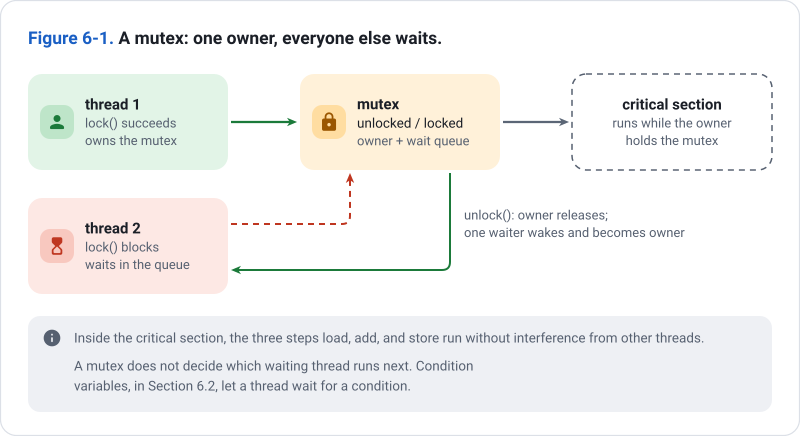

# 6. Synchronization and Memory Ordering

While atomic instructions suffice for single-word updates, most concurrent operations involve complex, multi-instruction transformations of data structures. To preserve system integrity, threads must coordinate their access to these critical sections using higher-level synchronization primitives.

## 6.1 Mutual Exclusion and Critical Sections

A **mutex** (mutual exclusion) is a synchronization primitive that grants exclusive access to a critical section of code to a single thread at a time. When a thread attempts to acquire a mutex already held by another, the kernel may suspend the thread, placing it in a wait queue to prevent wasteful "spinning."

The choice between atomic instructions and mutexes is primarily a matter of granularity and overhead. Atomic operations are highly efficient for single-word updates, as they are implemented directly in hardware. However, when a critical section encompasses complex data structures, such as queues or trees, the overhead of a mutex is negligible compared to the work performed within the section. In languages like Rust, the `Mutex` type enforces safety by wrapping the data it protects, ensuring that the data can only be accessed through a lock guard, thereby preventing accidental unprotected access at compile time.

<figure>

</figure>

**Listing 6-1. The shared counter, protected by a mutex (C++20).**

```cpp
{{#include ../code/ch06/mutex_counter.cpp}}
```

**Output 6-1. The observed value equals the expected value in every run.**

```text
{{#include ../code/out/ch06_mutex.out}}
```

**Listing 6-2. The same counter in Rust.**

```rust
{{#include ../code/ch06/mutex_counter.rs}}
```

**Output 6-2.**

```text
{{#include ../code/out/ch06_mutex_rs.out}}
```

## 6.2 Condition Variables and Predicate-Based Synchronization

Mutexes provide exclusion, but they lack the ability to facilitate coordination based on state changes. **Condition variables** bridge this gap by allowing threads to sleep until a specific logical condition, or **predicate**, is satisfied.

The standard pattern for using a condition variable is implemented through a `wait` operation that atomically releases the associated mutex and suspends the thread. When another thread modifies the state and invokes `notify`, the sleeping thread is awakened and must re-acquire the mutex before the `wait` returns. Because of potential race conditions and "spurious wakeups" (where a thread is awakened without the predicate being met), the `wait` operation must always be encapsulated within a loop that repeatedly tests the predicate. This ensures that the thread only proceeds when the condition is truly satisfied.

**Listing 6-3. A bounded buffer with two producers and two consumers (C++20).**

```cpp
{{#include ../code/ch06/prodcons.cpp}}
```

**Output 6-3. The three sums are equal.**

```text
{{#include ../code/out/ch06_prodcons.out}}
```

**Listing 6-4. The same buffer in Rust, with `Mutex` and `Condvar`.**

```rust
{{#include ../code/ch06/prodcons.rs}}
```

**Output 6-4.**

```text
{{#include ../code/out/ch06_prodcons_rs.out}}
```

## 6.3 Deadlock: Causes and Prevention

A **deadlock** occurs when a group of threads enters a state of permanent suspension, where each thread is waiting for a resource held by another thread in the cycle. For a deadlock to manifest, four necessary conditions must hold simultaneously:
1. **Mutual Exclusion:** The resource is held by exactly one thread.
2. **Hold and Wait:** A thread holds one resource while requesting another.
3. **No Preemption:** A resource cannot be forcibly taken from its holder.
4. **Circular Wait:** A closed chain of dependencies exists among the waiting threads.

Deadlock prevention strategies focus on breaking one of these conditions. One effective method is to enforce a strict, global acquisition order for all locks, which eliminates the possibility of a circular wait. Alternatively, threads can employ a "try-and-back-off" strategy using `try_lock` operations; if a thread fails to acquire a secondary resource, it releases its held resources and retries, thereby breaking the "hold and wait" condition.

<figure>

</figure>

**Listing 6-5. A deliberate deadlock (C++20).**

```cpp
{{#include ../code/ch06/deadlock.cpp}}
```

**Output 6-5. Each worker acquires its first mutex and never acquires the second.**

```text
{{#include ../code/out/ch06_deadlock.out}}
```

**Listing 6-6. Using try_lock to release and retry (C++20).**

```cpp
{{#include ../code/ch06/trylock.cpp}}
```

**Output 6-6. Worker 2 retries several times, and both workers finish.**

```text
{{#include ../code/out/ch06_trylock.out}}
```

## 6.4 Memory Ordering and Visibility

In a concurrent system, the visibility of memory operations is not guaranteed by atomicity alone. Memory ordering models define how different threads perceive the sequence of reads and writes performed by others.

- **Relaxed Ordering:** Guarantees only that the operation itself is atomic. It provides no guarantees regarding the order in which subsequent or preceding memory operations become visible to other threads.
- **Acquire/Release Semantics:** Provides a mechanism for transitive visibility. A `release` operation on a variable ensures that all prior memory writes by the thread are made visible to any thread that subsequently performs an `acquire` operation on that same variable. This is the fundamental pattern for publishing data safely between threads.
- **Sequential Consistency:** The strongest ordering model, providing a single, global total order of all operations that is consistent with all threads' views. While the easiest to reason about, it incurs significant performance penalties on modern hardware due to the requirement for strict synchronization across cores.

**Table 6-1. Memory orderings in C++ and Rust.**

| Need | C++ | Rust |
|---|---|---|
| atomic increment only | `fetch_add(1, memory_order_relaxed)` | `fetch_add(1, Ordering::Relaxed)` |
| publish data, then set a flag | `store(v, memory_order_release)` | `store(v, Ordering::Release)` |
| read the flag, then read the data | `load(memory_order_acquire)` | `load(Ordering::Acquire)` |
| one common order for all threads | default (`memory_order_seq_cst`) | `Ordering::SeqCst` |
