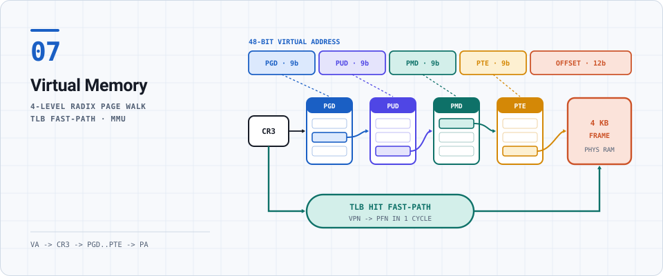
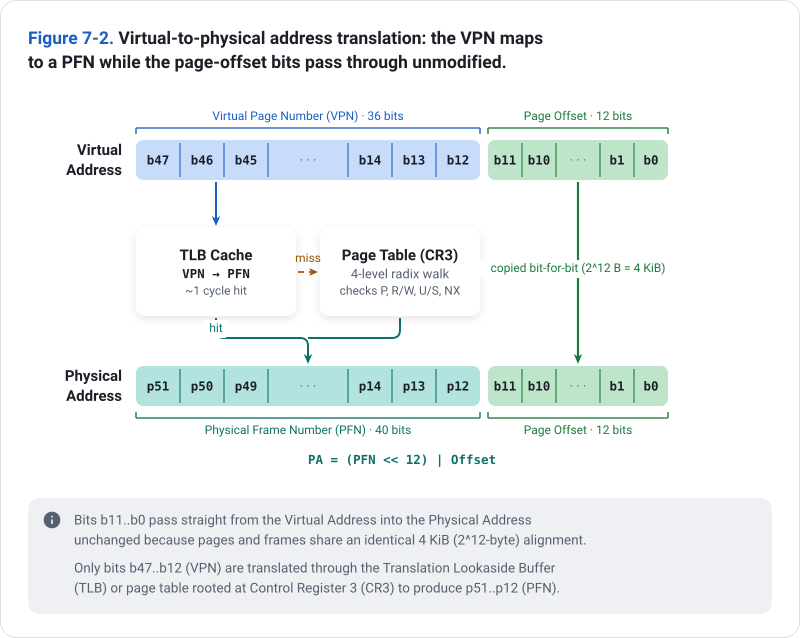
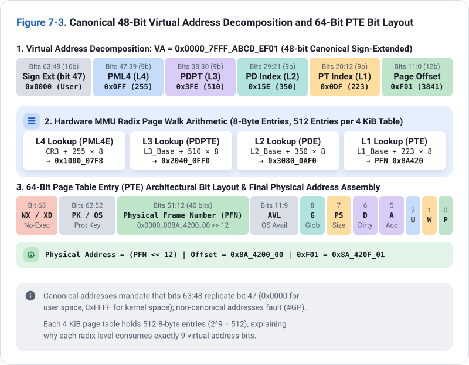
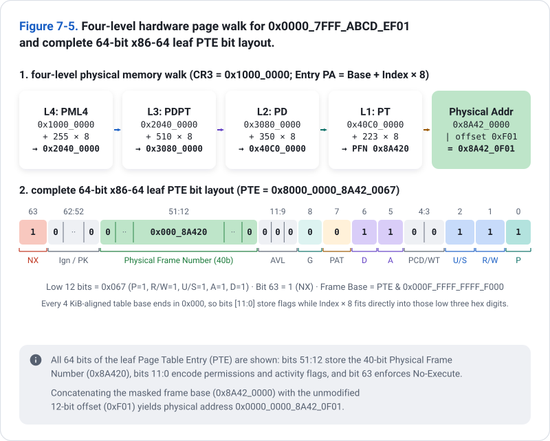
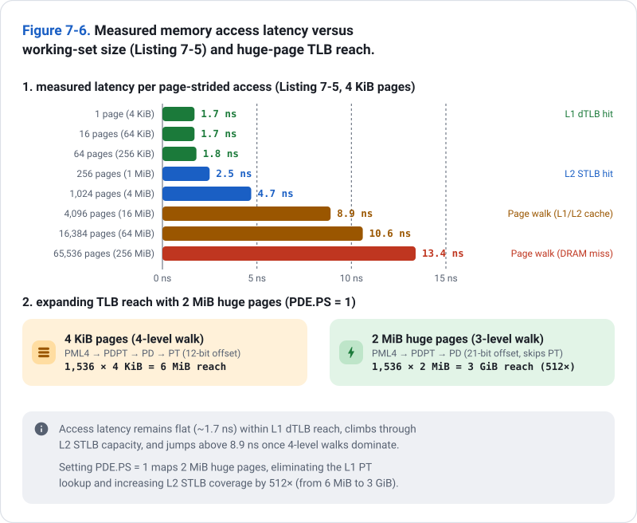
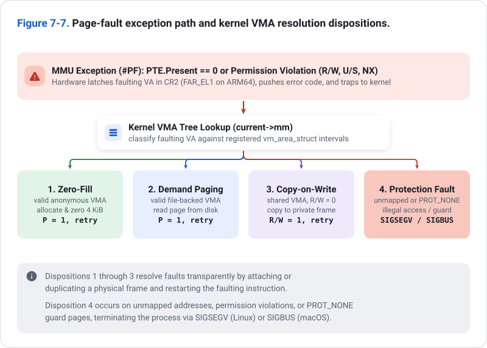

# 7. Virtual Memory and the Architecture of Address Translation



Virtual memory provides a layer of indirection between a process's perceived address space and the machine's physical memory. Without this indirection, processes executing directly against physical main memory (Dynamic Random-Access Memory) would share a single flat namespace: any process could read or overwrite the memory of any other process or the kernel itself, programs would have to be relocated to non-overlapping physical ranges before loading, and allocating contiguous physical regions for growing heaps and stacks would rapidly fragment main memory into unusable gaps.

To resolve these constraints while maintaining native execution speed, the operating system and processor implement **address translation** around three architectural objectives: **transparency**, so each process perceives a private, contiguous linear address space starting at a predictable base regardless of where its bytes reside in physical memory; **efficiency**, so translation neither adds prohibitive latency to instruction execution nor consumes excessive physical memory for metadata; and **protection**, so a process cannot read, modify, or execute memory outside its authorized domain. By partitioning both the virtual address space into fixed-size **pages** and physical memory into fixed-size **frames** of identical width, the operating system achieves granular hardware-enforced isolation, demand-driven resource allocation, and zero-copy memory sharing.

## 7.1 Page-Based Abstraction and Isolation

The fundamental mechanism of virtual memory is the **page table**, a per-process data structure maintained by the kernel and consulted by the processor's **Memory Management Unit** to map **virtual pages** (identified by a **Virtual Page Number**) to **physical frames** (identified by a **Physical Frame Number**). Because every virtual page has the exact same size as every physical frame (4,096 bytes on x86-64; 4,096 or 16,384 bytes on ARM64), any virtual page can be placed in any available physical frame in main memory without external fragmentation. This mapping allows the operating system to present a contiguous, linear address space to a program even when the underlying physical frames are scattered arbitrarily across physical memory (Figure 7-1).

Beyond translating frame locations, each **Page Table Entry (PTE)** embeds hardware permission bits that govern the allowed operations (`Read`, `Write`, `Execute`, and `User/Supervisor` privilege) for that page. This architecture enforces three foundational guarantees in silicon. First, it enforces **process and kernel isolation**: a process can reference only the physical frames explicitly mapped with user-accessible permissions (`User/Supervisor = 1`) in its own page table. Because a process has no valid mapping to sibling processes' frames, and because kernel pages mapped in the upper address space are marked supervisor-only (`User/Supervisor = 0`), cross-process interference and unauthorized kernel access trigger an immediate hardware exception before any memory state is altered. Second, it enables **demand-driven allocation**: virtual address reservation is decoupled from physical frame allocation, so pages that a process has reserved but not yet touched (such as `Page 5` in Figure 7-1) remain marked non-present (`Present = 0`) in the page table and consume zero physical memory until the first access triggers a page fault. Third, it supports **controlled sharing and copy-on-write**: multiple processes can map their virtual pages to the same physical frames with read-only permissions (`Read/Write = 0`), enabling shared libraries (`libc`) and `fork()` copy-on-write (Section 3.2) to avoid physical memory duplication until a store instruction occurs.

<figure>

</figure>

## 7.2 Hierarchical Translation and the TLB

Consistent with the separation of mechanism and policy established in Section 1.3, virtual memory divides responsibility between the hardware **Memory Management Unit (`MMU`)** and the operating system kernel. The kernel manages **policy**: it allocates physical frames for page tables, programs **Page Table Entry (`PTE`)** mappings, and resolves page-fault exceptions. The `MMU` implements the translation **mechanism**: on every instruction fetch, load, or store, hardware translates the **Virtual Address (`VA`)** into a **Physical Address (`PA`)** without invoking the operating system.

### 7.2.1 Address Decomposition and Hardware Translation

For a machine with an *n*-bit virtual address space and fixed-size pages of 2<sup>k</sup> bytes, the `MMU` partitions every `VA` into two contiguous bit fields (Figure 7-2):
- **Virtual Page Number (`VPN`, upper *n* − *k* bits):** Identifies which virtual page contains the referenced byte (`VPN = VA >> k`).
- **Page Offset (lower *k* bits):** Identifies the byte's exact displacement within that page (`Offset = VA & ((1 << k) - 1)`).

Because every virtual page and every physical frame share the exact same byte width (2<sup>k</sup> bytes) and align on 2<sup>k</sup>-byte boundaries, relocating a page to any physical frame adds an integer multiple of 2<sup>k</sup> to its base address, leaving all bit positions below *k* mathematically invariant. The Page Offset bits therefore pass wire-for-wire from the `VA` into the `PA` without modification. On standard x86-64 hardware with 4 KiB (2<sup>12</sup>-byte) pages and 48-bit virtual addresses, bits `[47:12]` form the 36-bit `VPN` and bits `[11:0]` form the 12-bit Page Offset.

During a memory reference, the `MMU` extracts the `VPN` and queries the **Translation Lookaside Buffer (`TLB`)**, a small, core-private associative cache of recent `VPN → PFN` mappings. On a `TLB` hit, hardware retrieves the corresponding 40-bit **Physical Frame Number (`PFN`)** and verifies the cached permission bits (**Present (`P`)**, **Read/Write (`R/W`)**, **User/Supervisor (`U/S`)**, and **No-Execute (`NX`)**) in approximately 0.5 to 1 clock cycle. On a `TLB` miss, the hardware page-table walker traverses the active process's page table starting from the root physical base address stored in **Control Register 3 (`CR3`)** on x86-64 (or **Translation Table Base Register 0 (`TTBR0_EL1`)** and **Translation Table Base Register 1 (`TTBR1_EL1`)** on ARM64), caches the resulting leaf `PTE` in the `TLB`, and concatenates the `PFN` with the unmodified 12-bit Page Offset to form the physical bus address:

```text
PA = (PFN << 12) | Offset
```

<figure>

</figure>

### 7.2.2 Multi-Level Radix Page Tables and Canonical Addressing

On 64-bit architectures, representing the page table as a single flat array is infeasible. A 48-bit virtual address space (2<sup>48</sup> bytes = 256 TiB) partitioned into 4 KiB (2<sup>12</sup>-byte) pages contains 2<sup>48</sup> / 2<sup>12</sup> = 2<sup>36</sup> (68.7 billion) virtual pages. At 8 bytes per 64-bit `PTE`, a flat lookup table would consume 2<sup>36</sup> × 8 bytes = 512 GiB of contiguous physical **Dynamic Random-Access Memory (`DRAM`)** per process, regardless of how few pages the process actually maps.

To bound metadata overhead while preserving deterministic hardware lookup depth, the kernel organizes the page table as a **sparse, four-level hierarchical radix tree** (extended to five levels on processors supporting 57-bit virtual addressing). Each level partitions the address space by a factor of 512: a Level 4 **Page Map Level 4 (`PML4`)** entry governs 512 GiB, a Level 3 **Page Directory Pointer Table (`PDPT`)** entry governs 1 GiB, a Level 2 **Page Directory (`PD`)** entry governs 2 MiB, and a Level 1 **Page Table (`PT`)** leaf entry maps a single 4 KiB page (Figure 7-3). Because the hardware walker aborts immediately upon encountering a non-present entry (`P = 0`), the kernel omits entire unmapped 512 GiB, 1 GiB, or 2 MiB subtrees and allocates physical frames solely for nodes covering active virtual regions. Table 7-1 consolidates the architectural terminology across x86-64, ARM64, and the Linux kernel.

**Table 7-1. Architectural terminology in virtual-memory address translation.**

| Concept | x86-64 | ARM64 | Linux Kernel | Role in Hardware Translation |
| :--- | :--- | :--- | :--- | :--- |
| **Translation Unit** | **Memory Management Unit (`MMU`)** | **Memory Management Unit (`MMU`)** | Hardware substrate | Translates `VA` to `PA` and enforces permissions on every memory access |
| **Addresses** | **Virtual Address (`VA`)** / **Physical Address (`PA`)** | **Virtual Address (`VA`)** / **Physical Address (`PA`)** | `unsigned long` / `phys_addr_t` | Software virtual pointer versus physical memory bus address |
| **Block Numbers** | **Virtual Page Number (`VPN`)** / **Physical Frame Number (`PFN`)** | **Virtual Page Number (`VPN`)** / **Output Address (`OA`)** | **Page Frame Number (`PFN`)** (`PA >> 12`) | Upper address bits identifying a 4 KiB virtual page or physical frame |
| **Root Register** | **Control Register 3 (`CR3`)** | **Translation Table Base Register (`TTBR0_EL1` / `TTBR1_EL1`)** | `mm_struct->pgd` | Privileged register holding the physical base address of the root table |
| **Level 4 (Root)** | **Page Map Level 4 (`PML4`)** | **Level 0 Translation Table** | **Page Global Directory (`PGD`)** | Indexed by bits `[47:39]`; 512 entries, 512 GiB per entry |
| **Level 3** | **Page Directory Pointer Table (`PDPT`)** | **Level 1 Translation Table** | **Page Upper Directory (`PUD`)** | Indexed by bits `[38:30]`; 1 GiB per entry (or 1 GiB huge page) |
| **Level 2** | **Page Directory (`PD`)** | **Level 2 Translation Table** | **Page Middle Directory (`PMD`)** | Indexed by bits `[29:21]`; 2 MiB per entry (or 2 MiB huge page) |
| **Level 1 (Leaf)** | **Page Table (`PT`)** | **Level 3 Translation Table** | **Page Table Entry (`PTE`)** Table | Indexed by bits `[20:12]`; maps one 4 KiB page to a physical frame |
| **Translation Cache** | **Translation Lookaside Buffer (`TLB`)** | **Translation Lookaside Buffer (`TLB`)** | Hardware `TLB` | Core-private associative cache of `VPN → PFN` mappings (~0.5–1 cycle hit) |
| **Address-Space Tag** | **Process-Context Identifier (`PCID`, 12-bit)** | **Address Space Identifier (`ASID`, 8- or 16-bit)** | `mm->context.id` | Tags `TLB` entries by address space to avoid flushes on context switch |

<figure>

</figure>

Two architectural invariants govern the structure of a 64-bit `VA` before the radix walk begins (Figure 7-4):

1. **Canonical Address Form (bits `[63:48]`):** Because 4-level paging translates only bits `[47:0]`, hardware prohibits software from storing arbitrary tags in the unused upper 16 bits, preserving forward compatibility with 5-level paging (57-bit `VA`). Bits `[63:48]` must be an exact sign-extension (replication) of bit 47. When bit 47 is `0`, bits `[63:48]` must equal `0x0000`, defining the **128 TiB User Canonical Space** (`0x0000_0000_0000_0000` to `0x0000_7FFF_FFFF_FFFF`). When bit 47 is `1`, bits `[63:48]` must equal `0xFFFF`, defining the **128 TiB Kernel Canonical Space** (`0xFFFF_8000_0000_0000` to `0xFFFF_FFFF_FFFF_FFFF`). Any pointer whose upper 16 bits fall into the **Non-Canonical Hole** raises an immediate **General Protection Fault (`#GP(0)`)** before any table walk begins.
2. **The `9-9-9-9-12` Radix Geometry (bits `[47:0]`):** Addressing 4,096 = 2<sup>12</sup> bytes within a 4 KiB frame requires a **12-bit Page Offset** (`bits [11:0]`). Each page-table node occupies exactly one 4 KiB physical frame, and each 64-bit `PTE` occupies 8 bytes (2<sup>3</sup> bytes), yielding 4,096 / 8 = 512 = 2<sup>9</sup> entries per table. Indexing 512 entries (`0` to `511`) requires an unsigned **9-bit index** at each of the four radix levels (4 × 9 + 12 = 48 bits). This 9-bit radix width is the exact fan-out that packs one complete table node into one 4 KiB frame with zero internal fragmentation. Extending translation to all 64 bits with 9-bit levels would require 6 levels, increasing every `TLB` miss to 6 dependent memory reads (and up to 36 reads under nested virtualization, Chapter 16), which is why hardware stops at 48 bits (or 57 bits on 5-level systems).

<figure>

</figure>

### 7.2.3 Worked 4-Level Address Translation Walkthrough

Consider the 64-bit user-space virtual address **`VA = 0x0000_7FFF_ABCD_EF01`** (a stack address near the top of the user canonical range) under a page-table hierarchy rooted at **`CR3 = 0x0000_0000_1000_0000`**.

#### Stage 1: Canonicality Verification and Bitwise Index Extraction

The hexadecimal digit covering bits `[47:44]` is `7` (`0111₂`), so bit 47 is `0` and bits `[63:48]` are `0x0000`, confirming a valid user canonical address. Because 12 bits equal three 4-bit hexadecimal digits, the Page Offset is read directly from the trailing three hex digits (`0xF01 = 3,841`). By contrast, because 9 does not divide evenly by 4, each 9-bit table index straddles hex-nibble boundaries (visible directly in the bit cells of Figure 7-4). Shifting and masking the upper 36-bit `VPN` (`0x7FFF_ABCDE`) into four 9-bit indices (`& 0x1FF`) yields:

```text
Hex Nibble:    7    F    F    F  _  A    B    C    D  _  E    F    0    1
4-Bit Binary: 0111 1111 1111 1111  1010 1011 1100 1101  1110 1111 0000 0001
Bit Position: ^47                                                        ^0

  PML4 Index (L4, bits [47:39]): (VA >> 39) & 0x1FF = 0_1111_1111_2    = 0x0FF = 255
  PDPT Index (L3, bits [38:30]): (VA >> 30) & 0x1FF = 1_1111_1110_2    = 0x1FE = 510
  PD Index   (L2, bits [29:21]): (VA >> 21) & 0x1FF = 1_0101_1110_2    = 0x15E = 350
  PT Index   (L1, bits [20:12]): (VA >> 12) & 0x1FF = 0_1101_1111_2    = 0x0DF = 223
  Page Offset    (bits [11:0]) :  VA        & 0xFFF = 1111_0000_0001_2 = 0xF01 = 3,841
```

#### Stage 2: Four-Level Physical Memory Walk from `CR3`

At each radix level, the hardware walker locates the target 8-byte entry inside the current 4 KiB table frame using:

```text
Entry_PA = Table_Base_PA + (Index × 8)
```

Two properties of 4 KiB alignment simplify this arithmetic in silicon. First, every 4 KiB-aligned `Table_Base_PA` ends in twelve zero bits (`0x...000`). Since `Index` ranges from `0` to `511`, `Index × 8` ranges from `0x000` to `0xFF8`, fitting entirely within those trailing three hex digits without carry propagation. Second, because the next table's physical base address also ends in twelve zero bits, each 64-bit entry packs status and permission flags into bits `[11:0]` (plus bit `63` for `NX`) and stores the 40-bit `PFN` in bits `[51:12]`. After validating the permission bits at each level, the `MMU` applies the mask `Entry & 0x000F_FFFF_FFFF_F000` to recover the next table's 4 KiB-aligned physical base address (Table 7-2 and Figure 7-5).

**Table 7-2. Four-level hardware page-table walk for `VA = 0x0000_7FFF_ABCD_EF01` (`CR3 = 0x1000_0000`).**

| Hop | Level & Span | Table Base `PA` | Index | Byte Offset (`Idx × 8`) | Entry `PA` Read | 64-Bit Entry Value | Flags & Hardware Check | Next Base (`Entry & 0x000F_FFFF_FFFF_F000`) |
| :--- | :--- | :--- | :--- | :--- | :--- | :--- | :--- | :--- |
| **1** | **L4: `PML4`** (512 GiB) | `0x1000_0000` | `255` (`0x0FF`) | `0x7F8` | `0x1000_07F8` | `0x0000_0000_2040_0007` | `0x007` (`P=1, R/W=1, U/S=1`) | **L3 Base:** `0x0000_0000_2040_0000` |
| **2** | **L3: `PDPT`** (1 GiB) | `0x2040_0000` | `510` (`0x1FE`) | `0xFF0` | `0x2040_0FF0` | `0x0000_0000_3080_0007` | `0x007` (`PS=0`, not 1 GiB) | **L2 Base:** `0x0000_0000_3080_0000` |
| **3** | **L2: `PD`** (2 MiB) | `0x3080_0000` | `350` (`0x15E`) | `0xAF0` | `0x3080_0AF0` | `0x0000_0000_40C0_0007` | `0x007` (`PS=0`, not 2 MiB) | **L1 Base:** `0x0000_0000_40C0_0000` |
| **4** | **L1: `PT`** (4 KiB) | `0x40C0_0000` | `223` (`0x0DF`) | `0x6F8` | `0x40C0_06F8` | `0x8000_0000_8A42_0067` | `0x067` + `NX=1` (`P, R/W, U/S, A, D = 1`) | **Frame Base:** `0x0000_0000_8A42_0000` |

Effective access permissions are the logical intersection across all four levels: clearing `U/S` or `R/W` in an upper directory entry restricts the entire subtree beneath it. At Hops 2 and 3, the **Page Size (`PS`)** bit is `0`, directing the walker to descend to the next level rather than terminating early on a huge page.

#### Stage 3: Leaf `PTE` Decoding and Physical Address Assembly

Hop 4 returns the leaf entry **`PTE = 0x8000_0000_8A42_0067`**. Unlike the intermediate directory entries (`0x...0007`), the leaf `PTE` records hardware-updated activity bits (**Accessed (`A = 1`)** and **Dirty (`D = 1`)**, contributing `0x60` to the low byte `0x67`) and sets bit 63 (**No-Execute, `NX = 1`**, leading hex digit `8`) to enforce non-executable stack data (Table 7-3 and Figure 7-5).

**Table 7-3. Architectural bit breakdown of leaf entry `PTE = 0x8000_0000_8A42_0067`.**

| Bits | Field (Full Form & Symbol) | Value | Hardware & Kernel Semantics |
| :--- | :--- | :--- | :--- |
| **0** | **Present (`P`)** | `1` (`0x001`) | Frame resides in physical memory. If `0`, hardware aborts the walk, latches the faulting `VA` into **Control Register 2 (`CR2`)**, and raises a **Page Fault (`#PF`, Vector 14)**. |
| **1** | **Read/Write (`R/W`)** | `1` (`0x002`) | Stores permitted. Cleared to `0` on shared pages during `fork()` **Copy-on-Write (`COW`)** (Section 3.2) so the first write traps to the kernel. |
| **2** | **User/Supervisor (`U/S`)** | `1` (`0x004`) | Accessible from user mode (**Ring 3** on x86-64; **Exception Level 0 (`EL0`)** on ARM64). Kernel mappings set `U/S = 0`. |
| **4:3** | **Page-Level Cache Disable (`PCD`)** / **Page-Level Write-Through (`PWT`)** | `00` | Hardware cache policy (`00` = write-back cacheable `DRAM`; set for uncached **Memory-Mapped Input/Output (`MMIO`)** device registers). |
| **5** | **Accessed (`A`)** | `1` (`0x020`) | Set atomically by the `MMU` on any read or write; scanned and cleared by the kernel page-reclamation daemon to approximate **Least Recently Used (`LRU`)** eviction. |
| **6** | **Dirty (`D`)** | `1` (`0x040`) | Set atomically by the `MMU` on a store instruction; signals that a modified file-backed page must be written back before eviction. |
| **7** | **Page Attribute Table (`PAT`)** / **Page Size (`PS`)** | `0` | Selects memory-type caching attributes in leaf `PTE`s; in `PD` (L2) or `PDPT` (L3) entries, `PS = 1` maps a 2 MiB or 1 GiB huge page directly. |
| **8** | **Global (`G`)** | `0` | When `1` (used on shared kernel mappings), preserves the `TLB` entry across `CR3` reloads on context switch. |
| **11:9** | **Available for Operating System Use (`AVL`)** | `000` | Ignored by hardware; available for kernel software metadata (for example, swap or copy-on-write markers). |
| **51:12** | **Physical Frame Number (`PFN`)** | `0x000_8A420` | 40-bit frame index. Masking `PTE & 0x000F_FFFF_FFFF_F000` yields the 4 KiB-aligned frame base `0x0000_0000_8A42_0000`. |
| **62:52** | **Ignored / Protection Key (`Ign / PK`)** | `0x000` | Ignored / **Memory Protection Key (`PKU`)** domain tag when hardware protection keys are enabled. |
| **63** | **No-Execute (`NX`)** | `1` (`0x8000...`) | Hardware **Write XOR Execute (`W^X`)** enforcement. Blocks instruction fetches from this stack page in silicon. |

Combining the masked 4 KiB frame base with the unmodified 12-bit Page Offset (`0xF01`) yields the final physical address:

```text
PA = (PTE & 0x000F_FFFF_FFFF_F000) | (VA & 0x0000_0000_0000_0FFF)
   = 0x0000_0000_8A42_0000         | 0x0000_0000_0000_0F01
   = 0x0000_0000_8A42_0F01
```

The `MMU` inserts `VPN 0x7FFF_ABCDE → PFN 0x8A420` into the core's `TLB` and issues the memory request for `0x0000_0000_8A42_0F01` to the Level 1 data cache. Subsequent accesses to any byte within `0x0000_7FFF_ABCD_E000` to `0x0000_7FFF_ABCD_EFFF` hit in the `TLB` in a single cycle without walking the page table.

<figure>

</figure>

### 7.2.4 The Translation Lookaside Buffer, Huge Pages, and Shootdowns

Without a `TLB`, every memory instruction would incur **five physical memory accesses**: four dependent 8-byte reads across `PML4 → PDPT → PD → PT`, followed by the data access itself. Even when all four table entries reside in the L1 or L2 data cache, chaining four dependent loads adds roughly 8 to 15 ns; when they miss to `DRAM`, a single translation stall exceeds 300 ns. The `TLB` amortizes this cost to ~0.5 to 1 cycle on a hit, and three microarchitectural properties govern its behavior under production workloads (Figure 7-6):

- **TLB Reach and Huge Pages (2 MiB / 1 GiB):** Single-cycle associative lookup constrains a **Level 1 Data Translation Lookaside Buffer (`L1 dTLB`)** to ~64 entries, backed by a **Level 2 Shared Translation Lookaside Buffer (`L2 STLB`)** of 1,024 to 2,048 entries. The total memory span mapped without misses is the **`TLB` reach** (`Entries × Page Size`). With 4 KiB pages, a 64-entry `L1 dTLB` covers 256 KiB and a 1,536-entry `L2 STLB` covers only **6 MiB**. Once an application's random-access working set exceeds `L2 STLB` reach, translation misses surge and latency climbs steeply (measured empirically in Listings 7-5 and 7-6). Mapping large arenas with **2 MiB Huge Pages** (`MAP_HUGETLB` or `MADV_HUGEPAGE`) sets `PS = 1` in the L2 `PD` entry, terminating the walk one level early and merging bits `[20:12]` with `[11:0]` into a **21-bit offset** (2<sup>21</sup> = 2 MiB). The same 1,536-entry `L2 STLB` then covers **3 GiB** (512× reach) with a 3-level walk. Setting `PS = 1` in an L3 `PDPT` entry creates a **1 GiB Huge Page** (30-bit offset, 2-level walk, 1.5 TiB reach).
- **Address Space Tagging (`PCID` / `ASID`):** Because identical virtual addresses in distinct processes map to different physical frames, legacy x86 processors flushed all non-global `TLB` entries on every `CR3` reload during a context switch. Modern processors tag each `TLB` entry with a 12-bit **Process-Context Identifier (`PCID`)** on x86-64 or an 8- or 16-bit **Address Space Identifier (`ASID`)** on ARM64. A lookup hits only when both `VPN` and the active process tag match, preserving cached translations across context switches and across **Kernel Page-Table Isolation (`KPTI`)** `CR3` switches on every system call.
- **Cross-Core `TLB` Shootdowns:** Unlike the L1, L2, and L3 data caches, which hardware keeps coherent via cache-coherency protocols (Section 2.2), **`TLB`s are not coherent across processor cores**. When a thread unmaps a page (`munmap`) or restricts permissions (`mprotect`) in a multi-threaded process, sibling cores may retain stale translations in their local `TLB`s. The kernel must update the `PTE` in memory, invalidate its local entry (`invlpg` on x86-64; `tlbi` on ARM64), and issue synchronous **Inter-Processor Interrupts (`IPI`s)** to every core running that address space, stalling those cores until all acknowledgements arrive. This cross-core synchronization cost is a primary reason high-performance memory allocators (Chapter 8) pool and reuse `mmap` arenas rather than returning pages via `munmap()` on every deallocation.

<figure>

</figure>

## 7.3 Fault Handling and Memory Management Strategies

While `TLB` hits and hardware page-table walks execute autonomously in silicon, the kernel enters the virtual-memory datapath when the `MMU` raises a **Page Fault (`#PF`)** exception. Upon encountering a `PTE` with `P = 0` or a permission violation (`R/W`, `U/S`, or `NX`), hardware latches the faulting `VA` into **Control Register 2 (`CR2`)** (or the **Fault Address Register (`FAR_EL1`)** on ARM64), pushes an architectural error code encoding the access type and cause onto the kernel stack, and transfers control to the kernel's page-fault handler (Figure 7-7).

A single load instruction can therefore traverse a six-order-of-magnitude latency hierarchy without any change to application code: ~0.5 ns on an `L1 dTLB` hit, ~10 to 300 ns on a hardware 4-level page walk, ~1 to 3 µs on a kernel minor page fault, and ~50 µs to 10 ms on a storage-backed major page fault. To classify a `#PF`, the kernel searches the process's balanced tree of **Virtual Memory Areas (`VMA`, `vm_area_struct` in `current->mm`, Section 3.1.1)**, which records every valid virtual interval and its logical permissions:

1. **Zero-Fill Allocation (Minor Fault):** The faulting `VA` lies inside a valid anonymous `VMA` (`MAP_PRIVATE | MAP_ANON`, such as heap or stack) whose `PTE` has `P = 0`. The kernel allocates a free 4 KiB frame, zeroes it to prevent cross-process data leakage, writes the `PTE` with `P = 1`, and restarts the faulting instruction with zero storage **Input/Output (`I/O`)**.
2. **Demand Paging (Major Fault):** The faulting `VA` lies inside a file-backed `VMA` whose page is not resident in `DRAM`. The kernel allocates a frame in the page cache, schedules a storage read, blocks the thread until `I/O` completes, maps the frame (`P = 1`), and restarts the instruction.
3. **Copy-on-Write (`COW`):** After `fork()` (Section 3.2), parent and child share frames marked read-only (`R/W = 0`) in their `PTE`s while their `VMA`s allow writes (`VM_WRITE`). A store traps on `R/W = 0`; the kernel allocates a fresh 4 KiB frame, copies the page contents, updates the writing process's `PTE` with `R/W = 1`, and resumes execution.
4. **Protection Violation:** The faulting `VA` falls outside every registered `VMA` (for example, a null-pointer dereference) or violates the `VMA`'s logical permissions (writing to read-only text or touching a `PROT_NONE` guard page). The kernel delivers a synchronous fatal signal: **Segmentation Violation (`SIGSEGV`)** on Linux, or **Bus Error (`SIGBUS`)** on macOS.

<figure>

</figure>

Separating virtual address reservation from hardware `PTE` permissions enables **guard pages**: virtual pages mapped with `mprotect(addr, page_size, PROT_NONE)` at the end of thread stacks or allocator regions to trap overflows immediately in silicon before adjacent memory is corrupted. Likewise, mapping files with `mmap` exposes kernel page-cache frames directly in the process's virtual address space, eliminating the system-call and buffer-copying overhead of explicit `read(2)` calls.

### 7.3.1 The `mmap` and `mprotect` System Call Interface

The parameters of `mmap(addr, length, prot, flags, fd, offset)` and `mprotect(addr, length, prot)` map directly onto the page-table and `VMA` structures described in Sections 7.2 and 7.3:

- **Address Hint (`addr`) and Length (`length`):** Passing `nullptr` (`ptr::null_mut()` in Rust) lets the kernel choose an unused, page-aligned virtual base address (`4,096` bytes on x86-64; `16,384` bytes on Apple Silicon ARM64). The kernel rounds `length` upward to an exact multiple of the hardware page size.
- **Protection Bitmask (`prot`):** Sets the hardware permission bits in each mapped leaf `PTE`. `PROT_READ` enables loads, `PROT_WRITE` sets `R/W = 1` while retaining `NX = 1`, and `PROT_NONE` revokes all permissions to establish a guard page while keeping the virtual range reserved.
- **Visibility and Backing Flags (`flags`):** `MAP_PRIVATE` creates a private copy-on-write mapping whose modifications never propagate to the backing file; `MAP_SHARED` shares physical frames across processes (Chapter 11) and flushes writes back to file-backed storage. Combining `MAP_PRIVATE | MAP_ANON` (`MAP_ANONYMOUS` on Linux) allocates demand-zeroed anonymous memory unbacked by any file, for which the **Portable Operating System Interface (`POSIX`)** standard requires `fd = -1` and `offset = 0`.
- **Error Contract and Reclamation:** On failure, `mmap` returns `MAP_FAILED` (`(void*)-1`) rather than `nullptr` and sets `errno`. Callers must verify `mapped != MAP_FAILED` before dereferencing the region and release mappings with `munmap(addr, length)`.

**Listing 7-1. Page size, page alignment, and a guard page (C++20).** ([`code/ch07/pagesize.cpp`](https://github.com/arpanpathak/cracking-the-systems-programming-interview/blob/prep-v2/operating-systems/code/ch07/pagesize.cpp))

```cpp
{{#include ../code/ch07/pagesize.cpp}}
```

**Output 7-1. The fault occurs on the protected page.**

```text
{{#include ../code/out/ch07_pagesize.out}}
```

**Listing 7-2. Mapping and protecting pages in Rust, using the libc crate.** ([`code/ch07/pagesize.rs`](https://github.com/arpanpathak/cracking-the-systems-programming-interview/blob/prep-v2/operating-systems/code/ch07/pagesize.rs))

```rust
{{#include ../code/ch07/pagesize.rs}}
```

**Output 7-2.**

```text
{{#include ../code/out/ch07_pagesize_rs.out}}
```

**Listing 7-3. Reading one file with read(2) and with mmap (C++20).** ([`code/ch07/mmap_file.cpp`](https://github.com/arpanpathak/cracking-the-systems-programming-interview/blob/prep-v2/operating-systems/code/ch07/mmap_file.cpp))

```cpp
{{#include ../code/ch07/mmap_file.cpp}}
```

**Output 7-3. Both methods count 4,128,768 characters.**

```text
{{#include ../code/out/ch07_mmap_file.out}}
```

**Listing 7-4. The same file-mapping comparison in Rust, using the libc crate.** ([`code/ch07/mmap_file.rs`](https://github.com/arpanpathak/cracking-the-systems-programming-interview/blob/prep-v2/operating-systems/code/ch07/mmap_file.rs))

```rust
{{#include ../code/ch07/mmap_file.rs}}
```

**Output 7-4.**

```text
{{#include ../code/out/ch07_mmap_file_rs.out}}
```

**Listing 7-5. One access per page, for a growing number of pages (C++20).** ([`code/ch07/tlb.cpp`](https://github.com/arpanpathak/cracking-the-systems-programming-interview/blob/prep-v2/operating-systems/code/ch07/tlb.cpp))

```cpp
{{#include ../code/ch07/tlb.cpp}}
```

**Output 7-5. One run on the verification machine.**

```text
{{#include ../code/out/ch07_tlb.out}}
```

**Listing 7-6. The same Translation Lookaside Buffer working-set sweep in Rust.** ([`code/ch07/tlb.rs`](https://github.com/arpanpathak/cracking-the-systems-programming-interview/blob/prep-v2/operating-systems/code/ch07/tlb.rs))

```rust
{{#include ../code/ch07/tlb.rs}}
```

**Output 7-6.**

```text
{{#include ../code/out/ch07_tlb_rs.out}}
```

<div class="callout keyidea">
<span class="label">Key idea</span>

Virtual memory is a hardware-software co-design: the kernel defines policy by populating sparse 4-level radix page tables and servicing `#PF` faults lazily, while the `MMU` and `TLB` execute translation in ~1 cycle on the fast path, keeping the 12-bit page offset invariant under 4 KiB frame relocation.

</div>

<div class="callout experiment">
<span class="label">Experiment</span>

Run Listing 7-5 ([`code/ch07/tlb.cpp`](https://github.com/arpanpathak/cracking-the-systems-programming-interview/blob/prep-v2/operating-systems/code/ch07/tlb.cpp)) on a local machine and inspect where per-access latency steps upward sharply (at ~64 pages for `L1 dTLB` overflow and ~1,024 to 4,096 pages for `L2 STLB` overflow). On Linux, add `madvise(buf, size, MADV_HUGEPAGE)` after `mmap()` to observe 2 MiB huge pages flattening the 16 MiB to 256 MiB cliff.

</div>

<div class="callout caution">
<span class="label">Common Pitfall</span>

Checking `mmap()` failure against `nullptr` instead of `MAP_FAILED` (`(void*)-1`). A failed `mmap()` returns `(void*)-1`, which evaluates as truthy in C and C++, causing the very next memory dereference to trigger an immediate `SIGSEGV` at address `0xFFFF_FFFF_FFFF_FFFF`.

</div>
