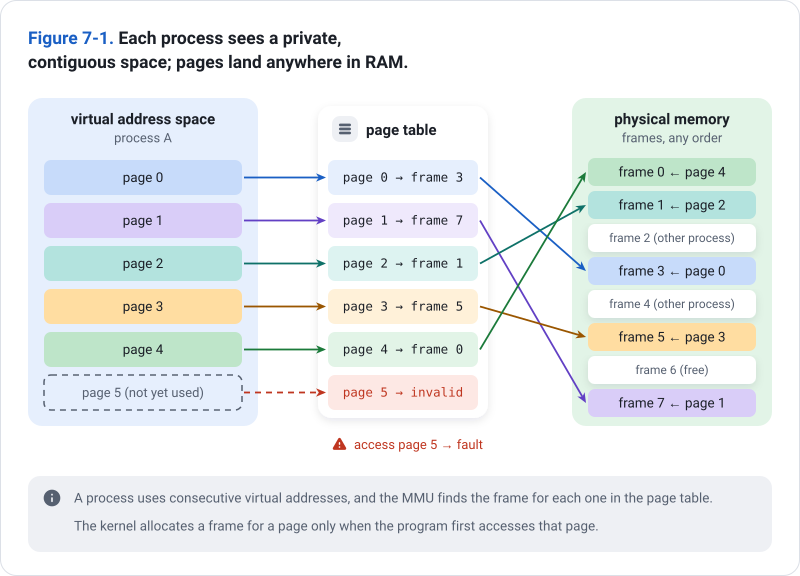
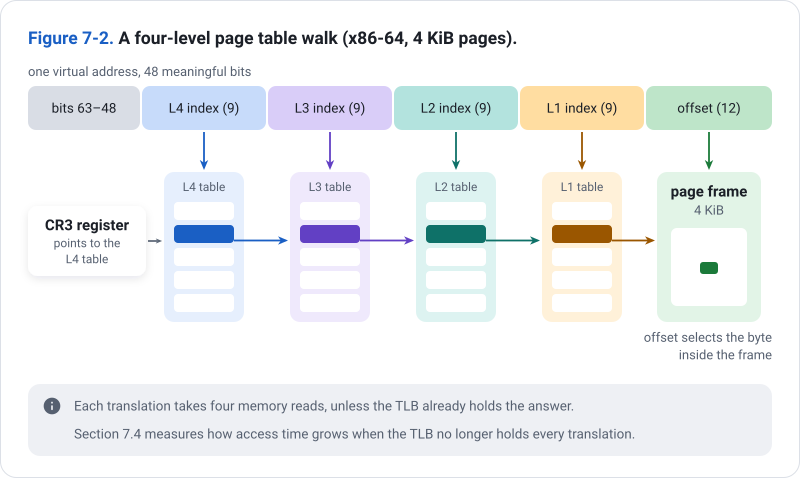

# 7. Virtual Memory and the Architecture of Address Translation

Virtual memory provides a layer of indirection between a process's perceived address space and the machine's physical memory. By partitioning both into fixed-size blocks, **pages** in the virtual address space and **frames** in physical memory, the operating system can implement granular isolation, demand-driven resource allocation, and efficient memory sharing.

## 7.1 Page-Based Abstraction and Isolation

The fundamental mechanism of virtual memory is the page table, a per-process data structure that maps virtual pages to physical frames. This mapping allows the OS to present a contiguous, linear address space to a program, even when the underlying physical memory is fragmented or non-contiguous. Crucially, each page table entry (PTE) includes permission bits that define the allowed operations (read, write, execute) for that page. This architecture enables hardware-enforced isolation: a process can only access the physical frames explicitly mapped in its own page table, and any violation of the programmed permissions triggers a hardware exception.

<figure>

</figure>

## 7.2 Hierarchical Translation and the TLB

On modern 64-bit architectures like x86-64 and ARM64, the virtual address space is too vast to be mapped by a single flat array. A flat page table covering a 48-bit address space (2<sup>48</sup> = 256 TiB) with 4 KiB pages (2<sup>12</sup> bytes) would require 2<sup>36</sup> entries; at 8 bytes per entry, every active process would consume 512 GiB of physical DRAM solely for its page table. Instead, the kernel employs a sparse, multi-level hierarchical radix tree—typically a four-level page table (or five-level with Intel LA57 / ARM64 LPA2). Because entire unmapped subtrees are omitted when their parent directory entry is marked non-present, physical memory is allocated only for page table nodes that map active regions of the process's address space.

### 7.2.1 Canonical Addresses and Multi-Level Radix Decomposition

Under standard 4-level paging on x86-64 (and 48-bit `VA_BITS` with 4 KiB granules on ARM64), only the lower 48 bits (`[47:0]`) of a 64-bit pointer participate in hardware address translation. To prevent software from overloading the upper unused bits (`[63:48]`) with arbitrary metadata that would break compatibility with 5-level paging extensions, the hardware enforces **canonical address form**: bits `63:48` must be an exact sign-extension (replication) of bit `47`.
- **User-Space Canonical Range (`bit 47 == 0`):** `0x0000_0000_0000_0000` through `0x0000_7FFF_FFFF_FFFF` (128 TiB).
- **Kernel-Space Canonical Range (`bit 47 == 1`):** `0xFFFF_8000_0000_0000` through `0xFFFF_FFFF_FFFF_FFFF` (128 TiB).
- **Non-Canonical Hole:** Any memory reference whose upper 16 bits are neither all zeros nor all ones violates canonicality and immediately triggers a hardware General Protection Fault (`#GP(0)`) before the MMU initiates a page table walk.

Why does each radix table level consume exactly **9 bits** of the virtual address? The geometry is derived directly from the hardware page size and entry width:
- Each page table node occupies exactly one physical 4 KiB frame (2<sup>12</sup> = 4,096 bytes).
- Each Page Table Entry (PTE) is 64 bits wide (8 bytes = 2<sup>3</sup> bytes).
- Consequently, one 4 KiB page table houses exactly 4,096 / 8 = 512 = 2<sup>9</sup> entries, requiring a **9-bit unsigned index** (`0` to `511`) to select an entry at each level, while the lowest **12 bits** (`0` to `4,095`) address the individual byte offset within the target 4 KiB physical frame (9 + 9 + 9 + 9 + 12 = 48 bits).

<figure>

</figure>

### 7.2.2 Hand-Calculated 4-Level Address Translation Walkthrough

To make the hardware MMU translation algorithm concrete, let us hand-calculate the exact bitwise decomposition and four-level physical memory walk for the 64-bit user-mode virtual address **`VA = 0x0000_7FFF_ABCD_EF01`** (a stack address near the apex of the user canonical range), assuming the processor's page-table root register holds **`CR3 = 0x0000_0000_1000_0000`**.

#### Step 1: Bitwise Index Extraction

First, we verify canonicality: bit 47 is `0` (since the hex digit at bits `47:44` is `7 = 0111_2`), and bits `63:48` are `0x0000`, confirming a valid user-space canonical address. Expanding the lower 48 bits (`0x7FFF_ABCD_EF01`) into binary and partitioning them into four 9-bit indices and one 12-bit offset yields:

```text
Hex:     7    F    F    F  _  A    B    C    D  _  E    F    0    1
Binary: 0111 1111 1111 1111 1010 1011 1100 1101 1110 1111 0000 0001

1. PML4 Index (Level 4, bits 47:39): (VA >> 39) & 0x1FF
   Binary: 0_1111_1111_2       = 0x0FF = 255
2. PDPT Index (Level 3, bits 38:30): (VA >> 30) & 0x1FF
   Binary: 1_1111_1110_2       = 0x1FE = 510
3. PD Index   (Level 2, bits 29:21): (VA >> 21) & 0x1FF
   Binary: 1_0101_1110_2       = 0x15E = 350
4. PT Index   (Level 1, bits 20:12): (VA >> 12) & 0x1FF
   Binary: 0_1101_1111_2       = 0x0DF = 223
5. Page Offset         (bits 11:0):  VA & 0xFFF
   Binary: 1111_0000_0001_2    = 0xF01 = 3,841
```

#### Step 2: Sequential Radix Table Lookups from `CR3`

The hardware page table walker executes four sequential 8-byte physical memory reads across DRAM (or the L1/L2 data cache):

1. **Level 4 — Page Map Level 4 (PML4 / `PGD`):**
   - The MMU reads the physical base address of the PML4 table from `CR3` (`0x1000_0000`) and indexes entry `255`:
     ```text
     PML4E_Addr = 0x1000_0000 + (255 × 8) = 0x1000_0000 + 0x7F8 = 0x1000_07F8
     ```
   - Suppose physical memory at `0x1000_07F8` contains `PML4E = 0x0000_0000_2040_0007`. The low flags `0x007` (`Present = 1`, `Read/Write = 1`, `User = 1`) authorize user-mode traversal, and bits `51:12` extract the Level 3 table physical base address: `L3_Base = 0x2040_0000`.
2. **Level 3 — Page Directory Pointer Table (PDPT / `PUD`):**
   - The MMU indexes entry `510` in the PDPT at `0x2040_0000`:
     ```text
     PDPTE_Addr = 0x2040_0000 + (510 × 8) = 0x2040_0000 + 0xFF0 = 0x2040_0FF0
     ```
   - Suppose `PDPTE = 0x0000_0000_3080_0007` (with Page Size bit `PS = 0`, indicating a pointer to a Level 2 directory rather than a 1 GiB huge page). Bits `51:12` yield `L2_Base = 0x3080_0000`.
3. **Level 2 — Page Directory (PD / `PMD`):**
   - The MMU indexes entry `350` in the Page Directory at `0x3080_0000`:
     ```text
     PDE_Addr   = 0x3080_0000 + (350 × 8) = 0x3080_0000 + 0xAF0 = 0x3080_0AF0
     ```
   - Suppose `PDE = 0x0000_0000_40C0_0007` (`PS = 0`, pointing to a 4 KiB leaf Page Table rather than a 2 MiB huge page). Bits `51:12` yield `L1_Base = 0x40C0_0000`.
4. **Level 1 — Leaf Page Table (PT / `PTE`):**
   - The MMU indexes entry `223` in the leaf Page Table at `0x40C0_0000`:
     ```text
     PTE_Addr   = 0x40C0_0000 + (223 × 8) = 0x40C0_0000 + 0x6F8 = 0x40C0_06F8
     ```
   - Suppose the leaf entry read from `0x40C0_06F8` is **`PTE = 0x8000_0000_8A42_0067`**.

#### Step 3: 64-Bit PTE Bit-Layout Verification and Physical Address Composition

The MMU masks and validates the architectural permission and status bits of the leaf **`PTE = 0x8000_0000_8A42_0067`**:
- **Bit 0 (`P` — Present = `1`):** The physical frame is resident in DRAM. (If `0`, the MMU halts and raises a `#PF` Page Fault exception, loading the faulting virtual address into control register `CR2`).
- **Bit 1 (`R/W` — Read/Write = `1`):** Store instructions are permitted on this page. (During `fork()` copy-on-write, the kernel clears this bit to `0` so the first write traps into the COW duplication handler).
- **Bit 2 (`U/S` — User/Supervisor = `1`):** Accessible from Ring 3 (`CPL = 3`). (Kernel pages set `U/S = 0`).
- **Bit 5 (`A` — Accessed = `1`) & Bit 6 (`D` — Dirty = `1`):** Set atomically by hardware when the page is read (`A`) or written (`D`). The kernel page-reclamation daemon inspects these bits to implement LRU/CLOCK eviction and to determine whether a file-backed page must be flushed to storage before eviction.
- **Bit 7 (`PS` / `PAT` = `0`):** Standard 4 KiB leaf page (at Level 2 or Level 3, setting `PS = 1` terminates the walk early to map a contiguous **2 MiB** or **1 GiB Huge Page**).
- **Bit 8 (`G` — Global = `0`):** When set to `1` on shared kernel mappings, prevents the TLB entry from being flushed when `CR3` is reloaded during a cross-process context switch.
- **Bits 51:12 (`PFN` — Physical Frame Number = `0x000_8A420`):** Extracted via `PTE & 0x000F_FFFF_FFFF_F000`, yielding the 4 KiB-aligned physical frame base address **`0x0000_0000_8A42_0000`**.
- **Bit 63 (`NX` / `XD` — No-Execute = `1`, from leading hex digit `8`):** Hardware Data Execution Prevention (`W^X`). Instruction fetches from this stack page are blocked in silicon; any attempt to jump to shellcode on this page raises an immediate `#PF` instruction-fetch fault.

Finally, the MMU concatenates the 40-bit Physical Frame Number with the 12-bit Page Offset (`0xF01`) in a single hardware clock cycle:

```text
Physical_Address = (PTE & 0x000F_FFFF_FFFF_F000) | (VA & 0x0000_0000_0000_0FFF)
                 = 0x0000_0000_8A42_0000 | 0x0000_0000_0000_0F01
                 = 0x0000_0000_8A42_0F01
```

<figure>

</figure>

### 7.2.3 The Translation Lookaside Buffer (TLB), Huge Pages, and Shootdowns

Because a 4-level radix walk requires **four sequential memory accesses** before the actual data load or store can proceed, performing a full walk on every instruction would quadruple memory latency. To avoid this penalty, the MMU caches recent virtual-page-to-physical-frame (`VPN → PFN`) translations in the **Translation Lookaside Buffer (TLB)**—a hardware content-addressable cache checked in parallel with the L1 cache tag array (~0.5–1 cycle latency on an L1 dTLB hit).

Three microarchitectural properties of the TLB directly govern systems software performance:
1. **TLB Reach and Working-Set Cliffs:** A typical L1 dTLB holds 64 entries and an L2 STLB holds 1,024–2,048 entries. With 4 KiB pages, a 1,536-entry L2 TLB covers a maximum working set ("TLB reach") of only 1,536 &times; 4 KiB = 6 MiB. When an application randomly accesses a memory buffer larger than the TLB reach, TLB misses spike, forcing the hardware page walker to stall the CPU pipeline. Configuring **2 MiB Huge Pages** (`MAP_HUGEPAGE` / `MADV_HUGEPAGE`, terminating the radix walk at Level 2 with `PDE.PS = 1`) increases the reach of those same 1,536 TLB entries to **3 GiB**, eliminating L1/L2 PT memory traffic and dramatically reducing translation latency for database buffer pools and VM hypervisors.
2. **Address Space Identifiers (`PCID` / `ASID`):** Historically, reloading `CR3` during a process context switch flushed all non-global TLB entries to prevent Process B from using Process A's cached translations. Contemporary processors tag each TLB entry with a 12-bit **Process-Context Identifier (`PCID` on x86-64)** or 16-bit **Address Space Identifier (`ASID` on ARM64)**, allowing translations from multiple processes to coexist safely in the TLB across context switches.
3. **TLB Shootdowns:** Unlike the L1/L2/L3 data caches, **hardware TLBs are not automatically kept coherent across CPU cores**. When the kernel modifies or unmaps a valid PTE (`munmap`, `mprotect`, or page eviction) in a multi-threaded process running across *K* cores, the kernel must flush its local TLB (`invlpg` on x86-64; `tlbi` on ARM64) and dispatch synchronous **Inter-Processor Interrupts (IPIs)** to all sibling cores running that address space—a high-overhead synchronization operation known as a **TLB shootdown**.

## 7.3 Fault Handling and Memory Management Strategies

The kernel's involvement in memory management is primarily event-driven, occurring through the handling of **page faults**. A page fault is not necessarily an error; rather, it is a mechanism for lazy resource allocation and sophisticated memory management. The kernel responds to faults in several ways:
- **Demand Paging:** Mapping a page of a file from disk into memory only when it is first accessed.
- **Zero-Fill Allocation:** Providing a fresh, zeroed physical frame when a program requests new heap or stack memory.
- **Copy-on-Write (COW):** Facilitating efficient process duplication by mapping shared pages as read-only and only performing a physical copy when a write is attempted.
- **Protection Violations:** Terminating a process via a signal (e.g., `SIGSEGV` or `SIGBUS`) when an access violates the page's permission bits.

This flexibility also allows for the implementation of **guard pages**, unmapped or protected pages placed strategically (such as at the end of a stack) to detect and halt buffer overflows or stack exhaustion before they corrupt adjacent memory regions. Furthermore, the `mmap` system call allows files to be mapped directly into the process's address space, enabling the program to access file data through the page cache without the overhead of explicit `read` calls and redundant data copying.

**Listing 7-1. Page size, page alignment, and a guard page (C++20).**

```cpp
{{#include ../code/ch07/pagesize.cpp}}
```

**Output 7-1. The fault occurs on the protected page.**

```text
{{#include ../code/out/ch07_pagesize.out}}
```

**Listing 7-2. Mapping and protecting pages in Rust, using the libc crate.**

```rust
{{#include ../code/ch07/pagesize.rs}}
```

**Output 7-2.**

```text
{{#include ../code/out/ch07_pagesize_rs.out}}
```

**Listing 7-3. Reading one file with read(2) and with mmap (C++20).**

```cpp
{{#include ../code/ch07/mmap_file.cpp}}
```

**Output 7-3. Both methods count 4,128,768 characters.**

```text
{{#include ../code/out/ch07_mmap_file.out}}
```

**Listing 7-4. The same file-mapping comparison in Rust, using the libc crate.**

```rust
{{#include ../code/ch07/mmap_file.rs}}
```

**Output 7-4.**

```text
{{#include ../code/out/ch07_mmap_file_rs.out}}
```

**Listing 7-5. One access per page, for a growing number of pages (C++20).**

```cpp
{{#include ../code/ch07/tlb.cpp}}
```

**Output 7-5. One run on the verification machine.**

```text
{{#include ../code/out/ch07_tlb.out}}
```

**Listing 7-6. The same TLB working-set sweep in Rust.**

```rust
{{#include ../code/ch07/tlb.rs}}
```

**Output 7-6.**

```text
{{#include ../code/out/ch07_tlb_rs.out}}
```
