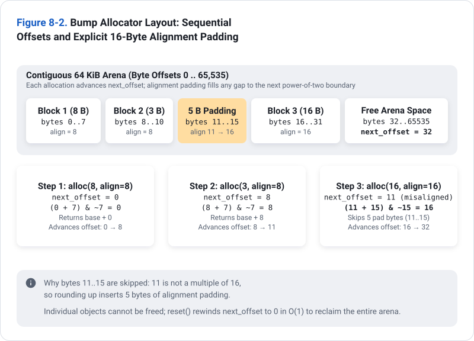

# 8. Memory Allocation and Management Strategies

The operating system virtual-memory subsystem manages RAM at coarse page granularity—typically 4 KiB on x86-64 and 16 KiB on Apple Silicon ARM64. Application software, however, dynamically allocates and destroys millions of objects ranging from 16-byte linked-list nodes to multi-megabyte buffers with heterogeneous lifetimes. Issuing a kernel system call (`mmap` or `brk`) for every small object would impose prohibitive privilege-transition latency and waste nearly an entire 4 KiB page for a 24-byte struct.

A **user-space memory allocator** bridges this granularity gap. It acquires large, contiguous virtual memory regions—**arenas**—from the operating system in bulk via `mmap`, subdivides those regions internally in Ring 3 according to alignment and reuse policies, and returns unneeded memory back to the kernel only at coarse boundaries.

## 8.1 The Allocator Interface and Hardware Alignment

Every dynamic allocator implements two core operations: `alloc(requested_bytes, alignment)`, which returns an aligned pointer to a writable slice of memory, and `free(pointer)` (or a bulk `reset()`), which reclaims memory for reuse.

### 8.1.1 Why Hardware Alignment and Padding Exist

Before writing a single line of allocator code, we must understand **memory alignment**—why an allocator cannot pack objects arbitrarily at odd byte offsets. Modern 64-bit processors transfer memory between caches and registers in aligned 8-byte words, 16-byte SIMD vectors, and 64-byte cache lines:

- **Natural Alignment Invariant:** A scalar or vector type of alignment `A` (always a power of two: 1, 2, 4, 8, 16, or 64 bytes) must begin at a memory address divisible by `A` (`address % A == 0`).
- **Hardware Consequences of Misalignment:** Accessing a 16-byte SIMD vector (`SSE`/`AVX`/`NEON`) or an atomic 64-bit word across an unaligned address either splits the load across two cache lines (doubling memory latency and breaking single-line hardware atomicity) or triggers an immediate hardware alignment fault (`#AC` / `SIGBUS`). Both the System V AMD64 ABI and ARM64 AAPCS64 therefore mandate **16-byte alignment** for general-purpose heap allocations (`malloc`).

### 8.1.2 Bitwise Alignment Rounding

When an allocator's current cursor sits at `next_offset` and a caller requests alignment `A = 2^k`, the allocator must round `next_offset` upward to the smallest multiple of `A` greater than or equal to `next_offset`:

```text
aligned_offset = (next_offset + A - 1) & ~(A - 1)
```

Because `A` is a power of two (`2^k`), `A - 1` consists of `k` trailing binary `1` bits, and `~(A - 1)` is a bitmask that clears those lowest `k` bits. Adding `A - 1` pushes any non-multiple into the next alignment bucket while leaving an exact multiple unchanged.

Trace a concrete example step-by-step across three allocations starting from `next_offset = 0`:
1. **`alloc(8, align=8)`:** `next_offset = 0` is already a multiple of 8 (`(0 + 7) & ~7 = 0`). The block occupies **bytes `0..7`**, advancing `next_offset` to **`8`**.
2. **`alloc(3, align=8)`:** `next_offset = 8` is already a multiple of 8 (`(8 + 7) & ~7 = 8`). The 3-byte block occupies **bytes `8..10`**, advancing `next_offset` to **`11`**.
3. **`alloc(16, align=16)`:** `next_offset = 11` is **not** a multiple of 16. Rounding up computes `(11 + 15) & ~15 = 26 & 0xFFFF...FFF0 = 16`. Bytes **`11..15` (5 bytes)** are left unused as **alignment padding** so that the 16-byte object begins cleanly at **offset `16`** (`bytes 16..31`), advancing `next_offset` to **`32`**.

## 8.2 Arena Allocation: The Bump Allocator

The **bump allocator** (also termed a linear or arena allocator) is the fastest possible memory allocator. It maintains only three scalar fields: the page-aligned `arena_base` pointer returned by `mmap`, the total `arena_capacity`, and a single monotonic integer `next_offset`.

Each allocation rounds `next_offset` upward to the requested alignment, verifies `aligned_offset + requested_bytes <= arena_capacity`, updates `next_offset`, and returns `arena_base + aligned_offset`. Allocation executes in O(1) time (roughly 3–5 CPU instructions) with zero per-object metadata overhead. The trade-off is deallocation granularity: because the bump allocator stores no per-object headers, individual objects cannot be freed. Instead, `reset()` rewinds `next_offset = 0` in a single instruction, reclaiming the entire arena simultaneously. This architecture excels for **phase-scoped lifetimes**, such as compiler AST arenas, per-frame game-engine scratch buffers, and per-request web server memory pools.

<figure>

</figure>

**Listing 8-1. A bump allocator with explicit alignment rounding (C++20).**

```cpp
{{#include ../code/ch08/bump.cpp}}
```

**Output 8-1. Three allocations demonstrating 5 bytes of alignment padding, followed by an O(1) reset.**

```text
{{#include ../code/out/ch08_bump.out}}
```

**Listing 8-2. The same bump allocator in Rust.**

```rust
{{#include ../code/ch08/bump.rs}}
```

**Output 8-2.**

```text
{{#include ../code/out/ch08_bump_rs.out}}
```

## 8.3 Explicit Deallocation: The Free-List Allocator

Supporting independent `free(pointer)` operations on objects with overlapping lifetimes requires the allocator to track the exact size and ownership state of every allocated region. A **free-list allocator** embeds a small **in-band `BlockHeader`** immediately preceding every user payload in memory:

```text
[ BlockHeader (24 bytes): payload_bytes | is_free | next_block ] [ User Payload (payload_bytes) ]
^                                                                ^
header pointer                                                   pointer returned to caller
```

This layout makes two pointer-arithmetic invariants straightforward:
- **On `alloc()`:** After locating a suitable free `BlockHeader* current`, the allocator advances the pointer past the 24-byte header (`current + 1` in C++ pointer arithmetic, or `current.cast::<u8>().add(HEADER_BYTES)` in Rust) and returns that payload address to the caller.
- **On `free(user_payload_ptr)`:** The caller passes only the payload pointer—never the allocation size. The allocator subtracts `sizeof(BlockHeader)` (24 bytes) from `user_payload_ptr` to recover the hidden `BlockHeader`, reads `payload_bytes`, and sets `is_free = true`.

### 8.3.1 First-Fit Search, Splitting, and Coalescing

Three policies govern fragmentation and reuse within a free-list arena:
1. **First-Fit Traversal:** Starting from `head_block`, `alloc(requested_bytes)` scans the block list in address order and selects the first block satisfying `is_free && payload_bytes >= requested_bytes`.
2. **Block Splitting (Suppressing Internal Fragmentation):** If the selected free block is significantly larger than `requested_bytes`—for example, fulfilling `alloc(150)` inside a 200-byte free hole—assigning the entire 200 bytes would waste 50 bytes of **internal fragmentation**. Whenever `leftover_bytes = payload_bytes - requested_bytes >= sizeof(BlockHeader) + MIN_SPLIT_PAYLOAD` (`24 + 16 = 40` bytes), the allocator writes a new `BlockHeader` immediately after the 150-byte payload, carving a reusable free block of `200 - 150 - 24 = 26` bytes and splicing it into the linked list.
3. **Adjacent Coalescing (Eliminating External Fragmentation):** Freeing adjacent blocks without merging them gradually shatters the arena into tiny isolated holes—**external fragmentation**—causing large allocations to fail even when aggregate free memory is plentiful. Upon `free()`, `coalesce_adjacent_free_blocks()` verifies physical contiguity (`neighbor == current + sizeof(BlockHeader) + current->payload_bytes`) and merges consecutive free blocks into a single unified block, reclaiming both the neighbor's payload and its redundant 24-byte header (`150 + 24 + 26 = 200` bytes restored).

<figure>

</figure>

**Listing 8-3. A first-fit free-list allocator with splitting and coalescing (C++20).**

```cpp
{{#include ../code/ch08/free_list.cpp}}
```

**Output 8-3. The block map after initial allocations, free, split reuse, and full coalescing.**

```text
{{#include ../code/out/ch08_free_list.out}}
```

**Listing 8-4. The same free-list allocator in Rust.**

```rust
{{#include ../code/ch08/free_list.rs}}
```

**Output 8-4.**

```text
{{#include ../code/out/ch08_free_list_rs.out}}
```

## 8.4 Production Allocator Architecture: Boundary Tags, Size Classes, and `mmap`

The educational free-list allocator in Listing 8-3 illustrates core mechanics, yet exhibits three severe bottlenecks under production multi-threaded workloads: O(N) linear free-list search, O(N) forward coalescing, and global lock contention across threads. Production allocators (`jemalloc`, `tcmalloc`, `mimalloc`, and `glibc ptmalloc2`) resolve all three through a three-tier hierarchy.

### 8.4.1 Knuth's Boundary Tags for O(1) Bidirectional Coalescing

In Listing 8-3, coalescing a freed block with its *preceding* physical neighbor required scanning the entire linked list from `head_block` in O(N) time because a singly linked header points only forward. Donald Knuth's **Boundary Tag** design eliminates this scan by replicating the 8-byte block descriptor (`payload_bytes | allocated_bit`, exploiting the fact that 16-byte aligned sizes always leave the lowest 4 bits zero) as both a **Header** before the payload and a **Footer** immediately after the payload:
- **Forward Coalescing (O(1)):** Add `current->size` to `current` to inspect the next physical block's Header directly.
- **Backward Coalescing (O(1)):** Step backward 8 bytes before `current`'s Header to read the previous physical block's **Footer**. If the footer's allocated bit is `0`, subtract its encoded size to jump directly to the predecessor's Header and merge in constant time.

### 8.4.2 Segregated Size Classes and Per-Thread Caches (`tcache`)

Rather than traversing a heterogeneous list of arbitrary block sizes under a single global mutex, production allocators partition small allocations into **segregated size classes** (discrete fixed-size bins such as `16 B`, `32 B`, `48 B`, `64 B`, ..., `4 KiB`). Every bin is a homogeneous slab of identically sized slots—eliminating external fragmentation within a size class and reducing both allocation and deallocation to O(1) singly linked stack pop/push operations.

To eliminate multi-core lock contention, every thread owns a private **thread-local cache (`tcache`)** holding small arrays of pre-allocated slots for each size class. Over 95% of small `malloc()` and `free()` calls execute purely in Ring 3 against thread-private cache lines with **zero atomic operations and zero mutex acquisitions**, touching central arenas only when a thread-local bin empties or overflows.

### 8.4.3 The `brk` / Arena vs. `mmap` Allocation Threshold (`M_MMAP_THRESHOLD`)

Sub-allocating small objects out of persistent arenas amortizes system-call overhead, yet placing a 10 MiB temporary image buffer inside a shared heap arena risks severe memory retention if a single 32-byte allocation remains live at the end of that arena. Production allocators therefore enforce a size threshold (**`M_MMAP_THRESHOLD`**, typically **128 KiB**):
- **Allocations `&lt; 128 KiB`:** Served from per-thread `tcache` bins and central size-class arenas backed by persistent `mmap` / `brk` spans.
- **Allocations `&ge; 128 KiB`:** Routed directly to standalone kernel `mmap(MAP_PRIVATE | MAP_ANON)` mappings. Upon `free()`, the allocator invokes `munmap()` immediately, returning the physical DRAM frames directly to the operating system kernel without waiting for arena compaction.

<figure>

</figure>

<div class="callout keyidea">
<span class="label">Key idea</span>

Memory allocators reconcile kernel page granularity (4 KiB / 16 KiB) with fine-grained object lifetimes: bump allocators trade individual deallocation for O(1) bulk resets, free-list allocators enforce splitting and coalescing via in-band headers, and production allocators achieve lock-free O(1) scaling via per-thread size-class caches, Knuth boundary tags, and direct `mmap` above 128 KiB.

</div>
