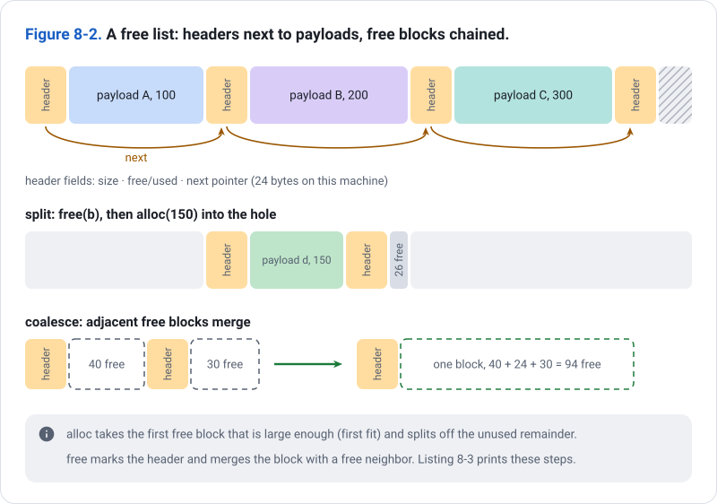

# 8. Memory Allocation and Management Strategies

The operating system virtual-memory subsystem manages physical RAM at coarse page granularity (typically 4 KiB on x86-64 and 16 KiB on Apple Silicon ARM64). Application software, however, dynamically allocates and deallocates millions of objects ranging from 16-byte linked-list nodes to multi-megabyte buffers with heterogeneous lifetimes. Issuing a kernel system call (`mmap` or `brk`) for every small object would impose prohibitive privilege-transition latency and waste nearly an entire 4 KiB page for a 24-byte struct.

A user-space memory allocator bridges this granularity gap. It acquires large, contiguous virtual memory regions (termed **arenas**) from the operating system in bulk via `mmap`, subdivides those regions internally in Ring 3 according to alignment and reuse policies, and returns unneeded memory to the kernel only at coarse page boundaries.

## 8.1 The Allocator Interface and Efficiency Constraints

A functional allocator provides two primary primitives: `alloc(n)`, which returns an aligned address for `n` bytes of memory, and `free(p)`, which returns a previously allocated block to the allocator for future reuse. The primary efficiency constraint is the high cost of system calls; therefore, an allocator must minimize its interaction with the kernel by requesting large regions and managing the lifecycle of these regions internally.

Allocators are distinguished by three architectural decisions: the placement strategy for new objects, the metadata utilized for block tracking, and the mechanism for reclaimed block reuse.

### 8.1.1 Requesting Raw Arenas from the Kernel (`mmap`)

The low-level allocators in Sections 8.2.2 and 8.3 acquire their backing memory (an **arena**) directly from the kernel via the POSIX `mmap` system call rather than calling `malloc`:

```text
mmap(nullptr, capacity_bytes, PROT_READ | PROT_WRITE, MAP_PRIVATE | MAP_ANON, -1, 0)
```

Each argument encodes a specific architectural contract with the kernel virtual-memory manager (detailed in Section 7.3.1):
- **`nullptr` (`ptr::null_mut()`):** Delegates virtual base-address selection to the kernel, guaranteeing a page-aligned starting address.
- **`capacity_bytes`:** Total contiguous virtual reservation requested (rounded upward by the kernel to whole hardware pages).
- **`PROT_READ | PROT_WRITE`:** Programs the hardware Page Table Entry (PTE) permission bits so the process can both load from and store into the arena while preserving non-executable (`NX = 1`) protection.
- **`MAP_PRIVATE | MAP_ANON`:** Allocates private, zero-initialized anonymous RAM unbacked by any disk file (`MAP_ANON`), ensuring modifications remain strictly isolated to this process (`MAP_PRIVATE`).
- **`-1, 0`:** Because `MAP_ANON` specifies no backing file, POSIX requires passing `-1` as the file descriptor and `0` as the file offset.
- **Error Check and Release:** `mmap` returns the sentinel `MAP_FAILED` (`(void*)-1`) on failure rather than `nullptr`. When the arena is destroyed, `munmap(arena_base, arena_capacity)` unmaps the virtual pages and returns their physical frames to the operating system.

### 8.1.2 Hardware Alignment and Bitwise Rounding

Before subdividing an arena into individual objects, an allocator must enforce **memory alignment**. Modern 64-bit processors transfer data between caches and registers in aligned 8-byte words, 16-byte SIMD vectors, and 64-byte cache lines. A type requiring alignment `A` (always a power of two: 1, 2, 4, 8, 16, or 64 bytes) must start at an address divisible by `A` (`address % A == 0`); unaligned accesses split across cache-line boundaries, break single-line hardware atomicity, or trigger hardware alignment faults (`#AC` / `SIGBUS`). Both the System V AMD64 ABI and ARM64 AAPCS64 therefore require **16-byte alignment** for general-purpose heap allocations.

Given a current cursor `next_offset` and a power-of-two alignment `A = 2^k`, the smallest multiple of `A` greater than or equal to `next_offset` is computed in two instructions:

```text
aligned_offset = (next_offset + A - 1) & ~(A - 1)
```

Because `A = 2^k`, `A - 1` has `k` trailing binary `1` bits, and `~(A - 1)` clears those lowest `k` bits. Adding `A - 1` advances any misaligned offset into the next multiple of `A` while leaving already-aligned offsets unchanged. Tracing three sequential allocations starting from `next_offset = 0` illustrates how alignment padding arises:
1. **`alloc(8, align=8)`:** Offset `0` is already 8-byte aligned (`(0 + 7) & ~7 = 0`). Occupies **bytes `0..7`**, advancing `next_offset` to **`8`**.
2. **`alloc(3, align=8)`:** Offset `8` is already 8-byte aligned (`(8 + 7) & ~7 = 8`). Occupies **bytes `8..10`**, advancing `next_offset` to **`11`**.
3. **`alloc(16, align=16)`:** Offset `11` is not a multiple of 16. Rounding up yields `(11 + 15) & ~15 = 26 & ~15 = 16`. Bytes **`11..15` (5 bytes)** are skipped as **alignment padding** so the 16-byte block begins cleanly at **offset `16`** (**bytes `16..31`**), advancing `next_offset` to **`32`**.

## 8.2 Arena Allocation: From Safe Index Pools to Raw Bump Allocators

An **arena** groups objects with identical lifetimes (such as request-scoped records in a web server, frame state in a renderer, or nodes in a syntax tree) into a single contiguous region and reclaims all of them simultaneously. Rather than introducing raw pointer arithmetic immediately, we construct arena allocation in two progressive stages: a completely safe typed index pool requiring zero raw pointers, followed by a raw `mmap`-backed bump allocator.

### 8.2.1 Level 1: The Safe Index Arena (Zero `unsafe`)

When all arena-resident nodes share a single homogeneous type `T` (such as abstract syntax tree nodes, graph vertices, or linked-list entries), raw memory management is unnecessary. Placing every node inside one contiguous array (`std::vector<T>` in C++20 or `Vec<T>` in Rust 2024) and linking nodes via copyable integer indices (`NodeId`) yields four immediate engineering benefits:
- **Memory safety without `unsafe`:** Indices remain valid even when the backing array reallocates to grow, eliminating dangling pointers and self-referential borrow-checker conflicts.
- **Cache-line locality:** Nodes allocated sequentially occupy adjacent bytes in L1/L2 caches, removing the pointer-chasing stalls characteristic of per-node `malloc` / `Box::new` trees.
- **Zero-cost bulk reclamation:** `reset()` calls `clear()`, reclaiming all nodes in O(1) while retaining the backing capacity for the next request or frame.
- **Production adoption:** Compilers (including `rustc` and LLVM), query planners, and Entity Component Systems (ECS) rely heavily on index-addressed arenas for cyclic graphs and syntax trees.

**Listing 8-1. Level 1 arena: a safe, contiguous index pool allocating a 10,000-node list (C++20).**

```cpp
{{#include ../code/ch08/index_arena.cpp}}
```

**Output 8-1. Verification of 10,000 contiguous arena nodes and O(1) bulk reset.**

```text
{{#include ../code/out/ch08_index_arena.out}}
```

**Listing 8-2. The same zero-`unsafe` index arena in Rust.**

```rust
{{#include ../code/ch08/index_arena.rs}}
```

**Output 8-2.**

```text
{{#include ../code/out/ch08_index_arena_rs.out}}
```

### 8.2.2 Level 2: The Raw Byte Bump Allocator (`mmap`-Backed)

When an arena must store heterogeneous types of varying sizes and alignments, or return direct typed references rather than integer handles, the allocator operates over a raw byte buffer. A **bump allocator** maintains a single monotonic offset (`next_offset`) within its contiguous virtual region. Allocation rounds `next_offset` upward to the requested alignment, verifies sufficient remaining space (`aligned_offset + requested_bytes <= arena_capacity`), and advances `next_offset` by the requested size.

The computational complexity of allocation in a bump allocator is O(1), consisting of only a few arithmetic operations with zero per-object metadata overhead. This speed is traded for coarse reclamation: individual objects cannot be freed, and `reset()` rewinds `next_offset = 0` to reclaim the entire arena at once.

<figure>

</figure>

**Listing 8-3. Level 2 arena: an `mmap`-backed bump allocator with explicit alignment rounding (C++20).**

```cpp
{{#include ../code/ch08/bump.cpp}}
```

**Output 8-3. Three allocations demonstrating 5 bytes of alignment padding, followed by an O(1) reset.**

```text
{{#include ../code/out/ch08_bump.out}}
```

**Listing 8-4. The same `mmap`-backed bump allocator in Rust.**

```rust
{{#include ../code/ch08/bump.rs}}
```

**Output 8-4.**

```text
{{#include ../code/out/ch08_bump_rs.out}}
```

Extending a raw byte bump allocator into a production typed Rust arena (such as `bumpalo`) introduces three subtle language and memory-model invariants:
- **Shared-borrow allocation (`&self` to `&'arena mut T`):** In Listing 8-4, `alloc(&mut self, ...)` requires exclusive access to the allocator, preventing callers from holding multiple live references returned by the same arena simultaneously. Production arenas wrap the bump cursor in interior mutability (`Cell<*mut u8>`) so `alloc<T>(&self, value: T) -> &mut T` accepts `&self`. Every returned reference carries the lifetime of `&self`, enabling arbitrary cross-referencing graphs while the borrow checker statically forbids any reference from outliving the arena; because `Cell` is neither `Send` nor `Sync`, single-threaded ownership is enforced at compile time.
- **Pointer provenance:** Storing the active cursor as a typed raw pointer (`*mut u8`) and computing alignment via `ptr::align_offset` and `ptr::add`, rather than casting pointers to `usize` integers and back, preserves strict pointer provenance under Rust's Stacked/Tree Borrows models and verifies cleanly under Miri.
- **Destructor omission:** Rewinding or unmapping a raw bump arena reclaims the backing bytes without executing per-object destructors (`Drop` in Rust, `~T()` in C++). Placing heap-owning types such as `Vec` or `String` inside a raw bump arena leaks their secondary heap allocations unless the arena records an explicit drop-function list (as in `typed-arena`) or restricts stored values to plain data and arena-scoped references.

### 8.2.3 Backing Store Trade-Off: Global-Allocator Chunks (`malloc` / `std::alloc`) vs. Direct `mmap`

Listings 8-3 and 8-4 call `mmap` directly to expose the exact OS boundary. In production systems, however, choosing between acquiring chunks from the global allocator (`malloc` / `std::alloc`) and mapping virtual memory directly with `mmap` depends on workload geometry:

| Dimension | Global-Allocator Chunks (`malloc` / `std::alloc`, e.g., 64 KiB) | Direct `mmap` Virtual Reservation (`MAP_NORESERVE`) |
| :--- | :--- | :--- |
| **Syscall & page-fault overhead** | Amortized; small chunks (64 KiB) are served from warm, already-faulted user-space arenas with zero kernel traps. | Each new `mmap` invokes a kernel trap and triggers minor page faults upon first write to every freshly mapped page. |
| **Contiguity & oversized requests** | Requires a chunk list (`Vec<(NonNull<u8>, Layout)>`) and a cold `grow()` path; leaves tail waste at chunk boundaries. | Single contiguous virtual range (e.g., 64 GiB reserved, committed lazily on demand); no chunk list and no relocation. |
| **Reclamation on `reset()`** | Rewinding a chunked arena retains committed RAM in user space until the arena itself is dropped. | `madvise(base, used, MADV_DONTNEED)` returns physical frames to the kernel while keeping the virtual range mapped and zeroed on reuse. |
| **Hardware page control** | Controlled indirectly by the global allocator. | Direct access to huge pages (`MAP_HUGETLB` / `MADV_HUGEPAGE`) and hardware guard pages (`mprotect(..., PROT_NONE)`). |
| **Portability & tooling** | Fully portable across POSIX and Windows; automatically checked by AddressSanitizer, Valgrind, and Miri. | OS-specific (`mmap` vs. `VirtualAlloc(MEM_RESERVE)`); may fail under strict overcommit (`vm.overcommit_memory=2`) and requires manual ASan poisoning. |

As a general rule, application-level arenas such as `bumpalo` allocate geometrically growing chunks (starting around 64 KiB) from `malloc` or `std::alloc`, avoiding syscall overhead and preserving sanitizer visibility. Direct `mmap` reserve-then-commit arenas are reserved for systems requiring single-span address stability, explicit huge-page or guard-page control, or immediate OS frame reclamation, most notably database buffer pools, JIT code heaps, and game-engine frame allocators.

## 8.3 Explicit Management: Free-List Allocation

To support the independent deallocation of individual objects, an allocator must track the size and ownership state of each allocated region. A **free-list allocator** accomplishes this by embedding an **in-band `BlockHeader`** immediately preceding every user payload in memory:

```text
[ BlockHeader (24 bytes): payload_bytes | is_free | next_block ] [ User Payload (payload_bytes) ]
^                                                                ^
header pointer                                                   pointer returned to caller
```

This layout establishes two direct pointer-arithmetic invariants:
- **On `alloc()`:** After finding a suitable free `BlockHeader* current`, the allocator advances past the 24-byte header (`current + 1` in C++ pointer arithmetic, or `current.cast::<u8>().add(HEADER_BYTES)` in Rust) and returns that payload address to the caller.
- **On `free(user_payload_ptr)`:** Because the caller supplies only the payload pointer, the allocator subtracts `sizeof(BlockHeader)` (24 bytes) from `user_payload_ptr` to recover the hidden `BlockHeader`, reads `payload_bytes`, and sets `is_free = true`.

### 8.3.1 First-Fit Search, Splitting, and Coalescing

The allocator's performance and fragmentation profile are governed by three policies:
1. **Allocation Policy (First-Fit):** Starting at `head_block`, `alloc(requested_bytes)` traverses the block list in address order and selects the first block satisfying `is_free && payload_bytes >= requested_bytes`.
2. **Splitting (Suppressing Internal Fragmentation):** When a chosen free block is significantly larger than `requested_bytes` (for example, satisfying `alloc(150)` inside a 200-byte hole), handing out all 200 bytes wastes 50 bytes of **internal fragmentation**. Whenever `leftover_bytes = payload_bytes - requested_bytes >= sizeof(BlockHeader) + MIN_SPLIT_PAYLOAD` (`24 + 16 = 40` bytes), the allocator writes a new `BlockHeader` immediately after the 150-byte payload, carving a reusable free block of `200 - 150 - 24 = 26` bytes and linking it into the list.
3. **Coalescing (Eliminating External Fragmentation):** Freeing adjacent blocks without merging them shatters the arena into small, unusable holes, causing **external fragmentation**. Upon `free()`, `coalesce_adjacent_free_blocks()` verifies physical contiguity (`neighbor == current + sizeof(BlockHeader) + current->payload_bytes`) and merges consecutive free blocks into a single unified region, reclaiming both the neighbor's payload and its redundant 24-byte header (`150 + 24 + 26 = 200` bytes restored).

<figure>

</figure>

**Listing 8-5. A first-fit free-list allocator with splitting and coalescing (C++20).**

```cpp
{{#include ../code/ch08/free_list.cpp}}
```

**Output 8-5. The block map after initial allocations, free, split reuse, and full coalescing.**

```text
{{#include ../code/out/ch08_free_list.out}}
```

**Listing 8-6. The same free-list allocator in Rust.**

```rust
{{#include ../code/ch08/free_list.rs}}
```

**Output 8-6.**

```text
{{#include ../code/out/ch08_free_list_rs.out}}
```

## 8.4 Production Allocator Architecture: Boundary Tags, Size Classes, and `mmap`

The educational free-list allocator in Listing 8-5 demonstrates core mechanics, yet exhibits three bottlenecks under multi-threaded production workloads: O(N) linear free-list search, O(N) coalescing traversal, and global lock contention across cores. Production allocators (`jemalloc`, `tcmalloc`, `mimalloc`, and `glibc ptmalloc2`) eliminate these bottlenecks through a three-tier hierarchy.

### 8.4.1 Knuth's Boundary Tags for O(1) Bidirectional Coalescing

In Listing 8-5, coalescing a freed block with its *preceding* physical neighbor required scanning the list from `head_block` in O(N) time because each header links only forward. Donald Knuth's **Boundary Tag** architecture eliminates linear scanning by replicating the 8-byte block descriptor (`payload_bytes | allocated_bit`, exploiting the fact that 16-byte aligned sizes leave the lowest 4 bits zero) as both a **Header** before the payload and a **Footer** immediately after the payload:
- **Forward Coalescing (O(1)):** Add `current->size` to `current` to inspect the next physical block's Header directly.
- **Backward Coalescing (O(1)):** Step backward 8 bytes prior to `current`'s Header to read the previous physical block's **Footer**. When the footer's allocated bit is `0`, subtract its encoded size to jump directly to the predecessor's Header and merge in constant time.

### 8.4.2 Segregated Size Classes and Per-Thread Caches (`tcache`)

Rather than searching a heterogeneous list of arbitrary block sizes under a single global mutex, production allocators partition small allocations into **segregated size classes** (discrete fixed-size bins such as `16 B`, `32 B`, `48 B`, `64 B`, ..., `4 KiB`). Each bin manages a homogeneous slab of identically sized slots, eliminating external fragmentation within a size class and reducing allocation and deallocation to O(1) stack pop and push operations.

To eliminate multi-core lock contention, each thread maintains a private **thread-local cache (`tcache`)** storing pre-allocated slots for every small size class. The vast majority of small `malloc()` and `free()` calls complete in Ring 3 against thread-private cache lines with zero atomic operations and zero mutex acquisitions, contacting central arenas only when a thread-local bin empties or overflows.

### 8.4.3 The `brk` / Arena vs. `mmap` Allocation Threshold (`M_MMAP_THRESHOLD`)

Sub-allocating small objects out of persistent arenas amortizes system-call overhead, whereas placing a multi-megabyte temporary buffer inside a shared arena risks retaining large physical memory spans if a single tiny allocation remains live near the end of the arena. Production allocators enforce a size threshold (**`M_MMAP_THRESHOLD`**, typically **128 KiB**):
- **Allocations `&lt; 128 KiB`:** Served from per-thread `tcache` bins and central size-class arenas backed by persistent `mmap` / `brk` spans.
- **Allocations `&ge; 128 KiB`:** Routed directly to standalone kernel `mmap(MAP_PRIVATE | MAP_ANON)` mappings. Upon `free()`, the allocator invokes `munmap()` immediately, returning the physical frames directly to the operating system kernel.

<figure>

</figure>

<div class="callout keyidea">
<span class="label">Key idea</span>

Memory allocators reconcile kernel page granularity with fine-grained object lifetimes: safe index pools and raw bump allocators trade individual deallocation for O(1) bulk resets, free-list allocators enforce splitting and coalescing via in-band headers, and production allocators achieve lock-free O(1) scaling via per-thread size-class caches, Knuth boundary tags, and direct `mmap` above 128 KiB.

</div>
