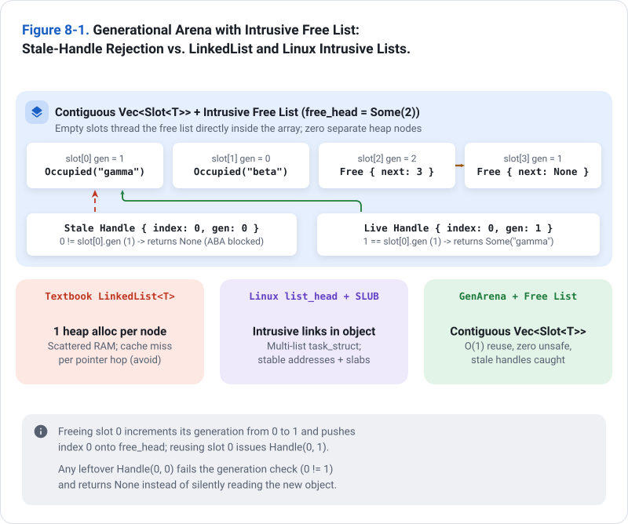

# 8. Memory Allocation and Management Strategies

The operating system virtual-memory subsystem manages physical **Random-Access Memory (`RAM`)** at coarse page granularity (typically 4 KiB on x86-64 and 16 KiB on Apple Silicon ARM64). Application software, however, dynamically allocates and deallocates millions of objects ranging from 16-byte linked-list nodes to multi-megabyte buffers with heterogeneous lifetimes. Issuing a kernel system call (`mmap` or `brk`) for every small object would impose prohibitive privilege-transition latency and waste nearly an entire 4 KiB page for a 24-byte struct.

A user-space memory allocator bridges this granularity gap. It acquires large, contiguous virtual memory regions (termed **arenas**) from the operating system in bulk via `mmap`, subdivides those regions internally in Ring 3 according to alignment and reuse policies, and returns unneeded memory to the kernel only at coarse page boundaries.

## 8.1 The Allocator Interface and Efficiency Constraints

A functional allocator provides two primary primitives: `alloc(n)`, which returns an aligned address for `n` bytes of memory, and `free(p)`, which returns a previously allocated block to the allocator for future reuse. The primary efficiency constraint is the high cost of system calls; therefore, an allocator must minimize its interaction with the kernel by requesting large regions and managing the lifecycle of these regions internally.

Allocators are distinguished by three architectural decisions: the placement strategy for new objects, the metadata utilized for block tracking, and the mechanism for reclaimed block reuse.

### 8.1.1 Requesting Raw Arenas from the Kernel (`mmap`)

The low-level allocators in Sections 8.2.3 and 8.3 acquire their backing memory (an **arena**) directly from the kernel via the **Portable Operating System Interface (`POSIX`)** `mmap` system call rather than calling `malloc`:

```text
mmap(nullptr, capacity_bytes, PROT_READ | PROT_WRITE, MAP_PRIVATE | MAP_ANON, -1, 0)
```

Passing `nullptr` (`ptr::null_mut()` in Rust) lets the kernel select a page-aligned virtual base address, while `capacity_bytes` is rounded upward to whole hardware pages. Setting `PROT_READ | PROT_WRITE` programs each leaf **Page Table Entry (`PTE`)** for readable, writable, non-executable (`NX = 1`) memory, and `MAP_PRIVATE | MAP_ANON` allocates private, zero-initialized anonymous memory unbacked by any file (for which `POSIX` requires `fd = -1` and `offset = 0`, as detailed in Section 7.3.1). On failure `mmap` returns `MAP_FAILED` (`(void*)-1`); when the arena is destroyed, `munmap(arena_base, arena_capacity)` returns its physical frames to the operating system.

### 8.1.2 Hardware Alignment and Bitwise Rounding

Before subdividing an arena into individual objects, an allocator must enforce **memory alignment**. Modern 64-bit processors transfer data between caches and registers in aligned 8-byte words, 16-byte **Single Instruction, Multiple Data (`SIMD`)** vectors, and 64-byte cache lines. A type requiring alignment `A` (always a power of two: 1, 2, 4, 8, 16, or 64 bytes) must start at an address divisible by `A` (`address % A == 0`); unaligned accesses split across cache-line boundaries, break single-line hardware atomicity, or trigger hardware alignment faults (`#AC` / `SIGBUS`). Both the System V AMD64 **Application Binary Interface (`ABI`)** and ARM64 AAPCS64 therefore require **16-byte alignment** for general-purpose heap allocations.

Given a current cursor `next_offset` and a power-of-two alignment `A = 2^k`, the smallest multiple of `A` greater than or equal to `next_offset` is computed in two instructions:

```text
aligned_offset = (next_offset + A - 1) & ~(A - 1)
```

Because `A = 2^k`, `A - 1` has `k` trailing binary `1` bits, and `~(A - 1)` clears those lowest `k` bits. Adding `A - 1` advances any misaligned offset into the next multiple of `A` while leaving already-aligned offsets unchanged. Table 8-1 traces three sequential allocations starting from `next_offset = 0`, illustrating how alignment padding arises when a 16-byte-aligned request follows an odd-length allocation.

**Table 8-1. Sequential bump-cursor alignment trace starting from `next_offset = 0`.**

| Step | Request | Rounding Arithmetic | Padding Skipped | Occupied Byte Range | New `next_offset` |
| :---: | :--- | :--- | :---: | :---: | :---: |
| **1** | `alloc(8, align=8)` | `(0 + 7) & ~7 = 0` | `0 B` | `0..7` | `8` |
| **2** | `alloc(3, align=8)` | `(8 + 7) & ~7 = 8` | `0 B` | `8..10` | `11` |
| **3** | `alloc(16, align=16)` | `(11 + 15) & ~15 = 16` | **`5 B`** (`11..15`) | `16..31` | `32` |

## 8.2 Arena Allocation: From Safe Index Pools to Raw Bump Allocators

An **arena** groups objects with identical lifetimes (such as request-scoped records in a web server, frame state in a renderer, or nodes in a syntax tree) into a single contiguous region and reclaims all of them simultaneously. Rather than introducing raw pointer arithmetic immediately, arena allocation is developed here in three progressive stages: a minimal append-only index pool requiring zero raw pointers, a generational arena with an intrusive free list supporting O(1) individual deletion and stale-handle detection, and finally a raw `mmap`-backed bump allocator.

### 8.2.1 Level 1: The Safe Index Arena (Zero `unsafe`)

When all arena-resident nodes share a single homogeneous type `T` (such as abstract syntax tree nodes, graph vertices, or linked-list entries), raw memory management is unnecessary. Placing every node inside one contiguous array (`std::vector<T>` in C++20 or `Vec<T>` in Rust 2024) wrapped in a minimal `Arena<T>` and linking nodes via copyable integer handles (`Id`) delivers memory safety without `unsafe`, high cache-line locality, and O(1) bulk reclamation. Indices remain valid even when the backing array reallocates to grow, eliminating dangling pointers and self-referential borrow-checker conflicts. Because nodes allocated sequentially occupy adjacent bytes in L1 and L2 caches, traversal avoids the pointer-chasing stalls characteristic of per-node `malloc` or `Box::new` trees, and calling `reset()` invokes `clear()` to reclaim every node in O(1) while retaining backing capacity for the next request or frame. Production compilers (including `rustc` and **Low-Level Virtual Machine (`LLVM`)**), query planners, and **Entity Component Systems (`ECS`)** rely heavily on index-addressed arenas for cyclic graphs and syntax trees.

**Listing 8-1. Level 1 arena: a safe, contiguous index pool allocating a 10,000-node list (C++20).**

```cpp
{{#include ../code/ch08/index_arena.cpp}}
```

**Output 8-1. Verification of 10,000 contiguous arena nodes and O(1) bulk reset.**

```text
{{#include ../code/out/ch08_index_arena.out}}
```

**Listing 8-2. The same zero-`unsafe` index arena in Rust.**

```rust
{{#include ../code/ch08/index_arena.rs}}
```

**Output 8-2.**

```text
{{#include ../code/out/ch08_index_arena_rs.out}}
```

### 8.2.2 Level 2: The Generational Arena with an Intrusive Free List (Zero `unsafe`)

The Level 1 `Arena<T>` in Listing 8-2 supports O(1) bulk `reset()`, yet it cannot reclaim individual removed objects without leaking their slots. Supporting individual deletion introduces two fundamental systems design problems: slot reuse without heap fragmentation and stale-handle detection.

**Intrusive Free Lists vs. Heap-Allocated Linked Lists.** A textbook pointer-based linked list (such as `std::collections::LinkedList`) calls the global heap allocator once per node, scattering nodes across **Dynamic Random-Access Memory (`DRAM`)** and causing a cache miss on every pointer hop. By contrast, an **intrusive free list** inside an arena allocates zero separate nodes: each empty slot inside the contiguous `Vec<Slot<T>>` stores `Entry::Free { next_free: Option<u32> }`, and the arena holds a single `free_head: Option<u32>` pointing to the most recently freed index. Inserting pops `free_head` in O(1); removing pushes the freed index onto `free_head` in O(1).

The Linux kernel applies both halves of this design. Its primary kernel object allocator (**Unqueued Slab Allocator (`SLUB`)**) manages contiguous arenas (slabs) of fixed-size objects with an intrusive free list threaded directly through empty slots. Meanwhile, Linux's intrusive **`struct list_head`** embeds `prev` and `next` pointers directly inside kernel objects such as `task_struct` (allocating zero wrapper nodes), giving kernel code three capabilities a growable `Vec` cannot match: O(1) self-unlinking given an existing pointer to the object, simultaneous membership of one object in multiple lists (runqueue, parent's children list, and a wait queue), and stable physical addresses that never relocate.

**Stale Handles and Generational Indices.** Replacing raw pointers with `usize` indices eliminates segmentation faults and undefined behavior, yet an index remains an unchecked handle the borrow checker cannot track. Suppose slot `0` holds `"alpha"`, a caller retains a copy of `Id(0)`, slot `0` is freed onto the free list, and `"gamma"` is inserted into recycled slot `0`. Dereferencing the stale `Id(0)` will not crash; it returns `"gamma"` without error, trading memory corruption for undetected logical corruption (an index-space ABA bug).

Pairing every slot index with a **generation counter** (`Handle { index: u32, generation: u32 }`) and storing a matching `generation: u32` inside each `Slot<T>` closes this gap. Every time a slot is freed, its `generation` increments by `1`. On every `get()` or `remove()`, the arena verifies `slot.generation == handle.generation`; any stale handle from an earlier lifetime fails the check immediately and returns `None` (`nullptr` in C++). Production Rust crates such as `slotmap` and `generational-arena` use this exact design. In long-running processes where a hot slot might recycle 2<sup>32</sup> times, production implementations use 64-bit generations or retire saturated slots to prevent wraparound collisions.

<figure>

</figure>

**Listing 8-3. Level 2 arena: a generational arena with an intrusive free list (C++20).**

```cpp
{{#include ../code/ch08/gen_arena.cpp}}
```

**Output 8-3. O(1) slot recycling and deterministic rejection of stale handles.**

```text
{{#include ../code/out/ch08_gen_arena.out}}
```

**Listing 8-4. The same zero-`unsafe` generational arena with intrusive free list in Rust.**

```rust
{{#include ../code/ch08/gen_arena.rs}}
```

**Output 8-4.**

```text
{{#include ../code/out/ch08_gen_arena_rs.out}}
```

### 8.2.3 Level 3: The Raw Byte Bump Allocator (`mmap`-Backed)

When an arena must store heterogeneous types of varying sizes and alignments, or return direct typed references rather than integer handles, the allocator operates over a raw byte buffer. A **bump allocator** maintains a single monotonic offset (`next_offset`) within its contiguous virtual region. Allocation rounds `next_offset` upward to the requested alignment, verifies sufficient remaining space (`aligned_offset + requested_bytes <= arena_capacity`), and advances `next_offset` by the requested size.

The computational complexity of allocation in a bump allocator is O(1), consisting of only a few arithmetic operations with zero per-object metadata overhead. This speed is traded for coarse reclamation: individual objects cannot be freed, and `reset()` rewinds `next_offset = 0` to reclaim the entire arena at once.

<figure>

</figure>

**Listing 8-5. Level 3 arena: an `mmap`-backed bump allocator with explicit alignment rounding (C++20).**

```cpp
{{#include ../code/ch08/bump.cpp}}
```

**Output 8-5. Three allocations demonstrating 5 bytes of alignment padding, followed by an O(1) reset.**

```text
{{#include ../code/out/ch08_bump.out}}
```

**Listing 8-6. The same `mmap`-backed bump allocator in Rust.**

```rust
{{#include ../code/ch08/bump.rs}}
```

**Output 8-6.**

```text
{{#include ../code/out/ch08_bump_rs.out}}
```

Extending a raw byte bump allocator into a production typed Rust arena (such as `bumpalo`) requires enforcing three subtle language and memory-model invariants. First, **shared-borrow allocation (`&'arena self` to `&'arena mut T`)** resolves an aliasing conflict: in Listing 8-6, `alloc(&mut self, ...)` requires exclusive access to the allocator, preventing callers from holding multiple live references returned by the same arena simultaneously. Production arenas wrap the bump cursor in interior mutability (`Cell<*mut u8>`) so `alloc<'a, T>(&'a self, value: T) -> &'a mut T` accepts a shared reference `&'a self`. Every returned reference carries the lifetime `'a` of the arena borrow, enabling arbitrary cross-referencing graphs while the borrow checker statically forbids any reference from outliving the arena; because `Cell` is neither `Send` nor `Sync`, single-threaded ownership is enforced at compile time.

Second, **pointer provenance** requires storing the active cursor as a typed raw pointer (`*mut u8`) and computing alignment via `ptr::align_offset` and `ptr::add` rather than casting pointers to `usize` integers and back, preserving strict provenance under Rust's Stacked and Tree Borrows models and verifying cleanly under Miri. Third, **destructor omission** means rewinding or unmapping a raw bump arena reclaims the backing bytes without executing per-object destructors (`Drop` in Rust, `~T()` in C++). Placing heap-owning types such as `Vec` or `String` inside a raw bump arena leaks their secondary heap allocations unless the arena records an explicit drop-function list (as in `typed-arena`) or restricts stored values to plain data and arena-scoped references.

### 8.2.4 Backing Store Trade-Off: Global-Allocator Chunks (`malloc` / `std::alloc`) vs. Direct `mmap`

Listings 8-5 and 8-6 call `mmap` directly to expose the exact OS boundary. In production systems, however, choosing between acquiring chunks from the global allocator (`malloc` / `std::alloc`) and mapping virtual memory directly with `mmap` depends on workload geometry (Table 8-2).

**Table 8-2. Comparison of global-allocator chunks versus direct `mmap` reservations as arena backing stores.**

| Dimension | Global-Allocator Chunks (`malloc` / `std::alloc`, e.g., 64 KiB) | Direct `mmap` Virtual Reservation (`MAP_NORESERVE`) |
| :--- | :--- | :--- |
| **Syscall & page-fault overhead** | Amortized; small chunks (64 KiB) are served from warm, already-faulted user-space arenas with zero kernel traps. | Each new `mmap` invokes a kernel trap and triggers minor page faults upon first write to every freshly mapped page. |
| **Contiguity & oversized requests** | Requires a chunk list (`Vec<(NonNull<u8>, Layout)>`) and a cold `grow()` path; leaves tail waste at chunk boundaries. | Single contiguous virtual range (e.g., 64 GiB reserved, committed lazily on demand); no chunk list and no relocation. |
| **Reclamation on `reset()`** | Rewinding a chunked arena retains committed `RAM` in user space until the arena itself is dropped. | `madvise(base, used, MADV_DONTNEED)` returns physical frames to the kernel while keeping the virtual range mapped and zeroed on reuse. |
| **Hardware page control** | Controlled indirectly by the global allocator. | Direct access to huge pages (`MAP_HUGETLB` / `MADV_HUGEPAGE`) and hardware guard pages (`mprotect(..., PROT_NONE)`). |
| **Portability & tooling** | Fully portable across `POSIX` and Windows; automatically checked by AddressSanitizer, Valgrind, and Miri. | OS-specific (`mmap` vs. `VirtualAlloc(MEM_RESERVE)`); may fail under strict overcommit (`vm.overcommit_memory=2`) and requires manual ASan poisoning. |

As a general rule, application-level arenas such as `bumpalo` allocate geometrically growing chunks (starting around 64 KiB) from `malloc` or `std::alloc`, avoiding syscall overhead and preserving sanitizer visibility. Direct `mmap` reserve-then-commit arenas are reserved for systems requiring single-span address stability, explicit huge-page or guard-page control, or immediate OS frame reclamation, most notably database buffer pools, **Just-In-Time (`JIT`)** code heaps, and game-engine frame allocators.

## 8.3 Explicit Management: Free-List Allocation and Fragmentation

To support the independent deallocation of individual objects, an allocator must track the size and ownership state of each allocated region. A **free-list allocator** accomplishes this by embedding an **in-band `BlockHeader`** immediately preceding every user payload in memory:

```text
[ BlockHeader (24 bytes): payload_bytes | is_free | next_block ] [ User Payload (payload_bytes) ]
^                                                                ^
header pointer                                                   pointer returned to caller
```

This layout establishes two symmetric pointer-arithmetic invariants. On `alloc()`, after locating a suitable free `BlockHeader* current`, the allocator advances past the 24-byte header (`current + 1` in C++ pointer arithmetic, or `current.cast::<u8>().add(HEADER_BYTES)` in Rust) and returns that payload address to the caller. On `free(user_payload_ptr)`, because the caller supplies only the payload pointer, the allocator subtracts `sizeof(BlockHeader)` (24 bytes) from `user_payload_ptr` to recover the hidden `BlockHeader`, reads `payload_bytes`, and sets `is_free = true`.

### 8.3.1 Placement Policies, Splitting, and Coalescing

Free-space management over variable-sized requests revolves around three interacting mechanisms: selecting a hole, splitting oversized holes, and coalescing adjacent freed holes.

When `alloc(requested_bytes)` searches the free list for a candidate block satisfying `is_free && payload_bytes >= requested_bytes`, the placement policy determines both search latency and long-term fragmentation (Table 8-3).

**Table 8-3. Classic variable-size free-list placement policies.**

| Placement Policy | Search Strategy | Time Complexity | Fragmentation Behavior |
| :--- | :--- | :---: | :--- |
| **First-Fit** | Starts at `head_block`; picks the first free block large enough | O(*N*) (fast in practice) | Accumulates small splinter holes near the head of the list |
| **Next-Fit** | Resumes scanning from the previous allocation's roving cursor | O(*N*) (shorter average scan) | Distributes splinters uniformly across the arena |
| **Best-Fit** | Scans the entire free list; picks the smallest block `&ge; requested_bytes` | O(*N*) (full scan every call) | Minimizes immediate leftover, yet creates tiny unusable slivers |
| **Worst-Fit** | Scans the entire free list; picks the largest available block | O(*N*) (full scan every call) | Leaves larger remainders, yet rapidly destroys large contiguous spans |

Listings 8-7 and 8-8 implement **First-Fit** paired with **splitting** and **coalescing**. When a chosen free block is significantly larger than `requested_bytes` (for example, satisfying `alloc(150)` inside a 200-byte hole), handing out all 200 bytes wastes 50 bytes of **internal fragmentation**. Whenever `leftover_bytes = payload_bytes - requested_bytes >= sizeof(BlockHeader) + MIN_SPLIT_PAYLOAD` (`24 + 16 = 40` bytes), the allocator writes a new `BlockHeader` immediately after the 150-byte payload, carving a reusable free block of `200 - 150 - 24 = 26` bytes and linking it into the list.

Conversely, freeing adjacent blocks without merging them shatters the arena into small, unusable holes, causing **external fragmentation**. Upon `free()`, `coalesce_adjacent_free_blocks()` verifies physical contiguity (`neighbor == current + sizeof(BlockHeader) + current->payload_bytes`) and merges consecutive free blocks into a single unified region, reclaiming both the neighbor's payload and its redundant 24-byte header (`150 + 24 + 26 = 200` bytes restored). Table 8-4 traces the exact offsets and block sizes produced by Listing 8-7 across its four lifecycle stages inside a 262,144-byte arena with 24-byte headers.

**Table 8-4. Worked splitting and coalescing trace matching Output 8-7 (262,144 B arena, 24 B `BlockHeader`).**

| Stage | Operation Sequence | Resulting Block Map (`[index] offset, payload, state`) | Total Usable Free Bytes |
| :--- | :--- | :--- | :---: |
| **1. Initial** | `alloc(100)`, `alloc(200)`, `alloc(300)` | `[0] 0: 100 used` &rarr; `[1] 124: 200 used` &rarr; `[2] 348: 300 used` &rarr; `[3] 672: 261,448 free` | `261,448 B` |
| **2. Free** | `free(block_b)` (at offset `124`) | `[0] 0: 100 used` &rarr; `[1] 124: 200 free` &rarr; `[2] 348: 300 used` &rarr; `[3] 672: 261,448 free` | `261,648 B` (2 holes) |
| **3. Split** | `alloc(150)` reuses offset `124` (`200 - 150 - 24 = 26 B`) | `[0] 0: 100 used` &rarr; `[1] 124: 150 used` &rarr; `[2] 298: 26 free` &rarr; `[3] 348: 300 used` &rarr; `[4] 672: 261,448 free` | `261,474 B` (2 holes) |
| **4. Coalesce** | `free` all remaining blocks | `[0] 0: 262,120 free` (all intermediate 24 B headers reclaimed) | `262,120 B` (1 span) |

### 8.3.2 Quantifying Internal vs. External Fragmentation

Distinguishing the two forms of memory waste guides allocator selection. **Internal fragmentation** occurs *inside* an allocated block when the allocator rounds a request upward for alignment, fixed size-class binning, or refusal to split a small remainder:

```text
Internal Fragmentation Ratio = (Allocated_Slot_Bytes - Requested_Bytes) / Allocated_Slot_Bytes
```

Without splitting, serving `alloc(150)` from a `200`-byte hole wastes `50 / 200 = 25.0%` internally; similarly, placing a `33`-byte struct into a `64`-byte power-of-two size class wastes `31 / 64 = 48.4%`.

**External fragmentation** occurs *between* allocated blocks when ample total free memory exists, yet no single contiguous hole satisfies the incoming request:

```text
External Fragmentation Ratio = 1 - (Largest_Contiguous_Free_Block / Total_Free_Bytes)
```

Suppose an arena holds `100` non-adjacent `16`-byte holes separated by live objects, yielding `1,600` total free bytes. The external fragmentation ratio reaches `1 - (16 / 1,600) = 99.0%`: even a modest `32`-byte allocation fails unless the allocator grows the arena from the operating system.

<figure>

</figure>

**Listing 8-7. A first-fit free-list allocator with splitting and coalescing (C++20).**

```cpp
{{#include ../code/ch08/free_list.cpp}}
```

**Output 8-7. The block map after initial allocations, free, split reuse, and full coalescing.**

```text
{{#include ../code/out/ch08_free_list.out}}
```

**Listing 8-8. The same free-list allocator in Rust.**

```rust
{{#include ../code/ch08/free_list.rs}}
```

**Output 8-8.**

```text
{{#include ../code/out/ch08_free_list_rs.out}}
```

## 8.4 Production Allocator Architecture: Boundary Tags, Size Classes, and `GlobalAlloc`

The educational free-list allocator in Listing 8-7 demonstrates core mechanics, yet exhibits three bottlenecks under multi-threaded production workloads: O(*N*) linear free-list search, O(*N*) coalescing traversal, and global lock contention across cores. Production allocators (`jemalloc`, `tcmalloc`, `mimalloc`, and `glibc ptmalloc2`) eliminate these bottlenecks through a three-tier hierarchy.

### 8.4.1 Knuth's Boundary Tags for O(1) Bidirectional Coalescing

In Listing 8-7, coalescing a freed block with its *preceding* physical neighbor required scanning the list from `head_block` in O(*N*) time because each header links only forward. Donald Knuth's **Boundary Tag** architecture eliminates linear scanning by replicating the 8-byte block descriptor (`payload_bytes | allocated_bit`, exploiting the fact that 16-byte aligned sizes leave the lowest 4 bits zero) as both a **Header** before the payload and a **Footer** immediately after the payload.

On `free()`, forward coalescing adds `current->size` to `current` to inspect the next physical block's Header directly in O(1) time. Backward coalescing steps backward 8 bytes prior to `current`'s Header to read the previous physical block's **Footer**: when the footer's allocated bit is `0`, subtracting its encoded size jumps directly to the predecessor's Header and merges the two blocks in constant time. Every deallocation therefore evaluates one of four O(1) cases (both neighbors allocated, next free only, previous free only, or both neighbors free) without ever traversing the heap.

### 8.4.2 Segregated Size Classes, Slabs, and Per-Thread Caches (`tcache`)

Rather than searching a heterogeneous list of arbitrary block sizes under a single global mutex, production allocators (`jemalloc`, `tcmalloc`, `mimalloc`, and the Linux kernel `SLUB` allocator) partition small allocations into **segregated size classes**. Instead of doubling class sizes at every step (which would allow up to `50%` internal fragmentation), production allocators space size classes geometrically by `12.5%` to `25%` (for example, `16`, `32`, `48`, `64`, `80`, `96`, `112`, `128`, `160`, `192`, `224`, `256` bytes), bounding worst-case internal fragmentation below `~20%`.

Each size class manages homogeneous **slabs** (typically 4 KiB to 64 KiB page runs) partitioned into identically sized slots. Because every slot within a slab shares the exact same size, the allocator records slab metadata once per page run (or via a radix tree indexed by page address) rather than prepending a 16- or 24-byte header to every small object. Allocation and deallocation inside a slab reduce to O(1) intrusive free-list pop and push operations, and external fragmentation within a size class drops to zero.

To eliminate multi-core lock contention and cross-core cache-line bouncing, each thread maintains a private **Thread-Local Cache (`tcache`)** holding pre-allocated free lists for every small size class. The vast majority of small `malloc()` and `free()` calls complete in Ring 3 against thread-private L1 cache lines with zero atomic instructions and zero mutex acquisitions. Only when a thread-local bin empties does the thread refill a batch of slots from a central per-CPU or sharded arena; when a bin overflows its watermark, it flushes excess slots back to the central arena. In producer-consumer workloads where Thread B frees an object originally allocated by Thread A, allocators such as `mimalloc` push the freed pointer onto the owning slab's atomic remote-free list via a single lock-free `CAS`, avoiding locks on the hot path while preventing unbounded memory transfer between thread caches.

### 8.4.3 The `brk` / Arena vs. `mmap` Allocation Threshold (`M_MMAP_THRESHOLD`)

Sub-allocating small objects out of persistent arenas amortizes system-call overhead, whereas placing a multi-megabyte temporary buffer inside a shared arena risks retaining large physical memory spans if a single tiny allocation remains live near the end of the arena. Production allocators therefore enforce a size threshold (**`M_MMAP_THRESHOLD`**, typically **128 KiB**). Allocations strictly below `128 KiB` are served from per-thread `tcache` bins and central size-class arenas backed by persistent `mmap` or `brk` spans, whereas allocations of `128 KiB` or larger are routed directly to standalone kernel `mmap(MAP_PRIVATE | MAP_ANON)` mappings so that `free()` can invoke `munmap()` immediately and return the physical frames directly to the operating system kernel.

<figure>

</figure>

### 8.4.4 Rust's `GlobalAlloc` Contract and Layout-Aware Deallocation

In C and C++, `free(void* ptr)` receives only the payload address, forcing the allocator to either read an in-band header or perform a page-metadata lookup to discover the block's size class (C++14 added sized `operator delete(void*, std::size_t)` to relieve this bottleneck for typed allocations). Rust's **`GlobalAlloc`** trait embeds size and alignment directly into both halves of the allocator contract:

```rust
pub unsafe trait GlobalAlloc {
    unsafe fn alloc(&self, layout: Layout) -> *mut u8;
    unsafe fn dealloc(&self, ptr: *mut u8, layout: Layout);
}
```

Passing `layout: Layout` (which encodes exact byte size and power-of-two alignment) directly into `dealloc` allows size-class allocators to compute the target bin index in a few instructions without touching page tables or in-band headers. Implementors of `GlobalAlloc` must uphold three strict invariants: `alloc` must return a non-null pointer aligned to `layout.align()` (or a null pointer on out-of-memory), callers must never pass a zero-sized `Layout` (`layout.size() == 0`, as Rust handles **Zero-Sized Types (`ZST`s)** via dangling aligned pointers without invoking the allocator), and every `GlobalAlloc` implementation must be `Sync` because multiple threads invoke `alloc` and `dealloc` concurrently through `&self`. Applications can swap the system allocator across an entire Rust binary by annotating a static instance of `tikv-jemallocator`, `mimalloc`, or a custom arena wrapper with `#[global_allocator]`.

<div class="callout keyidea">
<span class="label">Key idea</span>

Memory allocators reconcile kernel page granularity with fine-grained object lifetimes: safe index pools and raw bump allocators trade individual deallocation for O(1) bulk resets, free-list allocators enforce splitting and coalescing via in-band headers, and production allocators achieve lock-free O(1) scaling via per-thread size-class caches, Knuth boundary tags, and direct `mmap` above 128 KiB.

</div>

<div class="callout experiment">
<span class="label">Experiment</span>

In Listing 8-4 (`code/ch08/gen_arena.rs`), comment out the `slot.generation += 1` increment inside `remove()` and re-run. Observe how the stale `alpha` handle returns `"gamma"` without error from the recycled slot instead of `None`, demonstrating the logical ABA hazard of plain integer indices.

</div>

<div class="callout caution">
<span class="label">Common Pitfall</span>

Returning unaligned pointers from a custom bump or free-list allocator. Omitting power-of-two rounding (`(offset + A - 1) & ~(A - 1)`) violates the 16-byte `ABI` alignment invariant, triggering undefined behavior in C++ and Rust and hardware alignment faults (`SIGBUS`) on strict `SIMD` vector loads.

</div>
