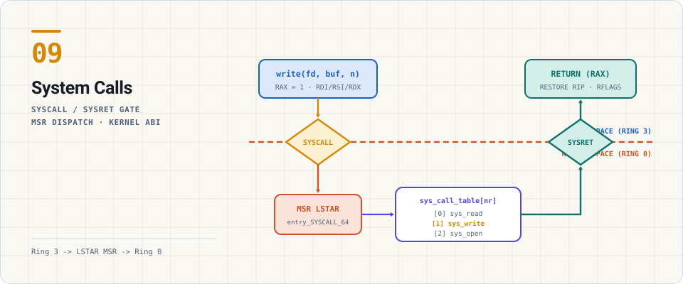

# 9. The Kernel Boundary and the Cost of System Calls



The system call represents the formal interface between user-mode application logic and the privileged operations of the operating system. It serves as the single, controlled gateway through which a process requests services, such as file **Input/Output (`I/O`)**, process management, or network communication, that require hardware access or kernel-level authority.

## 9.1 The Mechanics of the System Call Interface

A system call is initiated via a specialized trap instruction executed by a user-mode C library wrapper (`syscall` on x86-64; `svc #0` on ARM64). Unlike an ordinary function call, which pushes a return address onto the user stack and branches within the same privilege ring, a system call must cross the hardware isolation boundary separating Ring 3 (User Mode) from Ring 0 (Kernel Mode). The wrapper places a numeric system call identifier into a designated register (`rax` on x86-64 Linux; `x8` on ARM64 Linux; `x16` on Apple Silicon Darwin) and loads up to six arguments into fixed argument registers (`rdi`, `rsi`, `rdx`, `r10`, `r8`, `r9` on x86-64; `x0` through `x5` on ARM64) before executing the trap instruction.

Upon executing the trap, the processor saves the user program counter and processor flags, elevates the **Current Privilege Level (`CPL`)** to kernel mode, switches the stack pointer to the thread's private kernel stack (`TSS.rsp0` or per-CPU kernel stack), and jumps to the kernel's registered system call entry vector (`MSR_LSTAR` on x86-64; `VBAR_EL1` on ARM64). The kernel indexes into its system call dispatch table (`sys_call_table`) using the provided identifier, executes the handler, places the result into the return register, and restores user mode via `sysret` or `eret` (Figure 9-1).

Two architectural invariants govern every crossing of this boundary. First, the kernel enforces **untrusted user pointer validation**: every incoming argument, including system call numbers, buffer addresses, and byte counts, is treated as potentially adversarial. Before reading or writing a user buffer, the kernel verifies that the virtual address range lies strictly below the user/kernel canonical boundary and accesses it through fault-safe copy helpers (`copy_from_user` and `copy_to_user`) so a malformed pointer returns `EFAULT` rather than crashing the kernel. Second, the raw **Application Binary Interface (`ABI`)** follows a strict **error-return convention (`errno`)**: on Linux, a kernel handler returning a value in `[-4095, -1]` signals failure, with the negated value encoding the **Portable Operating System Interface (`POSIX`)** error number. The C library wrapper intercepts negative kernel returns, stores the positive error code in the thread-local variable `errno`, and returns `-1` to application code. Checking the return value before inspecting `errno` is mandatory because successful system calls do not clear a stale `errno` from an earlier failure.

<figure>

</figure>

### 9.1.1 Why Benchmarking Uses `getppid()`, Not `getpid()`

Measuring the pure cost of a privilege transition requires invoking a minimal system call that performs almost no work inside the kernel. A natural candidate would appear to be `getpid()`, yet on several platforms (including macOS/Darwin and historical `glibc` releases) the C library caches the **Process Identifier (`PID`)** in user-space memory after the first invocation, invalidating the cache only across `fork()`. Calling `getpid()` in a tight loop would therefore measure a user-mode memory load rather than a kernel trap.

Similarly, on Linux, high-frequency queries such as `clock_gettime()` and `gettimeofday()` bypass the trap path entirely via the **Virtual Dynamic Shared Object (`vDSO`)**, a read-only kernel page mapped directly into every process's virtual address space so user code reads calibrated hardware clock counters without entering Ring 0. By contrast, `getppid()` cannot safely be cached in user space because the parent process may terminate asynchronously and cause the kernel to reparent the caller to `PID 1`. Every call to `getppid()` must therefore execute a genuine user-to-kernel-to-user transition.

## 9.2 Performance Implications and Optimization via Buffering

Why is a bare `getppid()` call roughly two orders of magnitude slower than an ordinary user-mode function call (~100 to 300 nanoseconds versus ~1 nanosecond)? A single `syscall` instruction triggers a cascade of microarchitectural work: flushing speculative instructions, switching privilege levels and stacks, saving general-purpose registers, enforcing security mitigations such as **Kernel Page-Table Isolation (`KPTI`)** (which switches `CR3` page tables on Meltdown-affected processors to unmap kernel memory during user execution), and polluting Level 1 instruction caches and branch-predictor tables.

To amortize this privilege-transition penalty across high-volume `I/O` workloads, runtime libraries employ **user-space buffering**. Rather than issuing a `write(2)` system call for every 17-byte log line, a buffered stream (C's `FILE*` with `fwrite`, C++'s `std::ostream`, or Rust's `BufWriter`) appends small writes into a contiguous user-space buffer (for example, 64 KiB). Only when the buffer fills, or when the caller explicitly invokes `fflush()` or `flush()`, does the library issue a single large `write(2)` system call to transfer all 64 KiB into the kernel at once (Figure 9-2).

Buffering trades immediate visibility for throughput. Bytes residing in a user-space buffer are invisible to the kernel and to other processes; if the process terminates abruptly via **Kill Signal (`SIGKILL`)**, `_exit()`, or a segmentation fault prior to flushing, buffered data is discarded without ever reaching the kernel. Mixing raw file-descriptor writes (`write(fd, ...)`) with buffered library writes (`fwrite(..., f)`) on the same underlying descriptor also produces reordered output unless the user buffer is flushed before switching interfaces.

### 9.2.1 The `POSIX` Descriptor `I/O` Interface (`open`, `write`, `close`, `setvbuf`)

Listings 9-3 and 9-4 compare unbuffered kernel writes against 64 KiB user-space buffering using four standard `POSIX` and C interfaces:

```c
int     open(const char *pathname, int flags, ... /* mode_t mode */);
ssize_t write(int fd, const void *buf, size_t count);
int     close(int fd);
int     setvbuf(FILE *stream, char *buf, int mode, size_t size);
```

Calling `open(pathname, flags, [mode])` resolves `pathname` in the virtual filesystem, allocates an open file description in the kernel, and installs a reference to it in the lowest unused slot of the calling process's file descriptor table. Listings 9-3 and 9-4 open `/dev/null`, a virtual character device whose kernel driver immediately discards every written byte and returns success, isolating pure system-call overhead from storage latency. The `flags` bitmask combines one access mode (`O_RDONLY`, `O_WRONLY`, or `O_RDWR`) with optional creation or status flags (`O_CREAT`, `O_TRUNC`, `O_APPEND`, `O_CLOEXEC`); an octal permission `mode` (such as `0644`) is required only when `O_CREAT` is set. On success, `open()` returns a non-negative integer file descriptor (`fd >= 0`); on failure, it returns `-1` with `errno` set (`ENOENT`, `EACCES`, or `EMFILE`).

Calling `write(fd, buf, count)` requests that the kernel transfer up to `count` bytes starting at user address `buf` to the resource referenced by `fd`. It returns a signed byte count (`ssize_t`, `0 <= n <= count`) or `-1` on error (`EINTR` if interrupted by a signal, `EAGAIN` on a full non-blocking descriptor, `EPIPE` on a closed pipe or socket, or `ENOSPC` when storage is exhausted). Because `POSIX` permits **short writes** (transferring fewer than `count` bytes without error on pipes, sockets, or interrupted writes), production code wraps raw `write()` calls in a loop advancing the buffer slice until all bytes are accepted, as shown in Listing 9-4.

When the resource is no longer needed, `close(fd)` releases the descriptor slot and decrements the kernel open file description's reference count, returning `0` on success or `-1` on error (`EBADF` or delayed `EIO`). To control user-space buffering on a C `FILE*` stream before any `I/O` occurs, `setvbuf(stream, buf, mode, size)` configures the buffering policy: passing `buf = nullptr` allocates an internal buffer of `size` bytes (`64 * 1024`), while `mode` selects full buffering (`_IOFBF`), line buffering (`_IOLBF`), or unbuffered mode (`_IONBF`), returning `0` on success.

**Listing 9-1. A system call compared with a function call (C++20).**

```cpp
{{#include ../code/ch09/syscall_cost.cpp}}
```

**Output 9-1. One run on the verification machine.**

```text
{{#include ../code/out/ch09_syscall_cost.out}}
```

**Listing 9-2. The same comparison in Rust.**

```rust
{{#include ../code/ch09/syscall_cost.rs}}
```

**Output 9-2.**

```text
{{#include ../code/out/ch09_syscall_cost_rs.out}}
```

<figure>

</figure>

**Listing 9-3. 200,000 small writes, unbuffered and buffered (C++20).**

```cpp
{{#include ../code/ch09/write_buffered.cpp}}
```

**Output 9-3.**

```text
{{#include ../code/out/ch09_write_buffered.out}}
```

**Listing 9-4. The same comparison in Rust, with write(2) and BufWriter.**

```rust
{{#include ../code/ch09/write_buffered.rs}}
```

**Output 9-4.**

```text
{{#include ../code/out/ch09_write_buffered_rs.out}}
```

<div class="callout keyidea">
<span class="label">Key idea</span>

Crossing the Ring 3 to Ring 0 privilege boundary costs roughly 100× more than an ordinary function call. High-throughput systems software amortizes this cost by batching small operations into large user-space buffers (64 KiB `BufWriter`), bypassing traps via `vDSO`, or submitting batches through shared-memory rings (`io_uring`).

</div>

<div class="callout experiment">
<span class="label">Experiment</span>

Modify Listing 9-3 (`code/ch09/write_buffered.cpp`) to sweep the buffer size passed to `setvbuf()` across `256`, `4,096`, `65,536`, and `1,048,576` bytes. Observe how wall-clock time drops steeply up to 64 KiB (as syscall count falls 256×) and then plateaus once user-space `memcpy` dominates.

</div>

<div class="callout caution">
<span class="label">Common Pitfall</span>

Inspecting `errno` without first verifying that the system call returned `-1`. Successful `POSIX` calls never clear `errno`, so reading `errno` after a successful `write()` or `open()` surfaces a stale error code left behind by an unrelated earlier library call.

</div>
