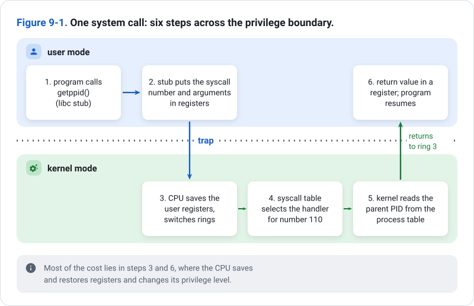

# 9. The Kernel Boundary and the Cost of System Calls

The system call represents the formal interface between user-mode application logic and the privileged operations of the operating system. It serves as the single, controlled gateway through which a process requests services, such as file **Input/Output (`I/O`)**, process management, or network communication, that require hardware access or kernel-level authority.

This interface poses a fundamental architectural problem: how can an operating system expose hardware devices, shared files, and scheduling services to untrusted user programs while preserving strict memory isolation and keeping request latency low? If user code could jump directly into kernel routines or touch device registers, a single buggy pointer or malicious instruction could compromise the entire machine. Conversely, if every 17-byte log write had to cross a heavy hardware privilege barrier, high-throughput services would spend most of their **Central Processing Unit (`CPU`)** cycles entering and leaving the kernel rather than executing application logic. Resolving this tension requires understanding both the hardware cost of crossing the privilege boundary and the software mechanisms that amortize or bypass it.

## 9.1 The Mechanics of the System Call Interface

A system call is initiated through a specialized trap instruction executed by a user-mode C library wrapper (`syscall` on x86-64; `svc #0` on ARM64). An ordinary function call pushes a return address onto the user stack and branches within the same privilege ring, whereas a system call must cross the hardware isolation boundary separating Ring 3 (User Mode) from Ring 0 (Kernel Mode) on x86-64, or **Exception Level 0 (`EL0`)** from **Exception Level 1 (`EL1`)** on ARM64. Before executing the trap instruction, the wrapper places a numeric system call identifier into a designated register and loads up to six arguments into fixed argument registers defined by the operating system's **Application Binary Interface (`ABI`)**.

| Architectural Element | x86-64 Linux | ARM64 Linux | ARM64 Darwin (Apple Silicon) |
| :--- | :--- | :--- | :--- |
| **Trap instruction** | `syscall` | `svc #0` | `svc #0x80` |
| **Return instruction** | `sysret` (or `iretq`) | `eret` | `eret` |
| **Syscall number register** | `rax` | `x8` | `x16` |
| **Argument registers (1 to 6)** | `rdi`, `rsi`, `rdx`, `r10`, `r8`, `r9` | `x0` through `x5` | `x0` through `x5` |
| **Entry vector register** | `MSR_LSTAR` | `VBAR_EL1` | `VBAR_EL1` |
| **Return value register** | `rax` (`[-4095, -1]` on error) | `x0` (`[-4095, -1]` on error) | `x0` (carry flag `C=1` on error) |
| **Hardware saved user PC / flags** | `rcx` (`RIP`), `r11` (`RFLAGS`) | `ELR_EL1`, `SPSR_EL1` | `ELR_EL1`, `SPSR_EL1` |

The difference between the ordinary C calling convention and the kernel system call `ABI` on x86-64 reflects a direct hardware constraint. In the System V x86-64 C calling convention, the fourth integer argument resides in `rcx`. When the processor executes the `syscall` instruction, however, hardware overwrites `rcx` with the user-space return address (`RIP`) and overwrites `r11` with the user `RFLAGS` register so it does not have to push them onto a stack before switching privilege levels. The kernel `ABI` therefore moves the fourth argument into `r10`, and user-space wrappers copy `rcx` to `r10` immediately before issuing `syscall`.

Upon executing the trap, the processor elevates the **Current Privilege Level (`CPL`)** to Ring 0 (or `EL1`) and jumps directly to the kernel's registered system call entry point (`MSR_LSTAR` on x86-64; `VBAR_EL1` on ARM64). Unlike the legacy 32-bit `int 0x80` software interrupt mechanism, which consulted the **Interrupt Descriptor Table (`IDT`)**, performed segment descriptor checks, and pushed a hardware interrupt frame onto the kernel stack automatically, the `syscall` instruction leaves the stack pointer (`rsp`) pointing at the user stack. The first kernel instructions must therefore execute `swapgs` to switch the `GS` segment base to the per-`CPU` kernel data area, save the untrusted user `rsp`, and load the thread's private kernel stack pointer (`TSS.rsp0` or per-`CPU` kernel scratch space) before touching the stack. On ARM64, the processor automatically selects the dedicated `SP_EL1` kernel stack pointer upon taking `svc #0`, avoiding the manual stack-swap dance.

Once safely on the kernel stack, the entry stub pushes the user's general-purpose registers into a `struct pt_regs` frame (168 bytes on x86-64), validates that the system call number lies within bounds, and dispatches through the kernel's function pointer table (`sys_call_table`). After the kernel handler completes, it places its return value into `rax` (or `x0`), restores the saved user registers and user stack pointer, switches `GS` back if on x86-64, and executes `sysret` (or `eret`) to drop privilege back to user mode and resume at the saved instruction pointer (Figure 9-1).

<figure>

</figure>

### 9.1.1 Untrusted User Pointers, `SMAP`/`PAN`, and Fault-Safe Copies

Crossing into Ring 0 grants the `CPU` full access to physical memory and kernel data structures, which creates a severe security boundary problem: every argument arriving in registers from user space, including system call numbers, buffer pointers, and byte counts, must be treated as potentially adversarial. Consider what would happen if a kernel `write(fd, buf, count)` handler dereferenced `buf` directly without validation. A malicious user process could pass a kernel-space virtual address such as `0xffff888000001000` as `buf` and ask the kernel to write 4,096 bytes to a file it owns, exfiltrating kernel secrets such as cryptographic keys or another user's password hashes. Conversely, passing a kernel address to `read(fd, buf, count)` would trick the kernel into overwriting its own code or page tables with attacker-controlled bytes. Even an honest program passing an unmapped or read-only user address would trigger an unhandled page fault inside Ring 0 and panic the operating system.

Modern processors enforce hardware guardrails against accidental kernel dereferences of user memory. On x86-64, **Supervisor Mode Access Prevention (`SMAP`)** causes the hardware to raise a fault if Ring 0 code reads or writes any virtual page whose page-table entry has the User (`U/S`) bit set. On ARM64, **Privileged Access Never (`PAN`)** enforces the identical invariant for `EL1` accesses to `EL0` pages. Because these hardware checks are active by default throughout kernel execution, the kernel cannot inadvertently follow a user pointer.

To transfer data legitimately across the boundary, every system call handler invokes specialized helpers: `copy_from_user()` to read user memory and `copy_to_user()` to write user memory. Each helper performs three coordinated steps. First, it checks with `access_ok()` that the entire interval `[buf, buf + count)` lies strictly below the canonical user/kernel virtual address boundary, rejecting kernel pointers and integer overflows (`buf + count` wrapping around the 64-bit address space) immediately with `-EFAULT`. Second, it temporarily disables the hardware user-access barrier (`stac` before the copy and `clac` afterward on x86-64; clearing and restoring `PSTATE.PAN` on ARM64). Third, every memory-access instruction inside the copy loop is registered in a special kernel **exception table (`__ex_table`)** that pairs the faulting instruction address with a fixup handler address. If a user page is unmapped or lacks write permission, the kernel's page-fault handler consults `__ex_table`, redirects execution to the fixup routine, restores `SMAP`/`PAN`, and returns `-EFAULT` cleanly to user space instead of crashing the kernel.

### 9.1.2 The Error-Return Convention and `errno` Thread-Local Storage

Because a system call must communicate both a valid result (such as a non-negative byte count or a mapped pointer) and a failure reason through a single return register, operating systems standardize a strict **error-return convention**. On Linux, any kernel handler returning a signed value in the range `[-4095, -1]` signals failure, with the negated value encoding the **Portable Operating System Interface (`POSIX`)** error number (for example, `-2` represents `ENOENT` and `-14` represents `EFAULT`). Even system calls that return virtual memory addresses, such as `mmap()`, can safely use this convention because the kernel reserves the top 4 KiB page of the virtual address space (`0xfffffffffffff000` through `0xffffffffffffffff`) and never maps it to user space. On **Berkeley Software Distribution (`BSD`)** kernels and macOS/Darwin, the kernel instead sets the processor's carry flag (`CF = 1` on x86-64; `C = 1` on ARM64) on error and returns the positive error code directly in `rax` or `x0`.

User-space C library wrappers translate this raw kernel convention into the standard C interface: when the kernel indicates an error, the wrapper stores the positive error code into `errno` and returns `-1` (or `MAP_FAILED` for `mmap()`) to the caller. In early single-threaded Unix systems, `errno` was an ordinary global `int` variable. In a multi-threaded process, a global variable would create an immediate data race: Thread A could fail an `open()` call with `ENOENT`, and before Thread A inspects `errno`, Thread B could fail a `write()` call with `ENOSPC` and overwrite Thread A's error code.

Modern `POSIX` runtimes eliminate this race by storing `errno` in **Thread-Local Storage (`TLS`)**. Rather than a global variable, `errno` is a preprocessor macro that expands to a dereferenced function call, such as `(*__errno_location())` in `glibc` on Linux or `(*__error())` on macOS. That helper reads the calling thread's dedicated `TLS` base pointer (`FS` segment base on x86-64; `TPIDR_EL0` on ARM64) and returns the address of that thread's private `errno` slot. One invariant remains essential across every platform: successful system calls never reset `errno` to zero. Application code must check whether the return value indicates failure (`ret == -1`) before reading `errno`; inspecting `errno` after a successful call surfaces a stale error left behind by an unrelated earlier failure.

### 9.1.3 Zero-Trap Calls via `vDSO` and Why Benchmarking Uses `getppid()`

Measuring the pure cost of a privilege transition requires invoking a minimal system call that performs almost no work inside the kernel. A natural candidate would appear to be `getpid()`, yet on several platforms (including macOS/Darwin and historical `glibc` releases) the C library cached the **Process Identifier (`PID`)** in user-space memory after the first invocation, invalidating the cache only across `fork()`. Calling `getpid()` in a tight loop on such a system measures a cached user-mode memory load rather than a kernel trap.

Even more dramatic optimizations exist for high-frequency read-only queries such as `clock_gettime()` and `gettimeofday()`. Logging frameworks, databases, and network profilers invoke `clock_gettime()` millions of times per second; paying a full Ring 3 to Ring 0 transition on every timestamp would degrade throughput substantially. Linux bypasses the trap path entirely through the **Virtual Dynamic Shared Object (`vDSO`)**, a small read-only **Executable and Linkable Format (`ELF`)** shared library mapped directly into every process's virtual address space alongside a shared kernel-updated data page (`vvar`).

When user code calls `clock_gettime(CLOCK_MONOTONIC, &ts)`, execution branches into the `vDSO` function entirely within Ring 3. The `vDSO` reads a monotonic sequence counter from the `vvar` page, reads the hardware **Time Stamp Counter (`TSC`)** (`rdtscp` on x86-64; `cntvct_el0` on ARM64), converts raw hardware ticks into nanoseconds using kernel-calibrated multiplier and shift parameters stored in `vvar`, and re-reads the sequence counter to verify that the kernel did not concurrently adjust the clock parameters (a lock-free **sequence lock**, or `seqlock`). If a concurrent update occurred, the loop retries; otherwise, the call completes in roughly 15 to 25 nanoseconds with zero privilege transitions.

By contrast, `getppid()` cannot safely be cached in user space or served from a process-global `vDSO` page without per-process kernel state updates, because a process's parent can terminate asynchronously at any instant, causing the kernel to reparent the caller to `PID 1` (or a configured subreaper). Every invocation of `getppid()` must therefore execute a genuine user-to-kernel-to-user trap, read the live parent pointer from the caller's task structure, and return it.

## 9.2 Hardware Costs: `KPTI`, `TLB` Impact, and Microarchitectural Overhead

Outputs 9-1 and 9-2 report the measured latency of a plain user-mode function call against `getppid()` on the verification machine: the plain function call takes `1.8` to `2.1` nanoseconds, whereas `getppid()` takes `582.7` to `586.8` nanoseconds, a factor of `277x` to `328x` slower despite `getppid()` performing virtually zero algorithmic work inside the kernel.

This two-order-of-magnitude gap stems from a cascade of microarchitectural events triggered by every privilege transition. First, executing `syscall` and `sysret` serializes the processor's out-of-order execution pipeline, draining speculative instructions before switching privilege rings. Second, the entry and exit stubs must save and restore the full `struct pt_regs` register context to and from the kernel stack and execute kernel entry bookkeeping (audit hooks, tracing checks, and pending-signal checks on exit). Third, executing kernel code evicts hot user-space instructions from the **Level 1 (`L1`)** instruction cache and pollutes branch-predictor structures such as the **Branch Target Buffer (`BTB`)**. On processors affected by speculative-execution vulnerabilities (such as Spectre v2), the kernel also issues predictor-isolation barriers such as **Indirect Branch Restricted Speculation (`IBRS`)** or retpoline thunks so user-trained branch predictors cannot steer speculative kernel execution.

On x86-64 processors vulnerable to the Meltdown side-channel attack, an additional mitigation dominates system call latency: **Kernel Page-Table Isolation (`KPTI`)**. Historically, operating systems mapped the entire kernel into the upper half of every process's page table (marked supervisor-only) so entering Ring 0 required zero page-table changes. Meltdown revealed that out-of-order execution could speculatively read supervisor-only kernel pages while in Ring 3 and leak their contents through the data cache before the permission fault retired. `KPTI` closes this hole by maintaining two separate page tables per process: a **user page table** that maps user memory plus only a minimal kernel entry trampoline, and a **kernel page table** that maps both user and kernel memory.

Under `KPTI`, the entry stub immediately writes the kernel page-table root into control register `CR3`, and the exit stub switches `CR3` back to the user page table before `sysret`. On older processors lacking **Process-Context Identifiers (`PCID`)**, writing `CR3` flushes the entire **Translation Lookaside Buffer (`TLB`)**, forcing expensive multi-level hardware page-table walks on subsequent user-mode memory accesses even after the system call finishes. Even on newer processors with `PCID` (which tags `TLB` entries with a 12-bit address-space identifier so user and kernel entries coexist without a full flush), the dual `CR3` writes, cache-line fetches, and trampoline instructions add tens to hundreds of nanoseconds to every single trap.

**Listing 9-1. A system call compared with a function call (C++20).**

```cpp
{{#include ../code/ch09/syscall_cost.cpp}}
```

**Output 9-1. One run on the verification machine.**

```text
{{#include ../code/out/ch09_syscall_cost.out}}
```

**Listing 9-2. The same comparison in Rust.**

```rust
{{#include ../code/ch09/syscall_cost.rs}}
```

**Output 9-2.**

```text
{{#include ../code/out/ch09_syscall_cost_rs.out}}
```

## 9.3 Amortizing Trap Overhead via User-Space Buffering

Because the fixed per-call cost of crossing the privilege boundary is several hundred nanoseconds regardless of payload size, issuing a system call for every small piece of data wastes nearly all execution time in trap overhead. Systems libraries solve this problem through **user-space buffering**: instead of invoking `write(2)` for every 17-byte log line, a buffered stream (C's `FILE*` with `fwrite`, C++'s `std::ostream`, or Rust's `BufWriter`) appends small writes into a contiguous user-space byte array (such as 64 KiB). Only when the buffer fills, or when the caller explicitly invokes `fflush()` or `flush()`, does the library issue a single large `write(2)` system call to transfer all 64 KiB into the kernel at once (Figure 9-2).

An explicit calculation on the workload in Listings 9-3 and 9-4 quantifies the amortization gain. Both programs write `N = 200,000` records of `s = 17` bytes each to `/dev/null`, for a total payload of `3,400,000` bytes (approximately `3.24 MiB`). In the unbuffered loop, the program executes `200,000` separate `write(2)` system calls. Outputs 9-3 and 9-4 record `274.3` ms (C++) and `276.0` ms (Rust), which corresponds to roughly `1.37` microseconds per `write(2)` call (reflecting both the privilege transition and the virtual filesystem dispatch to `/dev/null`).

When the identical `3,400,000` bytes pass through a `65,536`-byte (64 KiB) user-space buffer, the total number of `write(2)` calls drops to:

```text
ceil(3,400,000 / 65,536) = 52 system calls
```

That is a `3,846x` reduction in kernel boundary crossings. Multiplying `52` calls by `1.37` microseconds per call predicts a total kernel-crossing cost of roughly `0.071` milliseconds, leaving user-space memory copying as the sole remaining work.

Comparing Output 9-3 against Output 9-4 exposes a second, subtler systems cost inside user space itself. Both programs issue approximately `52` `write(2)` system calls, yet Rust's `BufWriter` completes in `0.6` milliseconds (`460x` faster than unbuffered) while C's `fwrite` takes `12.0` milliseconds (`23x` faster than unbuffered). Why does `fwrite` spend `11.4` extra milliseconds across `200,000` calls (roughly `57` nanoseconds per 17-byte append)? Under `POSIX`, every standard C `FILE*` stream must be thread-safe by default, so `fwrite()` acquires and releases an internal stream mutex on every invocation even in a single-threaded program. (C programs that know a stream is unshared can acquire the lock once with `flockfile()` and call `fwrite_unlocked()` inside the loop to close this gap.) Rust's `BufWriter::write_all()` requires an exclusive `&mut self` reference checked statically at compile time; with zero runtime locking, each 17-byte append compiles down to a bounds check and a 17-byte `memcpy` costing roughly `3` nanoseconds.

Buffering trades immediate visibility for throughput, introducing three operational hazards that systems programmers must manage explicitly. First, bytes sitting in a user-space buffer are completely invisible to the kernel and to other processes; if a process terminates abruptly via **Kill Signal (`SIGKILL`)**, `_exit(2)`, or a segmentation fault prior to flushing, all buffered data vanishes without ever reaching the kernel. Second, if a parent process forks while holding unflushed bytes in a `FILE*` buffer (for example, `stdout`), both parent and child inherit a copy of the identical user-space buffer and later flush the same lines twice unless the parent calls `fflush()` before `fork()`. Third, mixing raw file-descriptor calls (`write(fd, ...)`) with buffered library calls (`fwrite(..., f)`) on the same underlying descriptor produces reordered output unless the user-space buffer is flushed prior to switching interfaces.

For workloads that cannot aggregate writes into a single contiguous buffer, such as network servers assembling HTTP headers and file payloads or databases submitting hundreds of asynchronous storage operations per millisecond, kernels provide two additional batching mechanisms. **Vectored `I/O`** (`writev(2)` and `readv(2)`) accepts an array of `(pointer, length)` descriptors (`struct iovec`) and transfers all segments in a single kernel crossing. At even higher rates, Linux's **`io_uring`** maps shared lock-free submission and completion ring buffers between user space and the kernel, allowing a process to enqueue dozens of `read`, `write`, and `accept` requests into shared memory and submit them with a single `io_uring_enter()` trap, or even zero traps when kernel-side submission polling (`IORING_SETUP_SQPOLL`) is enabled.

<figure>

</figure>

### 9.3.1 The `POSIX` Descriptor `I/O` Interface (`open`, `write`, `close`, `setvbuf`)

Listings 9-3 and 9-4 compare unbuffered kernel writes against 64 KiB user-space buffering using four standard `POSIX` and C interfaces:

```c
int     open(const char *pathname, int flags, ... /* mode_t mode */);
ssize_t write(int fd, const void *buf, size_t count);
int     close(int fd);
int     setvbuf(FILE *stream, char *buf, int mode, size_t size);
```

Calling `open(pathname, flags, [mode])` resolves `pathname` in the virtual filesystem, allocates an open file description in the kernel, and installs a reference to it in the lowest unused slot of the calling process's file descriptor table. Listings 9-3 and 9-4 open `/dev/null`, a virtual character device whose kernel driver immediately discards every written byte and returns success, isolating pure system-call overhead from storage latency. The `flags` bitmask combines one access mode (`O_RDONLY`, `O_WRONLY`, or `O_RDWR`) with optional creation or status flags (`O_CREAT`, `O_TRUNC`, `O_APPEND`, `O_CLOEXEC`); an octal permission `mode` (such as `0644`) is required only when `O_CREAT` is set. On success, `open()` returns a non-negative integer file descriptor (`fd >= 0`); on failure, it returns `-1` with `errno` set (`ENOENT`, `EACCES`, or `EMFILE`).

Calling `write(fd, buf, count)` requests that the kernel transfer up to `count` bytes starting at user address `buf` to the resource referenced by `fd`. It returns a signed byte count (`ssize_t`, `0 <= n <= count`) or `-1` on error (`EINTR` if interrupted by a signal, `EAGAIN` on a full non-blocking descriptor, `EPIPE` on a closed pipe or socket, or `ENOSPC` when storage is exhausted). Because `POSIX` permits **short writes** (transferring fewer than `count` bytes without error on pipes, sockets, or interrupted writes), production code wraps raw `write()` calls in a loop advancing the buffer slice until all bytes are accepted, as illustrated in Listing 9-4.

When the resource is no longer needed, `close(fd)` releases the descriptor slot and decrements the kernel open file description's reference count, returning `0` on success or `-1` on error (`EBADF` or delayed `EIO`). To control user-space buffering on a C `FILE*` stream before any `I/O` occurs, `setvbuf(stream, buf, mode, size)` configures the buffering policy: passing `buf = nullptr` allocates an internal buffer of `size` bytes (`64 * 1024`), while `mode` selects full buffering (`_IOFBF`), line buffering (`_IOLBF`), or unbuffered mode (`_IONBF`), returning `0` on success.

**Listing 9-3. 200,000 small writes, unbuffered and buffered (C++20).**

```cpp
{{#include ../code/ch09/write_buffered.cpp}}
```

**Output 9-3.**

```text
{{#include ../code/out/ch09_write_buffered.out}}
```

**Listing 9-4. The same comparison in Rust, with write(2) and BufWriter.**

```rust
{{#include ../code/ch09/write_buffered.rs}}
```

**Output 9-4.**

```text
{{#include ../code/out/ch09_write_buffered_rs.out}}
```

<div class="callout keyidea">
<span class="label">Key idea</span>

Crossing the Ring 3 to Ring 0 privilege boundary costs roughly 100× to 300× more than an ordinary function call. High-throughput systems software amortizes this cost by batching small operations into large user-space buffers (64 KiB `BufWriter`), bypassing traps via `vDSO`, or submitting batches through shared-memory rings (`io_uring`).

</div>

<div class="callout experiment">
<span class="label">Experiment</span>

Modify Listing 9-3 (`code/ch09/write_buffered.cpp`) to sweep the buffer size passed to `setvbuf()` across `256`, `4,096`, `65,536`, and `1,048,576` bytes. Observe how wall-clock time drops steeply up to 64 KiB (as syscall count falls 256×) and then plateaus once user-space `memcpy` and `FILE*` stream locking dominate. Next, wrap the `fwrite` loop in `flockfile()` / `funlockfile()` and switch to `fwrite_unlocked()` to measure the cost of per-call stream locking directly.

</div>

<div class="callout caution">
<span class="label">Common Pitfall</span>

Inspecting `errno` without first verifying that the system call returned `-1`. Successful `POSIX` calls never clear `errno`, so reading `errno` after a successful `write()` or `open()` surfaces a stale error code left behind by an unrelated earlier library call.

</div>
