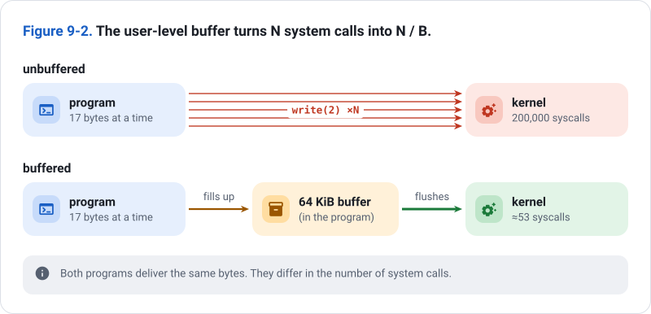

# 9. The Kernel Boundary and the Cost of System Calls

The system call represents the formal interface between user-mode application logic and the privileged operations of the operating system. It serves as the single, controlled gateway through which a process requests services, such as file I/O, process management, or network communication, that require hardware access or kernel-level authority.

## 9.1 The Mechanics of the System Call Interface

A system call is initiated via a specialized trap instruction executed by a user-mode C library wrapper (`syscall` on x86-64; `svc #0` on ARM64). Unlike an ordinary function call, which pushes a return address and jumps within the same privilege ring, a system call must cross the hardware isolation boundary separating Ring 3 (User Mode) from Ring 0 (Kernel Mode). The wrapper places a numeric system call identifier into a designated register (`rax` on x86-64 Linux; `x8` on ARM64 Linux; `x16` on Apple Silicon Darwin) and loads up to six arguments into fixed argument registers (`rdi`, `rsi`, `rdx`, `r10`, `r8`, `r9` on x86-64; `x0` through `x5` on ARM64) before executing the trap instruction.

Upon executing the trap, the processor saves the user program counter and processor flags, elevates the Current Privilege Level (CPL) to kernel mode, switches the stack pointer to the thread's private kernel stack (`TSS.rsp0` / per-CPU kernel stack), and jumps to the kernel's registered system call entry vector (`MSR_LSTAR` on x86-64; `VBAR_EL1` on ARM64). The kernel indexes into its system call dispatch table (`sys_call_table`) using the provided identifier, executes the handler, places the result into the return register, and restores user mode via `sysret` or `eret`.

Two architectural invariants govern every crossing of this boundary:
- **Untrusted User Pointers:** The kernel treats all incoming arguments, including system call numbers, user buffer pointers, and byte counts, as untrusted. Before reading or writing a user buffer, the kernel validates that the virtual address range lies strictly below the user/kernel address boundary and accesses it through fault-safe copy helpers (`copy_from_user` / `copy_to_user`) so a malformed pointer produces `EFAULT` rather than a kernel panic.
- **Error-Return Convention (`errno`):** At the raw hardware ABI level on Linux, a handler returning a value in `[-4095, -1]` signals failure, with the negated value encoding the POSIX error number. The C library wrapper intercepts negative kernel returns, stores the positive error code in the thread-local variable `errno`, and returns `-1` to application code. Checking the return value before inspecting `errno` is mandatory because successful system calls do not clear a stale `errno` from an earlier failure.

<figure>

</figure>

### 9.1.1 Why Benchmarking Uses `getppid()`, Not `getpid()`

Measuring the pure cost of a privilege transition requires invoking a minimal system call that performs almost no work inside the kernel. A natural candidate would appear to be `getpid()`, yet on several platforms (including macOS/Darwin and historical `glibc` releases) the C library caches the process identifier in user-space memory after the first invocation, invalidating the cache only across `fork()`. Calling `getpid()` in a tight loop would therefore measure a user-mode memory load rather than a kernel trap. Similarly, on Linux, high-frequency queries such as `clock_gettime()` and `gettimeofday()` are accelerated via the **vDSO** (virtual Dynamic Shared Object), a read-only kernel page mapped directly into user space so processes read calibrated clock counters without trapping into Ring 0. By contrast, `getppid()` cannot safely be cached in user space because the parent process may terminate asynchronously and cause the kernel to reparent the caller to PID 1; every call to `getppid()` must therefore execute a genuine user-to-kernel-to-user transition.

## 9.2 Performance Implications and Optimization via Buffering

Crossing the user/kernel privilege boundary incurs substantial hardware overhead. Saving and restoring architectural register state, applying security mitigations (such as Kernel Page Table Isolation, KPTI, which switches page tables on Meltdown-affected processors), and perturbing L1 instruction caches and branch predictors render a bare system call roughly two orders of magnitude slower than an ordinary user-mode function call.

To amortize this privilege-transition penalty across high-volume I/O workloads, runtime libraries employ **user-space buffering**. Rather than issuing a `write(2)` system call for every 17-byte log line, a buffered stream (C's `FILE*` with `fwrite`, C++'s `std::ostream`, or Rust's `BufWriter`) appends small writes into a contiguous user-space buffer (for example, 64 KiB). Only when the buffer fills, or when the caller explicitly invokes `fflush()` / `flush()`, does the library issue a single large `write(2)` system call to transfer all 64 KiB into the kernel at once.

Buffering trades immediate visibility for throughput. Bytes residing in a user-space buffer are invisible to the kernel and to other processes; if the process terminates abruptly via `SIGKILL`, `_exit()`, or a segmentation fault prior to flushing, buffered data is silently lost. Mixing raw file-descriptor writes (`write(fd, ...)`) with buffered library writes (`fwrite(..., f)`) on the same underlying descriptor also produces reordered output unless the user buffer is flushed before switching interfaces.

### 9.2.1 The POSIX Descriptor I/O Interface (`open`, `write`, `close`, `setvbuf`)

Listings 9-3 and 9-4 directly compare unbuffered kernel writes against 64 KiB user-space buffering using four standard interfaces:

```text
int     open(const char *pathname, int flags, ... /* mode_t mode */);
ssize_t write(int fd, const void *buf, size_t count);
int     close(int fd);
int     setvbuf(FILE *stream, char *buf, int mode, size_t size);
```

- **`open(pathname, flags, [mode])`:** Resolves `pathname` in the virtual filesystem, allocates an open file description in the kernel, and installs a reference to it in the lowest unused slot of the calling process's file descriptor table.
  - **`pathname`:** Null-terminated filesystem path. Listings 9-3 and 9-4 open `/dev/null`, a virtual character device whose kernel driver immediately discards every written byte and returns success, isolating pure system-call overhead from storage latency.
  - **`flags`:** Bitmask combining exactly one access mode (`O_RDONLY`, `O_WRONLY`, or `O_RDWR`) with optional creation or status flags (`O_CREAT`, `O_TRUNC`, `O_APPEND`, `O_CLOEXEC`). Passing `O_WRONLY` requests write-only access without creating a new file.
  - **`mode`:** Optional octal permission mask (such as `0644`) required only when `O_CREAT` is included in `flags`.
  - **Return value:** A non-negative integer file descriptor (`fd >= 0`) on success, or `-1` on failure with `errno` set (for example, `ENOENT` if the path does not exist, `EACCES` on permission denial, or `EMFILE` if the process descriptor table is full).
- **`write(fd, buf, count)`:** Requests that the kernel transfer up to `count` bytes starting at user address `buf` to the resource referenced by `fd`.
  - **Return value (`ssize_t`):** A signed byte count indicating how many bytes were actually accepted (`0 <= n <= count`), or `-1` on error (`EINTR` if interrupted by a signal before any byte transferred, `EAGAIN` on a full non-blocking descriptor, `EPIPE` if writing to a closed pipe or socket, or `ENOSPC` if storage is exhausted).
  - **Short-write invariant:** POSIX permits `write()` to transfer fewer than `count` bytes even without an error (commonly on pipes, sockets, or interrupted disk writes). Production code must therefore wrap raw `write()` calls in a loop that advances the slice offset until all bytes are written, as demonstrated in Listing 9-4.
- **`close(fd)`:** Releases the descriptor slot in the process's file descriptor table and decrements the kernel open file description's reference count, freeing kernel resources once the final reference closes. Returns `0` on success or `-1` on error (`EBADF` for an invalid descriptor, or `EIO` for delayed write errors).
- **`setvbuf(stream, buf, mode, size)`:** Configures the buffering policy of a C `FILE*` stream immediately after opening it and before any I/O occurs. Passing `buf = nullptr` directs the C library to allocate a buffer of `size` bytes (`64 * 1024`) internally, while `mode` selects full buffering (`_IOFBF`, flushing only when full or explicitly flushed), line buffering (`_IOLBF`, flushing on newline), or unbuffered mode (`_IONBF`). Returns `0` on success and non-zero on failure.

**Listing 9-1. A system call compared with a function call (C++20).**

```cpp
{{#include ../code/ch09/syscall_cost.cpp}}
```

**Output 9-1. One run on the verification machine.**

```text
{{#include ../code/out/ch09_syscall_cost.out}}
```

**Listing 9-2. The same comparison in Rust.**

```rust
{{#include ../code/ch09/syscall_cost.rs}}
```

**Output 9-2.**

```text
{{#include ../code/out/ch09_syscall_cost_rs.out}}
```

<figure>

</figure>

**Listing 9-3. 200,000 small writes, unbuffered and buffered (C++20).**

```cpp
{{#include ../code/ch09/write_buffered.cpp}}
```

**Output 9-3.**

```text
{{#include ../code/out/ch09_write_buffered.out}}
```

**Listing 9-4. The same comparison in Rust, with write(2) and BufWriter.**

```rust
{{#include ../code/ch09/write_buffered.rs}}
```

**Output 9-4.**

```text
{{#include ../code/out/ch09_write_buffered_rs.out}}
```
