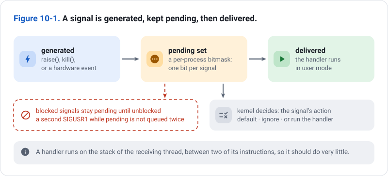

# 10. Asynchronous Notifications and Signal Semantics

A signal serves as the primary mechanism for asynchronous notification within a process, acting as the software analogue to a hardware interrupt. Generated by hardware exceptions (`SIGSEGV`, `SIGFPE`), terminal controls (`SIGINT`, `SIGTSTP`), child lifecycle events (`SIGCHLD`), or explicit inter-process signaling (`SIGUSR1`, `SIGTERM`), a signal compels the kernel to suspend the target thread's normal instruction stream and divert execution to a designated disposition.

## 10.1 The Signal Lifecycle: Generation, Pending, and Delivery

The lifecycle of every standard POSIX signal progresses through three strictly ordered phases:

1. **Generation:** An event occurs and the kernel sets the bit corresponding to that signal number inside the target process's (or thread's) **pending bitmask**. Because standard signals (`1` through `31`) are represented by a single bit per signal rather than a queue, pending signals **coalesce**: if five `SIGCHLD` or `SIGUSR1` signals arrive while the signal is blocked or before the process is scheduled, the pending bitmask records only a single `1` bit, and the handler runs once upon delivery.
2. **Masking (Blocking):** Each thread maintains its own **signal mask** (blocked set), a bitmask listing signals temporarily deferred. While a signal's bit is set in the mask, the signal remains recorded in the pending set without interrupting execution. Note that `SIGKILL` (9) and `SIGSTOP` (19) can never be caught, blocked, or ignored, guaranteeing that the kernel and system administrator always retain unconditional process control.
3. **Delivery:** Whenever the kernel prepares to transition a thread back from Ring 0 to Ring 3 (at the end of a system call or timer interrupt), it computes `deliverable = pending & ~blocked`. If any bit is set, the kernel clears that bit in `pending`, constructs a synthetic signal frame on the thread's user stack saving the interrupted register context, and redirects the user program counter to the registered **disposition** (either a default kernel action such as termination or core dump, ignore, or a user-supplied **signal handler**). When the handler returns, a trampoline invokes `sigreturn(2)` to restore the interrupted registers and resume normal execution.

<figure>

</figure>

## 10.2 Constraints on Asynchronous Execution and Async-Signal-Safety

Because a signal handler can preempt the main thread between any two machine instructions, it shares the exact same address space and stack as the interrupted execution context. If the interrupted thread was halfway through updating `malloc`'s internal free-list pointers or holding a `stdio` buffer lock inside `printf`, and the signal handler invokes `malloc` or `printf` on that same thread, the thread immediately self-deadlocks or corrupts heap metadata.

POSIX therefore defines a strict allowlist of **async-signal-safe** functions (listed in `signal-safety(7)`) that are guaranteed safe to call from a handler because they are re-entrant or invoke raw kernel traps directly without user-space locks. Allowed operations include `write(2)`, `waitpid(2)`, `_exit(2)`, and lock-free atomic stores; forbidden operations include `malloc`, `free`, `printf`, `std::mutex::lock`, and `pthread_mutex_lock`.

To eliminate re-entrancy hazards cleanly, production systems software restricts handlers to minimal state transitions:
- **In C and C++:** Store a flag into a global variable declared `volatile sig_atomic_t`. The `sig_atomic_t` type guarantees that loads and stores complete as a single indivisible instruction that cannot be torn by a signal, while `volatile` prevents the compiler from caching the variable in a register across loop iterations in `main()`.
- **In Rust:** Store into a `static AtomicBool` or `AtomicI32` using `Ordering::Relaxed` (or `Ordering::Release`/`Acquire` if publishing associated state), which guarantees hardware atomicity without undefined behavior.
- **Preserving `errno`:** If a handler calls any system call that may fail (such as `waitpid` in Section 10.3), a production handler saves `errno` on entry and restores it before returning so that the interrupted main-line code does not observe a clobbered error code.

### 10.2.1 The Signal Configuration Interface (`struct sigaction`, `sigaction`, `sigprocmask`, `sigset_t`, `raise`)

Older Unix code used the `signal(2)` function, whose semantics varied dangerously across operating systems (resetting handlers to `SIG_DFL` after one delivery on System V while keeping them installed on BSD). Modern systems programming exclusively uses **`sigaction(2)`**, which exposes every delivery property explicitly through `struct sigaction`:

```text
struct sigaction {
    void     (*sa_handler)(int);                        // Simple handler, SIG_DFL, or SIG_IGN
    void     (*sa_sigaction)(int, siginfo_t *, void *); // Extended handler when SA_SIGINFO is set
    sigset_t   sa_mask;                                 // Extra signals blocked while handler runs
    int        sa_flags;                                // Bitmask of delivery behavior flags
};

int sigaction(int signum, const struct sigaction *act, struct sigaction *oldact);
int sigemptyset(sigset_t *set);
int sigaddset(sigset_t *set, int signum);
int sigprocmask(int how, const sigset_t *set, sigset_t *oldset);
int raise(int sig);
```

Each structure field and function parameter carries a precise kernel contract:
- **`struct sigaction` fields:**
  - **`sa_handler`:** Function pointer `void handler(int sig)` invoked upon delivery, or one of the sentinel constants `SIG_DFL` (restore default kernel action) or `SIG_IGN` (ignore the signal).
  - **`sa_sigaction`:** Alternate three-argument handler activated when `SA_SIGINFO` is set in `sa_flags`. On most architectures `sa_handler` and `sa_sigaction` occupy a C `union`, so callers must populate only one of the two.
  - **`sa_mask`:** A `sigset_t` bitmask specifying *additional* signals the kernel automatically blocks while the handler executes, restoring the previous mask when the handler returns. By default, the kernel also blocks the delivered signal itself during handler execution (preventing recursive re-entry) unless `SA_NODEFER` is specified. Callers must always initialize `sa_mask` with `sigemptyset(&sa.sa_mask)` because uninitialized stack bytes would block arbitrary signals without warning.
  - **`sa_flags`:** Bitmask controlling delivery mechanics: `0` selects standard behavior; **`SA_RESTART`** instructs the kernel to transparently restart slow blocking system calls (such as `read`, `write`, or `waitpid`) interrupted by this signal rather than failing them with `EINTR`; **`SA_NOCLDSTOP`** suppresses `SIGCHLD` when children stop or resume via job control, delivering it only when children terminate; **`SA_SIGINFO`** enables `sa_sigaction` with rich `siginfo_t` metadata.
- **`sigaction(signum, act, oldact)`:** Atomically installs the disposition described by `act` for signal number `signum` (any signal except `SIGKILL` and `SIGSTOP`). If `oldact` is non-null, the kernel copies the prior `struct sigaction` into `*oldact` before replacing it; passing `nullptr` discards the prior disposition. Returns `0` on success, or `-1` with `errno` set (`EINVAL` for invalid signal numbers, `EFAULT` for invalid pointers).
- **Signal set helpers (`sigemptyset`, `sigaddset`, `sigdelset`, `sigfillset`):** Because the underlying representation of `sigset_t` differs across kernels (64 bits on Linux, 32 bits on Darwin/BSD), applications never manipulate its bits directly. `sigemptyset(&set)` clears every bit to `0`; `sigaddset(&set, signum)` sets the bit for `signum`. Both return `0` on success or `-1` on invalid arguments.
- **`sigprocmask(how, set, oldset)`:** Atomically inspects or updates the calling thread's blocked signal mask (in multi-threaded programs, POSIX specifies `pthread_sigmask` with identical arguments and return values):
  - **`how`:** `SIG_BLOCK` adds every signal in `*set` to the current mask (`mask |= *set`); `SIG_UNBLOCK` removes every signal in `*set` (`mask &= ~(*set)`); `SIG_SETMASK` replaces the entire mask with `*set`.
  - **`oldset`:** When non-null, stores the thread's previous signal mask before the update, enabling clean restoration once a critical section finishes (as shown at the end of Listings 10-1 and 10-2).
  - **Return value:** `0` on success, or `-1` with `errno = EINVAL` if `how` is unrecognized. If unblocking a signal via `SIG_UNBLOCK` exposes a signal that was waiting in the pending bitmask, the kernel delivers at least one pending unblocked signal **before `sigprocmask()` returns to user space**.
- **`raise(sig)`:** Sends signal `sig` to the calling thread itself (equivalent to `kill(getpid(), sig)` in a single-threaded process). Returns `0` on success and non-zero on failure.

**Listing 10-1. Blocking, sending, and unblocking a signal (C++20).**

```cpp
{{#include ../code/ch10/signals.cpp}}
```

**Output 10-1. The handler runs only after the signal is unblocked.**

```text
{{#include ../code/out/ch10_signals.out}}
```

**Listing 10-2. The same steps in Rust, using the libc crate.**

```rust
{{#include ../code/ch10/signals.rs}}
```

**Output 10-2.**

```text
{{#include ../code/out/ch10_signals_rs.out}}
```

## 10.3 Process Lifecycle Synchronization: `SIGCHLD` and Reaping

Whenever a child process terminates, the kernel retains its zombie PCB (Chapter 3) and generates `SIGCHLD` for the parent process. By default, `SIGCHLD` is ignored, meaning the parent must call `waitpid()` synchronously. Installing a `SIGCHLD` handler allows an event-driven server or supervisor to reap terminated children asynchronously without blocking its main loop.

Two signal properties dictate the exact shape of every correct `SIGCHLD` handler:
1. **Non-blocking reaping loop (`while (waitpid(-1, &status, WNOHANG) > 0)`):** Because standard pending signals coalesce into a single bit, if three worker children exit while the parent is inside the handler or briefly unscheduled, the kernel delivers only one `SIGCHLD`. Calling `waitpid()` only once per handler invocation would permanently leak two zombies. Looping with `pid = -1` (any child) and `options = WNOHANG` drains every currently terminated child without ever blocking: `waitpid()` returns each reaped child's positive PID until no zombies remain, at which point it returns `0` (if live children still exist) or `-1` with `errno = ECHILD` (if no children exist at all).
2. **`SA_RESTART` for interrupted system calls:** When `SIGCHLD` arrives while the parent is blocked inside a slow system call such as `accept()`, `read()`, or `sleep()`, the kernel interrupts the call. Setting `sa.sa_flags = SA_RESTART` instructs the kernel to automatically resume eligible system calls once `on_sigchld` returns, preventing spurious `EINTR` failures across unrelated application code.

In Listings 10-3 and 10-4, the parent first spawns child `c1` without a handler and reaps it explicitly via blocking `waitpid(c1, &status, 0)`. After flushing `stdout` so `c2` does not inherit buffered output across `fork()`, the parent installs `on_sigchld` with `SA_RESTART` and spawns `c2`. When `c2` exits, `on_sigchld` reaps it immediately; the subsequent `waitpid(c2, &status, WNOHANG)` in `main()` therefore returns `-1` (`ECHILD`), confirming that no zombie remains.

**Listing 10-3. Reaping one child directly and one child in a handler (C++20).**

```cpp
{{#include ../code/ch10/sigchld.cpp}}
```

**Output 10-3. The second child has already been reaped when the main program calls waitpid.**

```text
{{#include ../code/out/ch10_sigchld.out}}
```

**Listing 10-4. The same SIGCHLD reaping sequence in Rust.**

```rust
{{#include ../code/ch10/sigchld.rs}}
```

**Output 10-4.**

```text
{{#include ../code/out/ch10_sigchld_rs.out}}
```
