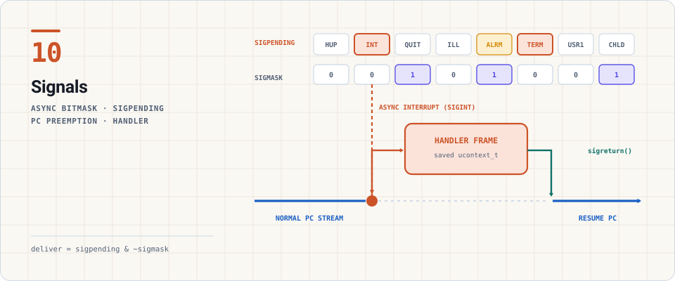
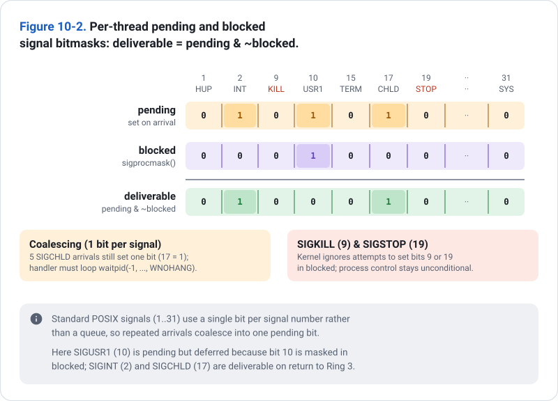

# 10. Asynchronous Notifications and Signal Semantics



A signal serves as the primary mechanism for asynchronous notification within a process, acting as the software analogue to a hardware interrupt. Generated by hardware exceptions (**Segmentation Violation (`SIGSEGV`)**, **Floating-Point Exception (`SIGFPE`)**), terminal controls (**Interrupt (`SIGINT`)**, **Terminal Stop (`SIGTSTP`)**), child lifecycle events (**Child Status Changed (`SIGCHLD`)**), or explicit inter-process signaling (**User-Defined Signal 1 (`SIGUSR1`)**, **Terminate (`SIGTERM`)**), a signal compels the kernel to suspend the target thread's normal instruction stream and divert execution to a designated disposition.

## 10.1 The Signal Lifecycle: Generation, Pending, and Delivery

The lifecycle of every standard **Portable Operating System Interface (`POSIX`)** signal progresses through three ordered phases (Figure 10-1):

1. **Generation:** An event occurs and the kernel sets the bit corresponding to that signal number inside the target process's (or thread's) **pending bitmask**. Because standard signals (`1` through `31`) are represented by a single bit per signal rather than a queue (Figure 10-2), pending signals **coalesce**: if five `SIGCHLD` or `SIGUSR1` signals arrive while the signal is blocked or before the process is scheduled, the pending bitmask records only a single `1` bit, and the handler runs once upon delivery.
2. **Masking (Blocking):** Each thread maintains its own **signal mask** (blocked set), a bitmask listing signals temporarily deferred. While a signal's bit is set in the mask, the signal remains recorded in the pending set without interrupting execution. **Kill (`SIGKILL`, 9)** and **Stop (`SIGSTOP`, 19)** can never be caught, blocked, or ignored, guaranteeing that the kernel and system administrator retain unconditional process control.
3. **Delivery:** Whenever the kernel prepares to transition a thread back from Ring 0 to Ring 3 (at the end of a system call or timer interrupt), it computes `deliverable = pending & ~blocked` (Figure 10-2). If any bit is set, the kernel clears that bit in `pending`, constructs a synthetic signal frame on the thread's user stack saving the interrupted register context, and redirects the user program counter to the registered **disposition** (either a default kernel action such as termination or core dump, ignore, or a user-supplied **signal handler**). When the handler returns, a trampoline invokes `sigreturn(2)` to restore the interrupted registers and resume normal execution.

<figure>

</figure>

<figure>

</figure>

## 10.2 Constraints on Asynchronous Execution and Async-Signal-Safety

Signals introduce a subtle and often underestimated concurrency hazard: *asynchronous re-entrancy on a single thread*. Even in a strictly single-threaded program with zero mutexes, a signal handler can preempt main-line code between any two machine instructions while sharing the exact same address space and call stack. If the interrupted thread was halfway through updating `malloc`'s internal free-list pointers or holding a `stdio` buffer lock inside `printf`, and the signal handler invokes `malloc` or `printf` on that same thread, the thread immediately self-deadlocks or corrupts heap metadata.

`POSIX` therefore defines a strict allowlist of **async-signal-safe** functions (documented in `signal-safety(7)`) that are guaranteed safe to invoke from a handler because they are re-entrant or issue raw kernel traps directly without acquiring user-space locks. Allowed operations include `write(2)`, `waitpid(2)`, `_exit(2)`, and lock-free atomic stores; forbidden operations include `malloc`, `free`, `printf`, `std::mutex::lock`, and `pthread_mutex_lock`.

Production systems software eliminates re-entrancy hazards by keeping signal handlers minimal. In C and C++, a handler stores a flag into a global variable declared `volatile sig_atomic_t`, where `sig_atomic_t` guarantees indivisible single-instruction loads and stores and `volatile` prevents the compiler from caching the variable in a register across loop iterations. In Rust, a handler stores into a `static AtomicBool` or `AtomicI32` with `Ordering::Relaxed` (or `Release`/`Acquire` when publishing state). Any handler that invokes a fallible system call such as `waitpid()` must also save `errno` on entry and restore it before returning so interrupted main-line code never observes a clobbered error code. High-concurrency daemons often go one step further, blocking signals in all threads and converting them into synchronous event-loop notifications via `signalfd` on Linux, `EVFILT_SIGNAL` in `kqueue`, or a self-pipe `write(2)`.

### 10.2.1 The Signal Configuration Interface (`sigaction`, `sigprocmask`, `raise`)

Older Unix code used `signal(2)`, whose semantics diverged dangerously across operating systems (resetting handlers to `SIG_DFL` after a single delivery on System V while keeping them installed on **Berkeley Software Distribution (`BSD`)** kernels). Modern systems programming exclusively uses **`sigaction(2)`**, which exposes every delivery property explicitly through `struct sigaction`:

```c
struct sigaction {
    void     (*sa_handler)(int);                        // Simple handler, SIG_DFL, or SIG_IGN
    void     (*sa_sigaction)(int, siginfo_t *, void *); // Extended handler when SA_SIGINFO is set
    sigset_t   sa_mask;                                 // Extra signals blocked while handler runs
    int        sa_flags;                                // Bitmask of delivery behavior flags
};

int sigaction(int signum, const struct sigaction *act, struct sigaction *oldact);
int sigemptyset(sigset_t *set);
int sigaddset(sigset_t *set, int signum);
int sigprocmask(int how, const sigset_t *set, sigset_t *oldset);
int raise(int sig);
```

Inside `struct sigaction`, `sa_handler` registers either a user callback `void handler(int sig)` or the sentinels `SIG_DFL` (default kernel action) and `SIG_IGN` (ignore); setting `SA_SIGINFO` in `sa_flags` selects the three-argument `sa_sigaction` callback instead (both fields typically share a C `union`, so callers populate only one). The `sa_mask` field specifies *additional* signals blocked while the handler runs (by default, the kernel also blocks the delivered signal itself unless `SA_NODEFER` is set); callers must always initialize `sa_mask` with `sigemptyset(&sa.sa_mask)` so uninitialized stack bytes do not block arbitrary signals. Useful `sa_flags` include **`SA_RESTART`** (automatically restarting slow blocking calls such as `read`, `write`, or `waitpid` instead of failing with `EINTR`) and **`SA_NOCLDSTOP`** (suppressing `SIGCHLD` on job-control stops and resumes).

Calling `sigaction(signum, act, oldact)` atomically installs `act` for `signum` (any signal except `SIGKILL` and `SIGSTOP`) and optionally saves the prior disposition into `*oldact`, returning `0` on success or `-1` on error (`EINVAL`, `EFAULT`). Because the bit layout of `sigset_t` varies across kernels (64 bits on Linux; 32 bits on Darwin/`BSD`), callers construct masks exclusively with `sigemptyset(&set)` and `sigaddset(&set, signum)`. Updating the calling thread's blocked mask is performed atomically via `sigprocmask(how, set, oldset)` (or `pthread_sigmask` in multi-threaded programs), where `how` is `SIG_BLOCK` (`mask |= *set`), `SIG_UNBLOCK` (`mask &= ~(*set)`), or `SIG_SETMASK` (`mask = *set`), and `oldset` captures the prior mask for later restoration. If `SIG_UNBLOCK` exposes a signal waiting in the pending bitmask, the kernel delivers at least one pending unblocked signal **before `sigprocmask()` returns to user space**. Finally, `raise(sig)` delivers `sig` to the calling thread itself (equivalent to `kill(getpid(), sig)` in a single-threaded process).

**Listing 10-1. Blocking, sending, and unblocking a signal (C++20).** ([`code/ch10/signals.cpp`](https://github.com/arpanpathak/cracking-the-systems-programming-interview/blob/prep-v2/operating-systems/code/ch10/signals.cpp))

```cpp
{{#include ../code/ch10/signals.cpp}}
```

**Output 10-1. The handler runs only after the signal is unblocked.**

```text
{{#include ../code/out/ch10_signals.out}}
```

**Listing 10-2. The same steps in Rust, using the libc crate.** ([`code/ch10/signals.rs`](https://github.com/arpanpathak/cracking-the-systems-programming-interview/blob/prep-v2/operating-systems/code/ch10/signals.rs))

```rust
{{#include ../code/ch10/signals.rs}}
```

**Output 10-2.**

```text
{{#include ../code/out/ch10_signals_rs.out}}
```

## 10.3 Process Lifecycle Synchronization: `SIGCHLD` and Reaping

Whenever a child process terminates, the kernel retains its zombie **Process Control Block (`PCB`)** (Chapter 3) and generates `SIGCHLD` for the parent process. By default, `SIGCHLD` is ignored, requiring the parent to call `waitpid()` synchronously. Installing a `SIGCHLD` handler allows an event-driven server or supervisor to reap terminated children asynchronously without blocking its main loop.

Two signal properties dictate the exact shape of every correct `SIGCHLD` handler. First, because standard pending signals coalesce into a single bit, if three worker children exit while the parent is inside the handler or briefly unscheduled, the kernel delivers only one `SIGCHLD`. Calling `waitpid()` once per handler invocation would permanently leak two zombies. The handler must therefore drain all terminated children in a non-blocking loop (`while (waitpid(-1, &status, WNOHANG) > 0)`), reaping every zombie's **Process Identifier (`PID`)** until `waitpid()` returns `0` (live children remain) or `-1` with `errno = ECHILD` (no children remain). Second, setting `sa.sa_flags = SA_RESTART` ensures that an asynchronous `SIGCHLD` arriving while the parent is blocked inside `accept()`, `read()`, or `sleep()` resumes the interrupted call transparently rather than surfacing spurious `EINTR` errors.

In Listings 10-3 and 10-4, the parent first spawns child `c1` without a handler and reaps it explicitly via blocking `waitpid(c1, &status, 0)`. After flushing `stdout` so `c2` does not inherit buffered output across `fork()`, the parent installs `on_sigchld` with `SA_RESTART` and spawns `c2`. When `c2` exits, `on_sigchld` reaps it immediately; the subsequent `waitpid(c2, &status, WNOHANG)` in `main()` therefore returns `-1` (`ECHILD`), confirming that no zombie remains.

**Listing 10-3. Reaping one child directly and one child in a handler (C++20).** ([`code/ch10/sigchld.cpp`](https://github.com/arpanpathak/cracking-the-systems-programming-interview/blob/prep-v2/operating-systems/code/ch10/sigchld.cpp))

```cpp
{{#include ../code/ch10/sigchld.cpp}}
```

**Output 10-3. The second child has already been reaped when the main program calls waitpid.**

```text
{{#include ../code/out/ch10_sigchld.out}}
```

**Listing 10-4. The same SIGCHLD reaping sequence in Rust.** ([`code/ch10/sigchld.rs`](https://github.com/arpanpathak/cracking-the-systems-programming-interview/blob/prep-v2/operating-systems/code/ch10/sigchld.rs))

```rust
{{#include ../code/ch10/sigchld.rs}}
```

**Output 10-4.**

```text
{{#include ../code/out/ch10_sigchld_rs.out}}
```

<div class="callout keyidea">
<span class="label">Key idea</span>

Standard `POSIX` signals (`1..31`) are single-bit flags (`deliverable = pending & ~blocked`), not queues. Repeated arrivals coalesce into one delivery, and handlers preempt main-line execution mid-instruction on the same stack, limiting handlers to async-signal-safe primitives.

</div>

<div class="callout experiment">
<span class="label">Experiment</span>

In Listing 10-3 ([`code/ch10/sigchld.cpp`](https://github.com/arpanpathak/cracking-the-systems-programming-interview/blob/prep-v2/operating-systems/code/ch10/sigchld.cpp)), spawn five children simultaneously after installing `on_sigchld` and replace the `while (waitpid(-1, &status, WNOHANG) > 0)` loop with a single `waitpid()` call. Inspect `ps` while the parent sleeps to observe leaked zombie processes caused by `SIGCHLD` coalescing.

</div>

<div class="callout caution">
<span class="label">Common Pitfall</span>

Calling `printf()`, `malloc()`, `free()`, or `std::mutex::lock()` inside a signal handler. If the signal interrupts the thread while it already holds the allocator or `stdio` lock, the handler immediately self-deadlocks the entire process.

</div>
