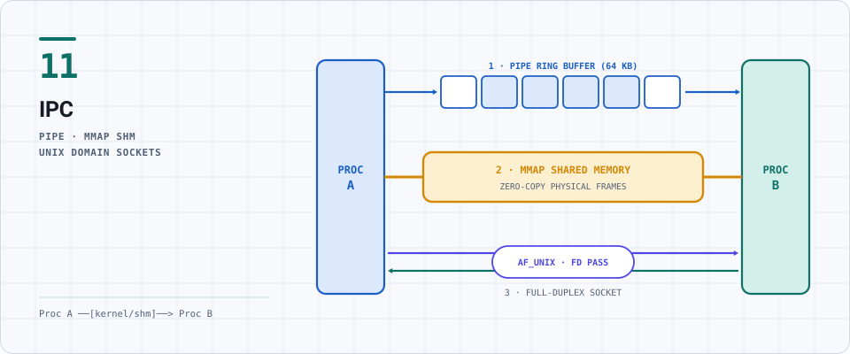

# 11. Inter-Process Communication (IPC)



While threads within a single process share an address space and coordinate directly through memory and synchronization primitives, processes are isolated by hardware page tables. **Inter-Process Communication (`IPC`)** provides controlled kernel-mediated channels through which isolated processes exchange data and synchronize execution without sacrificing memory protection.

## 11.1 Unidirectional Byte Streams: Pipes

A **pipe** is a unidirectional, kernel-resident ring buffer (typically 64 KiB on Linux and 16 to 64 KiB on macOS) exposed to user space as a pair of ordinary file descriptors. Because file descriptors are inherited across `fork()`, a parent process can create a pipe before forking and establish an immediate communication channel with its child (Figure 11-1).

### 11.1.1 The `pipe` System Call Interface and Stream Semantics

```c
int     pipe(int pipefd[2]);
ssize_t read(int fd, void *buf, size_t count);
ssize_t write(int fd, const void *buf, size_t count);
int     close(int fd);
```

Calling `pipe(pipefd)` allocates a single kernel pipe buffer and populates `pipefd` with two newly opened file descriptors: `pipefd[0]` is the **read end** (writing to it fails with `EBADF`), and `pipefd[1]` is the **write end** (reading from it fails with `EBADF`). It returns `0` on success or `-1` on failure (`EMFILE`, `ENFILE`, or `EFAULT`).

On the read end, `read(fd, buf, count)` copies up to `count` available bytes from the kernel ring buffer into `buf`, returning immediately with `1 <= n <= count` whenever data is present. If the buffer is empty and at least one open write descriptor still exists, `read()` blocks until data arrives or all writers close; once zero open write descriptors remain system-wide, `read()` returns `0`, signaling **End-of-File (`EOF`)**. On the write end, `write(fd, buf, count)` copies bytes into the ring buffer, blocking when the buffer is full. The **Portable Operating System Interface (`POSIX`)** standard guarantees that writes of at most `PIPE_BUF` bytes (minimum 512 bytes; 4,096 bytes on Linux and macOS) are **atomic**, preventing concurrent writers from interleaving bytes mid-write. If zero open read descriptors remain, the kernel refuses the write, delivers **Broken Pipe (`SIGPIPE`)** (whose default action terminates the process), and returns `-1` with `errno = EPIPE` if `SIGPIPE` is caught or ignored.

Three operational invariants prevent classic pipe bugs. First, both parent and child must **close their unused ends immediately after `fork()`**: because `fork()` duplicates both descriptors, the reference count on each end becomes `2`; if the parent forgets to close `pipefd[1]`, the writer reference count never drops to zero even after the child exits, causing the parent's `read()` to block forever instead of observing `EOF`. Second, multi-kilobyte workloads must loop over partial `read()` and `write()` transfers. Third, because pipes are **First-In, First-Out (`FIFO`)** raw byte streams that do not preserve write boundaries (two consecutive 10-byte writes may be returned by one 20-byte `read()`), structured protocols must layer explicit message framing such as a length prefix or newline delimiter.

<figure>

</figure>

**Listing 11-1. One pipe, one fork, and one message (C++20).** ([`code/ch11/pipe.cpp`](https://github.com/arpanpathak/cracking-the-systems-programming-interview/blob/prep-v2/operating-systems/code/ch11/pipe.cpp))

```cpp
{{#include ../code/ch11/pipe.cpp}}
```

**Output 11-1.**

```text
{{#include ../code/out/ch11_pipe.out}}
```

**Listing 11-2. The same program in Rust.** ([`code/ch11/pipe.rs`](https://github.com/arpanpathak/cracking-the-systems-programming-interview/blob/prep-v2/operating-systems/code/ch11/pipe.rs))

```rust
{{#include ../code/ch11/pipe.rs}}
```

**Output 11-2.**

```text
{{#include ../code/out/ch11_pipe_rs.out}}
```

## 11.2 Zero-Copy Communication: Shared Memory

Every byte transmitted through a pipe or socket traverses the kernel twice: once via `copy_from_user` into the kernel ring buffer during `write()`, and a second time via `copy_to_user` into the receiver's buffer during `read()`. For high-throughput workloads such as database buffer pools, video pipelines, and telemetry rings, **shared memory** eliminates both copies by mapping the exact same physical **Random-Access Memory (`RAM`)** frames into the page tables of multiple processes simultaneously (Figure 11-2). Once mapped, stores executed by one process become visible to peer processes at hardware cache-coherency speeds with zero system calls.

### 11.2.1 `MAP_SHARED` Mappings and Process-Shared Mutex Attributes

Removing kernel buffering shifts synchronization and failure-recovery responsibility entirely onto the application: concurrent processes mutating a shared region face the exact same read-modify-write atomicity gap as threads (Chapter 4), and if a peer crashes while holding a shared lock without `PTHREAD_MUTEX_ROBUST` recovery, sibling processes can hang indefinitely. Listings 11-3 and 11-4 place both a `pthread_mutex_t` and a 64-bit counter inside one shared virtual page:

```c
void *mmap(void *addr, size_t length, int prot, int flags, int fd, off_t offset);
int   pthread_mutexattr_init(pthread_mutexattr_t *attr);
int   pthread_mutexattr_setpshared(pthread_mutexattr_t *attr, int pshared);
int   pthread_mutex_init(pthread_mutex_t *mutex, const pthread_mutexattr_t *attr);
int   pthread_mutex_destroy(pthread_mutex_t *mutex);
```

Both `MAP_SHARED | MAP_ANON` and `MAP_PRIVATE | MAP_ANON` allocate zero-initialized anonymous memory (`fd = -1`, `offset = 0`, `prot = PROT_READ | PROT_WRITE`), but they diverge across `fork()`. Under `MAP_PRIVATE`, the kernel marks both parent and child **Page Table Entries (`PTE`s)** read-only and performs **Copy-on-Write (`COW`)** on the first store, splitting them onto isolated frames. Under `MAP_SHARED`, both processes' `PTE`s continue pointing to the identical writable physical frame, establishing true zero-copy shared memory. (For unrelated processes lacking a `fork()` ancestor, `POSIX` provides `shm_open()` plus `ftruncate()` to obtain a shared descriptor passed as `fd` to `mmap()`.)

By default, a `pthread_mutex_t` initialized with `nullptr` attributes uses `PTHREAD_PROCESS_PRIVATE`, allowing the runtime to key its futex wait queue strictly on the calling process's virtual address (`FUTEX_PRIVATE_FLAG` on Linux). Locking a private mutex across distinct processes produces undefined behavior because their wait queues do not match. Calling `pthread_mutexattr_init(&attr)` followed by `pthread_mutexattr_setpshared(&attr, PTHREAD_PROCESS_SHARED)` configures `pthread_mutex_init(&s->mu, &attr)` to hash futex wait queues on the underlying physical memory object. Each `pthread_*` function returns `0` on success or a positive `POSIX` error code directly (without setting `errno`). Once `waitpid()` confirms the child has exited, the parent invokes `pthread_mutex_destroy(&s->mu)` and `munmap(s, sizeof(Shared))`.

<figure>

</figure>

**Listing 11-3. A counter in shared memory, protected by a process-shared mutex (C++20).** ([`code/ch11/shm_counter.cpp`](https://github.com/arpanpathak/cracking-the-systems-programming-interview/blob/prep-v2/operating-systems/code/ch11/shm_counter.cpp))

```cpp
{{#include ../code/ch11/shm_counter.cpp}}
```

**Output 11-3. The counter reaches exactly 1,000,000.**

```text
{{#include ../code/out/ch11_shm_counter.out}}
```

**Listing 11-4. The same process-shared mutex counter in Rust.** ([`code/ch11/shm_counter.rs`](https://github.com/arpanpathak/cracking-the-systems-programming-interview/blob/prep-v2/operating-systems/code/ch11/shm_counter.rs))

```rust
{{#include ../code/ch11/shm_counter.rs}}
```

**Output 11-4.**

```text
{{#include ../code/out/ch11_shm_counter_rs.out}}
```

## 11.3 Bidirectional Channels: Socket Pairs

A pipe supports data flow in only one direction; implementing request-response communication with pipes requires two separate pipes and careful descriptor management to avoid deadlock. A **socket pair** provides a single **full-duplex** (bidirectional) local channel between related processes, backed by two independent kernel send/receive buffers so both peers can transmit and receive simultaneously.

### 11.3.1 The `socketpair` System Call Interface

```c
int socketpair(int domain, int type, int protocol, int sv[2]);
```

Calling `socketpair(AF_UNIX, SOCK_STREAM, 0, sv)` creates a pre-connected pair of symmetric local descriptors in `sv[0]` and `sv[1]`, returning `0` on success or `-1` on error (`EAFNOSUPPORT`, `EOPNOTSUPP`, `EMFILE`, `EFAULT`). The `AF_UNIX` (`AF_LOCAL`) domain routes traffic strictly through local kernel memory without **Internet Protocol (`IP`)** headers, checksums, or network interfaces, while `SOCK_STREAM` delivers a reliable, ordered byte stream analogous to a **Transmission Control Protocol (`TCP`)** connection (passing `SOCK_DGRAM` or `SOCK_SEQPACKET` preserves explicit message boundaries; `protocol = 0` selects the domain default). Unlike `pipe()`, either endpoint can both read and write: after `fork()`, the child closes `sv[0]` and keeps `sv[1]`, while the parent closes `sv[1]` and keeps `sv[0]`. Beyond byte streams, `AF_UNIX` socket pairs can transfer live open file descriptors across process boundaries via `sendmsg()` and `recvmsg()` with `SCM_RIGHTS` ancillary control messages, enabling privilege-separated browser and sandbox architectures where a broker process opens files on behalf of an untrusted worker.

**Listing 11-5. A two-way channel between parent and child (C++20).** ([`code/ch11/socketpair.cpp`](https://github.com/arpanpathak/cracking-the-systems-programming-interview/blob/prep-v2/operating-systems/code/ch11/socketpair.cpp))

```cpp
{{#include ../code/ch11/socketpair.cpp}}
```

**Output 11-5. Each process sends one message and receives the other.**

```text
{{#include ../code/out/ch11_socketpair.out}}
```

**Listing 11-6. The same bidirectional socketpair in Rust.** ([`code/ch11/socketpair.rs`](https://github.com/arpanpathak/cracking-the-systems-programming-interview/blob/prep-v2/operating-systems/code/ch11/socketpair.rs))

```rust
{{#include ../code/ch11/socketpair.rs}}
```

**Output 11-6.**

```text
{{#include ../code/out/ch11_socketpair_rs.out}}
```

## 11.4 Comparative Analysis of `IPC` Mechanisms

Selecting an `IPC` mechanism balances kernel-managed synchronization and backpressure against zero-copy throughput:

| Mechanism | Directionality | Data Copying | Synchronization | Typical Use Case |
| :--- | :--- | :--- | :--- | :--- |
| **Pipe (`pipe`)** | Unidirectional | Two copies per transfer | Kernel-managed (blocking and `FIFO` ordering) | Shell pipelines, streaming parent/child `stdout` redirection |
| **Shared Memory (`mmap(MAP_SHARED)`)** | Bidirectional | Zero copies (shared physical frames) | Application-managed (`PTHREAD_PROCESS_SHARED` mutexes or atomics) | High-throughput ring buffers, database buffer pools, telemetry |
| **Socket Pair (`socketpair(AF_UNIX)`)** | Full-duplex bidirectional | Two copies per transfer | Kernel-managed (blocking, ordering, `SCM_RIGHTS` fd passing) | Worker **Remote Procedure Call (`RPC`)** channels, privilege-separated sandboxes |

Pipes and socket pairs are preferred whenever kernel-managed blocking, `EOF` detection, and `poll`/`kqueue` readiness integration simplify system architecture. Shared memory is reserved for latency-critical or bandwidth-bound data planes where eliminating kernel copies justifies explicit cross-process locking and memory-ordering discipline.

<div class="callout keyidea">
<span class="label">Key idea</span>

Pipes and Unix domain sockets trade two kernel buffer copies per transfer for built-in backpressure, `EOF` lifecycle signaling, and `poll`/`kqueue` integration. `MAP_SHARED` shared memory eliminates every kernel copy by aliasing physical frames across page tables, shifting synchronization and crash recovery onto user space.

</div>

<div class="callout experiment">
<span class="label">Experiment</span>

In Listing 11-1 ([`code/ch11/pipe.cpp`](https://github.com/arpanpathak/cracking-the-systems-programming-interview/blob/prep-v2/operating-systems/code/ch11/pipe.cpp)), comment out `close(fds[1])` in the parent process and run the binary. Observe that the parent's `read()` blocks indefinitely even after the child exits because the parent itself still holds an open write reference, preventing `EOF`.

</div>

<div class="callout caution">
<span class="label">Common Pitfall</span>

Placing a default-initialized `pthread_mutex_t` (without `PTHREAD_PROCESS_SHARED`) inside `MAP_SHARED` memory. Default mutexes use process-private futex keys (`FUTEX_PRIVATE_FLAG`), causing cross-process lock acquisitions to hash into separate wait queues and produce undefined behavior.

</div>
