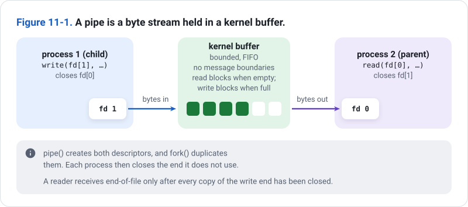
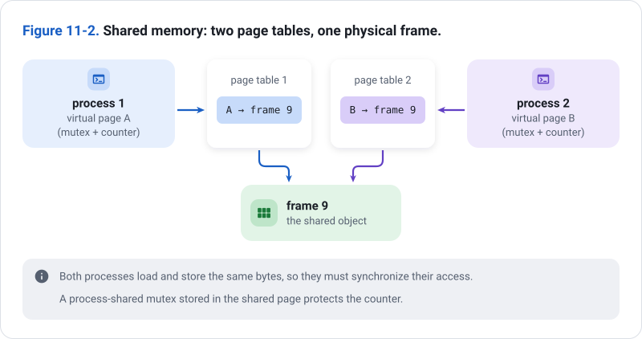

# 11. Inter-Process Communication (IPC)

While threads within a single process communicate through shared memory and standard synchronization primitives, processes are isolated by design. Inter-process communication (IPC) provides the necessary channels for cooperation between distinct execution environments, allowing them to exchange data and synchronize their actions through kernel-mediated interfaces.

## 11.1 Unidirectional Byte Streams: Pipes

A pipe is a kernel-managed buffer that facilitates unidirectional byte-stream communication between processes. Created via the `pipe` system call, it provides two file descriptors: one for reading and one for writing. Because pipe descriptors are standard file descriptors, they are inherited by child processes during a `fork` operation, making them an ideal mechanism for establishing communication between parent and child.

Effective use of pipes requires adherence to several operational protocols:
- **Descriptor Management:** Each process must close the end of the pipe it does not intend to use. A reader will only receive an end-of-file (EOF) signal once all write descriptors for that pipe have been closed across all processes.
- **Robust I/O:** Due to the nature of stream-oriented communication, both `read` and `write` operations must be executed within loops to account for partial transfers.
- **Message Framing:** Because pipes provide a continuous stream of bytes without inherent boundaries, applications requiring structured data must implement a framing protocol, such as length-prefixed messages or delimiter-based signaling.

<figure>

</figure>

**Listing 11-1. One pipe, one fork, and one message (C++20).**

```cpp
{{#include ../code/ch11/pipe.cpp}}
```

**Output 11-1.**

```text
{{#include ../code/out/ch11_pipe.out}}
```

**Listing 11-2. The same program in Rust.**

```rust
{{#include ../code/ch11/pipe.rs}}
```

**Output 11-2.**

```text
{{#include ../code/out/ch11_pipe_rs.out}}
```

## 11.2 Zero-Copy Communication: Shared Memory

For high-bandwidth data exchange, shared memory offers a significant performance advantage by bypassing the kernel-to-user space copying overhead associated with pipes and sockets. The kernel achieves this by mapping the same physical memory frame into the virtual address spaces of multiple processes.

However, the removal of kernel-mediated buffering places the burden of synchronization entirely on the application. Processes accessing shared memory are subject to the same data race hazards as threads, necessitating the use of synchronization primitives. To facilitate this, POSIX mutexes can be configured with the `PTHREAD_PROCESS_SHARED` attribute and stored directly within the shared memory region, allowing them to coordinate access across process boundaries. It is imperative to use the `MAP_SHARED` flag during the `mmap` call; otherwise, the kernel will implement copy-on-write (COW) semantics, resulting in private, isolated copies of the memory rather than a truly shared region.

<figure>

</figure>

**Listing 11-3. A counter in shared memory, protected by a process-shared mutex (C++20).**

```cpp
{{#include ../code/ch11/shm_counter.cpp}}
```

**Output 11-3. The counter reaches exactly 1,000,000.**

```text
{{#include ../code/out/ch11_shm_counter.out}}
```

**Listing 11-4. The same process-shared mutex counter in Rust.**

```rust
{{#include ../code/ch11/shm_counter.rs}}
```

**Output 11-4.**

```text
{{#include ../code/out/ch11_shm_counter_rs.out}}
```

## 11.3 Bidirectional Channels: Socket Pairs

A socket pair provides a full-duplex (bidirectional) communication channel between related processes. Unlike a pipe, which is strictly unidirectional, a socket pair creates two connected descriptors that allow for simultaneous two-way data exchange. This mechanism is widely used for implementing command-and-reply protocols between a controlling shell and its child processes.

**Listing 11-5. A two-way channel between parent and child (C++20).**

```cpp
{{#include ../code/ch11/socketpair.cpp}}
```

**Output 11-5. Each process sends one message and receives the other.**

```text
{{#include ../code/out/ch11_socketpair.out}}
```

**Listing 11-6. The same bidirectional socketpair in Rust.**

```rust
{{#include ../code/ch11/socketpair.rs}}
```

**Output 11-6.**

```text
{{#include ../code/out/ch11_socketpair_rs.out}}
```

## 11.4 Comparative Analysis of IPC Mechanisms

The selection of an IPC mechanism involves a fundamental trade-off between ease of use and raw performance:

| Mechanism | Directionality | Data Copying | Synchronization |
| :--- | :--- | :--- | :--- |
| **Pipe** | Unidirectional | Two copies per transfer | Kernel-managed (blocking/ordering) |
| **Shared Memory** | Bidirectional | Zero copies | Application-managed (mutexes) |
| **Socket Pair** | Bidirectional | Two copies per transfer | Kernel-managed (blocking/ordering) |

Pipes and socket pairs are generally preferred for their simplicity and the fact that the kernel handles synchronization and ordering automatically. Shared memory is reserved for scenarios where the throughput requirements justify the added complexity of implementing manual synchronization.
