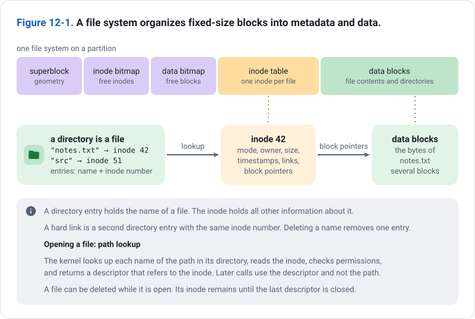
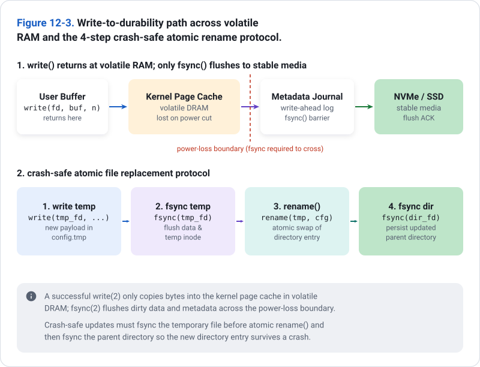

# 12. File System Architecture and Durability

A file system provides a persistent, named abstraction for data stored on a block device. It organizes raw arrays of fixed-size storage blocks into structured entities, files and directories, and maps human-readable hierarchical paths to physical media while surviving unexpected power loss and abrupt system crashes.

Persistence presents a distinct engineering challenge from virtualization and concurrency. Volatile **Random-Access Memory (`RAM`)** loses its entire state milliseconds after power fails, whereas storage hardware operates orders of magnitude more slowly than `RAM` and reorders buffered writes internally for throughput. How can an operating system deliver near-`RAM` read and write speed, support hierarchical naming and sparse multi-terabyte files, and guarantee that a sudden power failure between any two disk writes leaves both file system structure and committed application data intact? Answering this question requires tracing a file operation from the kernel's virtual abstraction layers down through on-disk layouts, crash-consistency protocols, and modern flash storage firmware.

## 12.1 The Virtual File System (`VFS`) and the Three-Table Open-File Model

A modern operating system simultaneously mounts diverse file systems: local block-device formats such as Linux `ext4`, **Extended File System (`XFS`)**, `Btrfs`, or **Apple File System (`APFS`)**; network file systems such as **Network File System (`NFS`)**; and synthetic in-memory file systems such as `tmpfs` and `procfs`. Rather than embedding format-specific branches inside `open()`, `read()`, and `write()`, Unix kernels interpose a polymorphic abstraction layer called the **Virtual File System (`VFS`)**.

The `VFS` defines four core kernel object interfaces, each backed by a table of function pointers populated by the concrete file system driver: the **superblock** (`super_operations`, representing a mounted volume), the **inode** (`inode_operations`, representing a file's metadata and block mapping), the **dentry** (`dentry_operations`, representing a single directory-entry name binding), and the **open file** (`file_operations`, representing an active open instance). When a process calls `read(fd, buf, count)`, the kernel invokes `file->f_op->read(...)`, dispatching transparently to `ext4`, `tmpfs`, or a character device driver such as `/dev/null`.

Resolving a hierarchical pathname such as `/var/log/app.log` requires walking four components sequentially (`/`, `var`, `log`, `app.log`). Reading four separate directory blocks from storage on every `open()` or `stat()` call would destroy performance. The `VFS` therefore maintains an in-memory **directory-entry cache (`dcache`)**, a hash table mapping `(parent_dentry, component_name)` pairs directly to cached `dentry` and `inode` objects. Even negative lookups (recording that a nonexistent path such as `/usr/local/bin/foo` is absent) are cached as negative dentries so repeated shell `PATH` searches avoid redundant disk reads.

Once a path is resolved, the kernel mediates every subsequent file operation through three distinct tables of indirection:

| Kernel Layer | Scope | Key State Stored | Sharing Semantics |
| :--- | :--- | :--- | :--- |
| **File Descriptor Table** | Per process (in **Process Control Block (`PCB`)**) | Small integer `fd` -> pointer to open file description, plus `FD_CLOEXEC` flag | Private per process; entries duplicated on `fork()` and `dup()` |
| **Open File Description (`struct file`)** | System-wide (allocated per `open()`) | Current byte offset, access mode (`O_RDONLY`/`O_WRONLY`/`O_RDWR`), status flags (`O_APPEND`, `O_NONBLOCK`), reference count, pointer to inode | Shared across `dup()`/`dup2()` and `fork()`; distinct across independent `open()` calls |
| **In-Memory Inode (`struct inode` / `vnode`)** | System-wide (one per active file) | File type, permissions, size, timestamps, hard-link count, page-cache tree, physical block/extent map | Shared by every process and descriptor referencing that file |

This three-level design explains a foundational Unix behavior. When a shell redirects standard output to a log file and forks a child process, parent and child descriptors point to the *same* open file description and therefore share a single synchronized byte offset: bytes written by the child advance the offset seen by the parent, preventing the two processes from overwriting each other's output. By contrast, two independent calls to `open("app.log", O_RDWR)` allocate *separate* open file descriptions with independent cursors pointing to the same underlying inode.

### 12.1.1 The `POSIX` File System Call Interface (`open`, `lseek`, `fstat`, `ftruncate`, `fsync`, `unlink`)

Listings 12-1 through 12-4 exercise the core **Portable Operating System Interface (`POSIX`)** file-manipulation system calls:

```c
int     open(const char *pathname, int flags, mode_t mode);
off_t   lseek(int fd, off_t offset, int whence);
int     fstat(int fd, struct stat *statbuf);
int     ftruncate(int fd, off_t length);
int     fsync(int fd);
int     unlink(const char *pathname);
```

Calling `open(pathname, flags, mode)` opens or creates a file and returns the lowest unused file descriptor (`>= 0`), or `-1` on error (`ENOENT`, `EACCES`, `EEXIST`, `EMFILE`). The `flags` bitmask combines an access mode (`O_RDWR`) with creation and state flags (`O_CREAT` creates a missing file; `O_TRUNC` resets an existing regular file to zero bytes). When `O_CREAT` creates a file, the octal `mode` (such as `0644`: owner `rw-`, group `r--`, other `r--`) is masked against the process's `umask` (`mode & ~umask`). Repositioning the open file description's byte offset without transferring data is performed by `lseek(fd, offset, whence)`, where `whence` selects the reference origin: `SEEK_SET` (from byte `0`), `SEEK_CUR` (relative to the current cursor), or `SEEK_END` (relative to end-of-file). Seeking past end-of-file is legal in `POSIX` and allocates zero storage until a subsequent `write()` creates a **sparse hole**.

To inspect authoritative inode metadata, `fstat(fd, statbuf)` populates `struct stat` (returning `0` on success or `-1` on `EBADF` / `EFAULT`): `st_ino` holds the unique inode number, `st_size` records the logical byte length (including sparse holes), `st_blocks` reports actual allocated physical storage in **512-byte units** regardless of the filesystem's native 4 KiB block size (`st_blocks * 512` bytes), `st_blksize` indicates the preferred **Input/Output (`I/O`)** transfer size, and `st_mode` / `st_nlink` record file type, permission bits, and hard-link count. Resizing a file's logical length (`st_size`) is performed by `ftruncate(fd, length)`, which discards trailing blocks when shrinking or creates a zero-reading sparse extension when growing.

Durability and reclamation rely on `fsync(fd)` and `unlink(pathname)`. Invoking `fsync(fd)` flushes all modified data pages and inode metadata associated with `fd` from the kernel's volatile page cache down to stable non-volatile storage, blocking until the storage controller acknowledges completion. Calling `unlink(pathname)` removes the directory entry naming `pathname` and decrements `st_nlink`; the kernel reclaims the inode and its data blocks only when both `st_nlink == 0` and zero open file descriptions reference the inode.

**Listing 12-1. open, write, lseek, read, and stat (C++20).**

```cpp
{{#include ../code/ch12/files.cpp}}
```

**Output 12-1. A file of 36 bytes and its metadata.**

```text
{{#include ../code/out/ch12_files.out}}
```

**Listing 12-2. The same operations with the Rust standard library.**

```rust
{{#include ../code/ch12/files.rs}}
```

**Output 12-2.**

```text
{{#include ../code/out/ch12_files_rs.out}}
```

## 12.2 On-Disk Organization, Links, and Locality

A classic Unix file system partitions a block device into fixed-size blocks (commonly 4 KiB) organized into four structural regions (Figure 12-1): the **Superblock** (global geometry, block size, inode and block counts, and mount state), **Allocation Bitmaps** (compact bit arrays tracking free and allocated inodes and data blocks), the **Inode Table** (on-disk inode records indexed directly by `st_ino`), and **Data Blocks** (file payloads and directory tables).

An **inode** is the authoritative descriptor for a file, recording its type, permissions, owner **User Identifier (`UID`)** and **Group Identifier (`GID`)**, logical size, timestamps, hard-link count (`st_nlink`), and block-pointer table. An inode never stores the file's name; names reside exclusively inside **directories**, which are special files mapping `(filename -> inode_number)` pairs.

### 12.2.1 Hard Links, Symbolic Links, and Unlink-While-Open Semantics

Decoupling directory names from inodes yields three distinctive Unix file-system behaviors. A **hard link**, created with `link(oldpath, newpath)`, inserts a second directory entry pointing to the exact same `st_ino` and increments `st_nlink`. Both names are completely symmetric; removing the original path with `unlink()` decrements `st_nlink` from `2` to `1` and leaves the file intact under the second name. Because inode numbers are unique only within a single mounted volume, hard links cannot cross file-system mount boundaries, and kernels forbid hard links to directories to prevent cycles in the directory graph that would break tree traversal and reference-count reclamation.

A **symbolic link** (or symlink), created with `symlink(target, linkpath)`, allocates a brand-new inode of type `S_IFLNK` whose data payload is the literal pathname string `target`. Because path resolution re-parses that string when traversing the symlink, symbolic links can span across distinct file systems and point to directories. Unlike hard links, removing `target` leaves the symlink intact as a **dangling link** whose subsequent `open()` fails with `ENOENT`.

Separating `st_nlink` (on-disk directory references) from the in-memory open-file reference count enables **unlink-while-open semantics**. When a process opens a temporary scratch file and immediately calls `unlink()` on its pathname, `st_nlink` drops to `0` and the file becomes invisible in the directory tree, yet the process can continue reading, writing, and seeking on its open file descriptor normally. The instant the process closes the descriptor, or terminates abruptly via `SIGKILL`, the kernel observes that both `st_nlink == 0` and open-reference count `== 0`, automatically reclaiming all blocks with zero leaked temporary files. This same invariant explains a classic production operations surprise: running `rm /var/log/huge.log` on a 50 GiB log file currently held open by a running daemon removes the directory entry immediately, yet `df` continues reporting a full disk until the daemon closes the file descriptor or restarts.

<figure>

</figure>

### 12.2.2 Indirect Block Pointers, Extents, and `FFS` Locality

File-system workloads are heavily skewed: most files are a few kilobytes in size, while a small fraction (databases, video files, disk images) span gigabytes or terabytes. Classic Unix inodes balance `O(1)` lookup for small files against multi-terabyte capacity through a multi-level pointer tree (Figure 12-2). Consider a file system with `4 KiB` (`4,096`-byte) blocks and `4`-byte (`32`-bit) block pointers, so each indirect block holds `4,096 / 4 = 1,024` pointers:

| Inode Pointer Level | Fan-Out (4 KiB Block, 4-Byte Pointers) | Additional Capacity Addressed | Extra Metadata Reads |
| :--- | :--- | :--- | :--- |
| **12 Direct Pointers** | `12` data blocks | `12 * 4 KiB = 48 KiB` | `0` |
| **1 Single Indirect Pointer** | `1,024` data blocks | `1,024 * 4 KiB = 4 MiB` | `1` |
| **1 Double Indirect Pointer** | `1,024^2` data blocks | `1,048,576 * 4 KiB = 4 GiB` | `2` |
| **1 Triple Indirect Pointer** | `1,024^3` data blocks | `1,073,741,824 * 4 KiB = 4 TiB` | `3` |

Pointer trees waste substantial metadata space on large contiguous files: a 1 GiB file requires `262,144` individual 4-byte block pointers (`1 MiB` of indirect pointer blocks) even when all `262,144` blocks sit back-to-back on disk. Modern file systems such as `ext4`, `XFS`, and `APFS` replace flat pointer arrays with **extent trees**. A single 12-byte `ext4` extent descriptor `(logical_block, block_count, physical_start)` represents up to `32,768` contiguous 4 KiB blocks (`128 MiB`), allowing an entire 1 GiB contiguous file to be described by eight extents rather than a quarter-million pointers.

Early Unix file systems placed the entire inode table at the front of the disk and all data blocks after it. On spinning **Hard Disk Drives (`HDD`s)**, opening a file required seeking to the front of the platter to read its inode and then seeking across the platter to read its first data block; as files were created and deleted over time, free blocks scattered randomly across the disk, collapsing sequential throughput to a tiny fraction of raw platter bandwidth. The **Berkeley Fast File System (`FFS`)** solved this by partitioning the disk into **cylinder groups** (modern **block groups** in `ext4`), each containing its own superblock replica, local allocation bitmaps, local inode table, and local data blocks. `FFS` enforces two locality heuristics: allocate a file's data blocks in the same block group as its inode, and place all files belonging to the same directory in the same block group while spreading newly created top-level directories across groups with abundant free space. Even on flash storage without mechanical seek arms, block-group locality improves metadata caching and reduces allocation contention across **Central Processing Unit (`CPU`)** cores.

<figure>

</figure>

## 12.3 Sparse Files and the Page Cache Writeback Path

File systems avoid wasting physical storage on large zero-filled regions through **sparse files**. When Listings 12-3 and 12-4 write 4 KiB at byte `0`, seek forward to `4 MiB` via `lseek(fd, 4 * 1024 * 1024, SEEK_SET)`, write 4 KiB, and extend the file to `8 MiB` via `ftruncate(fd, 8 * 1024 * 1024)`, the file system leaves every intermediate block pointer or extent entry unmapped. As confirmed in Output 12-3, `st_size` reports the full `8,388,608` logical bytes (`8 MiB`) while `st_blocks * 512` consumes only `16 * 512 = 8,192` bytes (`8 KiB`) of physical storage, a roughly `1,000x` reduction. Whenever a process reads from an unmapped hole (such as the 16-byte read at `2 MiB` in Listings 12-3 and 12-4), the kernel synthesizes zero bytes directly in memory without touching the block device. Virtual-machine disk images, core dumps, and database files rely heavily on sparse allocation.

Normal file reads and writes do not interact with the block device synchronously. Instead, the kernel caches file contents in 4 KiB frames inside the unified **page cache** in volatile `RAM`. When an application executes `write(fd, buf, 4096)`, the kernel copies those bytes into the corresponding page-cache frame, marks the page **dirty**, updates the in-memory inode's size and modification timestamp, and returns immediately in a few microseconds.

Kernel background flusher threads periodically perform **deferred writeback**, flushing dirty pages to storage when either the dirty-memory ratio exceeds a kernel threshold (`vm.dirty_background_ratio`, typically 10% of available `RAM`) or a dirty page ages past an expiration limit (`vm.dirty_expire_centisecs`, typically 30 seconds). Deferred writeback provides three performance benefits: it coalesces many small random writes into larger sequential disk transfers, absorbs repeated overwrites to the same block so only the final value hits storage, and eliminates disk writes entirely for short-lived temporary files that are unlinked before writeback triggers. The cost of deferred writeback is durability: until dirty pages are explicitly flushed to non-volatile media, a sudden power loss erases every uncommitted write.

## 12.4 The Crash-Consistency Problem: Concrete Failure Traces

Because storage devices only guarantee atomicity for individual sector writes (typically 512 bytes or 4 KiB) and routinely reorder queued writes for scheduling efficiency, multi-block file system updates are vulnerable to sudden power loss.

Consider appending a single 4 KiB data block `Db` to an existing 4 KiB file. Before the append, the file's inode `I` records `size = 4,096` with one direct pointer (`ptr[0] = D0`), the data-allocation bitmap `B` marks block `Db` as free (`0`), and physical block `Db` on disk contains leftover bytes from a previously deleted file. Completing the append durably requires updating three distinct blocks on disk: writing the new user payload to `Db`, marking `Db` allocated (`1`) in bitmap `B`, and updating inode `I` to `size = 8,192` with `ptr[1] = Db`.

Suppose power fails after the storage controller writes only a subset of `{I, B, Db}`. Six partial-write crash states can occur:

| Blocks Written Before Crash | Resulting On-Disk State | Severity and Consequence |
| :--- | :--- | :--- |
| **`Db` only** | Inode `I` still has `size = 4,096`; `B` still marks `Db` free. | Structurally consistent; the appended data is lost. |
| **`I` only** | `I` points to `Db` (`size = 8,192`), but `B` marks `Db` free and `Db` holds old bytes. | **Severe:** Reading the file returns stale garbage (a security leak of another user's deleted data), and a future allocation will assign `Db` to a second file (**cross-linked block corruption**). |
| **`B` only** | `Db` is marked allocated in `B`, yet zero inodes point to `Db`. | **Space leak:** `Db` can never be allocated again until repaired offline. |
| **`I` and `B` (`Db` lost)** | `I` and `B` agree that `Db` belongs to the file, but `Db` holds old bytes. | **Data corruption / security leak:** Structurally valid metadata points to uninitialized or stale garbage. |
| **`B` and `Db` (`I` lost)** | `Db` holds valid data and is marked allocated in `B`, but `I` does not point to it. | **Space leak:** Appended data is orphaned and unreachable. |
| **`I` and `Db` (`B` lost)** | `I` points to valid new data in `Db`, but `B` still marks `Db` free. | **Severe:** Future file creation will allocate `Db` and overwrite this file's data via cross-linking. |

Historically, Unix repaired these inconsistencies after a crash by running an offline **File System Check (`fsck`)** tool before mounting the volume. `fsck` scans the entire superblock, every inode, every directory, and every allocation bitmap to rebuild consistency, reclaiming leaked blocks and detaching cross-linked references. On modern multi-terabyte volumes, however, `fsck` is untenable: scanning a 10 TB disk at 200 MB/s requires nearly 14 hours of downtime, and even after completing, `fsck` cannot detect Case 4 (where `I` and `B` agree, yet `Db` still contains stale garbage).

## 12.5 Solutions: Write-Ahead Logging, Copy-on-Write, and `fsync`

Modern file systems eliminate hours-long `fsck` scans and prevent structural corruption through two primary architectures: **Write-Ahead Logging (`WAL`)** (also called **journaling**) and **Copy-on-Write (`COW`)**.

### 12.5.1 Write-Ahead Logging: Data vs. Metadata Journaling

Journaling file systems (`ext4`, `XFS`, **New Technology File System (`NTFS`)**) reserve a contiguous sequential circular log on disk called the **journal**. Instead of overwriting `I`, `B`, and `Db` in place immediately, the file system wraps the multi-block update into an atomic transaction.

In **data journaling** (`ext4` `data=journal`), the kernel executes a strict five-step protocol:
1. Write a **Transaction Begin (`TxB`)** block (carrying a transaction ID) followed by copies of `I`, `B`, and `Db` sequentially into the journal, and wait for the disk to confirm persistence.
2. Write a **Transaction End (`TxE`)** commit block (with a matching transaction ID and checksum) into the journal, and wait for confirmation. Once `TxE` hits stable media, the transaction is **committed**.
3. **Checkpoint** the update by writing `I`, `B`, and `Db` to their final home locations on disk.
4. Once all checkpoint writes complete, mark the transaction free in the journal superblock so the journal space can be reused.

If power fails *before* `TxE` reaches disk, recovery discards the incomplete transaction; the original pre-append state remains untouched. If power fails *after* `TxE` reaches disk (even mid-checkpoint), recovery replays the committed journal blocks to their home locations (**redo logging**), which is idempotent and completes in milliseconds because only the small active journal is scanned. The drawback of full data journaling is write amplification: every file payload block is written to disk twice (once to the journal, once to its home location), halving sequential write bandwidth.

To recover full write throughput while preventing the stale-data security leak (Case 4 above), Linux `ext4` defaults to **ordered metadata journaling** (`data=ordered`). The kernel writes the new data block `Db` directly to its final home location *first* and waits for `Db` to reach stable storage. Only after `Db` is safely on disk does the kernel write `[TxB, I, B, TxE]` into the journal and later checkpoint `I` and `B`. If power fails before `TxE`, `Db` is an unreferenced block (Case 1, completely harmless). If power fails after `TxE`, replaying `I` and `B` points `I` to `Db`, which is already guaranteed to hold valid new bytes. (A faster but riskier mode, `data=writeback`, skips ordering `Db` before the metadata commit and can expose stale data after a crash.)

### 12.5.2 Copy-on-Write (`COW`) File Systems (`ZFS`, `Btrfs`, `APFS`)

**Copy-on-Write (`COW`)** file systems (`ZFS`, `Btrfs`, `APFS`) take a fundamentally different approach: they never overwrite live data or metadata blocks in place. To append `Db`, a `COW` file system allocates a fresh free block for `Db`, writes a new copy of the indirect or extent block pointing to `Db` into a fresh location, writes a new copy of the inode `I'` pointing to that extent block, and propagates updated parent nodes all the way up to the root of the file-system tree. Finally, the file system atomically updates a single root pointer (the **uberblock** in `ZFS` or checkpoint superblock in `APFS`) protected by a cryptographic or **Cyclic Redundancy Check (`CRC`)** checksum.

Because the entire old tree remains completely unmodified until that single root block write succeeds, a crash at any earlier point leaves the previous file-system state 100% intact, and a crash after the root write leaves the new state 100% intact. `COW` eliminates double-write journaling, enables instant `O(1)` snapshots (by retaining an older root pointer), and integrates end-to-end block checksums cleanly, at the cost of increased fragmentation under heavy random overwrites.

### 12.5.3 The `fsync` and Parent-Directory Durability Contract

Journaling and `COW` protect *file-system structural consistency*, not un-flushed application buffers sitting in the volatile page cache. Without an explicit flush, recently written user data can still vanish on power failure. Calling `fsync(fd)` forces the kernel to flush every dirty data page and metadata update for `fd` (triggering a journal commit or `COW` root sync and issuing a hardware cache-flush command to the drive) and blocks until non-volatile persistence is confirmed. When an application only overwrites existing bytes without changing file size (such as appending to a pre-allocated database write-ahead log), **`fdatasync(fd)`** flushes the data blocks and only the minimal metadata required to retrieve them, skipping non-essential timestamp (`mtime`/`atime`) updates to save an extra metadata write.

For a newly created or atomically replaced file, calling `fsync(fd)` on the file alone is insufficient: the directory entry binding the filename to the new inode resides in the *parent directory's* data blocks, which may still be dirty in the page cache. Crash-safe atomic file replacement (Figure 12-3) therefore requires a strict four-step protocol:

1. Create and write the complete new contents to a sibling temporary file (`config.json.tmp`) in the same directory.
2. Call `fsync(tmp_fd)` to push the temporary file's data and inode to stable storage, then `close(tmp_fd)`.
3. Call `rename("config.json.tmp", "config.json")` to swap the directory entry atomically so readers see either the complete old file or the complete new file, never a half-written prefix.
4. Open the parent directory (`open(".", O_RDONLY | O_DIRECTORY)`) and call `fsync(dir_fd)` so the updated directory entry itself survives sudden power loss.

<figure>

</figure>

**Listing 12-3. A file with a logical size of 8 MiB and 8 KiB of storage (C++20).**

```cpp
{{#include ../code/ch12/sparse.cpp}}
```

**Output 12-3. The logical size is about 1,000 times the allocated storage.**

```text
{{#include ../code/out/ch12_sparse.out}}
```

**Listing 12-4. The same sparse file in Rust.**

```rust
{{#include ../code/ch12/sparse.rs}}
```

**Output 12-4.**

```text
{{#include ../code/out/ch12_sparse_rs.out}}
```

## 12.6 Modern Storage Hardware: `NVMe` `SSD`s and the Flash Translation Layer

Classical file-system geometry assumed spinning magnetic platters with millisecond seek latencies and symmetric in-place sector overwrites. Modern servers and laptops instead rely on **Non-Volatile Memory Express (`NVMe`)** **Solid-State Drives (`SSD`s)** built from **NAND flash memory**, which eliminate mechanical seek arms and deliver hundreds of thousands of **Input/Output Operations Per Second (`IOPS`)** across parallel internal flash channels, yet impose strict physical constraints hidden beneath the block interface.

NAND flash memory exhibits an asymmetric read/program/erase geometry. Data is read and programmed (written) in **pages** (typically `4 KiB` to `16 KiB`), but flash cells cannot be overwritten in place. Before a previously programmed page can be written again, its entire enclosing **erase block** (typically `256` to `512` pages, or `1 MiB` to `8 MiB`) must be erased in a single slow operation (several milliseconds). Furthermore, each erase block tolerates only a finite number of **Program/Erase (`P/E`)** cycles (ranging from roughly `1,000` to `3,000` cycles on consumer **Triple-Level Cell (`TLC`)** flash) before oxide wear causes permanent bit errors.

To present a conventional array of overwriteable **Logical Block Addresses (`LBA`s)** to the operating system, every `SSD` runs an embedded firmware layer called the **Flash Translation Layer (`FTL`)**. Internally, the `FTL` operates as a log-structured remapping engine: when the operating system overwrites `LBA 42`, the `FTL` programs the new 4 KiB payload into the next fresh physical flash page, updates its `LBA -> physical_page` mapping table in controller `DRAM`, and marks the old physical page invalid. Periodically, the `FTL` runs **garbage collection**: it selects an erase block containing a mix of valid and invalid pages, copies every still-valid page into a fresh erase block, updates the mapping table, and erases the old block. It also performs **wear leveling**, relocating cold data so `P/E` cycles distribute evenly across all physical blocks.

Garbage collection creates **write amplification**, quantified by the **Write Amplification Factor (`WAF`)**: the ratio of total bytes physically written to NAND flash divided by total logical bytes written by the host operating system. Consider a nearly full `SSD` servicing random 4 KiB host overwrites where each 256-page erase block chosen for garbage collection still contains 192 valid pages (75% live) and only 64 invalid pages (25% reclaimable). To reclaim 64 free pages, the `FTL` must copy 192 valid pages internally before erasing the block. Accommodating 64 new host pages therefore requires `64 + 192 = 256` physical NAND page writes, yielding `WAF = 256 / 64 = 4.0`. A `WAF` of `4.0` cuts sustained write throughput to one-quarter of raw flash bandwidth and quadruples flash wear.

Operating systems reduce `WAF` through two mechanisms. First, **over-provisioning** reserves 7% to 28% of physical flash capacity outside the host-visible `LBA` space so garbage collection always finds mostly-invalid blocks with fewer live pages to relocate. Second, when a file system deletes a file, it issues **`TRIM`** (or `NVMe` `Dataset Management Deallocate`) commands informing the `FTL` that the deleted `LBA` ranges no longer hold live data, preventing garbage collection from pointlessly copying dead file blocks. Finally, because `SSD`s buffer incoming writes in volatile on-drive `DRAM` to coalesce full flash pages, `fsync()` durability depends on the operating system issuing explicit `NVMe` `Flush` or **Force Unit Access (`FUA`)** commands (and enterprise drives incorporating hold-up capacitors to flush `DRAM` to NAND during sudden power loss).

<div class="callout keyidea">
<span class="label">Key idea</span>

Decoupling directory entries (names) from inodes (metadata and block pointers) enables hard links, atomic `rename()`, and open-but-unlinked temporary files. Meanwhile, `write()` only populates the volatile page cache; only `fsync()` on both the file and its parent directory crosses the power-loss durability boundary.

</div>

<div class="callout experiment">
<span class="label">Experiment</span>

Run Listing 12-3 (`code/ch12/sparse.cpp`) and inspect the created file with `ls -lh` versus `du -h` before `unlink()`. Notice that `ls -lh` reports the 8 MiB logical `st_size`, while `du -h` reports only 8 KiB of physical blocks allocated on disk.

</div>

<div class="callout caution">
<span class="label">Common Pitfall</span>

Calling `fsync(tmp_fd)` and `rename(tmp, target)` without calling `fsync(parent_dir_fd)` afterward. On sudden power loss, the file's data blocks may reach disk while the updated parent directory entry vanishes from the page cache, reverting or losing the newly renamed file.

</div>
