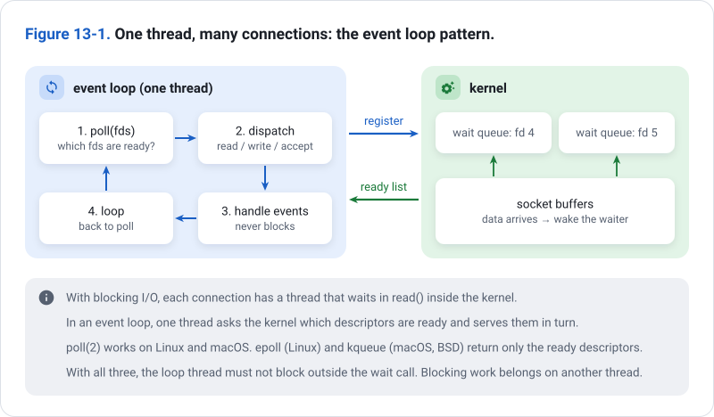

# 13. I/O Multiplexing and the Event Loop

The challenge of high-concurrency network services lies in efficiently managing thousands of simultaneous connections, most of which remain idle for the majority of their lifecycle. The architectural choice between thread-per-connection models and event-driven models fundamentally dictates the memory footprint and CPU overhead of the server.

## 13.1 The Scalability Limits of Thread-Per-Connection

The most intuitive approach to concurrency is to assign a dedicated thread to each incoming connection. In this model, the thread performs blocking I/O operations, such as `read`, and is suspended by the kernel until data arrives. While this design is pedagogically simple and maps directly to sequential application logic, it scales poorly. Each thread necessitates a dedicated stack and kernel-level scheduling state, consuming significant memory. As the number of connections reaches tens of thousands, the aggregate memory consumption and the overhead of frequent context switching between idle threads become prohibitive.

## 13.2 Event-Driven Architecture and I/O Multiplexing

To overcome the limitations of the thread-per-connection model, modern high-performance servers utilize an event-driven architecture centered around an **event loop**. Instead of blocking on individual descriptors, a single thread utilizes I/O multiplexing primitives, such as `poll`, `epoll` (Linux), or `kqueue` (macOS/BSD), to monitor a large set of descriptors simultaneously.

The event loop follows a repetitive cycle:
1. **Observation:** The thread invokes a multiplexing system call to query the kernel for all descriptors that have transitioned to a "ready" state (e.g., data is available to read or a buffer is ready to be written).
2. **Dispatch:** The loop iterates over the subset of ready descriptors, dispatching the appropriate handler logic for each.
3. **Execution:** The handler performs the non-blocking I/O operation and then returns control to the loop.

A critical constraint of the event loop is the requirement for **non-blocking execution**. Because a single thread manages all connections, any handler that performs a blocking operation (such as a long computation or a synchronous disk I/O) will stall the entire loop, effectively halting service for all other connections. To maintain responsiveness, such tasks must be offloaded to a worker thread pool or managed through asynchronous primitives.

<figure>

</figure>

**Listing 13-1. An echo server with one thread and `poll` (C++20).**

```cpp
{{#include ../code/ch13/poll_echo_server.cpp}}
```

**Listing 13-2. The client.**

```cpp
{{#include ../code/ch13/echo_client.cpp}}
```

**Output 13-1. The log of the server.**

```text
{{#include ../code/out/ch13_poll_echo_server.out}}
```

**Output 13-2. The first client run. The second run prints the same lines.**

```text
{{#include ../code/out/ch13_echo_client_1.out}}
```

## 13.3 Complexity and Evolution of Multiplexing Primitives

The efficiency of the event loop is heavily influenced by the underlying multiplexing primitive. The `poll` system call operates with O(N) complexity, as both the kernel and the application must iterate through the entire array of descriptors to identify ready events. This makes `poll` unsuitable for massive scales.

In contrast, more advanced interfaces like `epoll` and `kqueue` optimize this process by maintaining the interest list within the kernel and returning only the descriptors that have actually become ready. This reduces the complexity of the observation phase to O(ready events), enabling a single thread to efficiently manage hundreds of thousands of concurrent connections. This architectural pattern underpins high-performance networking frameworks such as Nginx, Node.js, and Tokio.

**Listing 13-3. An echo server with one thread per connection, and its client (Rust).**

```rust
{{#include ../code/ch13/thread_echo.rs}}
```

**Output 13-3.**

```text
{{#include ../code/out/ch13_thread_echo_rs.out}}
```
