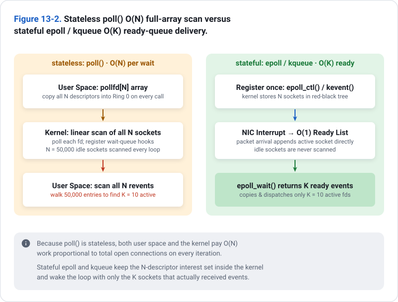

# 13. I/O Multiplexing and the Event Loop

The central engineering challenge of high-concurrency network servers, historically framed as the **C10K problem**, is sustaining tens of thousands of simultaneous client connections when the vast majority remain idle waiting for network packets at any given instant. Choosing between a thread-per-connection architecture and an event-driven **Input/Output (`I/O`)** multiplexing loop directly governs memory consumption, cache locality, and scheduler overhead.

## 13.1 The Scalability Limits of Thread-Per-Connection

Assigning one operating-system thread to every accepted **Transmission Control Protocol (`TCP`)** connection allows handlers to be written as straightforward sequential blocking code (`read()`, process, `write()`). While intuitive for low-concurrency services, this model encounters three scaling ceilings as connection counts grow into the tens of thousands. First, every thread reserves a dedicated user-space stack (commonly 1 to 8 MiB of virtual space and tens of kilobytes of resident pages) plus a kernel stack (8 to 16 KiB) and scheduling metadata. Second, waking thousands of threads across bursts of short packets triggers frequent scheduler invocations, register-state saves, Level 1/Level 2 cache eviction, and **Translation Lookaside Buffer (`TLB`)** pressure. Third, sharing mutable session tables or metrics across thousands of concurrent threads introduces heavy lock contention.

## 13.2 Event-Driven Architecture and `I/O` Multiplexing

An **event-driven server** decouples connection count from thread count by running a single-threaded (or one-thread-per-core) **event loop** over an **`I/O` multiplexing** system call (`poll`, Linux `epoll`, or **Berkeley Software Distribution (`BSD`)** / Darwin `kqueue`). Rather than blocking a dedicated thread on one socket, the loop registers every active file descriptor with the kernel and sleeps once until *any* descriptor becomes ready (Figure 13-1):

1. **Wait (Observation):** The loop invokes `poll()` (or `epoll_wait()` / `kevent()`), suspending the thread until one or more monitored sockets transition to a ready state (an incoming `TCP` connection waiting on the listening socket, readable bytes in a client receive buffer, or an error/hangup) or a timeout expires.
2. **Dispatch:** The loop inspects the ready descriptors reported by the kernel and routes each event to its connection state machine.
3. **Non-blocking Execution:** Each handler consumes or emits available bytes and returns promptly to the loop. Because one thread services all connections, a blocking disk read or expensive computation inside a handler stalls every other client until it returns; production event loops offload blocking work to dedicated thread pools.

<figure>

</figure>

### 13.2.1 Socket Setup, `struct sockaddr_in`, and the `poll(2)` System Call Interface

Listings 13-1 through 13-4 build a complete single-threaded `TCP` echo server and client using the `BSD` socket **Application Programming Interface (`API`)** paired with `poll(2)`:

```text
struct sockaddr_in {
    sa_family_t    sin_family; // Address family: AF_INET (IPv4)
    in_port_t      sin_port;   // 16-bit TCP/UDP port in network byte order (htons)
    struct in_addr sin_addr;   // 32-bit IPv4 address in network byte order (htonl)
    unsigned char  sin_zero[8];// Zero padding to match generic struct sockaddr size
};

struct pollfd {
    int   fd;       // File descriptor to monitor (negative entries are ignored)
    short events;   // Input bitmask: events the application asks the kernel to watch
    short revents;  // Output bitmask: events the kernel detected on return
};

int socket(int domain, int type, int protocol);
int setsockopt(int sockfd, int level, int optname, const void *optval, socklen_t optlen);
int bind(int sockfd, const struct sockaddr *addr, socklen_t addrlen);
int listen(int sockfd, int backlog);
int accept(int sockfd, struct sockaddr *addr, socklen_t *addrlen);
int connect(int sockfd, const struct sockaddr *addr, socklen_t addrlen);
int poll(struct pollfd *fds, nfds_t nfds, int timeout);
```

Internet protocols transmit multi-byte integers in **big-endian** network byte order, whereas x86-64 and ARM64 processors are little-endian. Calling `htons(45678)` ("host to network short", 16-bit) and `htonl(INADDR_LOOPBACK)` ("host to network long", 32-bit, converting `127.0.0.1` = `0x7F000001`) converts fields inside `struct sockaddr_in` into wire order before passing the struct to the kernel. Because `bind()`, `connect()`, and `accept()` serve **Internet Protocol Version 4 (`IPv4`, `sockaddr_in`)**, **Internet Protocol Version 6 (`IPv6`, `sockaddr_in6`)**, and Unix domain (`sockaddr_un`) addresses through a single C interface, callers cast the concrete pointer to `struct sockaddr *` and pass its exact byte length in `addrlen`.

To establish a listening server, `socket(AF_INET, SOCK_STREAM, 0)` allocates an unbound `IPv4` `TCP` endpoint (`fd >= 0`, or `-1` on `EMFILE`/`EAFNOSUPPORT`). Calling `setsockopt(ls, SOL_SOCKET, SO_REUSEADDR, &one, sizeof one)` allows immediate server restarts even when prior connections linger in `TCP` `TIME_WAIT` state (preventing `EADDRINUSE`). Next, `bind(ls, addr, addrlen)` attaches the local **Internet Protocol (`IP`)** address and port, and `listen(ls, backlog)` converts `ls` into a passive listener whose completed-connection queue is bounded by `backlog` (`8` in Listing 13-1). Each call to `accept(ls, addr, addrlen)` dequeues one completed client connection and returns a **new, distinct connected file descriptor** (`c >= 0`), leaving `ls` open for future clients. On the client side (Listing 13-2), `connect(fd, addr, addrlen)` initiates the `TCP` three-way handshake (**Synchronize (`SYN`)**, **Synchronize-Acknowledge (`SYN-ACK`)**, **Acknowledge (`ACK`)**), returning `0` once established or `-1` (`ECONNREFUSED`, `ETIMEDOUT`).

The `poll(fds, nfds, timeout)` system call monitors an array of `nfds` `struct pollfd` entries simultaneously. Before each call, the application sets `fds[i].fd` and `fds[i].events` (typically `POLLIN` to detect readable client bytes, peer **End-of-File (`EOF`)**, or a queued connection on `ls`). The `timeout` parameter specifies the maximum wait in milliseconds (`1000` ms in Listing 13-1; `-1` blocks indefinitely; `0` returns immediately). On return, the kernel populates `fds[i].revents` with observed flags (`POLLIN`, `POLLOUT`, and output-only `POLLHUP`, `POLLERR`, or `POLLNVAL`) and returns the count of ready entries (`> 0`), `0` on timeout, or `-1` on error (`EINTR`, `ENOMEM`). When `POLLIN` fires on a client socket and `read()` returns `0`, the peer has closed its write half (`TCP` **Finish (`FIN`)**), so the server closes the descriptor and removes it from `fds`.

**Listing 13-1. An echo server with one thread and `poll` (C++20).**

```cpp
{{#include ../code/ch13/poll_echo_server.cpp}}
```

**Listing 13-2. The C++20 echo client.**

```cpp
{{#include ../code/ch13/echo_client.cpp}}
```

**Output 13-1. The log of the C++20 server.**

```text
{{#include ../code/out/ch13_poll_echo_server.out}}
```

**Output 13-2. The first C++20 client run. The second run prints the same lines.**

```text
{{#include ../code/out/ch13_echo_client_1.out}}
```

**Listing 13-3. The same single-threaded `poll` echo server in Rust.**

```rust
{{#include ../code/ch13/poll_echo_server.rs}}
```

**Listing 13-4. The Rust echo client.**

```rust
{{#include ../code/ch13/echo_client.rs}}
```

**Output 13-3. The log of the Rust `poll` server.**

```text
{{#include ../code/out/ch13_poll_echo_server_rs.out}}
```

**Output 13-4. The first Rust client run.**

```text
{{#include ../code/out/ch13_echo_client_1_rs.out}}
```

## 13.3 Complexity and Evolution of Multiplexing Primitives (`select`, `poll`, `epoll`, `kqueue`)

The scalability of an event loop depends directly on how the kernel tracks the monitored descriptor set across calls (Figure 13-2):

| Primitive | Platform | Descriptor Limit | Per-Wait Complexity | Kernel Registration Model |
| :--- | :--- | :--- | :--- | :--- |
| **`select`** | **Portable Operating System Interface (`POSIX`)** | Fixed `FD_SETSIZE` (typically 1024) | O(max_fd) | Stateless; copies full bitmasks on every call |
| **`poll`** | `POSIX` | Unbounded (dynamic `pollfd[]`) | O(N) | Stateless; copies and scans full `fds` array on every call |
| **`epoll`** | Linux | Unbounded | O(K) ready events | Stateful kernel red-black tree (`epoll_ctl`) + O(1) ready list (`epoll_wait`) |
| **`kqueue`** | macOS / `BSD` | Unbounded | O(K) ready events | Stateful kernel event table (`kevent`) unifying sockets, timers, files, and processes |

Both `select` and `poll` are **stateless**: on every iteration of the event loop, user space copies the entire array of `N` descriptors into Ring 0, the kernel walks all `N` descriptors to attach wait-queue callbacks, and user space scans all `N` entries again on return to locate the `K` active sockets. When `N = 50,000` connections and only `K = 10` are active, O(N) scanning dominates execution time.

Modern kernels eliminate this linear scan via stateful interest sets (`epoll` on Linux, `kqueue` on Darwin/`BSD`). The application registers each socket once upon `accept()`; when packets arrive, the network interrupt handler appends that socket directly onto a kernel ready queue, reducing event retrieval from O(N) to **O(K)**. Event loops also choose between **level-triggered** readiness (default in `poll` and `epoll`, which notifies on every wait while unread bytes remain) and **edge-triggered** readiness (`EPOLLET`, which notifies once on state transition and requires draining the non-blocking socket until `EAGAIN`). On Linux 5.1+, `io_uring` extends this architecture from *readiness notification* to *asynchronous completion*, sharing submission and completion ring buffers in memory between user space and the kernel to execute batched network and storage operations with minimal system calls. Production runtimes including Nginx, Envoy, Node.js (`libuv`), and Rust's Tokio are built atop these O(K) interfaces.

<figure>

</figure>

**Listing 13-5. Contrast: a thread-per-connection echo server and client (Rust).**

```rust
{{#include ../code/ch13/thread_echo.rs}}
```

**Output 13-5.**

```text
{{#include ../code/out/ch13_thread_echo_rs.out}}
```

<div class="callout keyidea">
<span class="label">Key idea</span>

Event-driven servers scale to tens of thousands of idle connections by replacing per-connection thread stacks with one kernel readiness queue. Stateful `epoll` and `kqueue` reduce wait complexity from O(*N*) total connections (`poll`) to O(*K*) active connections.

</div>

<div class="callout experiment">
<span class="label">Experiment</span>

In Listing 13-1 (`code/ch13/poll_echo_server.cpp`), comment out the `setsockopt(..., SO_REUSEADDR, ...)` call, connect a client, terminate the server with Ctrl-C, and immediately restart it. Observe `bind()` failing with `EADDRINUSE` while the prior socket lingers in `TCP` `TIME_WAIT`.

</div>

<div class="callout caution">
<span class="label">Common Pitfall</span>

Executing a blocking disk read, synchronous `DNS` lookup, or heavy `CPU` loop inside a single-threaded event-loop callback. Because one thread multiplexes every socket, a 50 ms blocking call stalls tail latency across all sibling connections simultaneously; offload blocking work to a worker pool.

</div>
