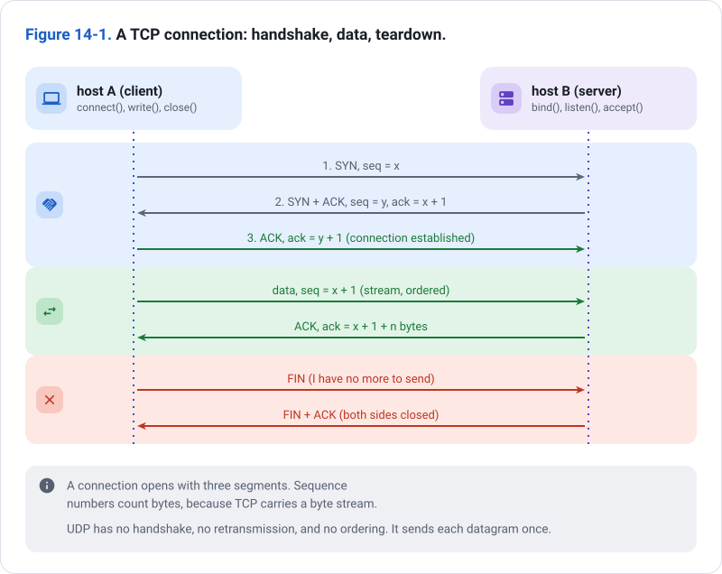

# 14. Network Protocols and the Socket Interface

Network communication across operating systems is unified by the **Berkeley Software Distribution (`BSD`)** socket interface, which exposes network endpoints as ordinary file descriptors while letting applications choose between two contrasting transport contracts: reliable, ordered byte streams via the **Transmission Control Protocol (`TCP`)** and connectionless, boundary-preserving datagrams via the **User Datagram Protocol (`UDP`)**. Understanding how a server sustains high throughput and low tail latency requires tracing both the protocol state machines on the wire and the exact kernel data path moving bytes between a **Network Interface Card (`NIC`)** and user-space memory.

## 14.1 The Kernel Packet Path: From Wire to User Space

Before a single byte reaches an application's `read()` or `recvfrom()` buffer, it traverses a multi-stage hardware and kernel pipeline designed to sustain millions of packets per second without livelocking the **Central Processing Unit (`CPU`)**. Consider a 10 Gbps Ethernet link carrying minimum-sized 64-byte Ethernet frames (84 bytes on the wire including preamble and inter-frame gap):

```text
10,000,000,000 bits/sec / (84 bytes * 8 bits/byte) = 14,880,952 packets/sec
```

At 14.88 million packets per second, a new frame arrives every **67.2 nanoseconds**. Servicing a traditional hardware **Interrupt Request (`IRQ`)** costs roughly 1 to 2 microseconds of register saving, interrupt-controller acknowledgement, and pipeline disruption. If the `NIC` raised one hardware interrupt per incoming packet under heavy load, the `CPU` would spend 100% of its cycles inside the top-half interrupt handler and zero cycles draining packets or running user-space processes, a classic failure mode known as **receive livelock**.

### 14.1.1 `DMA` Ring Buffers, `NAPI` Softirqs, and `struct sk_buff`

Modern kernels prevent receive livelock by separating packet reception into a **Direct Memory Access (`DMA`)** ring buffer, a brief hardware interrupt, and a polled bottom-half loop (**New API (`NAPI`)** on Linux). During driver initialization, the kernel allocates a circular **Receive (`RX`)** ring of pre-allocated physical memory buffers and registers their bus addresses with the `NIC`. When a frame arrives from the physical wire, the `NIC` verifies the Ethernet **Frame Check Sequence (`FCS`)** in hardware and writes the frame directly into the next free `RX` ring slot via `DMA` without waking the `CPU`. The `NIC` then raises a single **Message Signaled Interrupt (`MSI-X`)** to signal that one or more frames are waiting; the top-half interrupt handler disables further `RX` interrupts on that queue and schedules the **`NET_RX_SOFTIRQ`** software interrupt on the local core.

Running in softirq context, the `NAPI` loop polls the `NIC`'s `RX` ring in bounded batches (typically up to a budget of 64 packets per poll cycle). If the ring empties within the budget, `NAPI` re-enables hardware interrupts; if traffic remains heavy, interrupts stay disabled and `NAPI` keeps polling in bounded time slices, preventing livelock while amortizing interrupt cost across dozens of frames. For each drained frame, the driver wraps the `DMA` buffer in a kernel socket buffer descriptor (`struct sk_buff`, or `skb` on Linux; `mbuf` on `BSD`/Darwin). As the packet ascends from Layer 2 (Ethernet) to Layer 3 (**Internet Protocol (`IP`)**) and Layer 4 (`TCP` or `UDP`), the kernel advances a single `data` pointer inside `skb` to strip each header in place without copying the payload. Finally, the transport layer hashes the `(src_ip, src_port, dst_ip, dst_port)` four-tuple to locate the target `struct sock`, validates `TCP` sequence numbers and checksums, and appends the `skb` onto the socket's receive queue (`sk_receive_queue`, bounded by `SO_RCVBUF` and `net.core.rmem_max`). If the queue is full, `UDP` drops the datagram immediately while `TCP` advertises a shrinking receive window. The kernel then wakes any thread blocked in `read()`, `recvfrom()`, or `epoll_wait()`, and the syscall invokes `copy_to_user()` to copy payload bytes from kernel `skb` pages into the user-space buffer.

Every packet on the standard socket path therefore incurs at least one `DMA` transfer into kernel memory plus one `CPU` copy across the kernel-to-user boundary. Zero-copy interfaces that eliminate the `CPU` copy for high-throughput file and proxy servers are covered in Section 14.5.

## 14.2 The Transmission Control Protocol (`TCP`): Reliable Byte Streams

`TCP` constructs a connection-oriented, reliable, full-duplex byte stream atop an unreliable packet-switched `IP` network that can drop, duplicate, reorder, or corrupt packets. Because `TCP` treats transmitted data as an unstructured stream of bytes, it never preserves `write()` boundaries: three 10-byte writes may coalesce in the kernel send buffer and arrive as one 30-byte `read()`, or fragment across network segments into thirty 1-byte reads. Every application protocol layered over `TCP` (including **Hypertext Transfer Protocol (`HTTP`)**, **Transport Layer Security (`TLS`)**, **gRPC Remote Procedure Calls (`gRPC`)**, and the PostgreSQL wire protocol) must therefore define explicit framing through length prefixes or delimiters.

<figure>

</figure>

### 14.2.1 Three-Way Handshake, `SYN` Backlogs, and `SYN` Cookies

Every `TCP` connection opens with a **Three-Way Handshake** (Figure 14-1) that synchronizes initial sequence numbers and negotiates options such as **Maximum Segment Size (`MSS`)** and window scaling. The client transmits a **Synchronize (`SYN`)** segment carrying its initial sequence number `x`, the server replies with **`SYN-ACK`** carrying its own sequence number `y` and acknowledging `x + 1`, and the client returns **`ACK`** acknowledging `y + 1`.

Inside the server kernel, a passive listening socket maintains **two distinct queues** during this handshake:

| Kernel Queue | State of Entries | Tunable Bound (Linux) | Trigger to Advance |
| :--- | :--- | :--- | :--- |
| **`SYN` Queue (Incomplete)** | `SYN_RECV` (received `SYN`, sent `SYN-ACK`) | `net.ipv4.tcp_max_syn_backlog` | Client returns final `ACK` |
| **Accept Queue (Complete)** | `ESTABLISHED` (handshake finished, awaiting `accept()`) | `min(backlog, net.core.somaxconn)` | Application calls `accept()` |

This two-queue split exposes a classic denial-of-service vector known as a **`SYN` flood**. An attacker sends thousands of `SYN` packets per second with spoofed source `IP` addresses and never replies with the third `ACK`. Each half-open entry occupies a kernel `request_sock` in the `SYN` queue until its retransmission timer expires, filling `tcp_max_syn_backlog` and forcing the server to drop legitimate clients.

Linux mitigates `SYN` floods via **`SYN` cookies** (`net.ipv4.tcp_syncookies = 1`). When the `SYN` queue overflows, the server stops allocating `request_sock` memory for incoming `SYN` packets. Instead, it encodes the client's `MSS` class, a coarse timestamp, and a keyed cryptographic hash of the `(src_ip, src_port, dst_ip, dst_port)` four-tuple directly into the 32-bit server initial sequence number `y` of the `SYN-ACK`. When a legitimate client replies with `ACK = y + 1`, the server recomputes the hash in stateless arithmetic, verifies the cookie, and constructs the full `ESTABLISHED` socket directly in the accept queue. Because `SYN` cookies carry zero server-side state, they cannot remember optional `SYN` extensions such as `TCP` window scaling or selective acknowledgments (`SACK`) unless encoded in `TCP` timestamp bits, so kernels activate cookies only when the `SYN` queue actually fills.

### 14.2.2 Graceful Teardown, `TIME_WAIT`, and Ephemeral Port Exhaustion

`TCP` closes each direction independently via **Finish (`FIN`)** and `ACK` segments (half-close), allowing in-flight data in the reverse direction to drain cleanly. The endpoint that initiates the active close (sending the first `FIN` and receiving the peer's `FIN`) does not destroy its socket state immediately after transmitting the final `ACK`. Instead, it enters the **`TIME_WAIT`** state for twice the **Maximum Segment Lifetime (`2 * MSL`)**, fixed at 60 seconds on Linux and 30 to 120 seconds on `BSD`/Darwin.

`TIME_WAIT` enforces two protocol invariants. First, if the final `ACK` is lost in transit, the passive peer retransmits its `FIN` while stuck in `LAST_ACK`; keeping the socket in `TIME_WAIT` allows the active closer to re-send the `ACK` rather than replying with an abrupt **Reset (`RST`)**. Second, holding the `(src_ip, src_port, dst_ip, dst_port)` four-tuple out of service for `2 * MSL` guarantees that delayed duplicate packets wandering through routers from the old connection expire before a new connection reuses the same tuple and mistakes stale bytes for valid stream data.

In high-churn proxy or microservice architectures where one client opens thousands of short-lived outbound `TCP` connections per second to the *same* backend `(dst_ip, dst_port)`, `TIME_WAIT` produces **ephemeral port exhaustion**. On Linux, the default ephemeral port range (`net.ipv4.ip_local_port_range`) spans `32768` through `60999`, providing exactly `28,232` source ports. If a reverse proxy opens 1,000 short-lived connections per second to a single backend and performs the active close on each, those 28,232 ports enter `TIME_WAIT` for 60 seconds:

```text
28,232 ephemeral ports / 60 seconds = 470.5 connections/sec maximum sustained rate
```

At 1,000 connections/sec, the proxy exhausts all 28,232 local ports in **28.2 seconds**, after which every subsequent `connect()` fails with `EADDRNOTAVAIL`. Engineers prevent ephemeral port exhaustion primarily through **persistent connection pooling** (reusing established `TCP` connections via `HTTP/1.1` keep-alive or `HTTP/2` multiplexing), shifting the active close to the client side where source ports are distributed across thousands of distinct client `IP` addresses, widening `ip_local_port_range`, or enabling `net.ipv4.tcp_tw_reuse` for safe timestamp-verified outbound reuse. Setting `SO_LINGER` with a zero timeout to force `RST` teardown bypasses `TIME_WAIT` at the cost of truncating buffered application data and risking data corruption from delayed duplicates, making it unsuitable for general production traffic.

### 14.2.3 Flow Control vs. Congestion Control

High-speed `TCP` transfer is governed by two independent rate-limiting windows: **flow control** (protecting the receiver) and **congestion control** (protecting the intermediate network). The sender's maximum unacknowledged data in flight is always bounded by `min(cwnd, rwnd)`.

**Flow control** is strictly end-to-end. Every `TCP` header carries a 16-bit **Receive Window (`rwnd`)** field advertising how many free bytes remain in the receiver's `sk_receive_queue`. Because a 16-bit integer caps `rwnd` at 65,535 bytes, modern `TCP` negotiates a **Window Scale** shift factor during the `SYN` handshake (up to 14 bits, expanding the maximum window to 1 GiB). Consider the **Bandwidth-Delay Product (`BDP`)** of a 1 Gbps transcontinental link with a 50 ms **Round-Trip Time (`RTT`)**:

```text
BDP = (1,000,000,000 bits/sec / 8 bits/byte) * 0.050 sec = 6,250,000 bytes (~5.96 MiB)
```

To keep a 1 Gbps, 50 ms pipe full, the sender must keep nearly 6 MiB of bytes in flight simultaneously. Without `TCP` window scaling, a 64 KiB window limits throughput to `65,535 bytes / 0.050 sec = 1.31 MB/s` (~10.5 Mbps), leaving 98.9% of link capacity idle. When an application stops calling `read()`, `rwnd` shrinks to `0`, halting the sender until the receiver advertises a non-zero window update (backed by periodic zero-window probe packets in case the update is lost).

**Congestion control** prevents senders from overwhelming shared bottleneck routers whose queue capacities are invisible to either endpoint. Classic loss-based `TCP` (Tahoe and Reno) regulates a sender-side **Congestion Window (`cwnd`)** across two regimes. During **Slow Start**, `cwnd` begins at an initial window (typically 10 `MSS`, ~14.6 KiB) and increases by 1 `MSS` for every `ACK` received, effectively *doubling* every `RTT` until `cwnd` reaches the slow-start threshold (`ssthresh`) or packet loss occurs. Once past `ssthresh`, `TCP` enters **Congestion Avoidance**, applying **Additive Increase, Multiplicative Decrease (`AIMD`)**: `cwnd` grows linearly by 1 `MSS` per `RTT` and halves immediately (`cwnd = cwnd / 2`) upon detecting loss via three duplicate `ACK`s (fast recovery), or collapses to 1 `MSS` on a full retransmission timeout.

On high-`BDP` links, linear `+1 MSS/RTT` recovery takes minutes to reclaim multi-gigabit bandwidth after a single random packet drop. Linux therefore defaults to **CUBIC**, which replaces linear growth with a cubic function of elapsed time since the last congestion event: `cwnd` climbs aggressively back toward the prior plateau, flattens near the estimated bottleneck capacity to probe cautiously, and accelerates again if no loss appears, decoupling throughput fairness from `RTT`. More recently, **Bottleneck Bandwidth and Round-trip propagation time (`BBR`)** abandons packet loss as the primary congestion signal altogether. Loss-based algorithms (`Reno`, `CUBIC`) intentionally fill router buffers until queues overflow, inducing hundreds of milliseconds of queuing delay (**bufferbloat**). `BBR` instead continuously estimates the path's maximum delivery rate (`BtlBw`) and minimum propagation delay (`RTprop`), pacing packets at the exact bottleneck bandwidth while keeping in-flight data near `1 * BDP` so router queues remain nearly empty.

### 14.2.4 Nagle's Algorithm and the Delayed-`ACK` 40 ms Deadlock Trap

Two independent `TCP` optimizations interact pathologically on interactive request-response workloads: **Nagle's algorithm** (sender-side) and **Delayed `ACK`** (receiver-side). Nagle's algorithm prevents **Silly Window Syndrome** on telnet-style streams that emit 1-byte `write()` calls (each incurring 40 bytes of `IPv4`+`TCP` header overhead). Its rule is concise: if a connection already has unacknowledged bytes in flight, the sender buffers any new sub-`MSS` write until either an `ACK` arrives for the in-flight segment or enough bytes accumulate to fill a full `MSS` (typically 1,460 bytes). Meanwhile, Delayed `ACK` instructs the receiver to hold back a standalone `ACK` for up to 40 ms on Linux (or 200 ms on `BSD`/Windows) in the hope of piggybacking the `ACK` onto an outgoing response packet or acknowledging two incoming segments with one `ACK`.

Trace what occurs when a client issues two consecutive small `write()` calls (`write(header, 120)` followed immediately by `write(body, 200)`) and then calls `read()` to await the server's reply. At `t = 0 ms`, zero bytes are in flight, so Nagle transmits the 120-byte header immediately. At `t = 0.01 ms`, the client calls `write(body, 200)`; because the 120-byte header is still unacknowledged and `200 < 1,460` bytes, Nagle **holds the 200-byte body** in the client's send buffer waiting for an `ACK`. At `t = 0.2 ms`, the server receives the 120-byte header, cannot compute a response until the 200-byte body arrives, and therefore generates no outbound data, causing the server's `TCP` stack to arm its **40 ms Delayed-`ACK` timer** in hopes of piggybacking. Both sides then sit completely idle for 40 ms until the server's delayed-`ACK` timer expires at `t = 40.2 ms` and emits a bare `ACK`, finally allowing Nagle to release the 200-byte body.

This interaction introduces an artificial 40 ms stall on *every* request, capping a single connection at 25 requests per second over a sub-millisecond datacenter network. Low-latency `RPC` frameworks, databases, and web servers avoid the trap by disabling Nagle's algorithm via `setsockopt(fd, IPPROTO_TCP, TCP_NODELAY, &one, sizeof one)` and coalescing headers and bodies explicitly in user space using scatter-gather `writev(2)` (or Linux `TCP_CORK` around explicit multi-part writes).

## 14.3 The User Datagram Protocol (`UDP`): Unreliable Message Delivery

`UDP` strips away connection state, handshakes, retransmissions, congestion control, and ordering guarantees, adding only an 8-byte header (source port, destination port, length, and checksum) atop raw `IP` packets. Each `UDP` datagram is routed independently and may arrive out of order, arrive duplicated, or vanish in transit without notification.

This minimal contract yields two defining engineering properties. First, `UDP` eliminates handshake latency and **head-of-line blocking**: transmitting the first payload incurs zero setup round trips, and losing one packet never stalls subsequent packets waiting behind it in a kernel reorder buffer. Real-time voice and video pipelines, **Domain Name System (`DNS`)** resolvers, telemetry collectors, and modern **Quick UDP Internet Connections (`QUIC`)** transports (powering `HTTP/3`, which implements multiplexed streams and congestion control in user space over `UDP`) build directly on `UDP`. Second, `UDP` enforces strict **message-boundary preservation**: one `sendto()` call produces one discrete datagram delivered atomically by one `recvfrom()` call.

### 14.3.1 The Connectionless Datagram System Call Interface (`sendto`, `recvfrom`)

Because a `UDP` socket (`socket(AF_INET, SOCK_DGRAM, 0)`) maintains no fixed peer connection, every transmission and reception carries its endpoint address explicitly:

```c
ssize_t sendto(int sockfd, const void *buf, size_t len, int flags,
               const struct sockaddr *dest_addr, socklen_t addrlen);

ssize_t recvfrom(int sockfd, void *buf, size_t len, int flags,
                 struct sockaddr *src_addr, socklen_t *addrlen);
```

In both calls, `sockfd` is a `SOCK_DGRAM` descriptor (calling `bind()` assigns a fixed local port such as `45680` in Listing 14-1, whereas an unbound sender automatically receives an ephemeral port), `buf` and `len` specify the payload buffer, and `flags` controls per-call behavior (`0` for standard blocking **Input/Output (`I/O`)**, `MSG_DONTWAIT` for non-blocking execution, or `MSG_PEEK` to inspect a queued datagram without dequeuing it). In `sendto()`, `dest_addr` points to the target `struct sockaddr_in` (or `sockaddr_in6`) and `addrlen` is passed **by value** (`sizeof addr`). In `recvfrom()`, `src_addr` and `addrlen` are output parameters receiving the sender's address, so `addrlen` is passed **by pointer (`socklen_t *`)** as a value-result argument: the caller initializes `*addrlen` to the buffer capacity before the call, and the kernel overwrites it with the actual length written (passing `nullptr, nullptr`, as in Listing 14-1, discards the sender's address).

Both functions return the signed byte count transferred (`ssize_t >= 0`), or `-1` on error (`EMSGSIZE` if a datagram exceeds the link's **Maximum Transmission Unit (`MTU`)** limit, `EAGAIN` on non-blocking empty receive, or `EINTR`). Unlike `TCP` `read()`, which leaves unread bytes queued for the next call, if an arriving `UDP` datagram exceeds the `len` buffer supplied to `recvfrom()`, the kernel copies the first `len` bytes and **discards the remaining tail without signaling an error** (unless `MSG_TRUNC` is checked via `recvmsg()`).

**Listing 14-1. Sending and receiving one datagram (C++20).**

```cpp
{{#include ../code/ch14/udp.cpp}}
```

**Output 14-1. One datagram of 8 bytes.**

```text
{{#include ../code/out/ch14_udp.out}}
```

**Listing 14-2. The same exchange with `std::net::UdpSocket` (Rust).**

```rust
{{#include ../code/ch14/udp.rs}}
```

**Output 14-2.**

```text
{{#include ../code/out/ch14_udp_rs.out}}
```

## 14.4 Name Resolution and Addressing

Applications operate on human-readable hostnames (`"localhost"`, `"api.example.com"`) and service names (`"https"`, `"443"`), whereas `connect()` and `bind()` require binary **Internet Protocol Version 4 (`IPv4`, `sockaddr_in`)** or **Internet Protocol Version 6 (`IPv6`, `sockaddr_in6`)** structures. Modern **Portable Operating System Interface (`POSIX`)** software replaces legacy `IPv4`-only functions (`gethostbyname`, which used non-thread-safe static storage) with the re-entrant, protocol-independent resolver **`getaddrinfo(3)`**.

### 14.4.1 Protocol-Independent Resolution (`getaddrinfo`, `freeaddrinfo`, `inet_ntop`)

```c
struct addrinfo {
    int              ai_flags;     // Input options (e.g., AI_PASSIVE, AI_NUMERICHOST)
    int              ai_family;    // AF_UNSPEC (IPv4 or IPv6), AF_INET, or AF_INET6
    int              ai_socktype;  // SOCK_STREAM (TCP), SOCK_DGRAM (UDP), or 0 (any)
    int              ai_protocol;  // Protocol number or 0 (any matching protocol)
    socklen_t        ai_addrlen;   // Byte length of the socket address in ai_addr
    struct sockaddr *ai_addr;      // Pointer to populated sockaddr_in or sockaddr_in6
    char            *ai_canonname; // Canonical hostname (when AI_CANONNAME requested)
    struct addrinfo *ai_next;      // Next candidate in the singly-linked result list
};

int         getaddrinfo(const char *node, const char *service,
                        const struct addrinfo *hints, struct addrinfo **res);
void        freeaddrinfo(struct addrinfo *res);
const char *gai_strerror(int errcode);
const char *inet_ntop(int af, const void *src, char *dst, socklen_t size);
```

Callers zero-initialize a `struct addrinfo hints{}` and populate only the constraints they require: `ai_family = AF_UNSPEC` accepts both `IPv4` and `IPv6`, `ai_socktype = SOCK_STREAM` restricts results to `TCP` endpoints so each address is not duplicated for `UDP`, and `ai_flags = AI_PASSIVE` with `node = nullptr` yields wildcard server listen addresses (`0.0.0.0` and `::`). Calling `getaddrinfo(node, service, hints, res)` queries `/etc/hosts` and configured `DNS` resolvers, allocates a heap-resident singly-linked list of candidate `struct addrinfo` nodes in `*res`, and returns `0` on success. Unlike raw system calls, failures return a dedicated non-zero resolver code (`EAI_NONAME`, `EAI_AGAIN`, `EAI_MEMORY`) that callers decode with `gai_strerror(rc)` rather than `perror()`.

Because a hostname commonly resolves to both `IPv6` (`::1`) and `IPv4` (`127.0.0.1`) endpoints (as observed in Outputs 14-3 and 14-4), callers traverse the linked list via `ai->ai_next`, inspect `ai->ai_family` to cast `ai->ai_addr` safely to `sockaddr_in *` or `sockaddr_in6 *`, and release the entire list with `freeaddrinfo(list)`. To format a binary network-order address into text, `inet_ntop(af, src, dst, size)` ("network to presentation") writes a null-terminated string into `dst`; sizing `dst` to `INET6_ADDRSTRLEN` (46 bytes) guarantees sufficient capacity for both `IPv4` dotted-quad and full `IPv6` colon-hex strings.

**Listing 14-3. The addresses that `getaddrinfo` returns for "localhost" (C++20).**

```cpp
{{#include ../code/ch14/getaddrinfo.cpp}}
```

**Output 14-3. One IPv6 address and one IPv4 address.**

```text
{{#include ../code/out/ch14_getaddrinfo.out}}
```

**Listing 14-4. The same lookup in Rust, with `to_socket_addrs`.**

```rust
{{#include ../code/ch14/to_socket_addrs.rs}}
```

**Output 14-4.**

```text
{{#include ../code/out/ch14_to_socket_addrs_rs.out}}
```

## 14.5 Zero-Copy Network Data Paths (`sendfile`, `splice`, `MSG_ZEROCOPY`)

Serving static files, video segments, or proxied byte streams at 40 to 100 Gbps exposes the cost of redundant memory copies. A standard file-serving loop that calls `read(file_fd, buf, 65536)` followed by `write(sock_fd, buf, n)` executes **four data copies** and **four context switches** per chunk: the storage controller copies blocks via `DMA` into the kernel **Page Cache**, the `CPU` copies bytes from the page cache into user-space `buf`, the `CPU` copies the exact same bytes back from `buf` into the kernel socket send buffer (`sk_buff`), and the `NIC` copies bytes via `DMA` onto the wire. Even though the server never inspects or modifies a single byte of the file, the `CPU` touches every byte twice, polluting L1/L2 caches and saturating memory bandwidth.

| Mechanism | Source -> Destination | CPU Copies | Context Switches | Primary Trade-Off |
| :--- | :--- | :--- | :--- | :--- |
| **`read()` + `write()`** | Any fd -> Any fd | 2 | 4 | Maximum portability; highest memory-bandwidth cost |
| **`sendfile(2)`** | Page-cache file -> Socket | 0 (with `NIC` scatter-gather) | 2 | Unidirectional file-to-socket; no user-space transform |
| **`splice(2)`** | Arbitrary fd <-> Pipe <-> Arbitrary fd | 0 (page reference transfer) | 2 to 4 | Requires intermediate kernel pipe; ideal for L4 proxies |
| **`send(..., MSG_ZEROCOPY)`** | User buffer -> Socket | 0 (`DMA` from user pages) | 2 + error-queue poll | Page pinning + `MSG_ERRQUEUE` completion; pays off above ~10 KiB |

**`sendfile(out_fd, in_fd, &offset, count)`** collapses the transfer into a single kernel operation. On modern `NIC`s supporting **Scatter-Gather (`SG`)** `DMA` and hardware checksum offload, `sendfile()` maps the disk file into the kernel page cache and passes page descriptors directly to the `NIC` transmit ring without copying bytes into a separate socket buffer or crossing into user space, reducing `CPU` copies from two to zero.

**`splice(fd_in, off_in, fd_out, off_out, len, flags)`** generalizes zero-copy transfer beyond regular files by moving page-cache references through a kernel pipe (at least one descriptor must be a pipe). A **Layer 4 (`L4`)** reverse proxy can call `splice()` from an inbound `TCP` socket into a pipe and a second `splice()` from that pipe into an outbound `TCP` socket, forwarding gigabytes per second without ever mapping payload pages into user space.

When data originates in user-space memory (such as dynamically compressed responses, `TLS` ciphertext, or in-memory database pages), Linux **`MSG_ZEROCOPY`** (`setsockopt(fd, SOL_SOCKET, SO_ZEROCOPY, ...)` paired with `send(..., MSG_ZEROCOPY)`) pins the application's user pages in physical `DRAM` and directs the `NIC` to `DMA` directly from them. Because user space must not overwrite those pages while the `NIC` is still transmitting them, the kernel delivers asynchronous completion notifications on the socket's error queue (`recvmsg(fd, &msg, MSG_ERRQUEUE)`). Pinning pages, incrementing page reference counts, and polling completion notifications carry a fixed per-call cost, so `MSG_ZEROCOPY` yields net gains only for large payloads (typically 10 KiB and larger).

<div class="callout keyidea">
<span class="label">Key idea</span>

`TCP` delivers a reliable, ordered byte stream with zero message-boundary preservation, governed by receiver flow control (`rwnd`), network congestion control (`cwnd`), and `TIME_WAIT` tuple protection; `UDP` delivers discrete, boundary-preserving datagrams with zero reliability or ordering guarantees. Every protocol above `TCP` must therefore frame its own messages, while protocols above `UDP` (such as `QUIC`) implement custom reliability without head-of-line blocking.

</div>

<div class="callout experiment">
<span class="label">Experiment</span>

In Listing 14-1 (`code/ch14/udp.cpp`), shrink the receiver buffer `char buf[4]` while sending the 8-byte `"datagram"` payload. Observe `recvfrom()` returning `4` bytes and discarding the remaining 4 bytes without returning an error, contrasting sharply with `TCP` stream buffering.

</div>

<div class="callout caution">
<span class="label">Common Pitfall</span>

Assuming a single `read()` on a `TCP` socket returns one complete application message, forgetting to call `freeaddrinfo()` after `getaddrinfo()`, or leaving Nagle's algorithm enabled alongside unbuffered multi-part writes. Under network fragmentation or kernel coalescing, a single `TCP` `read()` may return half a header or three concatenated messages, and uncoalesced small writes trigger 40 ms delayed-`ACK` stalls.

</div>
