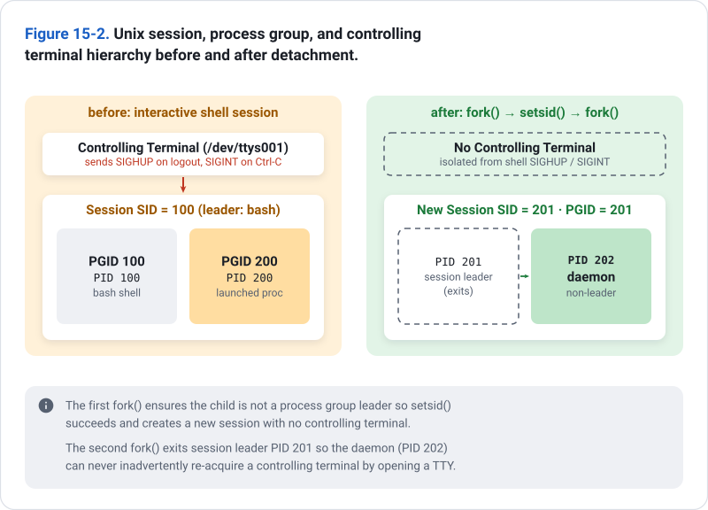

# 15. Daemon Lifecycle and Service Supervision

A daemon is a specialized process designed for long-running background execution, decoupled from any interactive terminal. While traditional daemons implement explicit detachment rituals to sever ties with their launching shell, modern operating systems have evolved toward a supervision-based model where central init systems (such as `launchd` on macOS and Darwin, or `systemd` on Linux) manage the lifecycle, socket activation, resource boundaries, and fault recovery of background services.

## 15.1 The Ritual of Detachment

To transition from a terminal-bound process to a fully independent daemon in a standalone environment, a program undergoes four ordered stages designed to sever every kernel linkage to the launching session and controlling terminal (Figures 15-1 and 15-2):

1. **Session Decoupling (First Fork):** The process invokes `fork()`, and the parent immediately calls `_exit(0)`, returning control to the launching shell. The child is reparented to **Process Identifier (`PID`)** `1` and is guaranteed *not* to be a process group leader because its new `PID` differs from its inherited **Process Group Identifier (`PGID`)**.
2. **Session Leadership (`setsid`):** The child invokes `setsid()` to create a new session (**Session Identifier (`SID`)**) and process group with itself as leader, detaching completely from its original controlling terminal so terminal signals (**Signal Hangup (`SIGHUP`)** on logout, **Signal Interrupt (`SIGINT`)** on Ctrl-C) can never reach it.
3. **Terminal Prevention (Second Fork):** Because the **Portable Operating System Interface (`POSIX`)** standard permits a session leader without a controlling terminal to acquire one inadvertently if it calls `open()` on a **Teletype (`TTY`)** device without `O_NOCTTY`, a second `fork()` exits the session leader so the grandchild daemon is never a session leader and can never acquire a controlling terminal.
4. **Environment Sanitization:** The grandchild restricts default file permissions via `umask()`, moves its working directory to `/` via `chdir("/")` so it cannot pin a mounted volume against unmounting, redirects descriptors `0`, `1`, and `2` (`stdin`, `stdout`, `stderr`) to `/dev/null` or a log file via `dup2()`, and writes its `PID` into a **pidfile**.

<figure>

</figure>

<figure>

</figure>

### 15.1.1 The Detachment System Call Interface (`setsid`, `umask`, `chdir`, `dup2`)

Listings 15-1 and 15-2 invoke four specialized environment-control system calls alongside `fork()`, `open()`, and `sigaction()`:

```text
pid_t  setsid(void);
mode_t umask(mode_t mask);
int    chdir(const char *path);
int    dup2(int oldfd, int newfd);
```

Calling `setsid()` creates a new session and process group whose `SID` and `PGID` both equal the caller's `PID`, stripping any controlling terminal association and returning the new `SID` (`> 0`). If the caller is already a process group leader, `setsid()` fails with `EPERM`, which is why the first `fork()` must precede it. Calling `umask(mask)` sets the file-mode creation mask and returns the prior mask (never failing); whenever the daemon creates a file via `open(..., mode)`, the kernel clears bits set in `umask` (`mode & ~umask`), so octal `0027` (`0o027` in Rust) clears group-write and all world permissions. Calling `chdir("/")` moves the working directory to the root mount (`0` on success, `-1` on `ENOENT`/`EACCES`) so the daemon never blocks administrative `umount` operations. Finally, `dup2(oldfd, newfd)` atomically closes `newfd` if open and duplicates `oldfd` onto slot `newfd`; in Listing 15-1, redirecting `STDOUT_FILENO` (`1`) and `STDERR_FILENO` (`2`) to the log file and `STDIN_FILENO` (`0`) to `/dev/null` ensures library reads observe immediate **End-of-File (`EOF`)** while log output lands cleanly on disk.

## 15.2 Signal-Driven Management and the Lifecycle Interface

The primary administrative interface for a standalone daemon consists of signals paired with its pidfile:
- **`SIGHUP` (Signal Hangup):** Conventionally repurposed to instruct the daemon to reload configuration files and rotate log handles without dropping active connections.
- **Signal Terminate (`SIGTERM`):** Requests a graceful shutdown. The handler sets an atomic stop flag (`g_stop = 1` / `STOP.store(true, Ordering::Relaxed)`), allowing the main loop to finish in-flight work, flush logs, call `unlink(pidfile)`, and exit cleanly.
- **Kill Signal (`SIGKILL`):** Forcibly terminates the process immediately in kernel mode when a daemon fails to exit within the supervisor's grace period after `SIGTERM`.

**Listing 15-1. A daemon from start to shutdown (C++20).**

```cpp
{{#include ../code/ch15/daemon.cpp}}
```

**Output 15-1. The C++ daemon.**

```text
{{#include ../code/out/ch15_daemon.out}}
```

**Listing 15-2. The same daemon in Rust.**

```rust
{{#include ../code/ch15/daemon.rs}}
```

**Output 15-2. The Rust daemon.**

```text
{{#include ../code/out/ch15_daemon_rs.out}}
```

<div class="callout keyidea">
<span class="label">Key idea</span>

A daemon's interface is three artifacts: a pidfile that names it, a log that records it, and signal handlers that steer it. In standalone systems, the double-fork ritual is plumbing; the signal-driven lifecycle is the true contract.

</div>

## 15.3 Service Supervision and On-Demand Activation: `launchd` and `systemd`

In modern production environments (particularly cloud server operating systems and Apple platforms), the manual detachment ritual is replaced by centralized **service supervision**. Central supervisors, such as Apple's `launchd` and Linux's `systemd`, operate as `PID 1`, managing daemons as direct child processes.

### 15.3.1 The Foreground Daemon Model

Supervised services run in the **foreground**: they do not call `fork()` or `setsid()`, do not manage their own pidfiles, and do not redirect standard **Input/Output (`I/O`)** to `/dev/null`. If a daemon double-forks under a supervisor, it severs parentage, causing the supervisor to believe the service terminated prematurely. Retaining direct parentage allows the supervisor to track the true `PID`, observe exact exit codes, enforce memory and CPU limits via control groups or task policies, and aggregate logs written directly to `stdout` and `stderr`.

### 15.3.2 Socket-Based On-Demand Activation

A major architectural innovation pioneered by Apple's `launchd` (and adopted by `systemd`) is **socket activation**. Traditional init scripts enforce fragile boot-order dependency chains: a logging daemon must start before a database daemon, which must start before an application server. Under socket activation, the supervisor creates and binds the listening sockets (Unix domain sockets or **Transmission Control Protocol (`TCP`)** ports) *before* the daemon launches. When a client connects, the kernel queues the incoming connection on the bound socket; the supervisor detects readiness, spawns the daemon on demand, and hands the pre-bound listening descriptor directly to the child (typically descriptor `3` or via `launch_activate_socket()`), letting the daemon call `accept()` immediately with zero startup race conditions.

## 15.4 Asynchronous Fault Detection and Process Monitoring via `kqueue`

In distributed infrastructure and cloud platforms, daemons frequently act as local supervisors that manage worker processes, telemetry sidecars, and hardware accelerators. A supervisor must detect worker crashes and hardware faults instantaneously.

### 15.4.1 The Limits of Signal-Based Monitoring (`SIGCHLD`)

Traditional Unix process monitoring relies on **Child Status Changed (`SIGCHLD`)** and `waitpid()`. In complex event-driven supervisors, signal-based monitoring imposes two constraints: standard `POSIX` signals coalesce when multiple children exit simultaneously (requiring non-blocking `waitpid(-1, &status, WNOHANG)` drain loops), and async-signal-safety restrictions prohibit allocating memory or acquiring standard mutexes inside the handler, forcing a self-pipe wakeup trick to notify the main loop.

### 15.4.2 Event-Driven Supervision with `EVFILT_PROC` and the `struct kevent` Interface

On Apple Darwin and **Berkeley Software Distribution (`BSD`)** kernels, **`kqueue`** unifies socket readiness, timers, filesystem changes, and process lifecycle monitoring inside one stateful kernel event queue. Rather than installing a signal handler, a supervisor registers an `EVFILT_PROC` filter directly on a child `PID` and receives termination notifications synchronously inside its main event loop:

```text
struct kevent {
    uintptr_t ident;  // Identifier for this event (e.g., fd, signal number, or child PID)
    int16_t   filter; // Kernel event subsystem (EVFILT_READ, EVFILT_TIMER, EVFILT_PROC)
    uint16_t  flags;  // Registration action flags (EV_ADD, EV_ENABLE, EV_DELETE, EV_ONESHOT)
    uint32_t  fflags; // Filter-specific sub-flags (for EVFILT_PROC: NOTE_EXIT, NOTE_FORK)
    intptr_t  data;   // Filter-specific payload (readable bytes, or exit status metadata)
    void     *udata;  // Opaque user-space context pointer returned untouched by the kernel
};

int  kqueue(void);
void EV_SET(struct kevent *kev, uintptr_t ident, int16_t filter, uint16_t flags,
            uint32_t fflags, intptr_t data, void *udata);
int  kevent(int kq, const struct kevent *changelist, int nchanges,
            struct kevent *eventlist, int nevents, const struct timespec *timeout);
```

Calling `kqueue()` allocates an empty kernel event queue and returns a descriptor (`kq >= 0`, or `-1` on `EMFILE`/`ENOMEM`) that is not inherited across `fork()`. The helper macro `EV_SET(&change, pid, EVFILT_PROC, EV_ADD | EV_ENABLE, NOTE_EXIT, 0, nullptr)` populates a `struct kevent` targeting child `ident = pid` under the `EVFILT_PROC` process-lifecycle filter, activating `NOTE_EXIT` notification (with optional opaque `udata` pointer for O(1) dispatch back to a supervisor's worker record).

The single `kevent()` system call performs both registration and retrieval. Passing a populated `changelist` with `eventlist = nullptr, nevents = 0` registers the filter and returns `0` immediately; passing `changelist = nullptr, nchanges = 0` with an `eventlist` blocks until up to `nevents` fire or `timeout` expires (`nullptr` blocks indefinitely), returning the ready count (`> 0`), `0` on timeout, or `-1` on error (`EBADF`, `EINTR`, or `ESRCH` if `pid` already exited). Once `event.fflags & NOTE_EXIT` arrives, the supervisor calls `waitpid(pid, &status, WNOHANG)` to reap the zombie **Process Control Block (`PCB`)** and extract `WEXITSTATUS(status)`.

**Listing 15-3. Process supervision via `kqueue` (C++20).**

```cpp
{{#include ../code/ch15/kqueue_supervisor.cpp}}
```

**Output 15-3. The C++ supervisor output.**

```text
{{#include ../code/out/ch15_kqueue_supervisor.out}}
```

**Listing 15-4. The same supervisor in Rust.**

```rust
{{#include ../code/ch15/kqueue_supervisor.rs}}
```

**Output 15-4. The Rust supervisor output.**

```text
{{#include ../code/out/ch15_kqueue_supervisor_rs.out}}
```

## 15.5 Fault Recovery Policies and Health Checks

Detecting a failure is only the first half of high-availability systems software; the second half is executing a deterministic recovery policy.

### 15.5.1 Crash Loops and Exponential Backoff

When a daemon crashes due to an unrecoverable condition (such as corrupted persistent state, a missing configuration file, or dead hardware), an unconstrained supervisor will repeatedly restart the process in an infinite tight loop, consuming 100% CPU capacity and filling storage disks with panic dumps. Production supervisors enforce **restart rate limiting** via fixed throttle intervals (`launchd`'s `ThrottleInterval`, defaulting to 10 seconds) or **exponential backoff** (doubling the delay on consecutive failures: 1s → 2s → 4s → 8s up to a cap, resetting once the service sustains healthy uptime).

### 15.5.2 Watchdog Timers and Liveness Probing

Process failures also manifest as deadlocks, infinite spin loops, or hung network `I/O`, where the process remains alive in the process table yet stops serving requests. Supervisors detect hung processes via **software watchdogs** (requiring periodic **Inter-Process Communication (`IPC`)** heartbeats or shared-memory timestamp updates, issuing **Abort Signal (`SIGABRT`)** or `SIGKILL` after missed intervals) and **hardware watchdogs** (resetting `/dev/watchdog` or a **Power Management Unit (`PMU`)** timer so a deadlocked kernel triggers a physical machine reset).

<div class="callout experiment">
<span class="label">Experiment</span>

Run Listing 15-1 (`code/ch15/daemon.cpp`), inspect the detached daemon's `PID`, `PGID`, `SID`, and `TTY` column (`ps -o pid,ppid,pgid,sid,tty,comm -p $(cat /tmp/osbook_daemon.pid)`), and send `kill -HUP` followed by `kill -TERM` while watching `/tmp/osbook_daemon.log` record the reload and graceful shutdown.

</div>

<div class="callout caution">
<span class="label">Common Pitfall</span>

Three common daemon failure modes:
1. **Double-daemonizing under a supervisor:** Invoking `fork()` and `setsid()` inside a `launchd` or `systemd` unit causes the supervisor to track the short-lived parent, leaving the actual worker orphaned and unmanaged.
2. **Blocking during `SIGTERM` cleanup:** Handling `SIGTERM` by initiating network requests that block on remote services. When the supervisor's grace period expires, `SIGKILL` forcibly kills the process, leaving intermediate state half-written.
3. **Stale pidfiles:** Relying on pidfiles without verifying process identity. If a crashed daemon leaves a stale pidfile, another unrelated process may later spawn with that reused PID, causing administrative scripts to kill innocent services.

</div>

<div class="callout summary">
<span class="label">Summary</span>

- Standalone daemons isolate themselves via a 4-step detachment ritual (`fork`, `setsid`, `fork`, `umask`/`chdir`/`dup2`), pidfiles, and signal handlers.
- Modern cloud and Apple OS architectures supervise daemons in the foreground, delegating process tracking, logging, and sandboxing to `launchd` or `systemd`.
- Socket activation decouples service boot ordering, allowing daemons to start lazily on demand.
- Event-driven monitoring via `kqueue` (`EVFILT_PROC` and `struct kevent`) delivers deterministic child exit notifications on the supervisor's main event loop, bypassing the fragility of `SIGCHLD`.
- High-availability recovery relies on exponential backoff restart limits and watchdog heartbeats to resolve deadlocks.

</div>
