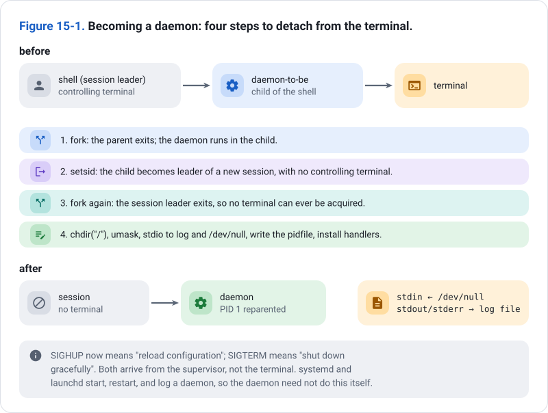

# 15. Daemon Lifecycle and Service Supervision

A **daemon** is a long-running background process decoupled from any interactive terminal, providing continuous infrastructure services such as packet routing, database storage, log aggregation, or container orchestration. The central engineering problem of daemon management is surviving the lifecycle of the launching user session while remaining controllable, observable, and recoverable across crashes and upgrades. If a background server remains attached to a login shell's terminal, closing that **Secure Shell (`SSH`)** connection terminates the server immediately; conversely, if a daemon detaches itself completely from its parent without a structured supervision contract, an administrator or init system loses the ability to detect crashes, bound resource usage, or coordinate clean restarts.

Unix operating systems have addressed this problem across two distinct eras. Traditional standalone daemons execute an explicit kernel detachment ritual (`fork`, `setsid`, `fork`) and expose signals plus a **pidfile** as their control plane. Modern production operating systems (`systemd` on Linux and `launchd` on macOS and Darwin) invert this architecture: services execute in the foreground as direct children of a central supervisor that manages socket activation, readiness protocols, resource boundaries, and fault recovery.

## 15.1 Sessions, Process Groups, and Controlling Terminals

Understanding why a standalone daemon must execute a double-fork detachment ritual requires tracing the three-tier job-control hierarchy maintained by the Unix kernel (Figure 15-2). Every process belongs to a **Process Group**, identified by its **Process Group Identifier (`PGID`)**, and every process group belongs to a **Session**, identified by its **Session Identifier (`SID`)**. When an interactive shell launches a pipeline such as `grep error app.log | wc -l`, the kernel places both commands in a single process group so a single signal (such as Ctrl-C delivering **Signal Interrupt (`SIGINT`)** or Ctrl-Z delivering **Terminal Stop (`SIGTSTP`)**) acts atomically on the entire pipeline.

A session may attach to at most one **Controlling Terminal** (typically a pseudo-terminal device such as `/dev/pts/3` or `/dev/ttys002`, referenced generically as `/dev/tty`). The process whose **Process Identifier (`PID`)** equals the session's `SID` is the **session leader** (typically the interactive login shell). Inside a session, one process group is designated the **foreground process group** (via `tcsetpgrp()`) and receives keyboard-generated signals and terminal input; all other process groups run in the background and receive **Background Read (`SIGTTIN`)** or **Background Write (`SIGTTOU`)** if they attempt terminal **Input/Output (`I/O`)**.

### 15.1.1 The `SIGHUP` Cascade on Terminal Disconnect

When a user logs out or an `SSH` connection drops, the kernel closes the master side of the pseudo-terminal and initiates a **Signal Hangup (`SIGHUP`)** cascade. First, the kernel delivers `SIGHUP` directly to the **session leader** (the shell). Interactive shells catch `SIGHUP` and forward `SIGHUP` to every active job (both foreground and background process groups) in their job table before exiting. Second, if a background process group becomes an **orphaned process group** (meaning no process in the group has a parent in a different process group of the same session) and contains any stopped processes, **Portable Operating System Interface (`POSIX`)** mandates that the kernel send `SIGHUP` followed immediately by **Continue (`SIGCONT`)** to every member of that orphaned group so stopped processes do not linger forever in the process table.

Any server launched directly from an interactive shell without severing its session and controlling-terminal bindings is therefore vulnerable to abrupt termination whenever the launching terminal closes.

## 15.2 The Ritual of Detachment: Why Double-Forking Works

To transition from a terminal-bound command into a fully isolated standalone daemon, a process executes four ordered kernel transitions (Figures 15-1 and 15-2). Table 15-1 traces the exact kernel attributes (`PID`, **Parent Process Identifier (`PPID`)**, `PGID`, `SID`, and `TTY`) at each stage, starting from an interactive shell (`PID 1000`, `SID 1000`, attached to `pts/0`) that runs the daemon binary (`PID 1050`).

| Stage | Executing Process | `PID` | `PPID` | `PGID` | `SID` | Controlling `TTY` | Session Leader? |
| :--- | :--- | :--- | :--- | :--- | :--- | :--- | :--- |
| **0. Launch** | Shell runs daemon binary | `1050` | `1000` | `1050` | `1000` | `pts/0` | No (Group leader) |
| **1. First `fork()`** | Parent exits via `_exit(0)`; child continues | `1051` | `1` | `1050` | `1000` | `pts/0` | No (`PID != PGID`) |
| **2. `setsid()`** | Child starts new session | `1051` | `1` | `1051` | `1051` | None (`?`) | **Yes (`PID == SID`)** |
| **3. Second `fork()`** | Session leader exits; grandchild continues | `1052` | `1` | `1051` | `1051` | None (`?`) | **No (`PID != SID`)** |

During the **first `fork()`**, the parent (`PID 1050`) immediately terminates via `_exit(0)` rather than `exit(0)`. Calling `_exit(0)` is essential because standard `exit(0)` flushes user-space C `stdio` buffers inherited by both parent and child, causing buffered log lines to appear twice. Once the parent exits, the launching shell resumes its prompt, and the child (`PID 1051`) is reparented to `PID 1` (or the nearest subreaper, discussed in Section 15.4.3). Because the child received a fresh `PID` (`1051`) while inheriting its parent's `PGID` (`1050`), the child is guaranteed *not* to be a process group leader.

This guarantee is the exact precondition required by **`setsid()`**. Calling `setsid()` fails with `EPERM` if the caller is already a process group leader (`PID == PGID`), because moving a group leader into a new session would leave sibling processes in the old group with an invalid `PGID` pointing across session boundaries. Since `PID 1051 != PGID 1050`, `setsid()` succeeds: it creates a brand-new session (`SID 1051`), creates a new process group (`PGID 1051`), places the child inside both as the sole member, and strips any controlling terminal (`TTY` becomes none). Terminal signals from `pts/0` (`SIGHUP`, `SIGINT`, `SIGQUIT`) can no longer reach `PID 1051`.

### 15.2.1 Why the Second `fork()` Prevents Controlling-Terminal Re-Acquisition

After `setsid()`, `PID 1051` has no controlling terminal, yet it is the **session leader** (`PID == SID == 1051`). Under System V and `POSIX` terminal semantics, whenever a session leader without a controlling terminal opens a **Teletype (`TTY`)** device (such as `/dev/ttyS0` or a pseudo-terminal slave) via `open()` without passing the `O_NOCTTY` flag, the kernel automatically assigns that device as the session's controlling terminal. A third-party library or diagnostic helper that opens a serial console or pseudo-terminal could inadvertently re-attach the daemon to a terminal and re-expose it to `SIGHUP`.

Executing a **second `fork()`** eliminates this hazard permanently. The session leader (`PID 1051`) calls `_exit(0)`, leaving the grandchild (`PID 1052`) running in session `1051` with `PID 1052 != SID 1051`. Because the grandchild never holds session leadership and can never become a session leader without calling `setsid()` again, the kernel refuses to assign it a controlling terminal even if it later opens a `TTY` device without `O_NOCTTY`.

### 15.2.2 Environment Sanitization and the Detachment System Calls

After the second `fork()`, the grandchild sanitizes four inherited process attributes before entering its service loop (as implemented in Listings 15-1 and 15-2):

```c
pid_t  setsid(void);
mode_t umask(mode_t mask);
int    chdir(const char *path);
int    dup2(int oldfd, int newfd);
```

First, `umask(0027)` (`0o027` in Rust) replaces any permissive file-creation mask inherited from the shell; whenever the daemon creates files via `open(..., mode)`, the kernel clears bits present in `umask` (`mode & ~umask`), stripping group-write and all world permissions (`0644 & ~0027 = 0640`). Second, `chdir("/")` moves the process's current working directory to the root filesystem mount (`0` on success, `-1` on `ENOENT`/`EACCES`). A daemon that retains a working directory inside `/mnt/data` holds an active kernel `dentry` reference on that mount, causing administrative `umount /mnt/data` commands to fail with `EBUSY`. Third, `dup2(oldfd, newfd)` atomically closes `newfd` if open and duplicates `oldfd` onto slot `newfd`. Redirecting `STDIN_FILENO` (`0`) to `/dev/null` and `STDOUT_FILENO` (`1`) plus `STDERR_FILENO` (`2`) to `/dev/null` or an append-only log file prevents library code that reads `stdin` from blocking (returning immediate **End-of-File (`EOF`)**) and ensures descriptors `0`, `1`, and `2` remain occupied so a subsequent `open()` or `accept()` cannot accidentally receive descriptor `1` and corrupt a client socket when a library writes to `stdout`. Fourth, the daemon records its grandchild `PID` in a **pidfile** (`/tmp/osbook_daemon.pid` in Listing 15-1) so external tools can locate and signal it.

<figure>

</figure>

<figure>

</figure>

## 15.3 Signal-Driven Management and Graceful Drain on `SIGTERM`

Once detached, a standalone daemon communicates with operators through `POSIX` signals paired with its pidfile. Conventionally, **`SIGHUP`** (which can no longer arrive from a terminal disconnect) is repurposed to trigger live configuration reloads and log-file rotation without dropping active client connections; **Signal Terminate (`SIGTERM`)** requests a controlled, graceful shutdown; and **Kill Signal (`SIGKILL`)** terminates the process immediately inside the kernel if it ignores `SIGTERM` beyond a configured timeout.

### 15.3.1 Async-Signal-Safety and Multi-Phase Graceful Drain

Inspecting Listing 15-1 (`daemon.cpp`) and Listing 15-2 (`daemon.rs`) highlights a strict kernel concurrency rule: signal handlers interrupt normal execution at arbitrary instruction boundaries, potentially while the main thread holds an internal lock inside `malloc()` or `printf()`. Calling any non-async-signal-safe function (`printf`, `malloc`, `free`, `std::mutex::lock`) inside `on_hup` or `on_term` risks self-deadlock or heap corruption. Both listings therefore restrict their signal handlers to a single atomic store (`g_stop = 1` on a `volatile sig_atomic_t` in C++20; `STOP.store(true, Ordering::Relaxed)` on an `AtomicBool` in Rust).

In a production network daemon, setting the stop flag initiates a deterministic **graceful drain** rather than an abrupt exit. First, the main event loop observes `g_stop == 1` and immediately stops accepting new work by removing its listening socket from `epoll` or `kqueue` (or closing the listener so a load balancer stops routing new requests to the instance). Second, the server enters a bounded drain phase (for example, 15 to 25 seconds, strictly shorter than the supervisor's `TimeoutStopSec` before `SIGKILL` arrives): existing connections finish in-flight **Remote Procedure Calls (`RPC`s)** or database transactions, and idle keep-alive sockets are closed once their current request completes. Third, once the active request counter reaches zero (or the drain deadline expires), the daemon flushes write-ahead logs via `fsync()`, closes storage handles, calls `unlink(pidfile)` (line 75 of Listing 15-1), and exits with status `0`.

**Listing 15-1. A daemon from start to shutdown (C++20).**

```cpp
{{#include ../code/ch15/daemon.cpp}}
```

**Output 15-1. The C++ daemon.**

```text
{{#include ../code/out/ch15_daemon.out}}
```

**Listing 15-2. The same daemon in Rust.**

```rust
{{#include ../code/ch15/daemon.rs}}
```

**Output 15-2. The Rust daemon.**

```text
{{#include ../code/out/ch15_daemon_rs.out}}
```

<div class="callout keyidea">
<span class="label">Key idea</span>

A standalone daemon's contract consists of three artifacts: a pidfile that names it, a log that records it, and async-signal-safe handlers that steer it. The double-fork ritual severs terminal and session lineage, while the signal-driven lifecycle governs live reloads and bounded graceful drains.

</div>

## 15.4 Modern Service Supervision: `systemd` and `launchd`

Legacy System V (`SysV`) init scripts launched self-daemonizing binaries and tracked them by polling pidfiles. That architecture suffers from three structural flaws: a race condition between the first parent exiting and the grandchild finishing initialization (causing dependent services to connect before the listening socket is bound), stale pidfiles left behind after a crash that can later collide with an unrelated process's reused `PID`, and loss of direct parentage once the daemon double-forks and reparents to `PID 1`.

Modern operating systems replace `SysV` init scripts with centralized **service supervisors**: `systemd` on Linux and `launchd` on macOS and Darwin. Both run as `PID 1` and supervise services as **direct foreground child processes**. Table 15-2 contrasts legacy self-daemonization with foreground supervision.

| Dimension | Legacy `SysV` Self-Daemonization | Supervised Foreground Model (`systemd` / `launchd`) |
| :--- | :--- | :--- |
| **Process Lineage** | Double-forked grandchild reparented to `PID 1` | Direct child of supervisor (or tracked inside dedicated `cgroup`) |
| **Process Identity** | Fragile pidfile on disk (subject to `PID` reuse races) | Direct kernel `PID` / `pidfd` + `cgroup` membership |
| **Readiness Signaling** | Parent exit timing or external port-polling loops | Explicit `sd_notify("READY=1")` or socket activation |
| **Logging & `stdio`** | Manual `dup2()` + custom log rotation (`SIGHUP`) | Direct `stdout`/`stderr` pipes captured by `journald` / `os_log` |
| **Resource Limits** | Manual `setrlimit()` per process | Enforced by supervisor via `cgroups` v2 or Darwin task policies |

### 15.4.1 Socket Activation (`LISTEN_FDS`) and Readiness Notification (`sd_notify`)

Pioneered by Apple's `launchd` and adopted widely by Linux's `systemd`, **socket activation** eliminates boot-order dependency chains and enables zero-downtime service restarts. Instead of starting a logging daemon, waiting for it to bind its socket, and then starting a database daemon, the supervisor creates and binds all listening **Transmission Control Protocol (`TCP`)** and Unix domain sockets *before* launching any service. All dependent services can launch in parallel: if a client connects before the target daemon finishes starting, the kernel buffers the incoming connection inside the pre-bound socket's accept queue until the daemon starts and calls `accept()`.

Under `systemd`, the supervisor hands pre-bound descriptors to the child starting at file descriptor `3` (`SD_LISTEN_FDS_START`) and communicates the count and target process through two environment variables: `LISTEN_FDS` (number of passed descriptors) and `LISTEN_PID` (the child's `PID`, preventing accidental inheritance by grandchildren). On macOS, a daemon retrieves its pre-bound descriptors via `launch_activate_socket()`. Because the supervisor retains ownership of the listening socket file description across daemon crashes or upgrades, the daemon can restart without dropping a single queued client connection.

For services that require substantial startup initialization (such as warming an in-memory index or recovering a database write-ahead log) before traffic should arrive, `systemd` provides the **`sd_notify`** readiness protocol (`Type=notify`). The supervisor opens a Unix domain datagram socket and passes its path in the `NOTIFY_SOCKET` environment variable. Once the daemon finishes initialization, it sends a single datagram containing `"READY=1"` to `NOTIFY_SOCKET`, notifying the supervisor deterministically with zero polling. The same channel carries `"RELOADING=1"` during configuration reloads, `"STOPPING=1"` at the start of graceful drain, and `"WATCHDOG=1"` for periodic liveness heartbeats.

### 15.4.2 Orphan Management: `prctl(PR_SET_PDEATHSIG)` and Subreapers

In multi-process servers (such as a parent manager spawning worker processes or a container runtime shim managing container processes), the standard Unix rule of reparenting orphaned children to `PID 1` breaks hierarchical supervision. If an intermediate manager crashes with `SIGKILL`, its worker processes remain running as unmanaged orphans attached to `PID 1`.

Linux provides two `prctl(2)` mechanisms to keep process trees intact. First, a worker calls **`prctl(PR_SET_PDEATHSIG, SIGTERM)`** (or `SIGKILL`) immediately after `fork()`. This registers a kernel trigger instructing Linux to deliver the chosen signal to the child if its parent *thread* terminates for any reason. Because a race window exists where the parent might die *between* `fork()` and `prctl()`, the child closes the race by checking `if (getppid() != expected_parent_pid) _exit(1);` immediately after `prctl()` returns.

Second, an intermediate supervisor calls **`prctl(PR_SET_CHILD_SUBREAPER, 1)`** to mark itself as a **subreaper**. Whenever any descendant process (including a double-forked grandchild daemon) loses its immediate parent, the kernel walks up the ancestor chain and reparents the orphan to the nearest enclosing subreaper rather than `PID 1`. Container runtimes (`containerd-shim`) and user-level `systemd --user` instances rely on subreapers to adopt, monitor, and reap every process spawned inside their subtree.

## 15.5 Asynchronous Process Monitoring: `kqueue` (`EVFILT_PROC`) and `pidfd`

Supervisors managing worker pools, telemetry sidecars, or accelerator helpers must detect worker crashes instantaneously inside an event loop. Traditional Unix monitoring relies on **Child Status Changed (`SIGCHLD`)** paired with `waitpid()`. In an event-driven supervisor, `SIGCHLD` creates two engineering complications: standard `POSIX` signals coalesce when multiple children exit simultaneously (requiring a non-blocking `while (waitpid(-1, &status, WNOHANG) > 0)` drain loop), and async-signal-safety prohibits updating supervisor data structures directly inside the handler, forcing a self-pipe or `signalfd` wakeup bridge into the main event loop.

### 15.5.1 Event-Driven Supervision with `EVFILT_PROC` and `struct kevent`

On Apple Darwin and **Berkeley Software Distribution (`BSD`)** kernels, **`kqueue`** unifies socket readiness, timers, filesystem changes, and process lifecycle monitoring inside one stateful kernel event queue. Instead of installing a `SIGCHLD` handler, a supervisor registers an `EVFILT_PROC` filter directly on a child `PID` and receives termination notifications synchronously inside its main event loop:

```c
struct kevent {
    uintptr_t ident;  // Identifier for this event (e.g., fd, signal number, or child PID)
    int16_t   filter; // Kernel event subsystem (EVFILT_READ, EVFILT_TIMER, EVFILT_PROC)
    uint16_t  flags;  // Registration action flags (EV_ADD, EV_ENABLE, EV_DELETE, EV_ONESHOT)
    uint32_t  fflags; // Filter-specific sub-flags (for EVFILT_PROC: NOTE_EXIT, NOTE_FORK)
    intptr_t  data;   // Filter-specific payload (readable bytes, or exit status metadata)
    void     *udata;  // Opaque user-space context pointer returned untouched by the kernel
};

int  kqueue(void);
void EV_SET(struct kevent *kev, uintptr_t ident, int16_t filter, uint16_t flags,
            uint32_t fflags, intptr_t data, void *udata);
int  kevent(int kq, const struct kevent *changelist, int nchanges,
            struct kevent *eventlist, int nevents, const struct timespec *timeout);
```

Calling `kqueue()` allocates an empty kernel event queue and returns a descriptor (`kq >= 0`, or `-1` on `EMFILE`/`ENOMEM`) that is not inherited across `fork()`. The helper macro `EV_SET(&change, pid, EVFILT_PROC, EV_ADD | EV_ENABLE, NOTE_EXIT, 0, nullptr)` populates a `struct kevent` targeting child `ident = pid` under the `EVFILT_PROC` process-lifecycle filter, activating `NOTE_EXIT` notification (with an optional opaque `udata` pointer for O(1) dispatch back to a supervisor's worker record).

The single `kevent()` system call performs both registration and retrieval. Passing a populated `changelist` with `eventlist = nullptr, nevents = 0` registers the filter and returns `0` immediately; passing `changelist = nullptr, nchanges = 0` with an `eventlist` blocks until up to `nevents` fire or `timeout` expires (`nullptr` blocks indefinitely), returning the ready count (`> 0`), `0` on timeout, or `-1` on error (`EBADF`, `EINTR`, or `ESRCH` if `pid` already exited). Once `event.fflags & NOTE_EXIT` arrives, the supervisor calls `waitpid(pid, &status, WNOHANG)` to reap the zombie **Process Control Block (`PCB`)** and extract `WEXITSTATUS(status)`.

On Linux 5.3+, **`pidfd_open(pid, 0)`** (or `clone3()` with `CLONE_PIDFD`) provides the modern Linux counterpart to `EVFILT_PROC`. A `pidfd` is a stable file descriptor pinned to a specific process instance rather than a recyclable integer `PID`. The supervisor adds the `pidfd` directly into its `epoll` or `io_uring` event loop; when the child terminates, the `pidfd` becomes readable (`EPOLLIN`), and calling `pidfd_send_signal()` guarantees a signal never hits an unrelated process that reused the same `PID`.

**Listing 15-3. Process supervision via `kqueue` (C++20).**

```cpp
{{#include ../code/ch15/kqueue_supervisor.cpp}}
```

**Output 15-3. The C++ supervisor output.**

```text
{{#include ../code/out/ch15_kqueue_supervisor.out}}
```

**Listing 15-4. The same supervisor in Rust.**

```rust
{{#include ../code/ch15/kqueue_supervisor.rs}}
```

**Output 15-4. The Rust supervisor output.**

```text
{{#include ../code/out/ch15_kqueue_supervisor_rs.out}}
```

## 15.6 Fault Recovery Policies and Watchdog Liveness

Detecting a crash is only the first half of high-availability service supervision; the second half is executing a deterministic recovery policy that restores service without amplifying failures.

### 15.6.1 Crash Loops and Exponential Backoff

When a daemon crashes on startup due to an unrecoverable fault (such as corrupted persistent state, a syntax error in a configuration file, or an exhausted disk), an unconstrained supervisor restarts the binary in an infinite tight loop, saturating **Central Processing Unit (`CPU`)** cores and filling storage volumes with core dumps. Production supervisors enforce **restart rate limiting** through fixed throttle intervals (`launchd`'s `ThrottleInterval`, defaulting to 10 seconds) or **exponential backoff** with jitter, doubling the restart delay on consecutive failures (1 s, 2 s, 4 s, 8 s, up to a cap such as 60 s) and resetting the backoff counter only after the daemon sustains healthy uptime for a configured stability window.

### 15.6.2 Software and Hardware Watchdogs

Service outages frequently occur without a crash: a deadlocked mutex, an infinite spin loop, or a wedged network `I/O` call leaves the process alive in the kernel process table while request throughput drops to zero. Supervisors detect hung processes via **software watchdogs** (`WatchdogSec` in `systemd`), requiring the daemon to emit periodic **Inter-Process Communication (`IPC`)** heartbeats (`sd_notify("WATCHDOG=1")`) or update a shared-memory timestamp. If two consecutive intervals elapse without a heartbeat, the supervisor delivers **Abort Signal (`SIGABRT`)** (capturing a diagnostic core dump) followed by `SIGKILL` and restarts the service. At the operating-system level, a **hardware watchdog** (such as `/dev/watchdog` wired to a **Power Management Unit (`PMU`)** countdown timer) resets the entire physical machine if a deadlocked kernel stops petting the hardware timer.

<div class="callout experiment">
<span class="label">Experiment</span>

Run Listing 15-1 (`code/ch15/daemon.cpp`), inspect the detached daemon's `PID`, `PGID`, `SID`, and `TTY` column (`ps -o pid,ppid,pgid,sid,tty,comm -p $(cat /tmp/osbook_daemon.pid)`), and send `kill -HUP` followed by `kill -TERM` while watching `/tmp/osbook_daemon.log` record the reload and graceful shutdown.

</div>

<div class="callout caution">
<span class="label">Common Pitfall</span>

Three daemon lifecycle mistakes recur frequently in production. First, invoking `fork()` and `setsid()` inside a `systemd` or `launchd` unit severs direct parentage, causing the supervisor to track the exiting parent while leaving the worker unmanaged. Second, initiating unbounded remote network calls during `SIGTERM` cleanup risks exceeding the supervisor's grace period, triggering `SIGKILL` mid-write and corrupting local state. Third, sending signals to a `PID` read from a stale pidfile without verifying process identity (or using `pidfd`) can terminate an innocent process that later reused that `PID`.

</div>

<div class="callout summary">
<span class="label">Summary</span>

Standalone Unix daemons isolate themselves from controlling terminals and `SIGHUP` cascades via the double-fork `setsid()` ritual, environment sanitization (`umask`, `chdir`, `dup2`), pidfiles, and async-signal-safe lifecycle handlers that drive bounded graceful drains on `SIGTERM`. Modern platforms (`systemd` and `launchd`) supervise daemons as foreground children, combining pre-bound socket activation (`LISTEN_FDS`), explicit readiness signaling (`sd_notify`), subreapers (`PR_SET_CHILD_SUBREAPER`), and race-free exit monitoring (`kqueue` `EVFILT_PROC` or Linux `pidfd`). High-availability recovery pairs exponential backoff restart limits with software and hardware watchdogs to resolve both crash loops and live deadlocks.

</div>
