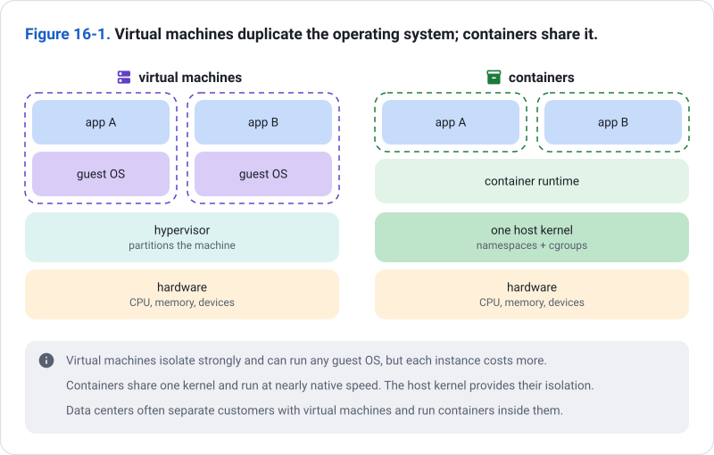
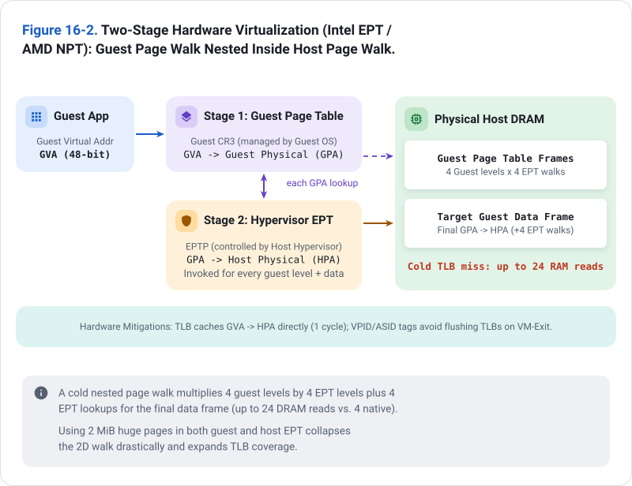

# 16. Virtualization and Containerization

Modern cloud infrastructure packs dozens of mutually untrusted customer workloads onto a single physical server while preserving the illusion that each tenant owns a dedicated machine. Systems engineers achieve this multi-tenancy through two distinct architectural mechanisms: **hardware virtual machines (VMs)**, which virtualize the physical processor and memory controller beneath complete guest kernels, and **containers**, which partition visibility and resource quotas inside a single shared host kernel.

## 16.1 Virtual Machines and Hypervisor Orchestration

A **virtual machine** executes an unmodified guest operating system (such as Linux or Windows) inside an isolated hardware environment synthesized by a **hypervisor** (such as Linux KVM, Xen, VMware ESXi, or Apple Virtualization.framework). Early software-only hypervisors faced a difficult architectural problem on x86: several sensitive instructions silently behaved differently in unprivileged rings instead of trapping, forcing complex binary translation.

Modern processors resolve this directly in silicon by introducing a dedicated hypervisor privilege tier orthogonal to Ring 0 through Ring 3:
- **On x86-64 (Intel VT-x / AMD-V):** The CPU divides execution into **VMX Root mode** (where the host kernel and hypervisor run) and **VMX Non-Root mode** (where the guest kernel runs at guest Ring 0 and guest apps run at guest Ring 3). Each virtual CPU (vCPU) is backed by an in-memory **Virtual Machine Control Structure (VMCS)** storing guest registers, host registers, and an execution-control bitmap specifying which sensitive guest instructions (`cpuid`, `hlt`, `in`/`out`, `mov cr3`, EPT violations) trigger a hardware **VM-Exit** back into the hypervisor, and how `VMLAUNCH` / `VMRESUME` re-enters the guest (**VM-Entry**).
- **On ARM64:** The processor provides an explicit **Exception Level 2 (`EL2`)** strictly above the guest kernel (`EL1`) and guest applications (`EL0`).

<figure>

</figure>

### 16.1.1 Two-Stage Hardware Address Translation (Intel EPT / AMD NPT)

Virtualizing memory poses a subtle challenge: the guest kernel believes it owns physical DRAM starting at address `0x0`, so it writes **Guest Physical Addresses (GPAs)** into its own page tables (`Guest CR3`). The host hypervisor cannot allow the guest kernel to map arbitrary **Host Physical Addresses (HPAs)** directly, or a compromised guest could read another tenant's DRAM.

Hardware-assisted virtualization solves this with **Two-Stage Address Translation** (Intel **Extended Page Tables, EPT**; AMD **Nested Page Tables, NPT**; ARM64 **Stage-2 Translation**), illustrated in Figure 16-2:

<figure>

</figure>

1. **Stage 1 (Controlled by Guest OS):** The guest application issues a **Guest Virtual Address (GVA)**. The MMU begins walking the guest's 4-level page table rooted at `Guest CR3` to translate `GVA -> GPA`.
2. **Stage 2 (Controlled by Host Hypervisor):** Every single pointer stored inside the guest's PML4, PDPT, PD, and PT is itself a *Guest Physical Address*, NOT a real host DRAM address. Before the MMU can read any of those four guest page-table entries, hardware must first walk the hypervisor's 4-level **EPT** (rooted at `EPTP` inside the VMCS) to translate that guest table's `GPA -> HPA`. Once the guest walk finally yields the data frame's GPA, hardware walks the EPT a fifth time to obtain the true host DRAM frame `HPA`.
3. **The 2D Page-Walk Cost and Hardware Mitigations:** Whereas a native 4-level TLB miss requires 4 DRAM accesses, a completely cold nested 4x4 walk requires up to `(4 * 4) + 4 + 4 = 24` memory reads (4 EPT reads for each of the 4 guest levels, 4 reads of the guest entries themselves, plus 4 EPT reads for the final data page). Hardware and hypervisors neutralize this penalty through three mechanisms:
   - **Direct `GVA -> HPA` TLB Caching:** Once the 2D walk completes, the CPU caches the final collapsed mapping `GVA -> HPA` directly in the TLB, delivering native 1-cycle hits on subsequent accesses.
   - **VPID / ASID Tagging:** Every TLB entry is tagged with a **Virtual Processor Identifier (`VPID` on Intel; `ASID` on AMD/ARM64)** so switching between host and guest on VM-Exit and VM-Entry does **not** flush the TLB.
   - **Huge Pages (2 MiB / 1 GiB):** Backing guest memory with 2 MiB host huge pages reduces EPT depth from 4 levels to 3 (and expands TLB reach by 512x).

### 16.1.2 Device Virtualization: Emulation, VirtIO, and Direct Passthrough

A guest kernel expects disk controllers and NICs to exist on its virtual PCIe bus. Hypervisors provide virtual I/O across three performance tiers:
- **Full Hardware Emulation:** Every guest MMIO register write traps via a VM-Exit into user-space QEMU, which emulates a legacy device (such as an Intel e1000 NIC). Compatible with any OS, but thousands of VM-Exits per second limit throughput severely.
- **Paravirtualization (`virtio`):** The guest runs a hypervisor-aware driver (`virtio-net`, `virtio-blk`) that places batches of I/O descriptors into shared-memory lock-free **virtqueues** in guest RAM and notifies the host once per batch via a single doorbell write, amortizing VM-Exit cost across dozens of packets or disk requests.
- **Hardware Passthrough (`VFIO` / `SR-IOV`):** Using an **IOMMU** (Intel VT-d / AMD-Vi / ARM SMMU) to translate device DMA addresses through the guest's `GPA -> HPA` mapping safely in silicon, the hypervisor assigns a physical GPU or SR-IOV NIC virtual function directly to the guest, achieving near-bare-metal latency and zero hypervisor data-plane overhead.

## 16.2 Containerization: Namespace and Resource Isolation

Running a complete guest kernel for every microservice duplicates hundreds of megabytes of kernel memory and requires seconds to boot. **Containers** (Docker, containerd, Kubernetes pods) take the opposite architectural path: every container shares the **single host Linux kernel**, executing as ordinary host processes constrained by three kernel subsystems:

1. **Namespaces (Visibility Isolation):** Partition global kernel tables so processes inside a container perceive a private system view (Figure 16-3). Container runtimes create namespaces via `clone()` flags or `unshare()`:
   - **`CLONE_NEWPID` (PID Namespace):** Assigns the container's entrypoint process PID `1` inside its own namespace while mapping it to an ordinary PID (such as `4821`) in the host process table. Processes inside the container cannot observe or signal host processes outside their subtree.
   - **`CLONE_NEWNS` (Mount Namespace) + `pivot_root`:** Gives the container an independent filesystem mount table rooted at its OCI container image layer (commonly assembled via `OverlayFS`).
   - **`CLONE_NEWNET` (Network Namespace):** Provides a private loopback interface, virtual Ethernet pair (`veth`), routing table, IP address, and iptables/eBPF firewall rules.
   - **`CLONE_NEWUTS`, `CLONE_NEWIPC`, `CLONE_NEWUSER`:** Isolate hostname, POSIX IPC/shared memory identifiers, and UID/GID mappings (allowing UID `0` inside a rootless container to map to an unprivileged UID such as `100000` on the host).
2. **Control Groups (`cgroups` v2, Resource Isolation):** Namespaces hide resources, whereas **cgroups** cap consumption so a single runaway container cannot starve noisy neighbors on the same host. The kernel exposes a hierarchical virtual filesystem (`/sys/fs/cgroup/`) where a runtime enforces hard ceilings on CPU bandwidth (`cpu.max`), physical RAM (`memory.max`, triggering the container-scoped OOM killer when exceeded), process count (`pids.max`, blocking fork bombs), and block storage IOPS (`io.max`).
3. **Syscall Filtering (`seccomp-bpf` and Linux Capabilities):** Because all containers share one host kernel, a vulnerability in an obscure kernel system call (such as `io_uring`, `bpf`, or `kexec_load`) threatens every container on the host. Runtimes drop unnecessary Linux capabilities (`CAP_SYS_ADMIN`, `CAP_NET_RAW`) and attach a **seccomp-bpf** filter program that intercepts every system call at Ring 0 entry and rejects disallowed syscall numbers with `EPERM` before the kernel handler ever runs.

<figure>

</figure>

## 16.3 Architectural Synthesis in Cloud Computing

Virtual machines and containers solve complementary layers of the cloud isolation problem, so production platforms routinely combine both:

| Dimension | Virtual Machines (KVM / Firecracker) | Containers (Namespaces + cgroups v2) |
| :--- | :--- | :--- |
| **Isolation Boundary** | Hardware-enforced (VMX Non-Root + EPT + IOMMU); distinct guest kernel per VM | Software-enforced inside one shared host kernel |
| **Attack Surface** | Narrow hypervisor + VirtIO device boundary | Entire host Linux syscall surface (mitigated by `seccomp-bpf`) |
| **Startup Latency** | Hundreds of milliseconds (microVMs) to seconds (full VMs) | Tens of milliseconds (`clone` + `execve`) |
| **Memory Overhead** | Dedicated guest kernel + page cache per VM | Near zero (shared host kernel and page cache) |

Cloud providers place a hardware VM boundary between distinct tenants (using lightweight **microVMs** such as AWS Firecracker or Kata Containers when serverless startup speed is required), and tenants deploy containers inside those VMs to package dependencies, orchestrate rolling upgrades, and pack microservices densely.
