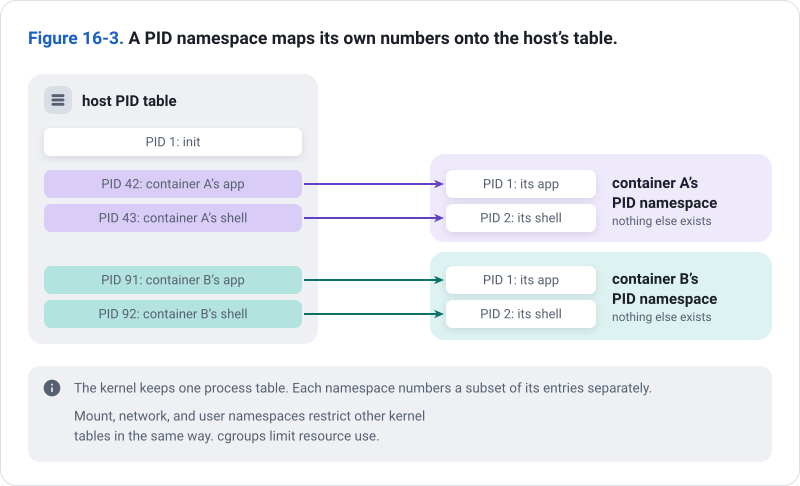

# 16. Virtualization and Containerization

Modern cloud infrastructure packs dozens of mutually untrusted customer workloads onto a single physical server while preserving the illusion that each tenant owns a dedicated machine. The central architectural problem of multi-tenancy is reconciling **isolation strength** with **density and startup speed**: how can one physical processor, memory controller, and **Network Interface Card (`NIC`)** host competing tenants safely without duplicating entire machines or sacrificing native execution speed?

Systems engineers address this trade-off through two complementary mechanisms (Figure 16-1). **Hardware Virtual Machines (`VM`s)** virtualize the physical processor, memory translation hardware, and peripheral bus beneath complete, unmodified guest operating-system kernels. **Containers** take the opposite path, partitioning visibility, resource quotas, and system-call access inside a single shared host kernel.

<figure>

</figure>

## 16.1 Popek-Goldberg Virtualization Requirements and the Classic x86 Problem

A **hypervisor** (also called a **Virtual Machine Monitor (`VMM`)**, such as Linux **Kernel-based Virtual Machine (`KVM`)**, Xen, VMware ESXi, or Apple Virtualization.framework) multiplexes physical hardware across multiple guest operating systems. In 1974, Gerald Popek and Robert Goldberg established the formal mathematical criteria for a classic hypervisor, defining three properties: **equivalence** (a program executing inside a `VM` behaves identically to executing on bare hardware, aside from timing), **resource control** (the hypervisor retains complete authority over physical memory, **Central Processing Unit (`CPU`)** time, and devices), and **efficiency** (the vast majority of guest instructions execute directly on the physical processor without hypervisor intervention).

To satisfy efficiency and resource control simultaneously, early hypervisors used **Trap-and-Emulate**: the hypervisor runs in supervisor mode (Ring 0), while the guest kernel is de-privileged to run in a less privileged ring (such as Ring 1 or Ring 3). Ordinary guest arithmetic and control-flow instructions run directly on silicon at full native speed. Whenever the guest kernel attempts to execute a **privileged instruction** (one that traps to Ring 0 when executed outside Ring 0, such as halting the processor or modifying page-table bases), the processor raises a hardware trap into the hypervisor, which emulates the instruction's effect on virtualized guest state and resumes the guest.

Popek and Goldberg proved a foundational theorem: an **Instruction Set Architecture (`ISA`)** is classically virtualizable by trap-and-emulate if and only if the set of **sensitive instructions** (instructions that read or modify hardware control state, or whose behavior changes depending on the current privilege level) is a subset of the **privileged instructions** (instructions that trap when executed in unprivileged mode).

### 16.1.1 Why Classic x86 Failed Popek-Goldberg

For decades, the classic 32-bit x86 architecture violated the Popek-Goldberg theorem: researchers identified **17 sensitive, unprivileged instructions** that did not trap when executed outside Ring 0, breaking trap-and-emulate virtualization. Three concrete instructions illustrate why de-privileging an unmodified x86 guest kernel fails. First, **`POPF` (Pop Flags)** updates the hardware **Interrupt Flag (`IF`)** when executed in Ring 0 to enable or disable external interrupts; when a de-privileged guest kernel executes `POPF` in Ring 1 or Ring 3 around a spinlock, x86 raises no fault and instead ignores the `IF` modification, leaving the hypervisor unaware that the guest expects interrupts to be masked. Second, **`SGDT`, `SIDT`, and `SLDT`** store the base address of the host's Global, Interrupt, or Local Descriptor Tables into a guest register without trapping at any privilege level, leaking host kernel addresses and violating isolation. Third, **`PUSH CS` and `MOV reg, CS`** expose the low two bits of the code segment register (`CS`), which encode the processor's true **Current Privilege Level (`CPL`)**; a guest kernel de-privileged to Ring 1 observes `CPL = 1` instead of `CPL = 0`, violating equivalence and breaking kernel paths that test whether an interrupt originated from user or kernel mode.

### 16.1.2 Dynamic Binary Translation vs. Hardware-Assisted Virtualization

Before processor vendors fixed these architectural holes in silicon, software hypervisors (notably VMware Workstation and early ESX) bypassed classic x86's flaws through **Dynamic Binary Translation (`BT`)**. Guest user-space code (Ring 3) still ran directly on the processor, while the hypervisor intercepted guest kernel code before execution, scanned basic blocks dynamically, and rewrote every sensitive unprivileged instruction into an explicit trap or inline emulation sequence targeting virtualized guest state. Translated basic blocks were stored in a software **translation cache** to amortize compilation overhead across repeated executions. While effective, binary translation incurred substantial complexity: tracking self-modifying guest kernel code, maintaining coherence between guest page tables and the translation cache, and paying software translation overhead on system-call-heavy workloads.

Modern processors eliminate binary translation entirely by introducing a dedicated hypervisor privilege tier orthogonal to Ring 0 through Ring 3. On x86-64 (**Intel Virtualization Technology (`VT-x`)** and **AMD Virtualization (`AMD-V`)**), the processor divides execution into **`VMX` Root mode** (where the host kernel and hypervisor execute across Rings 0 to 3) and **`VMX` Non-Root mode** (where the guest kernel executes natively at guest Ring 0 and guest applications execute at guest Ring 3). Because the guest kernel runs at true `CPL = 0` inside `VMX` Non-Root mode, `PUSH CS` reports Ring 0 and `POPF` behaves as expected, while the hardware transparently intercepts sensitive operations according to hypervisor policy. On ARM64, the architecture provides an explicit **Exception Level 2 (`EL2`)** hypervisor tier strictly above the guest kernel (**Exception Level 1 (`EL1`)**) and guest applications (**Exception Level 0 (`EL0`)**).

## 16.2 `VMX` Root vs. Non-Root Mode and `VMCS` Exit Costs

Under Intel `VT-x`, each **Virtual Central Processing Unit (`vCPU`)** is governed by a 4 KiB in-memory hardware control block called the **Virtual Machine Control Structure (`VMCS`)** (or **Virtual Machine Control Block (`VMCB`)** under `AMD-V`). Rather than reading or writing `VMCS` fields with ordinary memory instructions, the hypervisor manipulates the active `VMCS` through `VMREAD` and `VMWRITE` instructions so the processor can cache hot fields inside internal microarchitectural registers.

Each `VMCS` contains six logical regions: a **guest-state area** (storing guest `RIP`, `RSP`, `CR0`/`CR3`/`CR4`, segment descriptors, and interrupt flags), a **host-state area** (storing the host hypervisor's entry `RIP`, `RSP`, and host `CR3`), **VM-execution control fields** (bitmaps specifying exactly which guest instructions, exceptions, `I/O` port accesses, or external interrupts trigger an intercept), **VM-exit control fields**, **VM-entry control fields**, and **VM-exit information fields** (recording the exit reason and faulting guest address).

### 16.2.1 Tracing a VM-Entry and VM-Exit Round Trip

When the hypervisor schedules a `vCPU`, it executes `VMLAUNCH` (on first run) or `VMRESUME` (on subsequent entries). In a single hardware transition (**VM-Entry**), the processor saves host context, loads guest registers and `Guest CR3` from the `VMCS` guest-state area, switches to `VMX` Non-Root mode, and begins executing guest instructions natively.

When the guest executes an intercepted operation (such as `CPUID`, `HLT`, an `I/O` port `IN`/`OUT`, an **Extended Page Tables (`EPT`)** violation on an unmapped **Memory-Mapped Input/Output (`MMIO`)** register, or an arriving host hardware interrupt), the processor triggers a **VM-Exit**. Hardware atomically snapshots the guest's architectural state into the `VMCS` guest-state area, populates the exit-reason field, loads host registers and host `CR3` from the `VMCS` host-state area, and jumps to the hypervisor's exit handler in `VMX` Root mode.

A minimal hardware VM-Exit plus VM-Entry round trip handled entirely inside the host kernel (`KVM`) costs roughly **500 to 1,500 `CPU` cycles** (approximately 150 to 500 nanoseconds on a 3 GHz core), including pipeline flush, register-state switching, and speculative-execution mitigation barriers. If the exit cannot be satisfied inside the kernel and must return to a user-space device emulator such as **Quick Emulator (`QEMU`)** (for example, to emulate a legacy disk controller register), the round trip crosses into user space and back, expanding latency to **3 to 10 microseconds**. Minimizing VM-Exit frequency is therefore the single highest-leverage optimization in hypervisor design.

## 16.3 Memory Virtualization: Shadow Page Tables vs. Two-Dimensional `EPT`/`NPT`

Virtualizing physical memory poses a two-level naming problem: the guest operating system assumes it owns contiguous physical **Dynamic Random-Access Memory (`DRAM`)** starting at address `0x0`, so it writes **Guest Physical Addresses (`GPA`s)** into its own page tables (`Guest CR3`). The host hypervisor cannot allow the guest kernel to install arbitrary **Host Physical Addresses (`HPA`s)** directly into hardware page tables, or a compromised guest could read and overwrite another tenant's `DRAM` or the hypervisor itself.

### 16.3.1 Software Shadow Page Tables and the VM-Exit Storm

Before hardware-assisted memory virtualization arrived, hypervisors enforced isolation through **Shadow Page Tables**. The hypervisor maintained a separate, host-controlled page table mapping **Guest Virtual Addresses (`GVA`s)** directly to verified `HPA`s, and loaded that shadow table into the physical `CR3` register while the guest executed. Every time the guest switched processes (loading `Guest CR3`), or modified a single **Page Table Entry (`PTE`)** inside its own guest page tables, the hypervisor had to synchronize the shadow table.

To detect guest `PTE` edits, the hypervisor marked all guest page-table pages **read-only** in the shadow table. Every time the guest kernel executed `fork()`, `mmap()`, `munmap()`, or demand-faulted a single heap page, its write to its own page table triggered a page fault -> VM-Exit into the hypervisor -> instruction decode -> shadow `PTE` update -> VM-Entry. On process-creation benchmarks (`fork` + `exec`), shadow page tables generated tens of thousands of VM-Exits per second, degrading performance by 30% to 60% and consuming substantial host memory to duplicate page tables for every guest process.

### 16.3.2 Two-Stage Hardware Translation (`EPT` / `NPT`) and the 24-Access Walk

Modern processors eliminate shadow page tables via **Two-Stage Hardware Address Translation**: Intel **Extended Page Tables (`EPT`)**, AMD **Nested Page Tables (`NPT`)**, and ARM64 **Stage-2 Translation** (Figure 16-2). The hypervisor grants the guest full, trap-free ownership of `Guest CR3` and its own page tables (`GVA -> GPA`), while programming a second, hypervisor-controlled page table rooted at the **Extended Page Table Pointer (`EPTP`)** inside the `VMCS` (`GPA -> HPA`). Guest context switches, `fork()`, and `PTE` updates now execute inside `VMX` Non-Root mode with **zero VM-Exits**.

<figure>

</figure>

The cost of removing VM-Exits shifts to the hardware page-table walker on a **Translation Lookaside Buffer (`TLB`)** miss. Because every pointer stored inside the guest's 4-level page table (**Page Map Level 4 (`PML4`)**, **Page Directory Pointer Table (`PDPT`)**, **Page Directory (`PD`)**, and **Page Table (`PT`)**) is a *Guest Physical Address* rather than a host `DRAM` address, the **Memory Management Unit (`MMU`)** must translate each guest table's address through the 4-level `EPT` before it can read that guest table entry.

Count the exact memory accesses required for a completely cold 4-level guest walk atop a 4-level `EPT`:

```text
1. Translate Guest PML4 base (Guest CR3, a GPA) via 4-level EPT:   4 DRAM reads
   Read Guest PML4 entry at resulting HPA:                         1 DRAM read
2. Translate Guest PDPT base (a GPA) via 4-level EPT:              4 DRAM reads
   Read Guest PDPT entry at resulting HPA:                         1 DRAM read
3. Translate Guest PD base (a GPA) via 4-level EPT:                4 DRAM reads
   Read Guest PD entry at resulting HPA:                           1 DRAM read
4. Translate Guest PT base (a GPA) via 4-level EPT:                4 DRAM reads
   Read Guest PT entry at resulting HPA:                           1 DRAM read
5. Translate final Guest data frame (a GPA) via 4-level EPT:       4 DRAM reads
--------------------------------------------------------------------------------
Total worst-case DRAM accesses for one 4x4 nested TLB miss:       24 DRAM reads
```

Whereas a native bare-metal 4-level `TLB` miss performs 4 memory reads, a completely cold nested 4-by-4 walk performs up to **`(4 * 4) + 4 + 4 = 24` memory reads** before the processor can even issue the 25th read for the guest's actual data byte (on 5-level paging systems, a 5-by-5 nested walk reaches `(5 * 5) + 5 + 5 = 35` reads).

Processors and hypervisors neutralize this 6x page-walk amplification through four hardware and software mitigations. First, once resolved, the `TLB` caches the collapsed **`GVA -> HPA`** mapping directly, so `TLB` hits run in 1 cycle with zero virtualization penalty. Second, modern processors tag `TLB` entries with a **Virtual Processor Identifier (`VPID`)** on Intel or **Address Space Identifier (`ASID`)** on AMD/ARM64 so VM-Exits and VM-Entries no longer flush the `TLB`. Third, dedicated hardware **paging-structure caches** (caching upper-level `EPT` translations) short-circuit repeated `EPT` sub-walks for adjacent guest page tables. Fourth, hypervisors back guest `DRAM` with **2 MiB or 1 GiB host huge pages** (`Transparent Huge Pages` or `hugetlbfs`), collapsing `EPT` depth from 4 levels to 3 or 2 levels and expanding `TLB` reach by 512x.

## 16.4 Device Virtualization: Emulation, `virtio` Rings, and Direct Passthrough

A guest operating system expects disk controllers and `NIC`s on its virtual **Peripheral Component Interconnect Express (`PCIe`)** bus. Hypervisors deliver virtual **Input/Output (`I/O`)** across three architectural tiers summarized in Table 16-1.

| Tier | Mechanism | VM-Exit Frequency | Throughput / Latency | Guest Driver Requirement |
| :--- | :--- | :--- | :--- | :--- |
| **Full Emulation** | `QEMU` emulates legacy `e1000` / `IDE` registers via `MMIO` traps | Multiple VM-Exits per packet/block | Low (~100 Mbps to 1 Gbps) | Unmodified legacy OS drivers |
| **Paravirtualization (`virtio`)** | Shared-memory lock-free **virtqueues** + batched doorbells | Amortized (1 exit per batch of dozens) | High (10 to 40+ Gbps with `vhost`) | Guest `virtio-net` / `virtio-blk` driver |
| **Direct Passthrough (`VFIO` / `SR-IOV`)** | Physical `PCIe` function assigned directly via `IOMMU` | Near zero on data path | Bare-metal (100+ Gbps, microsecond) | Native vendor `NIC`/`GPU` driver |

### 16.4.1 Paravirtualized `virtio` Split-Ring Mechanics

Under full hardware emulation, every guest register read or write to a virtual Intel `e1000` `NIC` triggers an `EPT` violation VM-Exit into user-space `QEMU`, burning thousands of cycles per packet. **Paravirtualization (`virtio`)** replaces register-by-register emulation with a hypervisor-aware shared-memory contract built around lock-free circular buffers called **virtqueues** residing in guest `DRAM`.

A standard **split virtqueue** comprises three contiguous regions: a **Descriptor Table** (an array of `(guest_phys_addr, length, flags, next)` scatter-gather descriptors pointing to guest packet or block buffers), an **Available Ring** (written solely by the guest driver to publish indices of newly submitted descriptor chains), and a **Used Ring** (written solely by the host hypervisor to return completed descriptor chains and byte counts). To transmit 32 network packets, the guest driver writes all 32 entries into the Descriptor Table, advances the Available Ring index once, and executes a single `MMIO` **doorbell** write (triggering one VM-Exit, or zero exits when the host's `vhost-net` kernel thread or `DPDK` `vhost-user` poll-mode thread is actively polling). Once the host finishes transmitting the batch, it updates the Used Ring and injects a single virtual interrupt (`MSI-X`), using the `VIRTIO_RING_F_EVENT_IDX` feature to suppress redundant notifications while either side is already actively draining the ring.

### 16.4.2 Hardware Passthrough and `IOMMU` `DMA` Isolation

For latency-critical workloads such as **Graphics Processing Unit (`GPU`)** machine learning, 100 Gbps `RDMA` networking, or **Non-Volatile Memory Express (`NVMe`)** storage, hypervisors bypass virtual devices entirely via **Virtual Function I/O (`VFIO`)** and **Single Root I/O Virtualization (`SR-IOV`)** (which partitions one physical `NIC` into dozens of independent hardware **Virtual Functions (`VF`s)**).

Assigning a physical `PCIe` device directly to a guest poses a severe security risk if left unchecked: a malicious guest could program the `NIC`'s **Direct Memory Access (`DMA`)** engine to write into arbitrary host `DRAM` addresses. Hardware resolves this via an **Input-Output Memory Management Unit (`IOMMU`)** (Intel `VT-d`, AMD `AMD-Vi`, or ARM **System Memory Management Unit (`SMMU`)**). Sitting on the `PCIe` root complex, the `IOMMU` intercepts every `DMA` transaction issued by an assigned device and translates the guest-supplied `GPA` through a hypervisor-controlled `GPA -> HPA` `I/O` page table in silicon. Out-of-bounds `DMA` attempts are blocked in hardware, delivering bare-metal `I/O` latency while preserving full tenant isolation.

## 16.5 Containerization: Namespaces, `cgroups` v2, and `seccomp-bpf`

Running a complete guest kernel for every microservice duplicates 50 to 200 MiB of kernel memory per instance and adds hundreds of milliseconds to seconds of boot latency. **Containers** (Docker, `containerd`, Kubernetes pods) take the opposite architectural path: every container shares the **single host Linux kernel**, executing as ordinary host processes constrained by three orthogonal kernel mechanisms: **namespaces**, **Control Groups (`cgroups` v2)**, and **system-call filtering (`seccomp-bpf`)**.

### 16.5.1 Visibility Isolation via Linux Namespaces

Namespaces partition global kernel tables via `clone()` flags or `unshare(2)` so processes inside a container perceive a private, self-contained operating system (Figure 16-3). Table 16-2 catalogs the core namespace types used by **Open Container Initiative (`OCI`)** runtimes.

| Namespace Flag | Kernel Resource Isolated | Practical Container Effect |
| :--- | :--- | :--- |
| **`CLONE_NEWPID`** | Process ID tree | Container entrypoint sees itself as `PID 1`; host processes are invisible |
| **`CLONE_NEWNS`** | Mount table (`VFS`) | Private root filesystem via `pivot_root` atop layered `OverlayFS` image |
| **`CLONE_NEWNET`** | Network stack | Private loopback, virtual Ethernet (`veth`) pair, routing table, and `eBPF` rules |
| **`CLONE_NEWUSER`** | `UID` / `GID` mappings | Maps container `UID 0` (root) to unprivileged host `UID` (e.g., `100000`) |
| **`CLONE_NEWIPC`** | `POSIX` / `SysV` `IPC` | Isolates shared memory segments (`/dev/shm`) and message queues |
| **`CLONE_NEWUTS`** | Hostname and domain | Allows each container to set an independent `hostname` |
| **`CLONE_NEWCGROUP`** | `cgroup` root view | Virtualizes `/proc/self/cgroup` so containers cannot see host hierarchy |

<figure>

</figure>

### 16.5.2 Resource Isolation via `cgroups` v2

Namespaces restrict *visibility*, not *consumption*. Without resource ceilings, a single container running an infinite loop or a memory leak can saturate all host `CPU` cores or trigger a host-wide **Out-of-Memory (`OOM`)** kill affecting unrelated services. Linux **`cgroups` v2** exposes a unified hierarchical control filesystem under `/sys/fs/cgroup/` where the container runtime places each container's processes into a dedicated leaf group and writes hard resource budgets:

`cpu.max` enforces **Completely Fair Scheduler (`CFS`)** bandwidth throttling (for example, writing `50000 100000` caps the container to 50 ms of `CPU` time per 100 ms period, equivalent to 0.5 cores). `memory.high` sets a soft throttling watermark that forces memory reclaim inside the container, while `memory.max` sets a hard physical memory ceiling that triggers a **container-scoped `OOM` kill** rather than jeopardizing host daemons. `pids.max` caps the maximum number of threads and processes inside the container, stopping fork bombs (`while (1) fork()`) before they exhaust the host's global `PID` space. `io.max` caps storage read/write bandwidth and **Input/Output Operations Per Second (`IOPS`)** per block device to prevent noisy-neighbor disk starvation.

### 16.5.3 The Shared-Kernel Attack Surface and `seccomp-bpf`

Because every container on a node invokes system calls directly on the *same* Ring 0 Linux kernel, a single memory-corruption bug in any reachable kernel subsystem (such as `netfilter`, `io_uring`, or user-namespace mount handling) enables a **container escape** compromising every sibling container on the physical server. Linux exposes roughly 400 system calls, yet a typical web server or database requires fewer than 60.

Container runtimes narrow this attack surface in two layers. First, they drop dangerous Linux **Capabilities** (`CAP_SYS_ADMIN`, `CAP_NET_RAW`, `CAP_SYS_MODULE`, `CAP_SYS_PTRACE`) so even `UID 0` inside the container lacks privileged kernel operations. Second, they attach a **Secure Computing Mode (`seccomp-bpf`)** filter via `prctl(PR_SET_SECCOMP, SECCOMP_MODE_FILTER, &prog)`. A `seccomp-bpf` policy is a verified **Berkeley Packet Filter (`BPF`)** bytecode program executed by the kernel at every system-call entry *before* the syscall dispatcher runs. Inspecting the syscall number and register arguments, the filter allows safe calls (`read`, `write`, `epoll_wait`, `futex`) and rejects disallowed calls (`kexec_load`, `mount`, `bpf`, `keyctl`, `ptrace`) with `EPERM` or immediate `SIGSYS` termination.

## 16.6 Architectural Synthesis in Cloud Computing

Virtual machines and containers solve complementary layers of cloud infrastructure, summarized in Table 16-3.

| Dimension | Virtual Machines (`KVM` / Firecracker) | Containers (Namespaces + `cgroups` v2) |
| :--- | :--- | :--- |
| **Isolation Boundary** | Hardware-enforced (`VMX` Non-Root + `EPT` + `IOMMU`); distinct guest kernel per `VM` | Software-enforced inside one shared host kernel |
| **Attack Surface** | Narrow hypervisor + `virtio` device boundary | Entire host Linux syscall surface (mitigated by `seccomp-bpf`) |
| **Startup Latency** | ~125 ms (microVMs) to seconds (full `VM`s) | Tens of milliseconds (`clone` + `execve`) |
| **Memory Overhead** | Dedicated guest kernel + page cache per `VM` (~5 MiB in microVMs to 200+ MiB) | Near zero (shared host kernel and page cache) |

Because a `seccomp-bpf` allowlist still leaves dozens of complex kernel paths exposed (such as `TCP` parsing, `epoll`, and `VFS` path resolution), multi-tenant cloud providers do not rely on container namespaces alone to separate mutually untrusted customers. Instead, production platforms layer both technologies: a hardware `VM` boundary separates distinct tenants (using stripped-down **microVMs** such as AWS Firecracker or Kata Containers, which remove legacy `PCI`/`BIOS` emulation to boot a minimal Linux guest over `virtio` in roughly 125 ms with under 5 MiB of overhead), while each tenant runs containers inside its own `VM`s to package application dependencies, orchestrate rolling upgrades, and pack microservices densely.

<div class="callout keyidea">
<span class="label">Key idea</span>

Virtual machines isolate tenants in silicon (`VMX` Non-Root, two-stage `EPT`/`NPT`, and `IOMMU` `DMA` remapping) at the cost of a separate guest kernel and deeper `TLB` miss walks; containers isolate processes inside one shared host kernel via namespaces, `cgroups` v2, and `seccomp-bpf` with near-zero memory overhead.

</div>

<div class="callout experiment">
<span class="label">Experiment</span>

On Linux, launch an isolated `PID` and mount namespace directly from the shell (`sudo unshare --pid --fork --mount-proc bash`) and run `ps aux`. Notice that `bash` perceives itself as `PID 1` inside the namespace while `ps` on the host still lists it under an ordinary host `PID`.

</div>

<div class="callout caution">
<span class="label">Common Pitfall</span>

Treating container namespaces as a hardware security boundary equivalent to a `VM`. Because every container shares one host kernel, a privilege-escalation bug in a single exposed system call compromises all sibling containers on the node unless mitigated by `seccomp-bpf`, capability dropping, or a microVM boundary.

</div>
