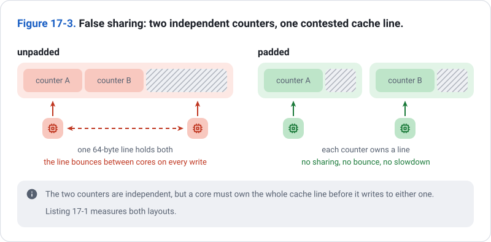

# 17. Multiprocessor Systems and Hardware Accelerators

As computing scale increases, the idealized model of a single, uniform pool of memory and a set of identical cores gives way to more complex architectures. Large-scale systems are characterized by Non-Uniform Memory Access (NUMA) topologies, complex cache coherency protocols, and the tight integration of specialized hardware accelerators for machine learning (ML) and high-performance computing (HPC). These hardware realities impose unique constraints on operating system design, runtime libraries, and systems software.

## 17.1 NUMA Topologies and Locality Optimization

In a Non-Uniform Memory Access (NUMA) architecture, the system is composed of multiple processor sockets or chiplets, each possessing its own local memory controller and associated DRAM. While any core can access any memory address in the physical address space, the latency and bandwidth of an access depend heavily on the physical distance between the executing core and the target memory chip. Accessing memory local to a socket is fast, whereas accessing memory across the inter-socket interconnect (e.g., UPI on Intel, Infinity Fabric on AMD, or UltraFusion on Apple Silicon) incurs a measurable latency penalty.

To mitigate performance degradation caused by remote memory access, the operating system employs two primary strategies:
- **Processor Affinity:** The scheduler attempts to maintain thread-to-socket locality by scheduling threads on the cores of the socket that currently holds their most frequently accessed data.
- **First-Touch Placement:** The kernel optimizes initial memory allocation by mapping a virtual page to a physical frame on the socket where the thread that first writes to that page is currently executing. This ensures that the data and the thread that uses it are co-located from the outset.

<figure>

</figure>

## 17.2 Cache Coherence and the False Sharing Phenomenon

The complexity of modern multiprocessor systems is further compounded by the requirement for hardware-level **cache coherence**. To ensure that all cores perceive a consistent view of memory, the hardware must manage the movement and invalidation of cache lines across the various levels of the cache hierarchy (typically via variants of the MESI/MOESI protocol). When a core writes to a memory location, it must obtain exclusive ownership of the corresponding 64-byte cache line, which necessitates invalidating any existing copies of that line in the caches of all other cores.

This mechanism introduces the performance hazard known as **false sharing**. False sharing occurs when two or more threads, which are logically operating on independent variables, happen to access data that resides within the same 64-byte cache line. Because the hardware manages coherence at the granularity of the cache line, the threads inadvertently trigger a continuous "ping-pong" effect, where the cache line is repeatedly transferred between cores. This results in massive, unintended synchronization overhead and can degrade performance by an order of magnitude. The remedy is to use architectural alignment (e.g., `alignas(64)`) to ensure that frequently written, independent variables reside on distinct cache lines.

<figure>

</figure>

**Listing 17-1. Two counters in one cache line and in two (C++20).**

```cpp
{{#include ../code/ch17/false_sharing.cpp}}
```

**Output 17-1. One run on the verification machine.**

```text
{{#include ../code/out/ch17_false_sharing.out}}
```

**Listing 17-2. The same experiment in Rust, with atomic counters.**

```rust
{{#include ../code/ch17/false_sharing.rs}}
```

**Output 17-2.**

```text
{{#include ../code/out/ch17_false_sharing_rs.out}}
```

<div class="callout keyidea">
<span class="label">Key idea</span>

Hardware cache coherence guarantees correctness, not performance. Independent variables written concurrently must be padded to 64-byte cache line boundaries (`alignas(64)`); otherwise, hardware invalidation traffic serializes execution cores across the memory bus.

</div>

## 17.3 Hardware Accelerators: Discrete Architecture vs. Unified Memory Architecture (UMA)

Beyond general-purpose CPUs, modern servers increasingly rely on specialized hardware accelerators, such as GPUs, Neural Processing Units (NPUs), and cryptographic ASICs, to handle computationally intensive ML and HPC workloads.

The operating system and runtime libraries manage accelerators across two fundamentally distinct memory architectures:

### 17.3.1 The Discrete Accelerator Model (PCIe + Dedicated VRAM)

In traditional enterprise servers (such as x86 hosts paired with discrete PCIe GPUs), the host CPU and the accelerator inhabit completely separate physical memory domains:
- **Host Memory:** General-purpose DDR4/DDR5 DRAM attached to the CPU sockets.
- **Device Memory:** High-bandwidth memory (HBM or GDDR) soldered directly onto the accelerator card.

To execute an ML workload, data must traverse the peripheral PCIe bus via Direct Memory Access (DMA):
1. **Memory Pinning:** The operating system must "pin" the host memory pages (`mlock` or kernel-level page pinning) so that the virtual memory subsystem does not page out or relocate the physical frames during the asynchronous DMA transfer.
2. **PCIe Transfer:** Data is copied over the PCIe bus into accelerator VRAM. PCIe bandwidth (typically 32–64 GB/s on PCIe 4.0/5.0) forms a severe throughput bottleneck compared to on-die memory buses.
3. **Execution & Return:** The accelerator processes the workload in its private VRAM and copies the result back across PCIe to host DRAM.

### 17.3.2 Unified Memory Architecture (UMA) on Apple Silicon

Apple Silicon servers and high-performance Systems-on-Chip (SoCs) employ a fundamentally different paradigm: **Unified Memory Architecture (UMA)**.

In a UMA system, the CPU cores, high-performance GPU cores, Neural Engine (NPU), and media engines are integrated onto the same physical silicon package, sharing a single, wide, high-bandwidth memory pool (reaching 800+ GB/s on Ultra-tier processors).

This architecture transforms system software design:
- **Zero-Copy Data Pipelines:** Because the CPU and accelerators share physical memory addresses, data transfers over PCIe are eliminated. An operating system daemon can allocate a buffer, ingest raw network or sensor packets via the CPU, and pass the buffer pointer directly to the GPU or Neural Engine without copying a single byte.
- **Elimination of Host Pinning Latency:** Accelerators access physical pages directly via the shared System Level Cache (SLC) and unified memory controllers, dramatically reducing dispatch latency for small, frequent ML inference tasks.

### 17.3.3 Heterogeneous Cache Coherency and Memory Barriers

While UMA eliminates physical memory copies, it introduces a critical systems software responsibility: **managing cache coherency across heterogeneous compute units**.

CPUs and accelerators prioritize fundamentally different memory access patterns:
- CPU cores utilize deep, strongly coherent L1/L2 caches optimized for ultra-low latency.
- GPU cores and NPUs utilize massive parallel write-combining buffers and specialized tile caches optimized for streaming throughput.

If a CPU thread writes an ML input tensor into a unified buffer and immediately signals the accelerator to begin execution, the accelerator may read stale data if the CPU's updates still reside in dirty L1/L2 cache lines. Conversely, when the accelerator finishes writing results, the CPU may read stale data from its own cache if lines are not explicitly invalidated.

Consequently, systems runtimes on UMA platforms must manage explicit synchronization:
- **Cache Flushing & Invalidation:** Forcing dirty CPU cache lines out to the shared physical memory (or SLC) before accelerator dispatch, and invalidating CPU caches before reading accelerator outputs.
- **Memory Fences & Command Queues:** Using hardware fences and completion events (such as Apple Metal command buffers and shared event primitives) to establish strict *happens-before* relationships between heterogeneous processors.

<div class="callout caution">
<span class="label">Watch out</span>

In Unified Memory Architectures, "zero-copy" does not mean "zero-synchronization." Forgetting to flush CPU write buffers or neglecting GPU completion fences leads to silent, non-deterministic data corruption that cannot be caught by standard CPU memory sanitizers.

</div>

<div class="callout summary">
<span class="label">Summary</span>

- NUMA systems enforce non-uniform access latencies; schedulers must optimize for socket affinity and first-touch memory allocation.
- False sharing occurs when concurrent threads write distinct variables within the same 64-byte cache line; align concurrently written data to 64 bytes (`alignas(64)`).
- Discrete accelerators are constrained by PCIe DMA transfer latency, host memory pinning, and separate memory pools.
- Apple Silicon Unified Memory Architecture (UMA) provides zero-copy memory sharing across CPU, GPU, and NPU cores, reaching sub-microsecond accelerator dispatch.
- Systems programming for UMA requires explicit management of cache flushes, memory barriers, and synchronization events across heterogeneous compute cores.

</div>
