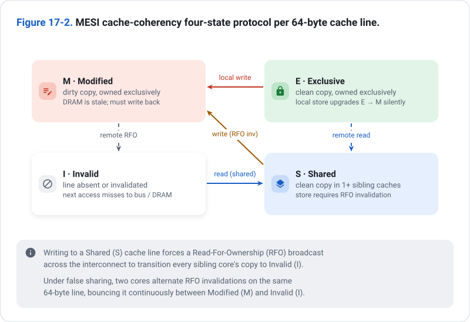

# 17. Multiprocessor Systems and Hardware Accelerators

The idealized model of a single uniform memory pool attached to identical, independent processors breaks down as core counts scale from a single socket to multi-socket servers and heterogeneous **Systems-on-Chip (`SoC`s)**. On real multiprocessor hardware, three physical realities dominate both correctness and throughput: threads contend for shared scheduling queues and cache lines across private L1/L2 caches, physical **Dynamic Random-Access Memory (`DRAM`)** latencies depend on which processor socket owns the target memory controller, and out-of-order cores buffer writes in private store buffers that relax program order unless constrained by hardware memory fences. Modern server and workstation designs compound these constraints by pairing general-purpose CPU cores with specialized accelerators for **Machine Learning (`ML`)** and **High-Performance Computing (`HPC`)**.

This chapter examines how operating systems and runtime libraries adapt to multiprocessor hardware from first principles: scheduling threads across cores without destroying cache locality, placing memory pages on **Non-Uniform Memory Access (`NUMA`)** topologies, reasoning through **Modified-Exclusive-Shared-Invalid (`MESI`)** and **Modified-Owned-Exclusive-Shared-Invalid (`MOESI`)** cache-coherency transitions and false sharing, navigating hardware memory models and **Read-Copy-Update (`RCU`)** grace periods, and synchronizing heterogeneous accelerators across both discrete **Peripheral Component Interconnect Express (`PCIe`)** buses and **Unified Memory Architecture (`UMA`)** silicon.

## 17.1 Multiprocessor Scheduling: `SQMS` vs. `MQMS`

On a uniprocessor, a scheduler selects one runnable thread from a single ready queue whenever a quantum expires or the running thread blocks. Extending that design to a machine with $N$ physical cores introduces a fundamental tension: how can an operating system keep all $N$ cores busy with balanced load while avoiding global lock contention and preserving each thread's warm private cache state?

### 17.1.1 Single-Queue Multiprocessor Scheduling (`SQMS`)

The most direct extension of uniprocessor scheduling is **Single-Queue Multiprocessor Scheduling (`SQMS`)**, where all runnable threads reside in one global ready queue protected by a single lock. Whenever any core needs work, it acquires the global lock, dequeues the next thread according to the scheduling policy, releases the lock, and dispatches the thread.

While `SQMS` reuses uniprocessor scheduling logic and keeps core utilization balanced automatically, it breaks down along two dimensions as core counts grow:

**Global lock contention and scalability collapse.** Every scheduling event on every core must acquire the same global spinlock. Consider a 64-core server running short request-handling tasks that execute for an average of $50\,\mu\text{s}$ before blocking on **Input/Output (`I/O`)**. Suppose each dequeue and enqueue sequence holds the global run-queue lock for $2\,\mu\text{s}$. Because the lock serializes all 64 cores, the scheduler can perform at most $1 / 2\,\mu\text{s} = 500{,}000$ transitions per second. Yet 64 cores running $50\,\mu\text{s}$ tasks demand $64 / 50\,\mu\text{s} = 1{,}280{,}000$ transitions per second. More than 60% of the machine's capacity vanishes into spinning on a single contested lock, while the cache line holding that lock bounces continuously across all 64 cores.

**Cache affinity loss.** Every thread accumulates warm state in its executing core's private L1/L2 caches and **Translation Lookaside Buffer (`TLB`)**. Under round-robin `SQMS`, threads migrate across cores on every time slice. Trace five runnable jobs ($A, B, C, D, E$) scheduled across four cores (CPU 0 through CPU 3) with a single FIFO ready queue:

```text
Quantum 1:  CPU 0 -> A   CPU 1 -> B   CPU 2 -> C   CPU 3 -> D   (Queue: [E])
Quantum 2:  CPU 0 -> E   CPU 1 -> A   CPU 2 -> B   CPU 3 -> C   (Queue: [D])
Quantum 3:  CPU 0 -> D   CPU 1 -> E   CPU 2 -> A   CPU 3 -> B   (Queue: [C])
```

In every quantum, every job lands on a different core than the one it ran on previously. Each migration forces the incoming core to suffer cold L1/L2 cache misses and `TLB` reloads while fetching the thread's working set across the inter-core interconnect. Some `SQMS` implementations add **cache affinity** heuristics that scan the queue to prefer jobs that last ran on the requesting core, migrating only one job periodically for fairness. That heuristic recovers partial locality, but scanning a shared queue increases lock hold time and worsens the central lock bottleneck.

### 17.1.2 Multi-Queue Multiprocessor Scheduling (`MQMS`)

**Multi-Queue Multiprocessor Scheduling (`MQMS`)** eliminates the global lock bottleneck by assigning each CPU core its own private ready queue (`Q0`, `Q1`, ..., `Q_{N-1}`). When a thread becomes runnable, the kernel places it into one core's local queue. During normal scheduling, each core locks and manipulates only its own queue, eliminating cross-core lock contention. Because a thread stays on the same queue across consecutive quanta, it runs repeatedly on the same core and reuses its warm L1/L2 cache lines and `TLB` entries automatically.

Eliminating the global queue introduces a new failure mode: **load imbalance**. Suppose CPU 0 holds queue `[A, C]` and CPU 1 holds queue `[B, D]`. While all four jobs run, both cores share the workload evenly and every job receives 50% of a core. If job $A$ exits, CPU 0 holds only `[C]` (giving $C$ 100% of a core) while CPU 1 continues time-slicing `[B, D]` (giving $B$ and $D$ only 50% each). If job $C$ also blocks on disk `I/O`, CPU 0 sits completely idle while $B$ and $D$ remain queued on CPU 1, wasting half the machine's compute capacity.

### 17.1.3 Migration and Work-Stealing

An `MQMS` scheduler restores balance through **thread migration**, moving a runnable thread from an overloaded queue to an underloaded or idle queue. Two complementary mechanisms perform migration in modern kernels and user-space runtimes.

In **work-stealing**, an idle core (or a core whose queue depth drops below a threshold) selects a remote victim core at random and inspects its queue. If the victim's queue holds substantially more runnable threads than the thief's queue, the thief steals one or more threads into its local queue. The central engineering trade-off in work-stealing is the **peeking interval**. If idle cores peek across remote queues continuously, the resulting cross-core reads saturate the coherence interconnect and disturb busy victims; if cores peek too infrequently, load imbalances persist for tens of milliseconds and inflate tail latency.

In production operating systems such as Linux, the **Completely Fair Scheduler (`CFS`)** and its successor, **Earliest Eligible Virtual Deadline First (`EEVDF`)**, combine per-core run queues with a hierarchical periodic load balancer that respects cache-domain topology. The balancer first tries to migrate threads between logical siblings sharing an L2 cache, then between cores sharing a **Last-Level Cache (`LLC`)**, and only migrates across `NUMA` sockets when the load imbalance exceeds a high threshold that justifies abandoning socket-local `DRAM`. User-space async runtimes (such as Rust's Tokio and the Go scheduler) apply the same `MQMS` principle using lock-free Chase-Lev work-stealing deques, where a worker pushes and pops tasks from its own local tail in **Last-In, First-Out (`LIFO`)** order for hot cache reuse, while remote thieves steal older tasks from the head in **First-In, First-Out (`FIFO`)** order.

| Scheduling Architecture | Common-Path Lock Contention | L1/L2 Cache Affinity | Load Balance | Primary Engineering Complexity |
| :--- | :--- | :--- | :--- | :--- |
| **`SQMS`** | High (single global queue lock) | Poor (frequent cross-core migration) | Automatic | Affinity heuristics and lock scalability |
| **`MQMS`** | Low (private per-core queues) | High (threads stay on local core) | Requires migration | Work-stealing thresholds and topology-aware balancing |

## 17.2 `NUMA` Topologies and Locality Optimization

Once a server grows beyond a few dozen cores, connecting every core to a single memory controller becomes physically impractical because pin counts, wire lengths, and memory-controller queue depths saturate. Hardware architects therefore partition large machines into **Non-Uniform Memory Access (`NUMA`)** nodes: multiple processor sockets or chiplets, each owning its own local memory controller and attached `DRAM` channels (Figure 17-1).

<figure>

</figure>

Every core can still load and store any physical address in the machine, preserving a flat shared-memory programming model. Latency and bandwidth, however, depend strongly on physical distance between the executing core and the memory controller hosting the target physical frame. On a typical dual-socket x86 server, accessing local `DRAM` takes roughly 70 to 80 ns at 200 GB/s of aggregate local bandwidth. Crossing the inter-socket interconnect (Intel **Ultra Path Interconnect (`UPI`)**, AMD Infinity Fabric, or Apple UltraFusion) to reach remote `DRAM` adds 50 to 70 ns per hop, raising access latency to 120 to 150 ns (a $1.7\times$ to $2.0\times$ penalty) while forcing traffic through a much narrower inter-socket link. On four-socket or eight-socket machines, two-hop remote accesses degrade latency further and can collapse throughput when multiple sockets contend for the same interconnect links.

### 17.2.1 First-Touch Page Allocation and the Initialization Trap

To keep threads close to their data, operating systems combine **processor affinity** (pinning or biasing threads onto cores within a single `NUMA` node) with **first-touch page placement**. When a process calls `mmap()` or `malloc()` to reserve a large region of virtual memory, the kernel does not allocate physical `DRAM` frames immediately. Instead, it records a virtual memory area and leaves the corresponding **Page Table Entries (`PTE`s)** unmapped. Only when a thread first faults on a page does the kernel allocate a physical frame, placing that frame on the `NUMA` node of the core that triggered the page fault.

First-touch placement creates a subtle performance pathology in multi-threaded applications. Consider a two-socket in-memory database that allocates a 64 GiB buffer pool at startup. If the main thread running on Socket 0 calls `mmap()` and immediately zeroes the entire 64 GiB region with `memset()` before spawning worker threads, every single page fault occurs on Socket 0. The kernel places all 64 GiB of physical frames in Socket 0's local `DRAM`. When worker threads subsequently launch on Socket 1 and execute queries, 100% of their memory accesses traverse the `UPI` interconnect to Socket 0, saturating the inter-socket link and doubling query latency.

Avoiding this trap requires aligning initialization with the execution topology. Either each worker thread initializes and faults its own memory partition in parallel after being pinned to its target socket (via `sched_setaffinity()` on Linux), or the application overrides the default policy using `mbind()` or `set_mempolicy()`. For read-mostly shared structures accessed uniformly by all sockets (such as global routing tables or lookup indices), the **`MPOL_INTERLEAVE`** policy distributes consecutive 4 KiB pages round-robin across all `NUMA` nodes so no single socket's memory controller becomes a hotspot.

## 17.3 Cache Coherence and the False Sharing Phenomenon

On a multiprocessor, each core maintains private L1 and L2 caches to hide the 200-to-300-cycle latency of main `DRAM`. Private caches immediately introduce a correctness hazard: if Core 0 modifies address `0x1000` in its private L1 cache while Core 1 holds an older copy of `0x1000` in its own L1 cache, subsequent reads on Core 1 would observe stale data. Hardware-level **cache coherence** prevents this divergence by enforcing two invariants on every memory location: a **Single-Writer, Multiple-Reader (`SWMR`)** invariant (at any instant, either one core holds exclusive write permission for a cache line or any number of cores hold read-only copies) and a **Data-Value Invariant** (the value returned by any read equals the value written by the most recent completed store in that line's coherence order).

### 17.3.1 The `MESI` and `MOESI` State Machines

Most modern processors implement coherence at the granularity of a **64-byte cache line** using variants of the **Modified-Exclusive-Shared-Invalid (`MESI`)** protocol (Figure 17-2) or the five-state **Modified-Owned-Exclusive-Shared-Invalid (`MOESI`)** extension. Every cache line in a core's private cache carries state bits defining what operations the core may perform locally without consulting the interconnect.

| Coherence State | Line Valid Locally? | Matches `DRAM`? | Other Cores May Hold Copy? | Local Store Requires Bus Transaction? |
| :--- | :--- | :--- | :--- | :--- |
| **Modified (`M`)** | Yes | No (dirty) | No (exclusive) | No (write locally at L1 speed) |
| **Exclusive (`E`)** | Yes | Yes (clean) | No (exclusive) | No (upgrades locally to `M`) |
| **Shared (`S`)** | Yes | Yes (clean, in `MESI`) | Yes | Yes (must broadcast `RFO` / invalidate) |
| **Invalid (`I`)** | No | N/A | Yes | Yes (must fetch line via `RFO`) |
| **Owned (`O`, `MOESI`)** | Yes | No (dirty) | Yes (peers hold `S`) | Yes (must invalidate `S` peers to enter `M`) |

<figure>

</figure>

To see the exact hardware cost of coherence, trace two cores (Core 0 and Core 1) reading and writing address `0x1000` under `MESI`, starting with the cache line absent (`I`) in both caches:

1. **Core 0 reads `0x1000`:** Core 0 suffers a read miss and broadcasts a `BusRd` request across the interconnect. No sibling core holds the line, so memory supplies the 64-byte block and Core 0 installs it in state **`E` (Exclusive)**. If Core 0 writes to `0x1000` next, it can transition from `E` to `M` locally with zero bus traffic.
2. **Core 1 reads `0x1000`:** Core 1 suffers a read miss and broadcasts `BusRd`. Core 0 snoops the request, detects that it holds the line in `E`, asserts the shared signal, and transitions its copy from `E` to **`S` (Shared)**. Core 1 installs its copy in **`S`**. Both cores can now read `0x1000` concurrently at L1 speed (~1 ns).
3. **Core 0 writes `0x1000`:** Because Core 0 holds the line in `S`, it cannot write locally without violating the `SWMR` invariant. Core 0 broadcasts a **Read-For-Ownership (`RFO`)** invalidation (`BusUpgr`) across the interconnect. Core 1 snoops the invalidation, transitions its copy from `S` to **`I` (Invalid)**, and returns an invalidation acknowledgement. Only after receiving all acknowledgements does Core 0 transition to **`M` (Modified)** and commit its store.
4. **Core 1 writes `0x1000`:** Core 1's copy is now `I`, causing a store miss. Core 1 broadcasts an `RFO` (`BusRdX`). Core 0 snoops the request, sees that it owns the only dirty copy in `M`, flushes the modified 64-byte line across the interconnect (updating `LLC`/`DRAM` or forwarding directly via cache-to-cache transfer), and transitions to **`I`**. Core 1 receives the line in **`M`** and completes its store.

When a system upgrades from `MESI` to `MOESI` (used in AMD x86-64 and ARM coherent interconnects), the fifth **`Owned` (`O`)** state eliminates unnecessary `DRAM` writebacks during read-sharing of dirty data. In step 4, if Core 1 only *reads* `0x1000` while Core 0 holds it in `M`, `MESI` requires Core 0 to write the dirty line back to `DRAM` before both cores enter `S`. Under `MOESI`, Core 0 forwards the dirty line directly to Core 1 (which enters `S`) and transitions itself from `M` to `O`, deferring the expensive `DRAM` writeback until Core 0 eventually evicts the `O` line.

### 17.3.2 False Sharing Latency Math and Cache-Line Padding

Because coherence tracks ownership per 64-byte cache line rather than per individual byte or machine word, two threads updating logically independent variables suffer severe contention whenever those variables share the same 64-byte line (Figure 17-3). This phenomenon is **false sharing**. Even though Thread 1 writes only to field `a` (offset 0) and Thread 2 writes only to field `b` (offset 8), the hardware cannot grant simultaneous `M` ownership of the enclosing cache line to two cores. Every store by Thread 1 issues an `RFO` that invalidates Thread 2's cache line, and every store by Thread 2 immediately steals the line back.

<figure>

</figure>

Listings 17-1 and 17-2 measure this exact effect in C++20 and Rust 2024. Both programs compare an `Unpadded` struct (where atomic counters `a` and `b` sit side by side inside one 64-byte cache line) against a `Padded` struct (where `alignas(64)` in C++20 or `#[repr(C, align(64))]` plus a 56-byte `[u64; 7]` pad in Rust forces `b` onto a separate 64-byte cache line). Each thread executes `40,000,000` relaxed atomic increments (`fetch_add(1)`), preceded by one full warmup pass so the final printed counter value reaches `80,000,000`.

**Listing 17-1. Two counters in one cache line and in two (C++20).**

```cpp
{{#include ../code/ch17/false_sharing.cpp}}
```

**Output 17-1. One run on the verification machine.**

```text
{{#include ../code/out/ch17_false_sharing.out}}
```

**Listing 17-2. The same experiment in Rust, with atomic counters.**

```rust
{{#include ../code/ch17/false_sharing.rs}}
```

**Output 17-2.**

```text
{{#include ../code/out/ch17_false_sharing_rs.out}}
```

The timing numbers in Outputs 17-1 and 17-2 expose the latency math of `RFO` ping-ponging directly. In the `Padded` layout, each core retains its cache line in state `M` for all 40 million iterations, executing local L1 atomic read-modify-write instructions in $340.6\,\text{ms} / 40{,}000{,}000 \approx 8.5\,\text{ns}$ per increment (C++20) and $337.5\,\text{ms} / 40{,}000{,}000 \approx 8.4\,\text{ns}$ (Rust). In the `Unpadded` layout, the exact same instruction stream takes $1{,}745.7\,\text{ms} / 40{,}000{,}000 \approx 43.6\,\text{ns}$ per increment (a $5.13\times$ slowdown in C++20 and $5.18\times$ in Rust). Each extra ~35 ns represents the inter-core coherence round-trip required to invalidate the peer core's L1 line and transfer dirty ownership across the interconnect. On multi-socket `NUMA` servers where the two threads run on different sockets, that round-trip climbs past 100 ns, degrading throughput by more than an order of magnitude.

In production systems code, padding to 64 bytes eliminates intra-line false sharing on x86-64. On platforms with 128-byte cache-line sectors or spatial adjacent-line prefetchers (such as Apple Silicon L2 caches and certain Intel Xeon microarchitectures), engineers pad hot cross-core fields to 128 bytes or query C++17's `std::hardware_destructive_interference_size` to prevent adjacent-line prefetch traffic from reintroducing contention.

<div class="callout keyidea">
<span class="label">Key idea</span>

Hardware cache coherence guarantees correctness, not performance. Independent variables written concurrently must be padded to cache-line boundaries (`alignas(64)` or `#[repr(align(64))]`); otherwise, `MESI` `RFO` invalidation traffic serializes execution cores across the interconnect.

</div>

<div class="callout experiment">
<span class="label">Experiment</span>

Run Listing 17-1 (`code/ch17/false_sharing.cpp`) or Listing 17-2 (`code/ch17/false_sharing.rs`) and compare elapsed time between the packed struct (both counters on one 64-byte cache line) and the padded struct. Notice how separating the two counters by 64 bytes eliminates `MESI` `RFO` ping-ponging and speeds up execution more than fivefold.

</div>

## 17.4 Hardware Memory Models, Store Buffers, and `RCU`

Cache coherence governs the visibility of accesses to a *single* memory address, yet multi-threaded synchronization almost always coordinates *multiple* addresses (for example, writing a data payload to `buffer[i]` and then publishing a flag `ready = 1`). On modern out-of-order processors, cache coherence alone does not guarantee that two cores observe writes to distinct addresses in program order.

### 17.4.1 Store Buffers and the Dekker Litmus Test

Waiting for an `RFO` invalidation acknowledgement takes 30 to 100+ cycles. If a processor stalled its execution pipeline on every store miss, single-thread throughput would collapse. Hardware architects therefore insert a private FIFO **store buffer** between each core's execution units and its L1 data cache. When a core executes a store, it places the address and value into its local store buffer and continues executing subsequent instructions immediately; the store drains into the coherent L1 cache asynchronously once `RFO` ownership arrives. To preserve single-thread correctness, the core performs **store-buffer forwarding**: if the same core loads an address currently sitting in its own store buffer, it reads the buffered value directly.

Because another core cannot inspect a sibling's private store buffer, store buffering breaks **Sequential Consistency (`SC`)**. Trace the classic **Store-Buffer (Dekker) litmus test**, with shared variables `x` and `y` both initialized to `0`:

```text
Core 0:  x = 1;  r1 = y;
Core 1:  y = 1;  r2 = x;
```

Under sequential consistency, at least one store must execute globally before the opposing load, making the outcome `r1 == 0 && r2 == 0` impossible. On real x86-64 and ARM64 hardware, however, `r1 == 0 && r2 == 0` occurs routinely: Core 0 writes `x = 1` into its private store buffer and immediately executes `r1 = y`, reading `0` from its coherent L1 cache before `x = 1` drains. Simultaneously, Core 1 buffers `y = 1` and reads `x == 0` from its L1 cache. Both loads complete with `0` before either store becomes globally visible.

### 17.4.2 x86-64 `TSO` vs. ARM64 Weak Memory Ordering

Processor architectures differ sharply in which memory-access pairs they allow hardware to reorder. **x86-64 Total Store Order (`TSO`)** guarantees that stores drain from the store buffer in strict FIFO order and that loads never pass earlier loads. Consequently, `TSO` permits only **Store-Load reordering** (the exact store-buffer effect seen in the Dekker test). Because Load-Load, Load-Store, and Store-Store ordering hold automatically in hardware, C++20 and Rust `acquire` loads and `release` stores compile to plain `MOV` instructions on x86-64, needing only a compiler barrier to prevent compiler reordering. Enforcing `SeqCst` (preventing Store-Load reordering) requires draining the store buffer via an explicit `MFENCE` or a locked instruction such as `LOCK XCHG`.

**ARM64 (AArch64)** implements a **weakly ordered memory model**. In addition to store buffering, ARM64 permits speculative loads to complete out of order and allows stores to coalesce and commit in non-FIFO order across memory banks. As a result, all four reorderings (Load-Load, Load-Store, Store-Store, and Store-Load) are architecturally legal unless constrained by explicit instructions. An `acquire` load compiles to `LDAR` (Load-Acquire Register), a `release` store compiles to `STLR` (Store-Release Register), and a full bidirectional fence compiles to `DMB ISH` (Data Memory Barrier, Inner Shareable domain). Code that omits `acquire`/`release` annotations by mistake often appears to pass stress tests on x86-64 `TSO` and then fails sporadically with data corruption when ported to ARM64 servers or Apple Silicon.

| Reordering Allowed by Hardware | Sequential Consistency (`SC`) | x86-64 (`TSO`) | ARM64 (Weak Ordering) |
| :--- | :--- | :--- | :--- |
| Load reordered after Load | No | No | Yes |
| Store reordered after Load | No | No | Yes |
| Store reordered after Store | No | No | Yes |
| Load reordered after Store (Store Buffer) | No | **Yes** | **Yes** |
| Typical `Acquire` / `Release` Hardware Cost | Full fence | Plain `MOV` (compiler fence only) | `LDAR` / `STLR` instructions |

### 17.4.3 Read-Copy-Update (`RCU`) and Grace Periods

On many-core servers running read-dominated kernel subsystems (such as network routing tables, Linux's `dentry` path-lookup cache, or loaded kernel module lists), even a reader-writer lock (`RwLock`) fails to scale. Every reader acquiring a traditional `RwLock` must execute an atomic increment on a shared reader counter, and an atomic decrement upon release. With 64 cores reading concurrently, that single reader-counter cache line bounces across all 64 cores via `RFO` invalidations, turning a theoretically parallel read path into a serialized coherence storm.

**Read-Copy-Update (`RCU`)** solves this scalability cliff by eliminating *all* shared writes, atomic instructions, and lock acquisitions from the read path. `RCU` coordinates readers and writers through three disciplined phases:

1. **Zero-write read-side critical sections.** A reader enters an `RCU` critical section (`rcu_read_lock()`), loads the shared pointer to the current data structure via `rcu_dereference()` (an acquire or consume load), traverses the immutable fields, and exits (`rcu_read_unlock()`). In a non-preemptible kernel, `rcu_read_lock()` and `rcu_read_unlock()` compile to zero memory fences and zero atomic writes; they only disable local kernel preemption. Because readers perform zero writes to shared cache lines, every core caches the read-only data in state `S`, and aggregate read throughput scales linearly with core count.
2. **Copy and atomic publication.** When a writer needs to modify the structure, it does not mutate the live object in place. Instead, it allocates a new copy, writes the updated fields into that private copy, and publishes the new pointer with a release store (`rcu_assign_pointer()`). Every reader that begins after the pointer swap observes the new version atomically; every pre-existing reader continues traversing the old, unmodified version safely without locking.
3. **Grace periods and deferred reclamation.** The writer cannot immediately free the old object because pre-existing readers may still hold pointers to it. To reclaim memory safely, the writer calls `synchronize_rcu()`, waiting for one **grace period** to elapse. A grace period ends once every CPU core in the system has passed through at least one **quiescent state** (such as a context switch, the idle loop, or user-mode execution) where the core is guaranteed not to be inside any non-preemptible `RCU` read-side critical section. Once all $N$ cores have reported a quiescent state, no pre-existing reader can possibly retain a reference to the old version, and the writer frees the old object safely.

The trade-off is explicit: `RCU` makes writers slower (requiring allocation, copying, and waiting milliseconds for a grace period) and permits bounded staleness (pre-existing readers finish seeing the previous snapshot), in exchange for wait-free, linear-scaling reads across hundreds of cores.

## 17.5 Hardware Accelerators: Discrete Architecture vs. Unified Memory Architecture (`UMA`)

Beyond general-purpose processors, modern servers increasingly rely on specialized hardware accelerators (such as **Graphics Processing Units (`GPU`s)**, **Neural Processing Units (`NPU`s)**, and cryptographic **Application-Specific Integrated Circuits (`ASIC`s)**) to execute `ML` and `HPC` workloads across two distinct memory architectures.

### 17.5.1 The Discrete Accelerator Model (`PCIe` + Dedicated `VRAM`)

In traditional enterprise servers (such as x86 hosts paired with discrete `PCIe` `GPU`s), the host processor and accelerator inhabit separate physical memory domains: general-purpose **Double Data Rate (`DDR4`/`DDR5`)** `DRAM` on the host, and **High Bandwidth Memory (`HBM`)** or **Graphics Double Data Rate (`GDDR`)** **Video Random-Access Memory (`VRAM`)** soldered onto the accelerator card. Executing a workload requires **Direct Memory Access (`DMA`)** transfers across `PCIe`: the operating system pins host pages (`mlock` or kernel page pinning) so the virtual memory subsystem cannot relocate physical frames mid-transfer, copies inputs across the `PCIe` bus (32 to 64 GB/s on `PCIe` 4.0/5.0, far slower than multi-terabyte-per-second on-package `HBM`), runs the kernel on the `GPU`, and copies results back to host `DRAM`.

For small batches or latency-sensitive inference requests, the host-to-device `DMA` copy and kernel-launch overhead across `PCIe` often exceed the actual compute time on the `GPU`. High-throughput systems amortize this boundary by overlapping `DMA` transfers with compute via asynchronous command streams and double-buffered pinned host staging pools.

### 17.5.2 **Unified Memory Architecture (`UMA`)** on Apple Silicon

Apple Silicon servers and high-performance `SoC`s integrate CPU cores, `GPU` cores, Neural Engine (`NPU`), and media engines onto a single silicon package sharing one wide memory pool (exceeding 800 GB/s on Ultra-tier parts). Because every compute unit addresses the same physical memory through a shared **System Level Cache (`SLC`)**, `PCIe` copies and host pinning vanish: a daemon can ingest network packets on the CPU and pass the buffer pointer directly to the `GPU` or `NPU` with sub-microsecond dispatch latency. Large language models and scientific datasets that exceed discrete `VRAM` capacities can run directly in unified memory without partitioning or swapping tensors across `PCIe`.

### 17.5.3 Heterogeneous Cache Coherency and Memory Barriers

While `UMA` eliminates physical memory copies, CPUs and accelerators maintain distinct local caches: CPUs optimize for low-latency coherent Level 1 and Level 2 caches, whereas `GPU`s and `NPU`s rely on wide streaming write-combining buffers and tile caches that do not participate in full CPU `MESI` snooping on every instruction. Without explicit synchronization, an accelerator can read stale bytes still sitting in dirty CPU cache lines, or the CPU can read stale cached bytes after the accelerator finishes writing results. Systems runtimes on `UMA` platforms therefore enforce explicit **cache flushes and invalidations** alongside hardware **memory fences and command-queue completion events** (such as Apple Metal command buffers and shared events) to establish strict *happens-before* visibility across heterogeneous compute units.

<div class="callout caution">
<span class="label">Watch out</span>

In Unified Memory Architectures, "zero-copy" does not mean "zero-synchronization." Forgetting to flush CPU write buffers or neglecting `GPU` completion fences leads to non-deterministic data corruption that standard CPU memory sanitizers cannot detect.

</div>

<div class="callout summary">
<span class="label">Summary</span>

Scaling software across multiprocessors requires designing around physical hardware boundaries. `MQMS` schedulers eliminate `SQMS` lock contention and preserve L1/L2 cache affinity while relying on topology-aware migration and work-stealing to prevent load imbalance. On `NUMA` servers, thread affinity and parallel first-touch initialization prevent remote interconnect saturation. Inside private caches, `MESI`/`MOESI` coherence enforces correctness at 64-byte granularity, making cache-line padding (`alignas(64)` / `#[repr(align(64))]`) mandatory for concurrently written fields. Across cores, store buffers and weak ARM64 memory ordering require explicit acquire/release barriers, while `RCU` achieves linear read scaling by replacing reader locks with deferred grace-period reclamation. Finally, heterogeneous systems trade `PCIe` `DMA` copies on discrete accelerators for explicit cache-flush and command-queue synchronization on `UMA` platforms.

</div>
