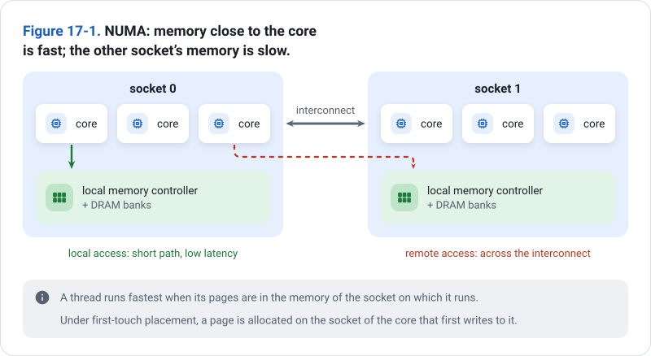

# 17. Multiprocessor Systems and Hardware Accelerators

As computing scale increases, the idealized model of a single, uniform pool of memory and a set of identical cores gives way to more complex architectures. Large-scale systems are characterized by **Non-Uniform Memory Access (`NUMA`)** topologies, complex cache coherency protocols, and the tight integration of specialized hardware accelerators for **Machine Learning (`ML`)** and **High-Performance Computing (`HPC`)**. These hardware realities impose unique constraints on operating system design, runtime libraries, and systems software.

## 17.1 `NUMA` Topologies and Locality Optimization

In a `NUMA` architecture, the system is composed of multiple processor sockets or chiplets, each possessing its own local memory controller and associated **Dynamic Random-Access Memory (`DRAM`)** (Figure 17-1). While any core can access any physical address, latency and bandwidth depend strongly on physical distance between the executing core and the target memory controller. Accessing local `DRAM` is fast, whereas traversing the inter-socket interconnect (such as Intel **Ultra Path Interconnect (`UPI`)**, AMD Infinity Fabric, or Apple UltraFusion) incurs a measurable latency and bandwidth penalty.

To preserve locality, operating systems combine two policies: **processor affinity** (scheduling threads onto cores belonging to the socket that holds their working set) and **first-touch placement** (allocating physical frames on the socket of the thread that first faults and writes a newly mapped page, rather than the thread that merely called `mmap()`).

<figure>

</figure>

## 17.2 Cache Coherence and the False Sharing Phenomenon

Hardware-level **cache coherence** guarantees that all cores observe a consistent value for every memory address, typically via variants of the **Modified-Exclusive-Shared-Invalid (`MESI`)** or **Modified-Owned-Exclusive-Shared-Invalid (`MOESI`)** state machine (Figure 17-2). Each 64-byte cache line in a core's private cache carries a coherence state: `Invalid` (not present), `Shared` (clean copy potentially held by multiple cores), `Exclusive` (clean copy held by this core alone), or `Modified` (dirty copy owned exclusively by this core). Before a core can write to a `Shared` line, it must broadcast a **Read-For-Ownership (`RFO`)** invalidation across the interconnect, forcing every sibling core to mark its copy `Invalid`.

This cache-line granularity creates **false sharing** (Figure 17-3): when two threads update logically independent variables that happen to reside within the same 64-byte cache line, every store invalidates the peer core's cache line, causing the line to bounce continuously across the interconnect and degrading throughput by an order of magnitude. Padding concurrently written fields to cache-line boundaries (`alignas(64)` in C++20; `#[repr(align(64))]` in Rust) eliminates the contention completely, as verified in Listings 17-1 and 17-2.

<figure>

</figure>

<figure>

</figure>

**Listing 17-1. Two counters in one cache line and in two (C++20).**

```cpp
{{#include ../code/ch17/false_sharing.cpp}}
```

**Output 17-1. One run on the verification machine.**

```text
{{#include ../code/out/ch17_false_sharing.out}}
```

**Listing 17-2. The same experiment in Rust, with atomic counters.**

```rust
{{#include ../code/ch17/false_sharing.rs}}
```

**Output 17-2.**

```text
{{#include ../code/out/ch17_false_sharing_rs.out}}
```

<div class="callout keyidea">
<span class="label">Key idea</span>

Hardware cache coherence guarantees correctness, not performance. Independent variables written concurrently must be padded to 64-byte cache line boundaries (`alignas(64)`); otherwise, hardware invalidation traffic serializes execution cores across the memory bus.

</div>

<div class="callout experiment">
<span class="label">Experiment</span>

Run Listing 17-1 (`code/ch17/false_sharing.cpp`) or Listing 17-2 (`code/ch17/false_sharing.rs`) and compare elapsed time between the packed struct (both counters on one 64-byte cache line) and the `alignas(64)` padded struct. Notice how separating the two counters by 64 bytes eliminates `MESI` `RFO` ping-ponging and speeds up execution several-fold.

</div>

## 17.3 Hardware Accelerators: Discrete Architecture vs. Unified Memory Architecture (`UMA`)

Beyond general-purpose processors, modern servers increasingly rely on specialized hardware accelerators (such as **Graphics Processing Units (`GPU`s)**, **Neural Processing Units (`NPU`s)**, and cryptographic **Application-Specific Integrated Circuits (`ASIC`s)**) to execute `ML` and `HPC` workloads across two distinct memory architectures.

### 17.3.1 The Discrete Accelerator Model (`PCIe` + Dedicated `VRAM`)

In traditional enterprise servers (such as x86 hosts paired with discrete **Peripheral Component Interconnect Express (`PCIe`)** `GPU`s), the host processor and accelerator inhabit separate physical memory domains: general-purpose **Double Data Rate (`DDR4`/`DDR5`)** `DRAM` on the host, and **High Bandwidth Memory (`HBM`)** or **Graphics Double Data Rate (`GDDR`)** **Video Random-Access Memory (`VRAM`)** soldered onto the accelerator card. Executing a workload requires **Direct Memory Access (`DMA`)** transfers across `PCIe`: the operating system pins host pages (`mlock` or kernel page pinning) so the virtual memory subsystem cannot relocate frames mid-transfer, copies inputs across the `PCIe` bus (32 to 64 GB/s on `PCIe` 4.0/5.0, far slower than on-die memory), runs the kernel on the `GPU`, and copies results back to host `DRAM`.

### 17.3.2 **Unified Memory Architecture (`UMA`)** on Apple Silicon

Apple Silicon servers and high-performance **Systems-on-Chip (`SoC`s)** integrate CPU cores, `GPU` cores, Neural Engine (`NPU`), and media engines onto a single silicon package sharing one wide memory pool (exceeding 800 GB/s on Ultra-tier parts). Because every compute unit addresses the same physical memory through a shared **System Level Cache (`SLC`)**, `PCIe` copies and host pinning vanish: a daemon can ingest network packets on the CPU and pass the buffer pointer directly to the `GPU` or `NPU` with sub-microsecond dispatch latency.

### 17.3.3 Heterogeneous Cache Coherency and Memory Barriers

While `UMA` eliminates physical memory copies, CPUs and accelerators maintain distinct local caches: CPUs optimize for low-latency coherent Level 1/Level 2 caches, whereas `GPU`s and `NPU`s rely on wide streaming write-combining buffers and tile caches. Without explicit synchronization, an accelerator can read stale data still sitting in dirty CPU cache lines, or the CPU can read stale cached bytes after the accelerator finishes. Systems runtimes on `UMA` platforms therefore enforce explicit **cache flushes and invalidations** alongside hardware **memory fences and command-queue completion events** (such as Apple Metal command buffers and shared events) to establish strict *happens-before* visibility across heterogeneous compute units.

<div class="callout caution">
<span class="label">Watch out</span>

In Unified Memory Architectures, "zero-copy" does not mean "zero-synchronization." Forgetting to flush CPU write buffers or neglecting GPU completion fences leads to silent, non-deterministic data corruption that cannot be caught by standard CPU memory sanitizers.

</div>

<div class="callout summary">
<span class="label">Summary</span>

- NUMA systems enforce non-uniform access latencies; schedulers must optimize for socket affinity and first-touch memory allocation.
- False sharing occurs when concurrent threads write distinct variables within the same 64-byte cache line; align concurrently written data to 64 bytes (`alignas(64)`).
- Discrete accelerators are constrained by PCIe DMA transfer latency, host memory pinning, and separate memory pools.
- Apple Silicon Unified Memory Architecture (UMA) provides zero-copy memory sharing across CPU, GPU, and NPU cores, reaching sub-microsecond accelerator dispatch.
- Systems programming for UMA requires explicit management of cache flushes, memory barriers, and synchronization events across heterogeneous compute cores.

</div>
