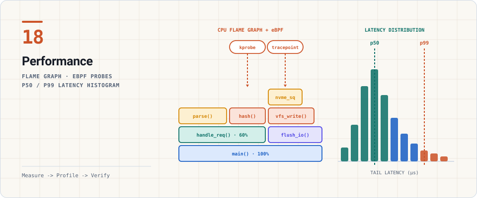
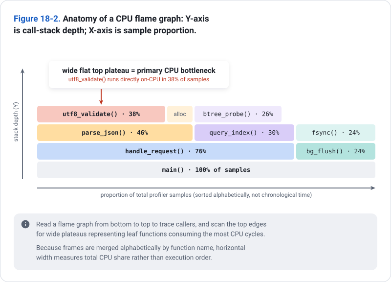

# 18. Performance Analysis and Observability



Systems performance optimization is an empirical engineering discipline. Intuition about why a program is slow is routinely wrong on modern out-of-order superscalar processors with multi-level caches, hardware prefetchers, and complex kernel **Input/Output (`I/O`)** stacks. Rigorous diagnosis follows a closed scientific loop: characterize which physical resource bounds throughput or latency (execution pipeline, memory hierarchy, lock contention, storage, or network), instrument the live system with low-overhead observability tools, hypothesize a single structural change, and verify the improvement under controlled statistical measurements.

## 18.1 The Empirical Method and the Memory Latency Hierarchy

Performance triage begins by classifying whether a workload is **on-CPU** (compute-bound or stalled on cache or **Translation Lookaside Buffer (`TLB`)** misses while holding a core) or **off-CPU** (blocked in kernel wait queues awaiting **Solid-State Drive (`SSD`)** `I/O`, network packets, or contended mutexes).

When a workload runs on-CPU, the dominant performance cliff on modern hardware is the three-order-of-magnitude latency gap across the memory hierarchy (Figure 18-1):
- **Processor Registers (~0.3 ns, 1 cycle):** Private operand storage inside the execution pipeline.
- **L1 Cache (32 to 64 KiB per core, ~1 ns, 3 to 4 cycles):** Split instruction and data caches, accessed virtually in parallel with the L1 `TLB`.
- **L2 Cache (256 KiB to 4 MiB per core, ~3 to 5 ns, 10 to 14 cycles):** Unified per-core cache absorbing L1 capacity misses.
- **L3 / System-Level Cache (8 to 128 MiB shared, ~12 to 20 ns, 35 to 55 cycles):** Shared across cores; last stop before crossing the memory controller to off-chip **Dynamic Random-Access Memory (`DRAM`)**.
- **Main `DRAM` (~60 to 100 ns, 200 to 300 cycles):** Hundreds of execution slots can stall inside the core's Reorder Buffer while a single pointer-chasing load waits for `DRAM`.

Sequential scans mask much of `DRAM` latency because the processor's **hardware stride prefetcher** detects regular address increments and fetches future 64-byte cache lines into L1/L2 ahead of the instruction stream. Listings 18-1 and 18-2 isolate raw cache-level capacity cliffs by striding through progressively larger working sets (from 4 KiB up to 64 MiB) in 64-byte steps: as soon as the working set exceeds L1, L2, and then L3 capacity, measured nanoseconds per access climb sharply in visible plateaus.

<figure>

</figure>

**Listing 18-1. Reading a buffer with a stride of 64 bytes (C++20).** ([`code/ch18/cache_bench.cpp`](https://github.com/arpanpathak/cracking-the-systems-programming-interview/blob/prep-v2/operating-systems/code/ch18/cache_bench.cpp))

```cpp
{{#include ../code/ch18/cache_bench.cpp}}
```

**Output 18-1. One run on the verification machine.**

```text
{{#include ../code/out/ch18_cache_bench.out}}
```

**Listing 18-2. The same program in Rust.** ([`code/ch18/cache_bench.rs`](https://github.com/arpanpathak/cracking-the-systems-programming-interview/blob/prep-v2/operating-systems/code/ch18/cache_bench.rs))

```rust
{{#include ../code/ch18/cache_bench.rs}}
```

**Output 18-2.**

```text
{{#include ../code/out/ch18_cache_bench_rs.out}}
```

## 18.2 Observability: Hardware `PMU` Counters, Profilers, Tracers, and Flame Graphs

Understanding *how* observability tools collect data prevents misinterpreting their output or distorting the system under measurement.

### 18.2.1 The Hardware **Performance Monitoring Unit (`PMU`)**

Every modern x86-64 and ARM64 core contains a dedicated `PMU`: a bank of silicon event counters that increment in parallel with execution at zero software cost. Tools such as Linux `perf stat` program these counters to measure exact microarchitectural events:
- **`cycles` and `instructions` (**Instructions Per Cycle (`IPC`)**):** A modern superscalar core can retire 4 to 8 instructions per cycle. Observing an `IPC` of `0.3` on a supposedly compute-bound loop immediately reveals that the core is stalling on L3 cache misses, branch mispredictions, or atomic lock bus traffic.
- **Last-Level Cache (`LLC`) and Data `TLB` (`dTLB`) Misses (`LLC-load-misses`, `dTLB-load-misses`):** Quantify whether stalls stem from working-set overflow out of the `LLC` or `TLB` reach exhaustion (addressable with 2 MiB huge pages, Chapter 7).

### 18.2.2 Sampling Profilers, Event Tracers, and Flame Graphs

**Sampling profilers** (`perf record`, macOS `sample` / Instruments) program a `PMU` counter to overflow every `N` cycles (or every 1 ms via a timer) and raise a **Non-Maskable Interrupt (`NMI`)**. Inside the interrupt handler, the kernel records the interrupted instruction pointer (`RIP`/`PC`) and walks the Frame Pointer chain (`RBP`/`x29`, Chapter 2) to capture the call stack. Because sampling wakes only ~1,000 times per second, runtime overhead stays below 1 to 2%, making it safe in production clusters.

**Event tracers** (`strace`, `dtrace`, **Extended Berkeley Packet Filter (`eBPF`)** / `bpftrace`) record *every* discrete occurrence of a selected event (such as every `open`, `read`, or `futex` call with arguments and duration). Legacy `strace` attaches via `ptrace(2)`, pausing the traced process twice per system call and imposing 10× to 100× slowdowns. Modern `eBPF` avoids user-space context switches by running verified bytecode directly inside Ring 0 tracepoints and aggregating latency histograms in kernel maps, cutting tracing overhead to a few percent.

**Flame Graphs** aggregate thousands of profiler stack samples into a single visual hierarchy (Figure 18-2). Two reading rules govern interpretation: the **Y-axis represents call-stack depth** (`main()` at the bottom, active leaf function on-CPU at the top), and the **X-axis represents alphabetical proportion of total samples, *not* chronological time**. A wide flat plateau at the top of a flame graph immediately pinpoints a leaf function consuming a large fraction of total CPU cycles; narrow spikes represent brief calls.

<figure>

</figure>

## 18.3 Statistical Rigor and Measurement Pitfalls

Reporting a single arithmetic mean hides the exact latency spikes that break production **Service-Level Objectives (`SLO`s)**. Consider a web gateway that fans out one user request to 100 backend shards in parallel and waits for the slowest shard to respond. Even if each individual shard responds in 2 ms on average and has a **99th percentile (`p99`)** latency of 50 ms, the probability that *at least one* of the 100 parallel shard calls hits the slow 1% tail is `1 - 0.99^100 = 63.4%`. In distributed fan-out architectures, **tail latency (`p99` and `p99.9`) becomes the common case**.

Reliable systems benchmarking must therefore report full latency distributions (`p50`, `p95`, `p99`, `p99.9`) and guard against four classic measurement traps:
1. **Unoptimized builds and dead-code elimination:** Benchmarking debug binaries measures compiler boilerplate rather than hardware limits; conversely, under `-O2`/`-O3`, compilers delete loops whose results are never observed unless outputs are consumed (as in Listing 18-1's checksum print) or fenced with `std::hint::black_box`.
2. **Cold-start bias:** The first iteration of a benchmark suffers minor page faults, cold instruction and data caches, cold `TLB`s, and low processor turbo clocks. Always separate warm-up iterations from measured trials.
3. **Coordinated omission:** When a single-threaded load generator waits for one slow response before sending the next request, it pauses during server stalls and fails to record the queuing delay that real open-loop users experience.
4. **Power-management and frequency scaling noise:** Modern laptops and servers dynamically throttle frequency (`Turbo Boost`, thermal throttling) and migrate threads across performance and efficiency cores. Pin benchmark threads when isolating microarchitectural costs, and run multiple independent trials to verify low variance.

<div class="callout keyidea">
<span class="label">Key idea</span>

Performance engineering is empirical: measure hardware `PMU` counters (`IPC`, `LLC` misses, `dTLB` misses) and flame graphs before optimizing, and evaluate full tail-latency distributions (`p99`, `p99.9`) rather than arithmetic averages, because fan-out amplifies rare tail spikes into the common case.

</div>

<div class="callout experiment">
<span class="label">Experiment</span>

Compile Listing 18-1 ([`code/ch18/cache_bench.cpp`](https://github.com/arpanpathak/cracking-the-systems-programming-interview/blob/prep-v2/operating-systems/code/ch18/cache_bench.cpp)) with `-O2` and run it; then change the stride from `64` bytes to `4,096` bytes to observe `dTLB` misses compounding `L2`/`L3` cache misses as the working set grows from 4 KiB to 64 MiB.

</div>

<div class="callout caution">
<span class="label">Common Pitfall</span>

Reading a CPU flame graph's X-axis as chronological time or benchmarking without consuming the loop result. Wide flame-graph frames represent alphabetical sample proportion (total CPU share), and an unused benchmark accumulator allows `-O3` to delete the entire measured loop at compile time.

</div>
