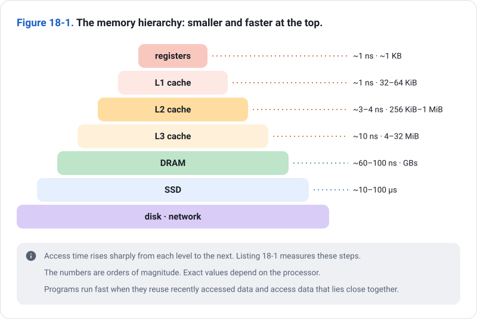

# 18. Performance Analysis and Observability

Systems performance optimization is an empirical engineering discipline. Intuition about why a program runs slowly is routinely wrong on modern out-of-order superscalar processors with multi-level caches, hardware stride prefetchers, branch predictors, and deep kernel **Input/Output (`I/O`)** stacks. An optimization that reduces instruction count on paper often degrades wall-clock latency if it introduces a single extra cache miss or breaks hardware prefetching. Rigorous diagnosis follows a closed scientific loop: identify which physical resource bounds throughput or latency (execution pipeline, memory hierarchy, lock contention, storage, or network), instrument the live system with low-overhead observability tools, form a falsifiable hypothesis for a single structural change, and verify the result under controlled statistical measurements.

## 18.1 The Empirical Method, the `USE` Method, and the Memory Latency Hierarchy

Performance triage begins by separating **on-CPU** time from **off-CPU** time. A thread running on-CPU occupies a physical core while either retiring useful instructions or stalling inside the execution pipeline on cache misses, **Translation Lookaside Buffer (`TLB`)** misses, or branch mispredictions. A thread running off-CPU has been descheduled by the kernel into a wait queue while awaiting **Solid-State Drive (`SSD`)** `I/O`, network packets, contended mutexes, or timer expirations. Applying a CPU profiler to an off-CPU bottleneck reveals nothing about why the application is slow, whereas applying a scheduler tracer immediately exposes the blocking wait queue.

### 18.1.1 Brendan Gregg's `USE` Method

Before diving into line-level profiling, systems engineers systematically survey every hardware and kernel resource using Brendan Gregg's **Utilization, Saturation, Errors (`USE`)** method. For every physical resource in the system (CPU cores, **Dynamic Random-Access Memory (`DRAM`)** capacity, memory interconnects, storage controllers, network interfaces, and kernel lock pools), the engineer measures three orthogonal signals:

**Utilization** records the average fraction of time a resource is busy servicing work (such as 75% CPU busy time) or the fraction of finite capacity currently allocated (such as 88% physical `DRAM` usage). Utilization alone frequently misleads because it is averaged over a sampling window: a CPU reporting 60% average utilization over one second can still experience 100% micro-bursts lasting 50 ms that breach latency targets.

**Saturation** measures the degree of extra work queued because the resource cannot service arrivals immediately. Examples include the scheduler run-queue length exceeding the core count, disk `I/O` queue depth growing past device concurrency, or TCP listen-backlog drops. Non-zero saturation is a direct indicator that queueing delay is inflating request latency even when average utilization appears moderate.

**Errors** track discrete fault events such as corrected **Error-Correcting Code (`ECC`)** memory faults, NVMe command retries, or network packet retransmissions. Errors frequently manifest as mysterious tail-latency spikes because hardware retry loops hide the failure from application logic while injecting milliseconds of delay.

| System Resource | Utilization Metric | Saturation Metric | Error Metric | Primary Linux Tools |
| :--- | :--- | :--- | :--- | :--- |
| **CPU Cores** | Per-core busy percentage (`%usr + %sys`) | Run-queue length (`r` > core count) | Machine-check exceptions (`MCE`) | `mpstat`, `vmstat`, `perf` |
| **Main `DRAM`** | Allocated memory minus page cache | Major page faults, swap-in/out rate | `ECC` memory errors (`edac-util`) | `free`, `vmstat`, `sar -B` |
| **Storage (`NVMe`/`SSD`)** | Device busy percentage (`%util`) | Average request queue depth (`aqu-sz`) | Controller resets, `I/O` retries | `iostat -xz`, `blktrace` |
| **Network (`NIC`)** | Link bandwidth vs. line rate | TX/RX ring drops, TCP retransmits | CRC / framing / link errors | `sar -n DEV`, `ethtool -S`, `ss` |

### 18.1.2 The Memory Latency Hierarchy

When `USE` triage confirms that a workload is on-CPU, the dominant performance cliff on modern hardware is the three-order-of-magnitude latency gap spanning processor registers down to off-chip `DRAM` (Figure 18-1).

| Memory Level | Typical Capacity | Access Latency | Approximate Cycles (3 GHz) | Dominant Bottleneck When Exceeded |
| :--- | :--- | :--- | :--- | :--- |
| **Processor Registers** | ~1 to 2 KiB per core | ~0.3 ns | 1 cycle | Register spills to stack (L1 cache) |
| **L1 Cache (I / D)** | 32 to 64 KiB per core | ~1 ns | 3 to 4 cycles | L1 capacity or conflict misses into L2 |
| **L2 Cache** | 256 KiB to 4 MiB per core | ~3 to 5 ns | 10 to 14 cycles | L2 capacity misses into shared L3 |
| **L3 / System-Level Cache** | 8 to 128 MiB shared | ~12 to 20 ns | 35 to 55 cycles | **Last-Level Cache (`LLC`)** misses to `DRAM` |
| **Main `DRAM`** | 16 GiB to 4 TiB | ~60 to 100 ns | 200 to 300 cycles | Reorder Buffer stalls; page faults to `SSD` |

A single pointer-chasing load that misses the `LLC` and stalls on `DRAM` for 250 cycles can freeze a 6-wide superscalar core for 1,500 potential instruction slots. Sequential scans, however, mask most of raw `DRAM` latency through two hardware mechanisms: the **hardware stride prefetcher**, which detects regular address increments and fetches upcoming 64-byte cache lines into L1/L2 ahead of the instruction stream, and **Memory-Level Parallelism (`MLP`)**, which allows a core to keep 10 to 20 independent cache misses in flight simultaneously across the memory controller.

<figure>

</figure>

Listings 18-1 and 18-2 measure these cache-level capacity cliffs directly in C++20 and Rust 2024 by walking progressively larger buffers (from 16 KiB up to 256 MiB in 4× steps) with a 64-byte stride for 16,000,000 accesses per size. Before starting the timer, each function touches every 64th byte once (`v[i] = 1`) to fault in all physical pages and eliminate cold-start minor page faults from the measurement.

**Listing 18-1. Reading a buffer with a stride of 64 bytes (C++20).**

```cpp
{{#include ../code/ch18/cache_bench.cpp}}
```

**Output 18-1. One run on the verification machine.**

```text
{{#include ../code/out/ch18_cache_bench.out}}
```

**Listing 18-2. The same program in Rust.**

```rust
{{#include ../code/ch18/cache_bench.rs}}
```

**Output 18-2.**

```text
{{#include ../code/out/ch18_cache_bench_rs.out}}
```

Outputs 18-1 and 18-2 illustrate both cache capacity cliffs and hardware prefetching in action. From 16 KiB through 256 KiB, the working set fits inside L1 and L2 caches and averages 0.7 to 0.8 ns per access. At 1 MiB to 4 MiB, the working set spills out of private L2 into shared L3, lifting access time to 1.3 to 1.9 ns. Once the buffer reaches 16 MiB to 256 MiB, accesses exceed L3 capacity and plateau at 3.6 to 4.5 ns per 64-byte step. Notice why the 256 MiB plateau measures ~4 ns rather than the full 60 to 100 ns latency of raw `DRAM`: because the loop strides linearly (`i += 64`), the hardware stride prefetcher and `MLP` overlap roughly 15 to 20 cache-line fetches in flight concurrently ($70\,\text{ns} / 18 \approx 3.9\,\text{ns}$ amortized per cache line). Replacing that linear stride with a randomized pointer-chasing linked list breaks both the prefetcher and `MLP`, exposing the full 60 to 100 ns `DRAM` penalty on every step.

## 18.2 Hardware `PMU` Counters and Top-Down Microarchitecture Analysis (`TMA`)

Every modern x86-64 and ARM64 core embeds a dedicated **Performance Monitoring Unit (`PMU`)**: a bank of hardware event counters wired directly into the pipeline that increment in parallel with execution at zero software overhead. A typical core provides three fixed-function counters (`cycles`, `instructions`, and reference clock cycles) alongside 4 to 8 programmable counters that can be configured to count microarchitectural events such as `LLC-load-misses`, `dTLB-load-misses`, or `branch-misses`.

When an engineer runs `perf stat` requesting more programmable events than the core has physical counter registers, the Linux kernel transparently activates **counter multiplexing**: it time-slices event groups across the available hardware registers every few milliseconds and scales the recorded counts proportionally. Multiplexing works well for steady-state loops, but short-lived or bursty phases can suffer sampling error if an event was scheduled out during a spike.

### 18.2.1 `IPC` and Top-Down Microarchitecture Analysis (`TMA`)

The first hardware ratio checked by any systems engineer is **Instructions Per Cycle (`IPC`)**, computed as `instructions / cycles`. Because a modern superscalar core can decode, issue, and retire 4 to 8 micro-operations per clock cycle, an `IPC` of `0.3` on a loop that performs arithmetic immediately reveals that the core spends over 90% of its cycles stalled rather than computing.

Raw `IPC` tells an engineer *that* the core is stalling, whereas **Top-Down Microarchitecture Analysis (`TMA`)** identifies *where* in the pipeline those execution slots are lost. On a core of pipeline width $W$ executing for $C$ cycles, the processor provides $W \times C$ total pipeline slots. Every cycle, each slot falls into one of four mutually exclusive top-level buckets:

| `TMA` Category | Pipeline Mechanism | Primary Hardware Symptoms | Typical Software Remediation |
| :--- | :--- | :--- | :--- |
| **Retiring** | Micro-operations that complete architectural work | High `IPC`, high execution-unit utilization | Vectorization (`SIMD`), algorithmic reduction |
| **Frontend Bound** | Fetch and decode fail to supply instructions | High `L1-icache-load-misses`, `iTLB` misses | Profile-guided layout (`PGO`), smaller hot code |
| **Backend Bound** | Execution ports or memory subsystem cannot accept ops | High `LLC-load-misses`, `dTLB` misses, `DRAM` bandwidth | Data-oriented layout, struct packing, huge pages |
| **Bad Speculation** | Pipeline flushed due to mispredicted control flow | High `branch-misses`, machine clears | Branchless arithmetic, sorting, lookup tables |

Consider a concrete numerical example on a 4-wide superscalar core running a hash-table benchmark for $1{,}000{,}000$ cycles, providing $4{,}000{,}000$ total pipeline slots. Suppose `perf stat --topdown` reports that $1{,}200{,}000$ slots retired useful micro-operations (`Retiring = 30%`, `IPC = 1.2`), $200{,}000$ slots stalled in instruction fetch (`Frontend Bound = 5%`), $400{,}000$ slots were discarded after branch mispredictions (`Bad Speculation = 10%`), and $2{,}200{,}000$ slots stalled waiting on memory loads (`Backend Bound = 55%`). Rather than guessing or unrolling branches (which can recover at most 10% of slots), `TMA` directs the engineer straight to the memory subsystem: switching from chained pointer buckets to open-addressed cache-line probing or enabling 2 MiB transparent huge pages to eliminate `dTLB` misses (Chapter 7).

## 18.3 Sampling Profilers, Flame Graphs, and `eBPF` Tracing

Once `PMU` counters identify the microarchitectural bottleneck, the engineer must attribute those cycles or cache misses back to specific functions, source lines, and kernel paths without distorting the workload under observation.

### 18.3.1 Sampling Mechanics, Interrupt Skid, and `PEBS`

**Sampling profilers** (Linux `perf record`, macOS `sample` and Instruments) program a `PMU` counter to overflow after a fixed event period (or trigger on a periodic timer such as `-F 999` Hz) and raise a **Non-Maskable Interrupt (`NMI`)**. Choosing `999` Hz rather than `1000` Hz is deliberate: a 1,000 Hz profiler can fall into lockstep aliasing with 1 ms kernel timer ticks, systematically over-sampling or missing periodic background work. Inside the `NMI` handler, the kernel records the interrupted instruction pointer (`RIP` on x86-64, `PC` on ARM64) and walks the Frame Pointer chain (`RBP`/`x29`, Chapter 2) or **DWARF** unwind tables to reconstruct the active call stack. Because the handler fires roughly 1,000 times per second, runtime overhead remains below 1 to 2%, making continuous profiling safe in production fleets.

Basic `NMI` sampling suffers from **interrupt skid**. When an out-of-order core overflows a `PMU` counter on a specific load instruction that missed `L3`, several cycles elapse before the `NMI` is recognized and in-flight instructions drain. By the time the kernel handler reads `RIP`, the instruction pointer has advanced several instructions past the offending load, often attributing cache misses to an innocent arithmetic instruction or the target of a branch. Intel's **Precise Event-Based Sampling (`PEBS`)** (and ARM's **Statistical Profiling Extension (`SPE`)**) eliminates skid in silicon: when the programmed counter overflows, hardware microcode snapshots the exact architectural register state and precise retiring instruction address directly into a pre-allocated kernel memory buffer without waiting for an interrupt handler. Requesting `:pp` or `:ppp` precision modifiers in Linux `perf` (for example, `perf record -e cycles:ppp`) activates `PEBS` so hot lines align with exact assembly instructions.

### 18.3.2 Flame-Graph Stack-Collapsing Mechanics

Raw profiler output consists of tens of thousands of individual stack traces. **Flame Graphs** collapse those samples into a single visual hierarchy (Figure 18-2) through a deterministic three-stage pipeline. First, the profiler dumps every captured call stack from root to leaf as a semicolon-delimited text line (for example, `main;worker_loop;parse_header;hash_lookup 1`). Second, a stack-collapsing pass merges identical stack strings and sums their sample counts (`main;worker_loop;parse_header;hash_lookup 1420`). Third, the renderer sorts sibling frames **alphabetically by function name** at each stack depth and merges adjacent identical parent prefixes into continuous horizontal rectangles.

<figure>

</figure>

That alphabetical sorting step explains the two governing reading rules of every flame graph. The **Y-axis represents call-stack depth**, with `main()` at the bottom and the active on-CPU leaf function at the top. The **X-axis represents alphabetical proportion of total samples, *not* chronological time**. A wide flat plateau at the top edge identifies a leaf function burning a large share of total CPU cycles; tall, narrow towers represent deep call chains that execute infrequently. Applying the exact same collapsing pipeline to thread wakeups and `sched_switch` block durations produces an **off-CPU flame graph**, where horizontal width measures time spent blocked in kernel wait queues rather than executing on a core.

### 18.3.3 Event Tracers, `eBPF` Verifier Safety, and Kernel Instrumentation

Whereas sampling profilers record periodic statistical snapshots, **event tracers** record *every* discrete occurrence of a selected event, capturing exact arguments, return codes, and per-operation latency distributions. Legacy `strace` attaches to a target process via `ptrace(2)`, pausing the traced thread twice on every system call (once on entry, once on exit) and context-switching to the tracer process in user space. Under `I/O`-intensive workloads, `ptrace(2)` imposes 10× to 100× slowdowns that distort concurrency timing and make production attachment unsafe.

Modern Linux observability replaces user-space `ptrace` traps with the **Extended Berkeley Packet Filter (`eBPF`)** (`bpftrace`, `libbpf`, `BCC`). An `eBPF` program compiles into compact register-based bytecode, loads into the kernel via the `bpf(2)` system call, and executes natively inside Ring 0 after **Just-In-Time (`JIT`)** compilation. Because histograms and counters aggregate directly inside kernel-space `eBPF` maps, the tracer eliminates per-event user-space context switches and cuts instrumentation overhead to a few percent.

Running user-supplied bytecode inside Ring 0 demands absolute memory safety: a single out-of-bounds write or infinite loop would crash the entire operating system. Before the `JIT` compiler emits a single native instruction, the kernel's **`eBPF` verifier** statically analyzes the program's control-flow graph. The verifier proves that the program forms a **Directed Acyclic Graph (`DAG`)** (or contains only provably bounded loops) so execution is guaranteed to terminate within a strict instruction limit, tracks the exact type, alignment, and range bounds of every register and stack slot across all branches, rejects any uninitialized stack read or unchecked pointer dereference, and confirms that only whitelisted kernel helper functions are invoked. Programs that fail any check are rejected at load time before they can ever attach.

Once verified, `eBPF` programs attach to three complementary instrumentation hooks depending on stability and scope:

| Hook Mechanism | Attachment Target | ABI Stability | Primary Use Case |
| :--- | :--- | :--- | :--- |
| **`kprobes` / `kretprobes`** | Entry or return of almost any kernel function | Unstable (tied to internal kernel symbols) | Deep ad-hoc kernel debugging where no tracepoint exists |
| **Static Tracepoints** | Pre-compiled kernel hooks (`sched:sched_switch`) | Stable across kernel releases | Production scheduler, filesystem, and syscall latency histograms |
| **`USDT` Probes** | **User-Space Statically Defined Tracing** markers | Stable per application runtime | Tracing PostgreSQL queries, JVM garbage collection, or Python calls |

## 18.4 Queueing Theory, Tail Latency, and Benchmarking Rigor

Microarchitectural counters explain how fast a single request executes when the machine is idle; queueing theory and tail-latency statistics explain why a service that runs in 2 ms under light load collapses to 500 ms under production traffic.

### 18.4.1 Little's Law and Queueing Nonlinearity

Every stable queueing system (whether a network server thread pool, an NVMe command queue, or a CPU run queue) obeys **Little's Law**:

$$L = \lambda W$$

Here, $L$ is the average number of requests concurrently inside the system (in service plus waiting in the queue), $\lambda$ is the average arrival rate (throughput in requests per second), and $W$ is the average residence time per request (queue wait plus service time). Little's Law holds regardless of the arrival distribution, service-time distribution, or scheduling discipline, making it an indispensable sanity check for capacity planning.

Work through a concrete example. Suppose a storage service must sustain $\lambda = 20{,}000$ requests per second, and each request takes an average of $W = 5\,\text{ms} = 0.005\,\text{s}$ from arrival to completion. By Little's Law, the server must hold $L = 20{,}000 \times 0.005 = 100$ concurrent requests in flight at all times. If an engineer configures the service with a fixed pool of 32 synchronous worker threads, throughput is physically capped at $\lambda_{\max} = L / W = 32 / 0.005 = 6{,}400$ requests per second regardless of how many CPU cores or NVMe drives sit idle behind the pool.

Little's Law also combines with **M/M/1 queueing theory** to explain why running servers near 100% utilization destroys latency. Define utilization as $\rho = \lambda / \mu$, where $\mu$ is the maximum service rate (requests per second). For Poisson arrivals and exponential service times, the expected wait time in the queue scales nonlinearly as:

$$W_{\text{queue}} = \frac{1}{\mu} \cdot \frac{\rho}{1 - \rho}$$

At $\rho = 0.50$ (50% utilization), the queueing factor $\frac{\rho}{1 - \rho}$ equals $1.0$: requests wait one service time on average. At $\rho = 0.80$, the factor quadruples to $4.0$. At $\rho = 0.95$, the factor explodes to $19.0$, multiplying total latency twentyfold even though throughput increased by less than 19%. Production systems therefore enforce strict utilization headroom and admission control to keep $\rho$ off the vertical asymptote.

### 18.4.2 Tail-Latency Amplification ($p99$ vs. $p50$)

Reporting a single arithmetic mean hides the exact latency outliers that violate production **Service-Level Objectives (`SLO`s)**. Modern distributed services routinely fan out a single user request to dozens or hundreds of backend shards in parallel and wait for the slowest shard to respond before replying.

Consider a web gateway that fans out one request to $N = 100$ independent backend shards. Each shard responds in 2 ms at the median (**50th percentile (`p50`)**) and has a **99th percentile (`p99`)** latency of 50 ms (meaning 99% of calls finish quickly, while 1% hit a garbage-collection pause, lock stall, or disk compaction). The probability that *all* 100 parallel shard calls avoid the slow 1% tail is $0.99^{100} = 0.366$. Consequently, the probability that *at least one* shard hits the slow tail and delays the entire user request is:

$$P(\text{slow}) = 1 - 0.99^{100} = 63.4\%$$

At $N = 10$ shards, $P(\text{slow}) = 1 - 0.99^{10} = 9.6\%$; at $N = 500$ shards, $P(\text{slow}) = 1 - 0.99^{500} = 99.3\%$. Under wide fan-out, **tail latency (`p99` and `p99.9`) becomes the common case**. Reliable systems benchmarking must therefore capture full latency histograms (`p50`, `p95`, `p99`, `p99.9`) using high-dynamic-range histograms (`HdrHistogram`) rather than compressing distributions into a mean.

### 18.4.3 Four Classic Benchmarking Traps

Even with accurate timers and full percentile histograms, four methodological traps routinely invalidate systems benchmarks:

**Unoptimized builds and Dead-Code Elimination (`DCE`).** Timing a debug binary (`-O0`) measures unoptimized stack-frame boilerplate and bounds checks rather than hardware limits. Conversely, compiling with `-O2` or `-O3` allows the compiler's **Dead-Code Elimination (`DCE`)** pass to prove that a benchmark loop's computed value is never observed and delete the entire loop, reporting a fraudulent `0.0 ns` per iteration. Listing 18-1 prevents `DCE` by accumulating `sum += v[i]` and printing the final checksum; in Rust microbenchmarks, wrapping inputs and outputs with `std::hint::black_box()` forces the compiler to treat values as opaque without inserting hardware fences.

**Cold-start bias.** The first iteration of any benchmark pays one-time setup costs that vanish in steady state: minor page faults as the kernel maps physical `DRAM` frames on first touch, cold instruction and data caches, empty `TLB` entries, and low initial processor clock frequencies before turbo governors ramp up. Listing 18-1 isolates steady-state cache latency by touching every 64-byte stride in a pre-timing loop before calling `steady_clock::now()`.

**Coordinated omission.** A closed-loop benchmark generator sends one request, waits for the response, and only then sends the next request. Suppose a server suffers a 1,000 ms stall while a benchmark targets 1,000 requests per second (1 ms inter-arrival spacing). A closed-loop generator pauses during the stall and records **one** slow latency sample of 1,000 ms; an open-loop generator (modeling real independent users arriving at 1,000 req/s) records **1,000** delayed requests spanning 1,000 ms, 999 ms, 998 ms, down to 1 ms. Closed-loop generators omit the 999 queued requests that real users experience, under-reporting `p99` by an order of magnitude. Production load testing therefore requires open-loop generators (such as `wrk2` or `k6` constant-arrival-rate executors) that schedule requests on an independent wall-clock timeline and measure latency from scheduled arrival time rather than actual send time.

**Power management, frequency scaling, and asymmetric cores.** Modern processors dynamically shift clock frequencies via thermal throttling and `Turbo Boost`, and hybrid architectures (such as Apple Silicon and modern Intel processors) migrate threads between high-frequency performance cores and lower-frequency efficiency cores mid-run. When isolating microarchitectural changes, pin benchmark threads to fixed performance cores, disable frequency scaling if permitted on dedicated lab hardware, and execute multiple independent trials to confirm low run-to-run variance.

<div class="callout keyidea">
<span class="label">Key idea</span>

Performance engineering is empirical: apply the `USE` method to locate saturated resources, inspect hardware `PMU` counters (`IPC`, `TMA`, `LLC` and `dTLB` misses) and flame graphs before optimizing, and evaluate full tail-latency distributions (`p99`, `p99.9`) with open-loop load generators because fan-out amplifies rare tail spikes into the common case.

</div>

<div class="callout experiment">
<span class="label">Experiment</span>

Compile Listing 18-1 (`code/ch18/cache_bench.cpp`) with `-O2` and run it; then change the stride from `64` bytes to `4,096` bytes to observe `dTLB` misses compounding `L2`/`L3` cache misses as the working set grows from 16 KiB to 256 MiB. Next, replace the linear stride with a shuffled index permutation to defeat the hardware stride prefetcher and expose raw `DRAM` latency.

</div>

<div class="callout caution">
<span class="label">Common Pitfall</span>

Reading a CPU flame graph's X-axis as chronological time, benchmarking without consuming the loop result, or trusting closed-loop load generators under server stalls. Wide flame-graph frames represent alphabetical sample proportion (total CPU share), an unused benchmark accumulator allows `-O3` to delete the measured loop at compile time, and closed-loop generators suffer coordinated omission during pauses.

</div>
