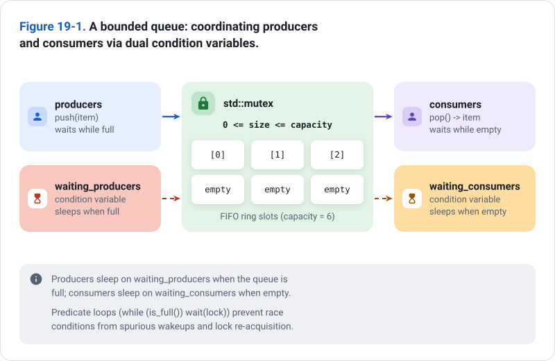
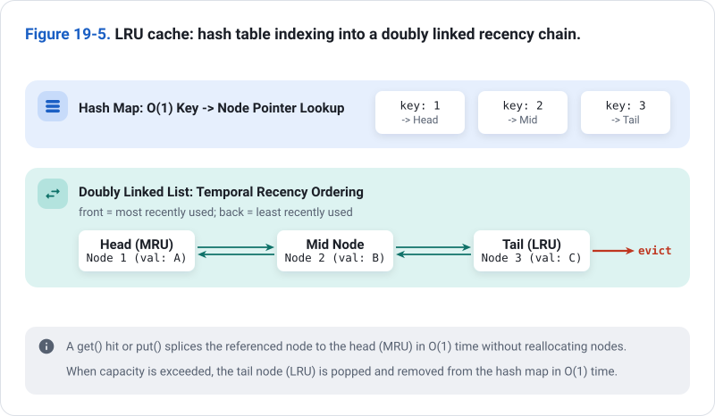

# 19. Systems Interview Problems: Derivations and Reference Implementations

The systems programming interview serves as an empirical evaluation of an engineer's capacity to translate low-level hardware constraints into correct, deterministic software abstractions. While application-level engineering frequently abstracts away execution costs, systems engineering requires direct reasoning from first principles: the mechanics of cache coherence, memory ordering semantics, kernel privilege transitions, memory fragmentation, and atomic instruction guarantees.

## 19.1 Architectural Framework and Problem-Solving Discipline

Every robust systems component is derived from three foundational tenets:

- **Formal Contract Specification:** Defining explicit preconditions, postconditions, and resource ownership boundaries before writing code. This encompasses capacity limits, pointer ownership transfers, lifetime bounds, and the exact threading model.
- **State Invariant Formulation:** Explicitly identifying the logical properties that must hold across all execution paths. In concurrent programming, this dictates the exact state protected by each mutex or synchronized via atomic variables.
- **Boundary and Interleaving Analysis:** Rigorously tracing edge cases (such as queue saturation, memory depletion, cache line false sharing, and spurious wakeups) under arbitrary thread interleavings.

This chapter presents ten canonical systems programming problems, followed by a rigorous examination of six fundamental operating system mechanisms. Each problem articulates the underlying systems model, establishes the mathematical and concurrency invariants, provides verified reference implementations in C++20 and Rust (2024 edition), and evaluates subtle hardware and language-level trade-offs.

## 19.2 The Bounded Blocking Queue

A bounded blocking queue is the foundational synchronization primitive underpinning multi-threaded producer-consumer architectures. It provides a thread-safe FIFO buffer of fixed maximum capacity, decoupling production rates from consumption rates while preventing unbounded heap exhaustion.

### 19.2.1 Concurrency Model and Synchronization Primitives

Managing a shared bounded buffer requires resolving two distinct concurrency hazards:

1. **Mutual Exclusion:** Concurrent threads must not mutate queue pointers, lengths, or ring indices simultaneously, which would induce data races and state corruption.
2. **Predicate Coordination:** When the queue reaches capacity, producer threads must suspend execution until space becomes available. Conversely, when the queue is empty, consumer threads must suspend until an item is enqueued.

A **mutex** provides mutual exclusion but possesses no native mechanism for suspended waiting on arbitrary logical state. A thread that simply loops while checking queue occupancy ("busy-waiting") wastes processor cycles and starves other threads contending for execution cores.

To resolve this, the queue pairs a mutex with **condition variables**. A condition variable enables a thread to release its held mutex and enter a sleep state atomically in a single hardware-supervised step. The atomicity of this transition is essential: if releasing the lock and sleeping were separate operations, a competing thread could signal a state change in the intervening gap, causing the waiting thread to sleep indefinitely, a catastrophic concurrency failure known as a **lost wakeup**.

Because the queue coordinates two opposing boundary states, it employs dual condition variables:
- **`is_full`:** Suspends producer threads while the queue is full (`size == capacity`).
- **`is_empty`:** Suspends consumer threads while the queue is empty (`size == 0`).

<figure>

</figure>

### 19.2.2 State Invariants and Predicate Verification

The queue maintains the following fundamental invariant across all operations:

```text
∀ t under mutex lock:  0 ≤ size ≤ capacity
```

Every state modification adheres to strict pre- and post-conditions:
- **`push(item)`:** Evaluates `is_full()`. If true, the caller suspends on `is_full`. Once unblocked with `size < capacity`, it appends the item, increments `size`, and signals `is_empty`.
- **`pop()`:** Evaluates `is_empty()`. If true, the caller suspends on `is_empty`. Once unblocked with `size > 0`, it dequeues the front item, decrements `size`, and signals `is_full`.

A critical requirement in predicate synchronization is the **repeated evaluation loop** (`while (is_full())` / `while (is_empty())`). When a thread is awakened, it is merely moved from the condition variable's sleep queue to the mutex's contention queue; it does not instantaneously resume execution with the lock. By the time the thread re-acquires the mutex, an intervening thread may have intercepted the vacancy or consumed the available item. Furthermore, POSIX and operating system schedulers permit **spurious wakeups**, where a waiting thread unblocks without any explicit notification. Encapsulating the wait operation within a predicate loop ensures that a thread never advances until the condition is verified under exclusive lock ownership.

### 19.2.3 Reference Implementation

**Listing 19-1. A bounded blocking queue (C++20).**

```cpp
{{#include ../code/ch19/bounded_queue.cpp}}
```

**Output 19-1.**

```text
{{#include ../code/out/ch19_bounded_queue.out}}
```

**Listing 19-2. The same queue in Rust.**

```rust
{{#include ../code/ch19/bounded_queue.rs}}
```

**Output 19-2.**

```text
{{#include ../code/out/ch19_bounded_queue_rs.out}}
```

The verification harness executes two concurrent producer threads and two concurrent consumer threads, processing 100,000 sequential integers (1 to 100,000). The mathematical sum of these values is:

```text
Sum = (100,000 × 100,001) / 2 = 5,000,050,000
```

The verified outputs confirm that the aggregate consumed sum exactly matches this expectation, demonstrating zero item loss, zero duplication, and strict FIFO integrity under heavy thread contention.

In Rust, acquiring a mutex lock or waiting on a condition variable returns a `PoisonError` if another thread panicked while holding the guard. In the reference implementation, this error is converted into a structured message and propagated deterministically via the `?` operator.

### 19.2.4 Backing-Store Variants and Building the Ring Buffer by Hand

In operating systems and embedded engineering interviews, picking the right underlying container for the access pattern is evaluated closely, and a standard follow-up immediately after Listing 19-2 is: *"Now build the queue without `VecDeque` or `std::deque`."* Understanding every backing-store variant, and the exact ownership rules behind each one, turns a routine queue question into a demonstration of systems mastery.

| Backing Store | FIFO / LIFO | Push / Pop Cost | Memory & Safety Profile | When to Use |
| :--- | :--- | :--- | :--- | :--- |
| **`VecDeque<T>` / `std::deque<T>`** | FIFO | O(1) / O(1) | Contiguous ring using `MaybeUninit` internally (Rust) or chunked blocks (C++); zero manual `unsafe` | **Default interview choice** for mutex-backed bounded queues |
| **Hand-rolled `Vec<Option<T>>` (`head` + `len`)** | FIFO | O(1) / O(1) | Fixed allocation after `new()`, zero `unsafe`, handles any non-`Copy` / non-`Default` `T`; small `Option` tag overhead | **Follow-up: "implement without `VecDeque`"** in safe Rust / C++ (`std::optional<T>`) |
| **Raw `Box<[MaybeUninit<T>]>`** | FIFO | O(1) / O(1) | Zero `Option` tag overhead, no `Default` bound; requires `unsafe` (`write`, `assume_init_read`) and custom `Drop` | Production channels, kernel rings, and lock-free SPSC queues (Section 19.4) |
| **Two-stack `Vec<T>` (`inbox` + `outbox`)** | FIFO | Amortized O(1) | Plain `Vec<T>` with zero `Option<T>` and zero `unsafe`, but reverses `inbox` in O(N) whenever `outbox` empties | Functional or safe FIFO when occasional O(N) tail-latency spikes are acceptable |
| **Plain `Vec<T>` (`push` + `pop`)** | **LIFO** | O(1) / O(1) | Plain `Vec<T>`, zero overhead, improves L1 cache warmth for recent items | Object pools and worker stacks where FIFO ordering is not required |
| **Plain `Vec<T>` (`push` + `remove(0)`)** | FIFO | O(1) / **O(N)** | Shifts every remaining element left via `memmove` on every pop | **Interview red flag** unless you explicitly call out the O(N) cost for tiny bounds |

#### Why `VecDeque` Is the Right First Answer

For a mutex-guarded bounded queue in an interview, start with `VecDeque::with_capacity(capacity)` (or `std::deque<T>` in C++) and state your reasoning out loud: `VecDeque` is already a contiguous circular ring buffer whose `push_back` and `pop_front` operations both run in O(1) time without reallocating once pre-sized, while using `MaybeUninit<T>` internally to avoid `Option<T>` discriminant padding. Using `Vec::remove(0)` is a mild red flag on systems teams because removing from index `0` copies `N - 1` elements left on every dequeue, turning a constant-time primitive into a linear bottleneck.

#### Why a Hand-Rolled Safe Ring Uses `Vec<Option<T>>` (and Not Plain `Vec<T>`)

When an interviewer asks you to drop `VecDeque` and write the circular buffer directly, three Rust ownership invariants explain why a generic ring buffer cannot be backed by a plain `Vec<T>`:
1. **Empty slots cannot remain uninitialized in `Vec<T>`:** Every index `0..vec.len()` in a `Vec<T>` must hold a fully initialized `T`. At construction, the ring is empty, and arbitrary types such as `String`, `TcpStream`, or `Job` do not implement `Default`. (Plain `vec![0u8; cap]` works only for `T: Copy + Default`, such as a raw byte buffer.)
2. **Moving a non-`Copy` item out of `buf[head]`:** Writing `let item = self.buf[self.head];` fails to compile for any owning type such as `String` or `Box<T>`, because `Vec<T>` retains ownership of the slot and would double-free it when overwritten or dropped. Wrapping each slot in `Option<T>` lets `self.buf[self.head].take()` atomically move ownership of the `T` to the caller while leaving `None` in the slot.
3. **Sound destruction on `Drop`:** When the ring is dropped while partially populated, `Vec<Option<T>>` executes destructors strictly on live `Some(T)` slots and skips empty `None` slots automatically.

#### Avoiding the Full-versus-Empty Ambiguity with `(head, len)`

A classic bug in hand-rolled ring buffers arises from tracking only `(head, tail)`: when `head == tail`, the ring could be either completely empty (`len == 0`) or completely full (`len == cap`). Traditional fixes waste one array slot (`cap + 1` allocation) or add a separate `full: bool` flag. Tracking **`head`** (index of the oldest live element) together with **`len`** (count of live elements) eliminates the ambiguity cleanly:
- `is_empty()` is `len == 0`
- `is_full()` is `len == cap`
- The next write index is derived deterministically as **`tail = (head + len) % cap`** (or `(head + len) & (cap - 1)` when `cap` is a power of two).

<figure>

</figure>

**Listing 19-2a. Bounded blocking queue backed by a hand-rolled `Ring<T>` without `std::deque` (C++20).**

```cpp
{{#include ../code/ch19/ring_buffer.cpp}}
```

**Output 19-2a.**

```text
{{#include ../code/out/ch19_ring_buffer.out}}
```

**Listing 19-2b. The same hand-rolled `Ring<T>` over `Vec<Option<T>>` without `VecDeque` (Rust 2024).**

```rust
{{#include ../code/ch19/ring_buffer.rs}}
```

**Output 19-2b.**

```text
{{#include ../code/out/ch19_ring_buffer_rs.out}}
```

### 19.2.5 Systems Analysis and Concurrency Interview Follow-Ups

Interviewers routinely probe five concurrency subtleties directly on top of your bounded queue implementation (in C/C++ with `std::condition_variable` or `pthread_cond_wait`, and in Rust with `Condvar`):

- **Why `wait_while` (or a `while` loop) instead of a single `if` + `wait`?** Operating system schedulers and POSIX condition variables permit **spurious wakeups**, where a sleeping thread unblocks without any matching signal. Even on a legitimate wakeup, another thread can acquire the mutex first and consume the item or fill the slot before the awakened thread re-acquires the lock. Rechecking the predicate inside a `while` loop (which `Condvar::wait_while` and `std::condition_variable::wait(lock, pred)` encapsulate for you) guarantees that the thread proceeds only when the invariant holds under exclusive lock ownership.
- **Why two condition variables (`not_full` and `not_empty`) instead of one?** Dual condition variables isolate waiting producers from waiting consumers: a producer wakes only consumers, and a consumer wakes only producers. With a single shared condition variable, `notify_one` can wake another producer when the queue is full (causing permanent deadlock), forcing `notify_all` on every operation and waking every sleeping thread when only one can proceed.
- **Why is `notify_one` safe and preferred over `notify_all`?** Because each `push` inserts exactly one item (enabling at most one consumer to proceed) and each `pop` frees exactly one slot (enabling at most one producer to proceed). Waking every waiter via `notify_all` triggers a **thundering herd**, burning CPU cycles as `K - 1` threads re-acquire the mutex only to fall back asleep. (Reserve `notify_all` for shutdown/close transitions where all waiters must wake and exit.)
- **Should you notify before or after dropping the mutex lock?** Both orders are strictly correct. Signaling while holding the mutex can cause a "hurry up and wait" penalty where the woken thread immediately blocks trying to acquire the mutex still held by the signaler; dropping the guard (`drop(ring)`) before calling `notify_one()` avoids that redundant context switch, though modern OS kernels also mitigate inside-lock signaling via **wait morphing** (moving a waiter directly from the condvar wait queue to the mutex wait queue in kernel space).
- **What is Rust lock poisoning (`PoisonError`)?** Unique to Rust's `std::sync::Mutex`, a mutex transitions to a *poisoned* state if a thread panics while holding its `MutexGuard`, warning subsequent callers that the protected data structure may have been left halfway through a multi-field update with broken invariants. In production and interview code, propagate the error cleanly with `.map_err(...)?` (as in Listings 19-2 and 19-2b) rather than panicking blindly with `.unwrap()`.

<div class="callout keyidea">
<span class="label">Key idea</span>

Start a bounded-queue interview with `VecDeque` for O(1) ring semantics, be ready to drop down to a hand-rolled `Vec<Option<T>>` ring tracking `(head, len)` to eliminate full-versus-empty ambiguity, and pair dual condition variables with `while` / `wait_while` loops and `notify_one` to prevent spurious wakeups, lost wakeups, and thundering herds.

</div>

<div class="callout caution">
<span class="label">Watch out</span>

Using `if (!is_full())` instead of `while (is_full())`: an awakened producer does not hold the lock immediately upon unblocking; another thread may acquire the mutex first and fill the queue, causing lost updates or buffer overflow.

</div>

## 19.3 The Free-List Allocator

While the operating system allocates memory in coarse, page-sized increments (typically 4 KiB), user-space applications require dynamic allocation for objects with arbitrary sizes and heterogeneous lifetimes. A memory allocator bridges this granularity gap by requesting a large contiguous memory region (an **arena**) from the kernel and managing sub-allocations internally.

### 19.3.1 Memory Architecture and Layout Topology

A free-list allocator manages an arena as a continuous sequence of memory blocks without gaps. Every block consists of two distinct components:
- **Header:** Embedded metadata stored immediately preceding the usable memory. The header encapsulates the total payload size, an allocation flag (indicating whether the block is free or active), and pointer linkages to adjacent blocks in address order.
- **Payload:** The raw memory buffer returned to the client application.

To support hardware vector extensions (e.g., SSE, AVX, NEON) and prevent unaligned memory penalties, the allocator enforces a strict **16-byte alignment invariant**: every returned payload address and payload size must be an exact multiple of 16 bytes. Given a 32-byte header (itself a multiple of 16), preserving payload alignment maintains complete alignment throughout the arena.

### 19.3.2 Allocation and Reclamation Mechanics

The allocator's efficiency and memory fragmentation profile are governed by three primary policies:

- **First-Fit Search:** Upon receiving an allocation request of `n` bytes, the allocator rounds `n` up to the next 16-byte boundary. It then traverses the block list in address order and selects the first free block whose payload capacity meets or exceeds the aligned request.
- **Block Splitting:** If the selected free block is significantly larger than the requested size, allocating the entire block causes excessive **internal fragmentation** (wasted capacity within an allocated block). If the excess capacity is sufficient to house a 32-byte header and at least a 16-byte payload (48 bytes minimum), the allocator splits the block: the front portion is assigned to the caller, and the remainder is formatted into a new free block linked into the arena.
- **Coalescing Upon Release:** When `release(p)` is invoked, the allocator accesses the preceding header at `p - sizeof(Header)` and marks the block as free. If adjacent neighboring blocks in memory are also free, leaving them fragmented would prevent future large allocations even if total free capacity is sufficient, a condition known as **external fragmentation**. The allocator therefore coalesces adjacent free blocks into a single unified block, recovering the 32-byte overhead of the subsumed header and consolidating available memory.

### 19.3.3 Structural Invariants

The allocator preserves the following invariants across every allocation and release cycle:
- **Exhaustive Arena Coverage:** The linked list of blocks spans the entire arena continuously from start to finish, with zero unmapped gaps and zero overlapping regions.
- **Monotonic Address Ordering:** Consecutive nodes in the linked list are strictly adjacent in physical memory.
- **Post-Release Coalescing Invariant:** Upon the return of `release(p)`, no two adjacent blocks in the arena are both marked as free.
- **Alignment Invariant:** For every active block, `address(payload) % 16 == 0` (aligned to a 16-byte boundary).

### 19.3.4 Reference Implementation

**Listing 19-3. A first-fit allocator with splitting and coalescing (C++20).**

```cpp
{{#include ../code/ch19/free_list_allocator.cpp}}
```

**Output 19-3.**

```text
{{#include ../code/out/ch19_free_list_allocator.out}}
```

**Listing 19-4. The same allocator in Rust.**

```rust
{{#include ../code/ch19/free_list_allocator.rs}}
```

**Output 19-4.**

```text
{{#include ../code/out/ch19_free_list_allocator_rs.out}}
```

The verification trace illustrates the deterministic state transitions within a 1,024-byte arena with a 32-byte header:
1. An allocation request for 100 bytes is aligned up to 112 bytes. With the 32-byte header, the initial block spans offsets 0 to 143, with its payload residing at offsets 32–143. The remaining 880 bytes form a free block at offset 144.
2. Subsequent requests for 200 bytes (aligned to 208 bytes) and 300 bytes (aligned to 304 bytes) carve additional blocks from the arena, leaving the final free block at offset 720 with a payload of `1,024 - 720 - 32 = 272` bytes.
3. When the second allocation (208 bytes) is released, it creates an isolated free block. A subsequent allocation of 150 bytes (aligned to 160 bytes) fits within this 208-byte space. Because `208 - 160 = 48` bytes (matching the exact 32-byte header + 16-byte minimum payload threshold), the allocator successfully splits the block.
4. When all blocks are released, coalescing recursively merges all adjacent segments back into a single unified free block with a payload of `1,024 - 32 = 992` bytes, completely eliminating external fragmentation.

### 19.3.5 Systems Analysis and Production Considerations

- **Boundary Tags and Asymptotic Complexity:** In this reference design, traversal and linear coalescing operate in `O(N)` time relative to the number of blocks. Production allocators (such as Knuth's boundary-tag design) store duplicate size and status metadata at both the head and tail of each block, enabling bidirectional neighbor inspection and `O(1)` constant-time coalescing.
- **Segregated Size Classes and Contention:** General-purpose enterprise allocators (`jemalloc`, `tcmalloc`) bypass linear list searching by maintaining segregated free lists for discrete size classes (e.g., 16 B, 32 B, 64 B, up to multi-page spans). To eliminate multi-threaded lock contention, they assign independent thread-local arenas, falling back to global synchronization only when thread caches require replenishment.
- **Buffer Overrun Vulnerabilities:** Because metadata is embedded in-band directly adjacent to user data, an out-of-bounds write corrupts the header of the successor block. This corrupts allocator state, precipitating segmentation faults or exploitable memory vulnerabilities during subsequent, unrelated allocation cycles.

<div class="callout keyidea">
<span class="label">Key idea</span>

The free-list allocator bridges coarse virtual memory pages and fine-grained application objects. Enforcing 16-byte alignment via `(n + 15) & ~15` guarantees SIMD safety; splitting suppresses internal fragmentation, and coalescing eliminates external fragmentation.

</div>

<div class="callout caution">
<span class="label">Watch out</span>

In-band metadata corruption: because block headers reside immediately before payloads, an off-by-one or buffer overflow corrupts the next block's size and free flag. The program crashes not during the errant write, but on a subsequent, unrelated call to `allocate()` or `release()`.

</div>

## 19.4 The Lock-Free Single-Producer Single-Consumer Ring Buffer

In ultra-low-latency systems (such as high-frequency trading engines, audio processing graphs, and real-time network drivers), mutex-based queues introduce unacceptable jitter. Kernel-managed thread preemption, lock acquisition overhead, and priority inversions degrade deterministic throughput. A lock-free Single-Producer Single-Consumer (SPSC) ring buffer eliminates locks entirely, enabling safe, asynchronous communication across a dedicated producer and consumer thread using hardware-level memory ordering.

### 19.4.1 Architectural Model and Single-Writer Principle

The ring buffer manages a fixed-size contiguous array of capacity C, accessed via two monotonically increasing 64-bit integer indices:
- **`tail`:** The write pointer, representing the cumulative count of inserted elements. Written exclusively by the producer thread.
- **`head`:** The read pointer, representing the cumulative count of extracted elements. Written exclusively by the consumer thread.

<figure>

</figure>

The core principle establishing lock-free safety is the **single-writer discipline**: each mutable variable is modified by exactly one thread. The producer updates only `tail`, and the consumer updates only `head`. While each thread reads the other's index to detect boundary conditions, stale reads never compromise memory safety:
- If the producer reads a stale (lagging) value of `head`, it perceives the buffer to have fewer free slots than actually exist. In the worst case, it observes a "false full" condition and backs off, retrying on the next iteration.
- If the consumer reads a stale value of `tail`, it perceives fewer available elements, observes a "false empty" condition, and retries.

Under no interleaving can a stale read permit the producer to overwrite unread data, nor can it cause the consumer to read an uninitialized or previously consumed slot.

### 19.4.2 State Invariants and Ring Wraparound

The indices maintain the fundamental queue invariant:

```text
0 ≤ tail - head ≤ capacity
```

The queue is empty when `head == tail`, and full when `tail - head == capacity`.

Because `head` and `tail` are 64-bit unsigned integers incremented monotonically, they do not suffer from wraparound distortion over realistic execution horizons. The physical array slot corresponding to an index is computed via modular arithmetic:

```text
slot_index = index % capacity
```

When capacity is constrained to a power of two, the expensive modulo division is replaced by a single-cycle bitwise mask: `index & (capacity - 1)`.

### 19.4.3 Memory Ordering and Acquire-Release Synchronization

Ensuring data visibility across CPU cores requires strict memory ordering guarantees. Without explicit barriers, modern out-of-order processors and optimizing compilers can reorder stores and loads, exposing uninitialized data to the consumer.

The SPSC ring buffer enforces an **acquire-release synchronization pair**:

1. **Producer Write:** The producer writes the data payload into `slots[tail % capacity]` using standard memory operations. It then commits the updated index using a **release store**:

   ```text
   tail.store(tail + 1, std::memory_order_release);
   ```

   The release barrier guarantees that all preceding memory writes (the data payload) are globally visible to other cores before the updated `tail` becomes visible.
2. **Consumer Read:** The consumer inspects the write pointer using an **acquire load**:

   ```text
   tail.load(std::memory_order_acquire);
   ```

   The acquire barrier guarantees that subsequent reads (extracting the slot data) cannot be reordered ahead of the load. This establishes a formal *happens-before* relationship: once the consumer observes the incremented `tail`, it is guaranteed to observe the complete, valid payload written by the producer.

The symmetric acquire-release pair governs `head` updates, ensuring that the consumer finishes reading a slot before the producer observes the updated `head` and overwrites that memory.

### 19.4.4 Reference Implementation

**Listing 19-5. A lock-free SPSC ring buffer (C++20).**

```cpp
{{#include ../code/ch19/spsc_ring.cpp}}
```

**Output 19-5.**

```text
{{#include ../code/out/ch19_spsc_ring.out}}
```

**Listing 19-6. The same ring buffer in Rust, with atomic slots and no `unsafe`.**

```rust
{{#include ../code/ch19/spsc_ring.rs}}
```

**Output 19-6.**

```text
{{#include ../code/out/ch19_spsc_ring_rs.out}}
```

In the Rust implementation, lock-free safety is achieved entirely in safe code by wrapping slot values in `AtomicU64` types, demonstrating thread-safe interior mutability without invoking `unsafe` blocks.

### 19.4.5 Microarchitectural Optimization and False Sharing

- **Mitigating False Sharing:** Because the producer and consumer execute on different physical CPU cores, independent updates to `head` and `tail` can introduce severe cache contention. If `head` and `tail` reside within the same 64-byte cache line, a write to `tail` invalidates the entire cache line in the consumer core's L1/L2 cache, triggering continuous cache coherency bus traffic ("cache ping-ponging"). This hazard is mitigated by aligning each atomic variable to the hardware cache line boundary using `alignas(64)` in C++ or `#[repr(align(64))]` in Rust.
- **Multi-Producer Limitations:** The SPSC architecture relies fundamentally on the single-writer invariant. If multiple producers attempt to push concurrently, reading and updating `tail` without synchronization causes race conditions where multiple producers overwrite the same slot. Extending this design to Multiple-Producer Multiple-Consumer (MPMC) topologies requires atomic Compare-And-Swap (CAS) loops or ticketed reservation counters.

<div class="callout keyidea">
<span class="label">Key idea</span>

In a lock-free SPSC queue, the single-writer discipline ensures each index is mutated by exactly one thread. Acquire-release memory ordering guarantees that payload writes are globally visible across cores before the updated index is published.

</div>

<div class="callout caution">
<span class="label">Watch out</span>

Cache line false sharing on `head` and `tail`: because producer and consumer execute on different cores, placing both atomic indices in the same 64-byte cache line causes the hardware coherency protocol (MESI) to bounce the line between cores on every push and pop. Always separate cross-core indices with `alignas(64)`.

</div>

## 19.5 Byte Routines: `memmove`, `strlen` and `atoi`

Low-level byte manipulation routines form the foundation of runtime environments, operating systems, and network protocol parsers. Implementing these routines correctly requires reasoning directly about contiguous byte streams, pointer arithmetic, buffer overlap, and numerical conversion limits.

### 19.5.1 The Memory Overlap Hazard and `memmove`

The POSIX specification establishes a critical distinction between `memcpy` and `memmove`:
- `memcpy` assumes the source and destination memory buffers are strictly non-overlapping. Passing overlapping regions to `memcpy` invokes undefined behavior.
- `memmove` guarantees correct copying regardless of whether the source and destination memory regions overlap.

The necessity for directional copying arises when the destination buffer begins within the source buffer at a higher memory address (`dst > src` and `dst < src + count`). If an unconditional forward copy (index 0 to `count - 1`) is executed, writing to early destination offsets overwrites later source bytes before they have been read, destroying the source data.

For example, shifting the string `"abcdef"` two bytes to the right (source offset 0, destination offset 2, length 4) via forward copying writes `'a'` to offset 2 and `'b'` to offset 3. When the copy reaches offset 2, it reads the newly written `'a'`, resulting in corrupted repetition (`"ababad"`).

To guarantee correctness under all geometries, `memmove` evaluates pointer addresses:
- **`dst <= src`:** The copy proceeds **forward**, from the lowest byte to the highest byte.
- **`dst > src`:** The copy proceeds **backward**, from the highest byte (`count - 1`) down to the lowest byte (`0`).

### 19.5.2 String Bounds and NUL-Termination in `strlen`

The standard C string convention relies on sentinel-based termination: a string is a contiguous array of non-zero characters terminated by a null byte (`'\0'`). The `strlen` function iterates through memory, incrementing a counter until encountering the first zero byte.

The primary hazard of `strlen` is the risk of an unbounded read: if a buffer lacks a null terminator, the function continues reading beyond allocated memory bounds until triggering a segmentation fault (`SIGSEGV`) or leaking adjacent private memory. In safe systems languages like Rust, strings and byte buffers are represented as explicit fat pointers (pointer plus length), precluding unbounded traversals.

### 19.5.3 Robust Parsing and Overflow Prevention in `atoi`

Converting an ASCII character sequence to a signed 32-bit integer requires managing four distinct phases:
1. **Whitespace Truncation:** Skipping leading whitespace characters (spaces, tabs).
2. **Sign Determination:** Parsing an optional leading `'+'` or `'-'` character.
3. **Digit Accumulation:** Iterating over sequential numeric characters (`'0'` through `'9'`) and accumulating the value using Horner's method: `value = value * 10 + (char - '0')`.
4. **Boundary Enforcement:** Detecting integer overflow. A 32-bit signed integer spans the asymmetric range `[-2,147,483,648, 2,147,483,647]`. In C++, signed integer overflow invokes undefined behavior; therefore, accumulating directly in an `int32_t` is hazardous. The robust implementation accumulates intermediate values in a 64-bit integer (`int64_t`), applies the parsed sign, and clamps or reports an error if the magnitude exceeds the 32-bit bounds.

### 19.5.4 Reference Implementation

**Listing 19-7. `memmove`, `strlen` and `atoi` (C++20).**

```cpp
{{#include ../code/ch19/byte_routines.cpp}}
```

**Output 19-7.**

```text
{{#include ../code/out/ch19_byte_routines.out}}
```

**Listing 19-8. The same routines in Rust.**

```rust
{{#include ../code/ch19/byte_routines.rs}}
```

**Output 19-8.**

```text
{{#include ../code/out/ch19_byte_routines_rs.out}}
```

### 19.5.5 Systems Optimization and Vectorization

- **Vectorized Word Processing (SWAR and SIMD):** Byte-at-a-time implementations process one byte per iteration. Production standard libraries (`glibc`, `musl`) achieve an order-of-magnitude higher throughput using SIMD vector instructions (AVX-512, ARM NEON) or SIMD Within A Register (SWAR) bit-tricks. For example, `strlen` tests 64 bytes simultaneously using vector mask instructions (`_mm512_cmpeq_epi8_mask`), identifying null bytes in a single processor cycle.
- **Relational Pointer Comparisons:** The ISO C++ standard specifies that relational comparisons (`<`, `>`) between pointers are only well-defined when both pointers refer to elements of the same complete array object. For arbitrary pointers, `std::less` provides a total hardware-level address ordering. In systems programming where execution occurs on flat linear address spaces, direct relational comparisons correspond directly to unsigned integer address evaluations.

<div class="callout keyidea">
<span class="label">Key idea</span>

Directional copying in `memmove` eliminates memory overlap corruption: copy forward when `dst <= src`, and backward when `dst > src`.

</div>

<div class="callout caution">
<span class="label">Watch out</span>

Signed integer overflow in `atoi`: in C and C++, signed 32-bit overflow invokes undefined behavior. Accumulate intermediate values in a 64-bit integer (`int64_t`) and validate against `INT_MIN` and `INT_MAX` before downcasting.

</div>

## 19.6 The LRU Cache

A Least Recently Used (LRU) cache is a foundational eviction mechanism used across operating system page replacement algorithms, database buffer pools, and web storage tiers. When the cache reaches its maximum capacity, subsequent insertions must evict the element that has remained unaccessed for the longest duration.

### 19.6.1 The Algorithmic Duality

The central challenge of an LRU cache is achieving strict O(1) time complexity for both data retrieval (`get`) and insertion/eviction (`put`). Neither primitive data structure satisfies both constraints independently:
- **Hash Table:** Provides expected O(1) key lookup and insertion, but maintains no sequential record of access history. Evicting the oldest key requires an O(N) linear scan of all entries.
- **Doubly Linked List:** Preserves access history by maintaining elements in temporal order, with the most recently accessed at the head and the least recently accessed at the tail. Splicing a known node to the head or removing the tail executes in O(1) time, but locating a specific key requires an O(N) linear traversal.

<figure>

</figure>

The LRU cache reconciles these dual complexity constraints through structural composition: a hash map whose values are direct pointers (or iterators) referencing nodes within a doubly linked list. The linked list stores the actual key-value pairs, while the hash map provides instantaneous O(1) index access into the list.

### 19.6.2 State Invariants and Access Dynamics

The cache maintains the following structural invariants:
- **Set Equivalence:** The set of keys present in the hash map is strictly identical to the set of keys contained within the doubly linked list:
  ```text
  Keys(HashMap) ≡ Keys(LinkedList)
  ```
- **Capacity Bound:** The total count of elements never exceeds `capacity`:
  ```text
  0 ≤ |Keys| ≤ capacity
  ```
- **Temporal Ordering:** Nodes are sequenced from head to tail in descending order of recency. The most recently used (MRU) node resides at the front; the least recently used (LRU) node resides at the back.

Every operation preserves this topology:
- **`get(key)`:** Looks up `key` in the hash map. If absent, it returns a cache miss. If present, it retrieves the node pointer, splices the node to the head of the list in O(1) time, and returns the stored value.
- **`put(key, value)`:** If the key already exists, its value is updated and the node is spliced to the head. If the key is new and the cache is saturated (`|Keys| == capacity`), the tail node is extracted, its key is purged from the hash map, and the node is re-purposed or deallocated. The new key-value pair is inserted at the head and registered in the hash map.

### 19.6.3 Reference Implementation

**Listing 19-9. An LRU cache built from a list and a hash map (C++20).**

```cpp
{{#include ../code/ch19/lru_cache.cpp}}
```

**Output 19-9.**

```text
{{#include ../code/out/ch19_lru_cache.out}}
```

**Listing 19-10. The same cache in Rust, with a list linked by index.**

```rust
{{#include ../code/ch19/lru_cache.rs}}
```

**Output 19-10.**

```text
{{#include ../code/out/ch19_lru_cache_rs.out}}
```

In the C++ implementation, `std::list::splice` transfers nodes between positions within the linked list by updating internal pointer links, guaranteeing that existing iterators remain valid and avoiding memory reallocation.

In Rust, implementing doubly linked lists using raw pointers introduces aliasing hazards that run afoul of the borrow checker. The reference Rust implementation demonstrates an idiomatic systems approach: storing nodes within a contiguous `Vec<Node>` arena and linking them via array indices (`usize`). This achieves high cache locality, eliminates pointer indirection, and preserves complete memory safety without `unsafe` blocks.

### 19.6.4 Concurrency and Partitioning Considerations

Because every `get` operation mutates the linked list to update access recency, `get` is fundamentally a write operation. Consequently, standard reader-writer locks (`std::shared_mutex`) offer no concurrency benefit, as read operations cannot run concurrently. In high-throughput multi-threaded environments, LRU contention is mitigated through:
- **Cache Striping:** Partitioning the cache into K independent shards using a hash of the key, each protected by an isolated mutex.
- **Approximation Algorithms (CLOCK / Second Chance):** Rather than moving nodes on every read, page eviction subsystems in operating systems employ circular buffers with reference bits, decoupling read tracking from synchronization locks.

<div class="callout keyidea">
<span class="label">Key idea</span>

The LRU cache pairs an O(1) hash map with an O(1) doubly linked list. In C++, `std::list::splice` transfers nodes without reallocating memory or invalidating iterators; in safe Rust, an index-backed arena (`Vec<Node>`) achieves complete memory safety without `unsafe`.

</div>

<div class="callout caution">
<span class="label">Watch out</span>

In an LRU cache, `get()` is a mutating write operation: every hit splices the accessed node to the head of the list. A standard reader-writer lock cannot run concurrent readers without causing race conditions on pointer updates.

</div>

## 19.7 The Reader-Writer Lock

In concurrent systems, workloads frequently exhibit read-heavy asymmetry: many threads inspect shared data structures, while modifications occur infrequently. While a standard mutex guarantees safety by enforcing mutual exclusion across all callers, it serializes read operations unnecessarily, throttling multi-core throughput. A **reader-writer lock** relaxes this constraint by permitting concurrent shared read access while guaranteeing exclusive access for mutations.

### 19.7.1 Concurrency Invariants and Access Policies

The synchronization contract of a reader-writer lock enforces two distinct access modes:
- **Shared Access (Read):** Arbitrary numbers of reader threads may acquire the lock concurrently, provided no writer thread holds or is actively modifying the resource.
- **Exclusive Access (Write):** Exactly one writer thread may hold the lock. While a writer is active, all other threads (both readers and writers) are precluded from entering.

The internal state is mediated via three counters protected by an underlying mutex and coordinated via a condition variable:
- **`readers_active`:** Count of reader threads currently holding shared access.
- **`writer_active`:** Boolean flag indicating whether an exclusive writer currently holds the lock.
- **`writers_waiting`:** Count of writer threads queued awaiting exclusive access.

The system upholds the fundamental mutual exclusion invariant:

```text
(writer_active => readers_active == 0) and (readers_active > 0 => !writer_active)
```

### 19.7.2 The Starvation Hazard and Writer-Preference Policy

A reader-preference lock grants access to any arriving reader as long as `writer_active` is false. Under high read concurrency, new reader threads arrive before existing readers release the lock, causing `readers_active` to remain non-zero indefinitely. Under this reader-preference policy, waiting writers experience **writer starvation**, blocked from updating state for unbounded durations.

To prevent starvation, the lock implements a **writer-preference policy**: an arriving reader thread is forced to wait if `writer_active` is true *or* if `writers_waiting > 0`. Prioritizing queued writers bounds write latency and ensures fair forward progress across both read and write operations.

### 19.7.3 Reference Implementation

**Listing 19-11. A reader-writer lock with writer preference (C++20).**

```cpp
{{#include ../code/ch19/rw_lock.cpp}}
```

**Output 19-11.**

```text
{{#include ../code/out/ch19_rw_lock.out}}
```

**Listing 19-12. The same lock in Rust.**

```rust
{{#include ../code/ch19/rw_lock.rs}}
```

**Output 19-12.**

```text
{{#include ../code/out/ch19_rw_lock_rs.out}}
```

The verification harness executes concurrent reader and writer threads simulating an invariant financial ledger. Two accounts share an aggregate balance of 1,000 units. Writer threads continuously transfer funds between the accounts, momentarily perturbing intermediate values. If a reader were permitted to execute concurrently with a writer, it would observe an inconsistent state (`balance_a + balance_b != 1,000`). The recorded output confirms zero "broken reads" across millions of operations, demonstrating absolute exclusive isolation.

### 19.7.4 Notification Dynamics and Performance Nuances

- **Broadcast Signaling (`notify_all`):** When an exclusive writer completes its critical section and releases the lock, multiple queued reader threads may now proceed simultaneously. Signaling with `notify_one` would awaken only a single reader, degrading read concurrency. Thus, write releases must invoke `notify_all`.
- **Comparison with Counting Semaphores:** A counting semaphore maintains an integer permit count, permitting up to N threads to proceed concurrently. However, a semaphore does not differentiate between shared inspection and exclusive mutation; an exclusive writer would require acquiring all N permits simultaneously, introducing deadlock hazards under contention.
- **Operating System Implementations:** Standard libraries encapsulate these semantics via `std::shared_mutex` in C++ and `std::sync::RwLock` in Rust, typically mapped down to OS-level primitives like POSIX `pthread_rwlock_t`.

<div class="callout keyidea">
<span class="label">Key idea</span>

Reader-writer locks maximize read throughput, but unmitigated reader preference causes writer starvation. Writer-preference policies guarantee that arriving readers wait if any writer is queued, bounding write latency.

</div>

<div class="callout caution">
<span class="label">Watch out</span>

Broadcast signaling on write release: when an exclusive writer finishes, multiple queued readers can proceed simultaneously. Notifications must use `notify_all()`; `notify_one()` awakens only a single reader, destroying read concurrency.

</div>

## 19.8 The Thread Pool

Operating system threads are resource-intensive abstractions. Creating a thread invokes kernel-level system calls, allocates per-thread execution stacks (typically 1–8 MiB of virtual address space), initializes hardware registers, and registers the thread with the kernel scheduler. Spawning and tearing down a thread for every brief, fine-grained task imposes severe CPU and memory allocation overhead. A **thread pool** amortizes these lifecycle costs by maintaining a static cohort of pre-spawned worker threads that execute tasks dispatched from a shared queue.

### 19.8.1 Execution Architecture and Lifecycle States

A thread pool decouples task specification from execution mechanics. It operates as a multi-producer, multi-consumer system:
- **Submission (Producer):** Client threads invoke `submit(task)`, packaging a closure or function pointer and enqueuing it onto an internal work queue.
- **Worker Execution (Consumer):** Worker threads run a continuous event loop. When the work queue contains tasks, workers extract tasks and execute them. When the queue is empty, workers enter a suspended sleep state on a condition variable, consuming zero CPU cycles.

### 19.8.2 Graceful Teardown and Drain Invariants

Tearing down a thread pool requires coordinating clean state transitions across all worker threads without dropping pending tasks or precipitating thread leaks. The shutdown sequence enforces two strict invariants:
- **Exhaustive Task Draining:** Every task submitted prior to initiating shutdown must run to completion.
- **Deterministic Worker Termination:** Every worker thread must break out of its execution loop and be joined by the parent thread, releasing all operating system resources.

The shutdown protocol sets a `stopping` flag under the queue mutex and broadcasts a notification (`notify_all`) to all suspended workers. A worker thread exits its loop only when both of the following conditions are met:

```text
stopping == true  and  queue.empty() == true
```

If the queue still contains tasks when `stopping` is asserted, workers continue extracting and processing tasks until the queue is fully drained, after which they terminate cleanly.

### 19.8.3 Reference Implementation

**Listing 19-13. A thread pool (C++20).**

```cpp
{{#include ../code/ch19/thread_pool.cpp}}
```

**Output 19-13.**

```text
{{#include ../code/out/ch19_thread_pool.out}}
```

**Listing 19-14. The same pool in Rust, built on a channel.**

```rust
{{#include ../code/ch19/thread_pool.rs}}
```

**Output 19-14.**

```text
{{#include ../code/out/ch19_thread_pool_rs.out}}
```

In the Rust implementation, task coordination is built on standard library cross-thread channels (`std::sync::mpsc`). When the thread pool is dropped, the sender endpoint is closed. In accordance with channel semantics, when a channel disconnects and its buffer empties, subsequent `recv()` calls return `Err`, causing worker threads to terminate naturally without requiring manual condition variable management.

### 19.8.4 Systems Nuances and Synchronization Hazards

- **Task Execution Outside the Synchronization Lock:** A frequent bug in thread pool implementations is invoking the task closure while still holding the task queue mutex. This serializes task execution: only one worker can execute at any time, reducing the entire multi-core pool to a single-threaded bottleneck. The worker must extract the task from the queue, release the mutex, and execute the task completely unconstrained.
- **Lost Wakeups During Teardown:** Updating the `stopping` flag without holding the mutex can trigger race conditions where a worker evaluates the predicate, finds no work, and prepares to sleep just as the shutdown signal is broadcast. Holding the mutex during the state update ensures that workers cannot enter the sleep state after shutdown has commenced.
- **Production Extensions:** Enterprise thread pools (such as Rust's Tokio or Go's runtime scheduler) enhance this model with **work stealing**: each core maintains a local task deque, stealing tasks from remote queues only when local work is exhausted, thereby minimizing central lock contention.

<div class="callout keyidea">
<span class="label">Key idea</span>

A thread pool decouples task submission from worker thread execution. Teardown requires setting `stopping` under the mutex and broadcasting a notification so that all queued tasks drain before workers join.

</div>

<div class="callout caution">
<span class="label">Watch out</span>

Executing tasks with the queue mutex held: worker threads must release the lock immediately after popping a task from the queue. Invoking the task closure while holding the mutex serializes execution across the entire pool into a single core.

</div>

## 19.9 The Process Pipeline: `fork`, `exec` and `pipe`

The Unix architecture is distinguished by the philosophy of composing complex data processing workflows from small, specialized utilities connected via standardized byte streams. Constructing a process pipeline, such as piping the output of `echo hello` into `tr a-z A-Z`, requires orchestrating inter-process communication (IPC) through kernel file descriptors, process duplication, and address space replacement.

### 19.9.1 Kernel File Descriptor Mechanics and Redirection

A running program interacts with input/output channels via integer file descriptors, which index into the process's kernel-managed File Descriptor Table. Standard conventions establish descriptor 0 as standard input (`stdin`), descriptor 1 as standard output (`stdout`), and descriptor 2 as standard error (`stderr`).

Crucially, user-space programs are decoupled from underlying device geometries: writing to descriptor 1 invokes the same `write()` system call regardless of whether the descriptor refers to a terminal display, a disk file, a network socket, or an IPC pipe. Constructing a pipeline exploits this indirection by remapping file descriptors before executing program binaries.

### 19.9.2 The Pipeline Orchestration Sequence

Establishing a pipeline between two child processes proceeds through five deterministic steps:

<figure>

</figure>

1. **Pipe Creation:** The parent process invokes `pipe(pipefd)`. The kernel allocates a unidirectional circular memory buffer and returns two new file descriptors: `pipefd[0]` for reading and `pipefd[1]` for writing.
2. **Upstream Producer Spawning (`echo`):** The parent calls `fork()`. In the child process:
   - It redirects standard output to the pipe via `dup2(pipefd[1], STDOUT_FILENO)`.
   - It closes the unneeded read descriptor (`pipefd[0]`).
   - It replaces its process image by calling `execvp("echo", ...)`.
3. **Downstream Consumer Spawning (`tr`):** The parent calls `fork()` a second time. In this child process:
   - It redirects standard input from the pipe via `dup2(pipefd[0], STDIN_FILENO)`.
   - It closes the unneeded write descriptor (`pipefd[1]`).
   - It replaces its process image by calling `execvp("tr", ...)`.
4. **Parent Descriptor Teardown:** The parent process must explicitly close both `pipefd[0]` and `pipefd[1]`.
5. **Reaping Child Processes:** The parent invokes `waitpid()` for both child PIDs, collecting their exit status codes and preventing zombie process accumulation.

### 19.9.3 Reference Implementation

**Listing 19-15. A pipeline of two processes (C++20).**

```cpp
{{#include ../code/ch19/mini_pipeline.cpp}}
```

**Output 19-15.**

```text
{{#include ../code/out/ch19_mini_pipeline.out}}
```

**Listing 19-16. The same pipeline in Rust, with the libc crate.**

```rust
{{#include ../code/ch19/mini_pipeline.rs}}
```

**Output 19-16.**

```text
{{#include ../code/out/ch19_mini_pipeline_rs.out}}
```

### 19.9.4 Deadlock Hazards and Process Isolation

- **The Parent Write-End Deadlock:** A process reading from a pipe encounters an End-Of-File (`EOF`, returning 0 bytes) only when *every* open file descriptor pointing to the pipe's write end across the entire operating system has been closed. Because file descriptors are duplicated across `fork()`, the parent process retains an open copy of `pipefd[1]`. If the parent fails to close its copy, the downstream child (`tr`) will never observe EOF: after the upstream child (`echo`) terminates, `tr` remains blocked waiting for further input from the parent's unclosed descriptor. Simultaneously, the parent blocks in `waitpid()` waiting for `tr` to exit, precipitating a permanent system deadlock.
- **Child Termination via `_exit`:** If an `execvp` invocation fails (e.g., binary not found), the child process must terminate immediately using `_exit()` rather than standard `exit()`. Standard `exit()` flushes all user-space C stdio buffers and invokes exit handlers registered by the parent process. Because memory was cloned during `fork()`, flushing stdio buffers in the failed child can duplicate buffered parent output, corrupting log streams and output files.
- **Zombie Process Accumulation:** When a child process terminates, the kernel preserves its exit status in the process table until the parent acknowledges it via `waitpid()`. Unreaped child processes remain as **zombies**, consuming kernel process table slots. If a parent continuously spawns children without reaping them, the system's PID table becomes exhausted, preventing any new processes from spawning.

<div class="callout keyidea">
<span class="label">Key idea</span>

A pipeline redirects standard input and output streams via `dup2()` before replacing process images with `execvp()`. The kernel pipe is a bounded byte buffer whose EOF is delivered only when all write-end copies across all processes are closed.

</div>

<div class="callout caution">
<span class="label">Watch out</span>

The parent write-end deadlock: if the parent process fails to close its inherited copy of `pipefd[1]`, the downstream consumer (`tr`) waits indefinitely for further input after the producer exits, completely freezing `waitpid()`.

</div>

## 19.10 Bit Manipulation

Operating systems and systems runtimes operate at the boundary between software and physical hardware. Memory allocators, virtual memory paging subsystems, network protocol decoders, and device drivers rely fundamentally on bit-level manipulation to enforce alignment constraints, calculate page offsets, and manage dense allocation bitmaps.

### 19.10.1 Mathematical Principles of Two's Complement Arithmetic

Low-level bit manipulation exploits the mathematical invariants of two's complement integer representation. The most powerful identity is the subtraction property:

```text
In two's complement:  x - 1 = x + (~1 + 1)
```

Subtracting 1 from an integer `x` inverts the least significant set bit (the lowest 1 bit) and sets all lower-order bits (which were previously 0) to 1.
For example, in binary:

```text
x           = 12_10 = 0000 1100_2
x - 1       = 11_10 = 0000 1011_2
x & (x - 1) =  8_10 = 0000 1000_2
```

Computing the bitwise AND of `x` and `x - 1` clears the lowest set bit while leaving all higher-order bits unaltered.

### 19.10.2 Algorithmic Derivations

- **Population Count (`count_set_bits`):** Brian Kernighan's algorithm applies `x & (x - 1)` iteratively. Each operation clears exactly one set bit. The algorithm terminates when `x` reaches 0, executing in `O(k)` operations where `k` is the number of set bits, outperforming fixed 64-step bit-shifting loops.
- **Power-of-Two Detection (`is_power_of_two`):** A positive integer is an exact power of two if and only if its binary representation contains exactly one set bit. Testing whether `x > 0` and `(x & (x - 1)) == 0` establishes this in `O(1)` constant time without division or loops.
- **Power-of-Two Memory Alignment (`align_up`):** System architectures require memory buffers to be aligned to powers of two (e.g., 16-byte cache line alignment, 4096-byte page alignment). For an alignment `A = 2^k`, the mask `A - 1` contains 1s in the lowest `k` bit positions. Rounding an address `x` up to the next multiple of `A` is computed as:
  ```text
  align_up(x, A) = (x + (A - 1)) & ~(A - 1)
  ```
  Adding `A - 1` forces any non-zero offset in the lower `k` bits to carry into the `k`-th position; the subsequent bitwise AND clears the lower `k` bits, truncating to the aligned boundary.
- **Next Power of Two (`next_power_of_two`):** Determines the smallest power of two ≥ x. In systems software, this is computed either via bit-smearing (propagating the highest set bit rightward across all lower positions and adding 1) or via the Count Leading Zeros (`CLZ`) hardware instruction.

### 19.10.3 Reference Implementation

**Listing 19-17. Bit manipulation (C++20).**

```cpp
{{#include ../code/ch19/bit_tricks.cpp}}
```

**Output 19-17.**

```text
{{#include ../code/out/ch19_bit_tricks.out}}
```

**Listing 19-18. The same functions in Rust.**

```rust
{{#include ../code/ch19/bit_tricks.rs}}
```

**Output 19-18.**

```text
{{#include ../code/out/ch19_bit_tricks_rs.out}}
```

For example, `align_up(4097, 4096)` evaluates to 8,192, showing how a memory allocation request for 4,097 bytes must span two complete 4,096-byte virtual memory pages.

### 19.10.4 Microarchitectural Hardware Acceleration

Modern CPU architectures provide dedicated hardware instructions that execute these bitwise primitives in a single clock cycle:
- `POPCNT` on x86-64 and `CNT` on ARM NEON map directly to `std::popcount` in C++20 and `count_ones()` in Rust.
- `LZCNT`/`BSR` on x86-64 and `CLZ` on ARM map to `std::bit_ceil` and `next_power_of_two()`.

In performance-critical loops, compilers optimize high-level bitwise idioms directly into these single-cycle machine instructions.

## 19.11 Linked List Operations

Pointer manipulation is a classical interview domain that directly evaluates an engineer's mental model of memory addressing, pointer aliasing, and topological mutation. Performing in-place reversals, sorted merges, and cycle detections demonstrates the ability to reason about pointer graphs without introducing memory leaks or relying on heap allocation.

### 19.11.1 In-Place List Inversion

Reversing a singly linked list in-place requires redirecting every node's `next` pointer to reference its predecessor. The primary danger during inversion is pointer erasure: overwriting `curr->next` destroys the only reference to the unvisited remainder of the list.

The algorithm maintains three pointers:
- **`prev`:** The head of the newly inverted list.
- **`curr`:** The active node undergoing pointer redirection.
- **`next_temp`:** A temporary holder preserving the reference to `curr->next` prior to mutation.

Traversing the list once achieves O(N) linear time complexity while consuming O(1) auxiliary memory.

### 19.11.2 Sorted Merging and Sentinel Nodes

Merging two sorted linked lists into a single consolidated chain requires repeatedly comparing the head elements of each list, detaching the smaller node, and appending it to the result.

Without a dummy header, initializing the result list requires special-case branching to establish the initial `head` pointer. In systems programming, this branching overhead is eliminated using a **sentinel node** (or dummy node): a temporary, stack-allocated node placed at the root of the chain. Subsequent appends link directly to `tail->next`, eliminating conditionals inside the loop. Once the merge completes, the true head is retrieved as `sentinel.next`. In Rust, `Option::insert` initializes the tail pointer in-place; once either list is exhausted, the entire remainder is spliced in O(1) constant time via `*tail = left.or(right)`.

### 19.11.3 Cycle Detection: Floyd's Tortoise and Hare Algorithm

Determining whether a linked list contains a cycle using O(1) auxiliary memory precludes the use of hash sets to record visited pointers. Instead, Floyd's cycle detection algorithm employs two pointers traversing the list at different velocities:
- **`slow`:** Advances by one node per step.
- **`fast`:** Advances by two nodes per step.

If the list is acyclic, `fast` reaches the null terminator in `O(N)` steps. If a cycle exists, both pointers eventually enter the cycle. Let the cycle length be `C`. Once both pointers circulate within the cycle, each step decreases the distance from `fast` to `slow` by exactly one node (2 - 1 = 1). Because relative distance decreases monotonically by 1 modulo `C`, `fast` is mathematically guaranteed to collide with `slow` within at most `C` iterations from the moment `slow` entered the cycle.

### 19.11.4 Reference Implementation

**Listing 19-19. Reverse, merge and cycle detection (C++20).**

```cpp
{{#include ../code/ch19/linked_list.cpp}}
```

**Output 19-19.**

```text
{{#include ../code/out/ch19_linked_list.out}}
```

**Listing 19-20. The same operations in Rust.**

```rust
{{#include ../code/ch19/linked_list.rs}}
```

**Output 19-20.**

```text
{{#include ../code/out/ch19_linked_list_rs.out}}
```

### 19.11.5 Rust Ownership and Graph Topology

In Rust's ownership model, standard `Box<Node>` pointers represent unique, non-aliased ownership. A cyclical data structure violates this model, as a cycle implies multiple incoming references to a single node. Consequently, constructing cycles with `Box` is impossible in safe Rust. The Rust reference implementation illustrates the idiomatic alternative: modeling the graph as an arena array where nodes are stored contiguously and linked via integer indices. Floyd's algorithm executes identically over this array, demonstrating graph traversal within the bounds of safe, verified memory.

## 19.12 Operating System Fundamentals: Six Technical Derivations

Beyond algorithmic implementations, systems engineering interviews evaluate conceptual mastery of kernel mechanics and hardware abstraction layers. The following six sections provide rigorous, first-principles derivations of the core concepts developed throughout Chapters 1 to 18.

### 19.12.1 Process Isolation vs. Thread Concurrency Topology

The fundamental distinction between a process and a thread is defined by memory isolation and resource ownership:

- **Process Topology:** A **process** is the operating system's fundamental unit of isolation and resource allocation. It encapsulates a private virtual address space, an isolated page table hierarchy, environment variables, security credentials, and a File Descriptor Table. Hardware-level memory isolation is enforced by the Memory Management Unit (MMU): each process possesses its own page directory root register (`CR3` on x86-64, `TTBR0_EL1` on ARM64). A memory write in one process cannot access or corrupt physical memory allocated to another process without explicit inter-process shared memory mappings.
- **Thread Topology:** A **thread** is the fundamental unit of CPU scheduling and execution. Multiple threads exist within the administrative domain of a single host process, sharing its complete address space, page tables, open file descriptors, and signal dispositions. Each thread possesses only its private architectural state: a dedicated Program Counter (PC), register set, and execution stack. Because threads share memory without hardware protection, concurrent mutations are susceptible to data races, requiring software synchronization primitives (see Chapters 3 and 4).

### 19.12.2 Context Switch Mechanics and Microarchitectural Overhead

A context switch is the kernel-supervised procedure of pausing execution of an active thread and resuming another on a CPU core. The operation comprises two distinct phases:

1. **Architectural State Preservation:** The kernel traps execution into privileged mode, saving the CPU registers, program counter, and stack pointer of the outgoing thread into its Process Control Block (PCB) or Thread Control Block (TCB). The saved state of the incoming thread is then loaded into physical registers.
2. **Address Space Reconfiguration (Cross-Process Only):** If switching between threads of the same process, the virtual address space remains unchanged. If switching between distinct processes, the kernel reloads the hardware page table base register (`CR3`/`TTBR0`), reconfiguring virtual memory mapping.

While saving and restoring registers requires only tens of nanoseconds, the dominant cost of a cross-process context switch is indirect microarchitectural disruption:
- **TLB Invalidation:** Reloading the page directory root invalidates non-global entries in the Translation Lookaside Buffer (TLB). Subsequent memory accesses incur expensive multi-level page table walks until the TLB warms up. Modern architectures mitigate this using Process-Context Identifiers (PCID on x86-64, ASID on ARM).
- **Cache Pollution:** The incoming process populates the L1/L2 caches with its own working set, evicting the cached data of the previous process and degrading memory throughput (see Chapters 2 and 5).

### 19.12.3 System Call Traps and Privilege Boundary Enforcement

A system call provides a secure, hardware-supervised mechanism for user-mode applications to request privileged operating system services (e.g., file I/O, process creation, network transmission) without granting unrestricted access to hardware.

The execution sequence proceeds across the privilege boundary:
1. **User Mode Setup:** The C runtime library places the system call number and parameters into designated CPU registers (e.g., `RAX`, `RDI`, `RSI` on x86-64; `X8`, `X0`–`X5` on ARM64).
2. **Hardware Trap:** The program executes a specialized trap instruction (`syscall` on x86-64, `svc` on ARM64). The CPU immediately elevates its privilege level from User Mode (Ring 3 / EL0) to Kernel Mode (Ring 0 / EL1).
3. **Privilege Boundary Enforcement:** The CPU switches from the user stack to a secure, kernel-allocated stack and jumps to a predefined kernel entry point specified in the architectural Model-Specific Registers (MSRs) or Exception Vector Tables.
4. **Validation and Dispatch:** The kernel validates all user pointers, verifying they reside within the calling process's address space. It indexes into the system call dispatch table, executes the requested driver or filesystem routine, and returns execution to user mode via `sysret` or `eret`.

On modern hardware, a standard function call executes in sub-nanosecond time (a few clock cycles), whereas a system call requires hundreds of nanoseconds due to pipeline flushes, privilege transitions, and security checks (see Chapters 1 and 9).

### 19.12.4 Synchronization Taxonomy: Mutex, Spinlock, and Semaphore

Selecting appropriate synchronization primitives requires evaluating lock hold duration relative to operating system context switch latency:

- **Mutex (Mutual Exclusion):** A sleep-lock primitive designed for general synchronization. When a thread attempts to acquire an already-held mutex, the kernel suspends the thread, placing it in a wait queue and scheduling another thread. A mutex is optimal when the critical section involves I/O, memory allocation, or variable durations exceeding the cost of two context switches (~2–5 µs).
- **Spinlock:** A busy-waiting primitive implemented via atomic instructions (e.g., `test_and_set` or Compare-And-Swap). A contending thread loops continuously on the CPU core until the lock becomes free. Spinlocks are appropriate only in low-latency kernel code or interrupt handlers where thread suspension is forbidden and where the lock is guaranteed to be held for fewer cycles than a context switch. On single-core systems, uniprocessor spinlocks cause permanent priority inversion without preemption.
- **Counting Semaphore:** A generalized signaling primitive that manages a pool of identical resources. A semaphore encapsulates an atomic integer counter. `acquire()` (or `sem_wait`) decrements the counter, suspending if the value is zero; `release()` (or `sem_post`) increments the counter and awakens a waiting thread. A binary semaphore (counter initialized to 1) resembles a mutex, but lacks the concept of ownership: any thread can release a semaphore, whereas a mutex must strictly be unlocked by the thread that acquired it (see Chapter 6).

### 19.12.5 Deadlock Dynamics: Coffman Conditions and Prevention Strategies

A deadlock occurs when a set of concurrent processes are permanently blocked because each process holds a resource while awaiting another resource held by another process in the set.

A deadlock can arise if and only if all four **Coffman conditions** hold simultaneously:
1. **Mutual Exclusion:** Resources cannot be shared; each resource is held by at most one thread at a time.
2. **Hold and Wait:** A thread currently holding allocated resources is permitted to request new resources without releasing its existing allocations.
3. **No Preemption:** Resources cannot be forcibly revoked from a thread; they must be released voluntarily upon task completion.
4. **Circular Wait:** A closed chain of threads exists such that each thread holds a resource requested by the next thread in the chain (T₁ → T₂ → ... → Tₙ → T₁).

Breaking any single Coffman condition mathematically precludes deadlock:
- **Lock Ordering (Breaking Circular Wait):** The most common prevention strategy in software engineering. All system locks are assigned a strict global hierarchy. Every thread must acquire locks in strictly ascending numerical order. Because cycles cannot exist in a directed acyclic graph, circular wait is rendered impossible.
- **Non-Blocking Acquisition (Breaking Hold and Wait):** Threads utilize `try_lock()` operations. If a thread cannot acquire all required locks, it immediately releases all previously acquired locks, backs off, and retries the entire sequence, eliminating the hold-and-wait condition (see Chapter 6).

### 19.12.6 Virtual Memory Architecture and Page Fault Resolution

Virtual memory abstracts physical DRAM into a uniform, protected linear address space. The CPU's Memory Management Unit (MMU) translates virtual addresses to physical addresses at hardware speeds using hierarchical page tables (typically 4 levels on 64-bit architectures).

Recent translations are cached in the Translation Lookaside Buffer (TLB). When an instruction attempts to access a virtual address whose Page Table Entry (PTE) is marked invalid, the MMU halts execution and triggers a **page fault** hardware trap (`#PF`).

The operating system kernel intercepts the trap and resolves the fault according to the memory region's backing semantics:
- **Demand Paging (File-Backed):** For program code (`.text`) or memory-mapped files (`mmap`), the kernel allocates a physical frame, reads the page data from storage into the page cache, updates the PTE with the physical frame address, and marks it valid.
- **Zero-Fill on Demand (Anonymous Memory):** When a process requests heap (`brk`/`malloc`) or stack expansion, the kernel lazily allocates a physical page filled with zeros, avoiding the overhead of initializing memory until the first write occurs.
- **Copy-on-Write (COW):** Following a `fork()` system call, the child and parent processes share physical frames marked read-only. When either process attempts to write to a shared page, the MMU triggers a protection fault. The kernel intercepts the write, duplicates the physical frame into a new private frame, assigns write permissions, and resumes execution.
- **Protection Violations:** If an instruction violates permissions (e.g., attempting to execute code on a non-executable stack page, or writing to a read-only code segment) or accesses an unmapped virtual address, the kernel dispatches a fatal signal (`SIGSEGV` or `SIGBUS`), terminating the errant process (see Chapter 7).

<div class="callout summary">
<span class="label">Summary</span>

- **Contract, Invariants, and Failure Modes:** Systems problem solving begins by specifying operational limits, verifying synchronization invariants, and tracing concurrency boundary states.
- **Synchronization Primitives:** Condition variables enable atomic mutex release and sleep; predicate loops (`while`) prevent spurious wakeup corruption; writer-preference policies prevent writer starvation.
- **Lock-Free Concurrency:** Single-writer invariants eliminate lock contention; acquire-release pairs establish cross-core happens-before visibility; 64-byte alignment (`alignas(64)`) eliminates false sharing.
- **Memory & Allocation:** 16-byte alignment satisfies vector SIMD constraints; block splitting and coalescing manage internal and external fragmentation.
- **Unix Process Orchestration:** `pipe()`, `fork()`, and `dup2()` enable compositional pipelines; closing unused parent descriptors is mandatory to avoid EOF deadlocks.
- **First-Principles OS Mechanics:** Understanding address space isolation (`CR3`/`TTBR0`), context switch microarchitectural penalties (TLB invalidation and cache pollution), kernel trap gates, Coffman deadlock conditions, and page fault resolution forms the bedrock of systems engineering.

</div>
