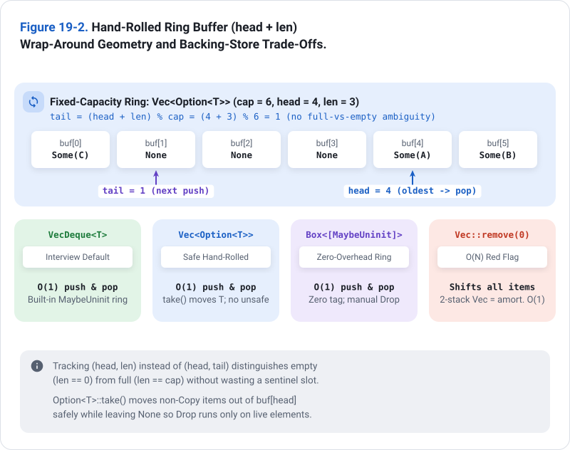
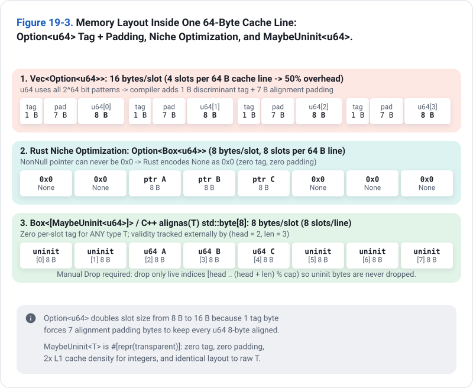
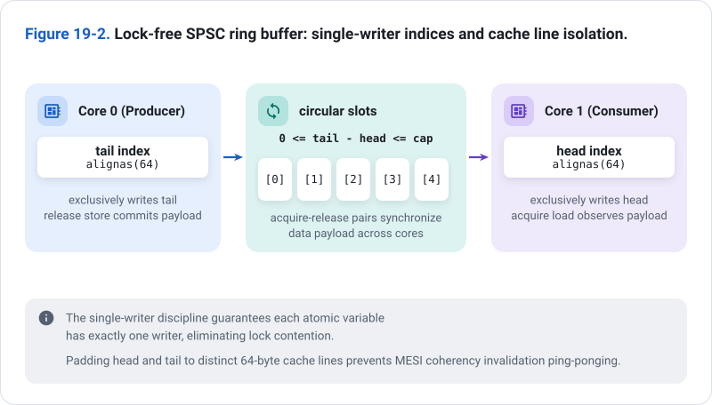
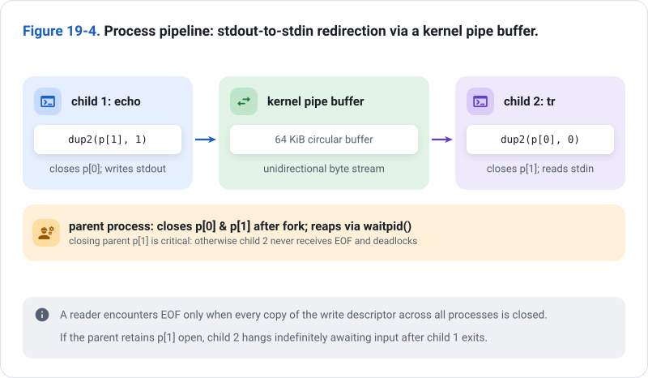

# 19. Systems Interview Problems: Derivations and Reference Implementations

The systems programming interview serves as an empirical evaluation of an engineer's capacity to translate low-level hardware constraints into correct, deterministic software abstractions. While application-level engineering frequently abstracts away execution costs, systems engineering requires direct reasoning from first principles: the mechanics of cache coherence, memory ordering semantics, kernel privilege transitions, memory fragmentation, and atomic instruction guarantees.

## 19.1 Architectural Framework and Problem-Solving Discipline

Every robust systems component rests on three engineering disciplines applied in sequence before writing code. First, **formal contract specification** establishes explicit preconditions, postconditions, and resource ownership boundaries, including capacity limits, pointer ownership transfers, lifetime bounds, and the exact threading model. Second, **state invariant formulation** identifies the logical properties that must hold across every execution path, dictating the exact state protected by each mutex or synchronized via atomic variables. Third, **boundary and interleaving analysis** traces edge cases (such as queue saturation, memory depletion, cache-line false sharing, and spurious wakeups) under arbitrary thread interleavings.

This chapter presents ten canonical systems programming problems, followed by a rigorous examination of six fundamental operating system mechanisms. Each problem articulates the underlying systems model, establishes the mathematical and concurrency invariants, provides verified reference implementations in C++20 and Rust (2024 edition), and evaluates subtle hardware and language-level trade-offs.

## 19.2 The Bounded Blocking Queue

A bounded blocking queue is the foundational synchronization primitive underpinning multi-threaded producer-consumer architectures. It provides a thread-safe **First-In, First-Out (`FIFO`)** buffer of fixed maximum capacity, decoupling production rates from consumption rates while preventing unbounded heap exhaustion.

### 19.2.1 Concurrency Model and Synchronization Primitives

Managing a shared bounded buffer requires resolving two distinct concurrency hazards simultaneously: **mutual exclusion** (concurrent threads must not mutate queue pointers, lengths, or ring indices at the same time, which would induce data races and state corruption) and **predicate coordination** (producer threads must suspend execution when the queue reaches capacity until space opens, while consumer threads must suspend when the queue is empty until an item arrives).

A **mutex** provides mutual exclusion but possesses no native mechanism for suspended waiting on arbitrary logical state. A thread that loops continuously while polling queue occupancy ("busy-waiting") wastes processor cycles and starves other threads contending for execution cores.

To resolve this, the queue pairs a mutex with **condition variables**. A condition variable enables a thread to release its held mutex and enter a sleep state atomically in a single hardware-supervised step. The atomicity of this transition is essential: if releasing the lock and sleeping were separate operations, a competing thread could signal a state change in the intervening gap, causing the waiting thread to sleep indefinitely, a catastrophic concurrency failure known as a **lost wakeup**.

Because the queue coordinates two opposing boundary states, it employs dual condition variables: **`is_full`** suspends producer threads while `size == capacity`, whereas **`is_empty`** suspends consumer threads while `size == 0`.

<figure>

</figure>

### 19.2.2 State Invariants and Predicate Verification

The queue maintains the following fundamental invariant across all operations:

```text
∀ t under mutex lock:  0 ≤ size ≤ capacity
```

Every state modification enforces strict pre- and post-conditions under the lock. When `push(item)` runs, it evaluates `is_full()`, suspending on `is_full` whenever the buffer is saturated; once unblocked with `size < capacity`, it appends the item, increments `size`, and signals `is_empty`. Symmetrically, `pop()` evaluates `is_empty()`, suspending on `is_empty` while the buffer holds no items; once unblocked with `size > 0`, it dequeues the front item, decrements `size`, and signals `is_full`.

A critical requirement in predicate synchronization is the **repeated evaluation loop** (`while (is_full())` / `while (is_empty())`). When a thread is awakened, it is moved from the condition variable's sleep queue to the mutex's contention queue; it does not instantaneously resume execution with the lock. By the time the thread re-acquires the mutex, an intervening thread may have intercepted the vacancy or consumed the available item. Furthermore, **Portable Operating System Interface (`POSIX`)** and operating system schedulers permit **spurious wakeups**, where a waiting thread unblocks without any explicit notification. Encapsulating the wait operation within a predicate loop ensures that a thread never advances until the condition is verified under exclusive lock ownership.

### 19.2.3 Reference Implementation

**Listing 19-1. A bounded blocking queue (C++20).**

```cpp
{{#include ../code/ch19/bounded_queue.cpp}}
```

**Output 19-1.**

```text
{{#include ../code/out/ch19_bounded_queue.out}}
```

**Listing 19-2. The same queue in Rust.**

```rust
{{#include ../code/ch19/bounded_queue.rs}}
```

**Output 19-2.**

```text
{{#include ../code/out/ch19_bounded_queue_rs.out}}
```

The verification harness executes two concurrent producer threads and two concurrent consumer threads, processing 100,000 sequential integers (1 to 100,000). The mathematical sum of these values is:

```text
Sum = (100,000 × 100,001) / 2 = 5,000,050,000
```

The verified outputs confirm that the aggregate consumed sum exactly matches this expectation, demonstrating zero item loss, zero duplication, and strict FIFO integrity under heavy thread contention.

In Rust, acquiring a mutex lock or waiting on a condition variable returns a `PoisonError` if another thread panicked while holding the guard. In the reference implementation, this error is converted into a structured message and propagated deterministically via the `?` operator.

### 19.2.4 Backing-Store Variants and Building the Ring Buffer by Hand

In operating systems and embedded engineering interviews, picking the right underlying container for the access pattern is evaluated closely, and a standard follow-up immediately after Listing 19-2 is: *"Now build the queue without `VecDeque` or `std::deque`."* Understanding every backing-store variant, and the exact ownership rules behind each one, turns a routine queue question into a demonstration of systems mastery.

| Backing Store | FIFO / LIFO | Push / Pop Cost | Memory & Safety Profile | When to Use |
| :--- | :--- | :--- | :--- | :--- |
| **`VecDeque<T>` / `std::deque<T>`** | FIFO | O(1) / O(1) | Contiguous ring using `MaybeUninit` internally (Rust) or chunked blocks (C++); zero manual `unsafe` | **Default interview choice** for mutex-backed bounded queues |
| **Hand-rolled `Vec<Option<T>>` (`head` + `len`)** | FIFO | O(1) / O(1) | Fixed allocation after `new()`, zero `unsafe`, handles any non-`Copy` / non-`Default` `T`; small `Option` tag overhead | **Follow-up: "implement without `VecDeque`"** in safe Rust / C++ (`std::optional<T>`) |
| **Raw `Box<[MaybeUninit<T>]>`** | FIFO | O(1) / O(1) | Zero `Option` tag overhead, no `Default` bound; requires `unsafe` (`write`, `assume_init_read`) and custom `Drop` | Production channels, kernel rings, and lock-free SPSC queues (Section 19.4) |
| **Two-stack `Vec<T>` (`inbox` + `outbox`)** | FIFO | Amortized O(1) | Plain `Vec<T>` with zero `Option<T>` and zero `unsafe`, but reverses `inbox` in O(N) whenever `outbox` empties | Functional or safe FIFO when occasional O(N) tail-latency spikes are acceptable |
| **Plain `Vec<T>` (`push` + `pop`)** | **LIFO** | O(1) / O(1) | Plain `Vec<T>`, zero overhead, improves L1 cache warmth for recent items | Object pools and worker stacks where FIFO ordering is not required |
| **Plain `Vec<T>` (`push` + `remove(0)`)** | FIFO | O(1) / **O(N)** | Shifts every remaining element left via `memmove` on every pop | **Interview red flag** unless the O(N) cost is called out explicitly for tiny bounds |

#### Why `VecDeque` Is the Right First Answer

For a mutex-guarded bounded queue in an interview, starting with `VecDeque::with_capacity(capacity)` (or `std::deque<T>` in C++) and stating the reasoning clearly is the strongest opening: `VecDeque` is already a contiguous circular ring buffer whose `push_back` and `pop_front` operations both run in O(1) time without reallocating once pre-sized, while using `MaybeUninit<T>` internally to avoid `Option<T>` discriminant padding. Using `Vec::remove(0)` is a mild red flag on systems teams because removing from index `0` copies `N - 1` elements left on every dequeue, turning a constant-time primitive into a linear bottleneck.

#### Why a Hand-Rolled Safe Ring Uses `Vec<Option<T>>` (and Not Plain `Vec<T>`)

When an interviewer asks a candidate to drop `VecDeque` and write the circular buffer directly, three Rust ownership invariants explain why a generic ring buffer cannot be backed by a plain `Vec<T>`. First, empty slots cannot remain uninitialized inside `Vec<T>`: every index `0..vec.len()` must hold a fully initialized `T`, yet at construction the ring is empty and arbitrary types such as `String`, `TcpStream`, or `Job` do not implement `Default` (plain `vec![0u8; cap]` works only for `T: Copy + Default`, such as a raw byte buffer). Second, moving a non-`Copy` item out of `buf[head]` via `let item = self.buf[self.head];` fails to compile for any owning type such as `String` or `Box<T>`, because `Vec<T>` retains ownership of the slot and would double-free it when overwritten or dropped; wrapping each slot in `Option<T>` lets `self.buf[self.head].take()` move ownership of the `T` to the caller while leaving `None` in the slot. Third, when the ring is dropped while partially populated, `Vec<Option<T>>` executes destructors strictly on live `Some(T)` slots and skips empty `None` slots automatically.

#### Avoiding the Full-versus-Empty Ambiguity with `(head, len)`

A classic bug in hand-rolled ring buffers arises from tracking only `(head, tail)`: when `head == tail`, the ring could be either completely empty (`len == 0`) or completely full (`len == cap`). Traditional fixes waste one array slot (`cap + 1` allocation) or add a separate `full: bool` flag. Tracking **`head`** (index of the oldest live element) together with **`len`** (count of live elements) eliminates the ambiguity cleanly: `is_empty()` holds when `len == 0`, `is_full()` holds when `len == cap`, and the next write index is derived deterministically as **`tail = (head + len) % cap`** (or `(head + len) & (cap - 1)` when `cap` is a power of two).

<figure>

</figure>

**Listing 19-2a. Bounded blocking queue backed by a hand-rolled `Ring<T>` without `std::deque` (C++20).**

```cpp
{{#include ../code/ch19/ring_buffer.cpp}}
```

**Output 19-2a.**

```text
{{#include ../code/out/ch19_ring_buffer.out}}
```

**Listing 19-2b. The same hand-rolled `Ring<T>` over `Vec<Option<T>>` without `VecDeque` (Rust 2024).**

```rust
{{#include ../code/ch19/ring_buffer.rs}}
```

**Output 19-2b.**

```text
{{#include ../code/out/ch19_ring_buffer_rs.out}}
```

### 19.2.5 Memory Layout: The `Option<T>` Tag, Niche Optimization, and `MaybeUninit<T>`

To evaluate when `Vec<Option<T>>` is completely free and when dropping down to `Box<[MaybeUninit<T>]>` (or C++ raw aligned byte storage) doubles cache efficiency, examine the exact bytes stored in RAM.

#### What Is the `Option<T>` Tag (Discriminant) and Why Does `Option<u64>` Cost 16 Bytes?

A Rust `Option<T>` (and C++'s `std::optional<T>`) is a **tagged union**: in memory, the program must distinguish `None` from `Some(value)` at runtime. Consider storing a 64-bit integer `u64`. Because a `u64` uses every one of its `2^64` bit combinations (`0x0000_0000_0000_0000` through `0xFFFF_FFFF_FFFF_FFFF`) as a valid number, the compiler cannot steal `0` or `u64::MAX` to encode `None`. It therefore appends a **1-byte tag (discriminant)** (`0` for `None`, `1` for `Some`). In a contiguous array, every `u64` must start at an address divisible by its 8-byte hardware alignment (Chapter 8, Section 8.1.2); if a slot occupied only `1 + 8 = 9` bytes, slot `1` would start at misaligned byte offset `9`. The compiler consequently inserts **7 bytes of alignment padding** between the tag and the payload (or after the payload in C++), inflating `size_of::<Option<u64>>()` from **8 bytes to 16 bytes**. Inside a 64-byte L1 cache line, `Vec<Option<u64>>` holds only **4 elements** instead of **8**, doubling RAM usage and cutting L1 cache density in half.

#### Rust's Niche Optimization (When `Option<T>` Costs Zero Extra Bytes)

Not every type exhausts all of its bit patterns. A reference (`&T`), `Box<T>`, `NonNull<T>`, `String` (whose internal heap pointer is `NonNull<u8>`), or `bool` (which uses only `0` and `1`, leaving `2..255` unused) possesses at least one **invalid bit pattern**, called a **niche**. Whenever `T` has a niche, the Rust compiler encodes `None` using that forbidden bit pattern (for example, all-zeros `0x0` for `Box<T>` or `String`) and eliminates the discriminant byte and padding completely. Thus `size_of::<Option<Box<u64>>>()` remains `8` bytes and `size_of::<Option<String>>()` remains `24` bytes with zero overhead. By contrast, C++'s `std::optional<T>` does not perform niche optimization, so `sizeof(std::optional<std::string>)` inflates from **24 bytes to 32 bytes** (24-byte `std::string` plus a 1-byte engaged `bool` and 7 bytes of padding).

#### Zero-Overhead Storage for Every Type: `MaybeUninit<T>` and C++ Aligned Raw Bytes

Even with Rust's niche optimization, plain numeric types (`u32`, `u64`, `i64`, `f64`, and fixed-size structs of integers) have no niche, so `Option<T>` still pays tag plus padding overhead. Inside a ring buffer, storing a per-slot tag is redundant because the ring's own `(head, len)` indices already record which slots are initialized (`(head + k) % cap` for `0 <= k < len`) and which slots are empty.

Rust's **`std::mem::MaybeUninit<T>`** (internally a `#[repr(transparent)]` union of `()` and `ManuallyDrop<T>`) exploits this invariant directly. It preserves the exact byte-for-byte size and alignment of `T` (`size_of::<MaybeUninit<T>>() == size_of::<T>()`), packing **8 `u64` slots per 64-byte cache line** (Figure 19-3). Empty slots start as `MaybeUninit::uninit()` with no `Default` bound; `push_back` initializes a slot via `.write(item)`; and `pop_front` extracts ownership via `unsafe { self.buf[head].assume_init_read() }`, immediately advancing `head` and decrementing `len` so no slot is read twice. Because `MaybeUninit<T>` suppresses automatic destructors to avoid dropping uninitialized bytes, `RawRing<T>` must implement a manual `Drop` that pops and drops strictly the live range `[head .. (head + len) % cap)`. The C++20 counterpart stores `alignas(T) std::byte bytes[sizeof(T)]` per slot, constructs elements in place with `std::construct_at` (placement `new`), ends lifetime upon extraction with `std::destroy_at`, and destroys remaining live slots in `~RawRing()`.

**Table 19-1. Verified 64-bit memory layout comparison (x86-64 / ARM64).**

| Type | Rust 2024 Size | C++20 Equivalent Size | Slots per 64 B Cache Line | Per-Slot Tag Overhead |
| :--- | :--- | :--- | :--- | :--- |
| `u64` / `uint64_t` | 8 B | 8 B | 8 | None |
| `Option<u64>` / `std::optional<uint64_t>` | 16 B | 16 B | 4 | 1 B tag + 7 B padding (2x) |
| `Option<Box<u64>>` / `std::optional<unique_ptr<uint64_t>>` | **8 B** (niche) | 16 B | 8 (Rust) / 4 (C++) | 0 B (Rust) / 8 B (C++) |
| `Option<String>` / `std::optional<std::string>` | **24 B** (niche) | 32 B | ~2.6 (Rust) / 2 (C++) | 0 B (Rust) / 8 B (C++) |
| `MaybeUninit<u64>` / `alignas(uint64_t) std::byte[8]` | **8 B** | **8 B** | **8** | **0 B (tracked by `head` + `len`)** |

<figure>
 with 1B tag and 7B padding, Option<Box<u64>> niche optimization, and tightly packed MaybeUninit<u64>"/>
</figure>

**Listing 19-2c. Zero-overhead ring buffer using raw aligned byte storage, `std::construct_at`, and `std::destroy_at` (C++20).**

```cpp
{{#include ../code/ch19/ring_buffer_uninit.cpp}}
```

**Output 19-2c. Verified byte layouts, 200 wrapped `std::string` transfers, and exact partial-ring destruction.**

```text
{{#include ../code/out/ch19_ring_buffer_uninit.out}}
```

**Listing 19-2d. Zero-overhead ring buffer over `Box<[MaybeUninit<T>]>` with verified manual `Drop` (Rust 2024).**

```rust
{{#include ../code/ch19/ring_buffer_uninit.rs}}
```

**Output 19-2d.**

```text
{{#include ../code/out/ch19_ring_buffer_uninit_rs.out}}
```

### 19.2.6 Systems Analysis and Concurrency Interview Follow-Ups

Interviewers routinely probe five concurrency subtleties directly on top of a bounded queue implementation (in C/C++ with `std::condition_variable` or `pthread_cond_wait`, and in Rust with `Condvar`).

| Concurrency Question | Engineering Answer and Invariant |
| :--- | :--- |
| **Why `while` / `wait_while` instead of `if`?** | Operating system schedulers and `POSIX` condition variables permit **spurious wakeups**, and an intervening thread can acquire the mutex first and invalidate the condition. Looping guarantees the predicate holds under exclusive lock ownership before proceeding. |
| **Why two condition variables (`not_full`, `not_empty`)?** | Dual condition variables isolate waiting producers from waiting consumers. With a single shared condition variable, `notify_one` can wake another producer when the queue is full (causing deadlock), forcing costly `notify_all` broadcasts on every operation. |
| **Why `notify_one` instead of `notify_all`?** | Each `push` enables at most one consumer and each `pop` enables at most one producer. Calling `notify_all` triggers a **thundering herd**, waking $K - 1$ threads that immediately block again. Reserve `notify_all` for shutdown transitions. |
| **Signal before or after unlocking the mutex?** | Both orders are correct. Dropping the guard (`drop(ring)`) before `notify_one()` avoids a "hurry up and wait" context switch where the woken thread immediately blocks on the still-held mutex, though modern kernels also mitigate inside-lock signaling via **wait morphing**. |
| **What is Rust lock poisoning (`PoisonError`)?** | A Rust `std::sync::Mutex` transitions to a *poisoned* state if a thread panics while holding its `MutexGuard`, warning callers that protected invariants may be half-updated. Propagate errors cleanly with `.map_err(...)?` (Listings 19-2 and 19-2b) rather than panicking with `.unwrap()`. |

<div class="callout keyidea">
<span class="label">Key idea</span>

Start a bounded-queue interview with `VecDeque` for O(1) ring semantics, be ready to drop down to a hand-rolled `Vec<Option<T>>` ring tracking `(head, len)` to eliminate full-versus-empty ambiguity, and pair dual condition variables with `while` / `wait_while` loops and `notify_one` to prevent spurious wakeups, lost wakeups, and thundering herds.

</div>

<div class="callout caution">
<span class="label">Watch out</span>

Using `if (!is_full())` instead of `while (is_full())`: an awakened producer does not hold the lock immediately upon unblocking; another thread may acquire the mutex first and fill the queue, causing lost updates or buffer overflow.

</div>

## 19.3 The Free-List Allocator

While the operating system allocates memory in coarse, page-sized increments (typically 4 KiB), user-space applications require dynamic allocation for objects with arbitrary sizes and heterogeneous lifetimes. A memory allocator bridges this granularity gap by requesting a large contiguous memory region (an **arena**) from the kernel and managing sub-allocations internally.

### 19.3.1 Memory Architecture and Layout Topology

A free-list allocator manages an arena as a continuous sequence of memory blocks without gaps. Every block consists of two contiguous components: an embedded **header** stored immediately before the usable memory (encoding the total payload size, an allocation flag marking the block free or active, and pointer linkages to adjacent blocks in address order), followed immediately by the **payload** (the raw memory buffer returned to the client application).

To support hardware vector extensions (**Single Instruction, Multiple Data (`SIMD`)** units such as SSE, AVX, and NEON) and prevent unaligned memory penalties, the allocator enforces a strict **16-byte alignment invariant**: every returned payload address and payload size must be an exact multiple of 16 bytes. Given a 32-byte header (itself a multiple of 16), preserving payload alignment maintains complete alignment throughout the arena.

### 19.3.2 Allocation and Reclamation Mechanics

Three interlocking policies govern the allocator's throughput and fragmentation profile. Under **first-fit search**, an allocation request of `n` bytes is rounded up to the next 16-byte boundary, after which the allocator traverses the block list in address order and selects the first free block whose payload capacity meets or exceeds the aligned request.

If the selected free block is significantly larger than the requested size, returning the entire block wastes unused bytes inside the allocation (**internal fragmentation**). The allocator prevents this via **block splitting**: whenever the excess capacity can hold a 32-byte header plus at least a 16-byte payload (48 bytes minimum), the front portion is assigned to the caller and the remainder is formatted into a new free block linked into the arena.

When `release(p)` is invoked, the allocator steps back to the preceding header at `p - sizeof(Header)` and marks the block free. Leaving adjacent free blocks fragmented would prevent future large allocations even when total free capacity is ample (**external fragmentation**). The allocator therefore performs **coalescing upon release**, merging adjacent free blocks into a single unified free block and recovering the 32-byte overhead of each subsumed header.

### 19.3.3 Structural Invariants

Across every allocation and release cycle, the allocator preserves four structural invariants: **exhaustive arena coverage** (the block list spans the entire arena continuously with zero unmapped gaps and zero overlapping regions), **monotonic address ordering** (consecutive nodes in the list are strictly adjacent in physical memory), the **post-release coalescing invariant** (upon return from `release(p)`, no two adjacent blocks are both marked free), and the **alignment invariant** (`address(payload) % 16 == 0` for every active block).

### 19.3.4 Reference Implementation

**Listing 19-3. A first-fit allocator with splitting and coalescing (C++20).**

```cpp
{{#include ../code/ch19/free_list_allocator.cpp}}
```

**Output 19-3.**

```text
{{#include ../code/out/ch19_free_list_allocator.out}}
```

**Listing 19-4. The same allocator in Rust.**

```rust
{{#include ../code/ch19/free_list_allocator.rs}}
```

**Output 19-4.**

```text
{{#include ../code/out/ch19_free_list_allocator_rs.out}}
```

The verification trace walks through deterministic state transitions inside a 1,024-byte arena with a 32-byte header. An initial request for 100 bytes rounds up to 112 bytes; combined with its 32-byte header, the first block spans offsets 0 to 143 (payload at offsets 32 to 143), leaving an 880-byte free block at offset 144. Subsequent requests for 200 bytes (aligned to 208 bytes) and 300 bytes (aligned to 304 bytes) carve two more blocks, leaving a final free block at offset 720 with a payload of `1,024 - 720 - 32 = 272` bytes. Releasing the second allocation (208 bytes) creates an isolated free hole; a subsequent request for 150 bytes (aligned to 160 bytes) fits inside this 208-byte hole and splits it cleanly because `208 - 160 = 48` bytes matches the exact 32-byte header plus 16-byte minimum payload threshold. Once all blocks are released, coalescing merges every adjacent segment back into a single unified free block of `1,024 - 32 = 992` payload bytes, eliminating external fragmentation completely.

### 19.3.5 Systems Analysis and Production Considerations

In this reference design, linear traversal and coalescing operate in `O(N)` time relative to the number of blocks. Production allocators based on Knuth's **boundary-tag** design store duplicate size and status metadata at both the head and tail of every block, enabling bidirectional neighbor inspection and `O(1)` constant-time coalescing.

Enterprise general-purpose allocators (`jemalloc`, `tcmalloc`) also eliminate linear searching by maintaining **segregated free lists** for discrete size classes (16 B, 32 B, 64 B, up to multi-page spans). To avoid multi-threaded lock contention, they assign independent thread-local caches and fall back to global synchronization only when a thread cache requires replenishment or flushing.

Because headers are stored **in-band** directly adjacent to user payloads, any out-of-bounds buffer write corrupts the successor block's size and status metadata. That corruption destabilizes the allocator heap and precipitates segmentation faults or exploitable memory vulnerabilities during subsequent, unrelated allocation cycles.

<div class="callout keyidea">
<span class="label">Key idea</span>

The free-list allocator bridges coarse virtual memory pages and fine-grained application objects. Enforcing 16-byte alignment via `(n + 15) & ~15` guarantees SIMD safety; splitting suppresses internal fragmentation, and coalescing eliminates external fragmentation.

</div>

<div class="callout caution">
<span class="label">Watch out</span>

In-band metadata corruption: because block headers reside immediately before payloads, an off-by-one or buffer overflow corrupts the next block's size and free flag. The program crashes not during the errant write, but on a subsequent, unrelated call to `allocate()` or `release()`.

</div>

## 19.4 The Lock-Free Single-Producer Single-Consumer Ring Buffer

In ultra-low-latency systems (such as high-frequency trading engines, audio processing graphs, and real-time network drivers), mutex-based queues introduce unacceptable jitter. Kernel-managed thread preemption, lock acquisition overhead, and priority inversions degrade deterministic throughput. A lock-free **Single-Producer Single-Consumer (`SPSC`)** ring buffer eliminates locks entirely, enabling safe, asynchronous communication across a dedicated producer and consumer thread using hardware-level memory ordering.

### 19.4.1 Architectural Model and Single-Writer Principle

The ring buffer manages a fixed-size contiguous array of capacity `C`, indexed by two monotonically increasing 64-bit unsigned counters: **`tail`** (the write pointer recording cumulative inserted elements, written exclusively by the producer thread) and **`head`** (the read pointer recording cumulative extracted elements, written exclusively by the consumer thread).

<figure>

</figure>

The core principle establishing lock-free safety is the **single-writer discipline**: each mutable index is modified by exactly one thread. Although each thread reads the peer's index to detect boundary conditions, stale reads remain strictly safe. If the producer observes a lagging value of `head`, it underestimates available free slots, treats the buffer as temporarily full ("false full"), and retries on the next iteration. Symmetrically, if the consumer observes a lagging value of `tail`, it perceives fewer available items ("false empty") and retries. Under no interleaving can a stale read permit the producer to overwrite unread data or cause the consumer to read an uninitialized or previously consumed slot.

### 19.4.2 State Invariants and Ring Wraparound

The indices maintain the fundamental queue invariant:

```text
0 ≤ tail - head ≤ capacity
```

The queue is empty when `head == tail`, and full when `tail - head == capacity`.

Because `head` and `tail` are 64-bit unsigned integers incremented monotonically, they do not suffer from wraparound distortion over realistic execution horizons. The physical array slot corresponding to an index is computed via modular arithmetic:

```text
slot_index = index % capacity
```

When capacity is constrained to a power of two, the expensive modulo division is replaced by a single-cycle bitwise mask: `index & (capacity - 1)`.

### 19.4.3 Memory Ordering and Acquire-Release Synchronization

Ensuring data visibility across CPU cores requires strict memory ordering guarantees. Without explicit barriers, modern out-of-order processors and optimizing compilers can reorder stores and loads, exposing uninitialized data to the consumer.

The `SPSC` ring buffer enforces an **acquire-release synchronization pair** on both indices. On the producer side, the thread writes the payload into `slots[tail % capacity]` and then publishes the updated index with a **release store**:

```text
tail.store(tail + 1, std::memory_order_release);
```

The release barrier guarantees that all preceding memory writes (the data payload) become globally visible to other cores before the updated `tail` becomes visible. On the consumer side, the thread reads the write pointer with an **acquire load**:

```text
tail.load(std::memory_order_acquire);
```

The acquire barrier guarantees that subsequent reads (extracting the slot payload) cannot be reordered ahead of the load, establishing a formal *happens-before* edge: once the consumer observes the incremented `tail`, it is guaranteed to read the complete payload written by the producer. A symmetric acquire-release pair governs `head` updates, ensuring the consumer finishes reading a slot before the producer observes the updated `head` and overwrites that memory.

### 19.4.4 Reference Implementation

**Listing 19-5. A lock-free SPSC ring buffer (C++20).**

```cpp
{{#include ../code/ch19/spsc_ring.cpp}}
```

**Output 19-5.**

```text
{{#include ../code/out/ch19_spsc_ring.out}}
```

**Listing 19-6. The same ring buffer in Rust, with atomic slots and no `unsafe`.**

```rust
{{#include ../code/ch19/spsc_ring.rs}}
```

**Output 19-6.**

```text
{{#include ../code/out/ch19_spsc_ring_rs.out}}
```

In the Rust implementation, lock-free safety is achieved entirely in safe code by wrapping slot values in `AtomicU64` types, demonstrating thread-safe interior mutability without invoking `unsafe` blocks.

### 19.4.5 Microarchitectural Optimization and False Sharing

Because the producer and consumer execute on distinct physical CPU cores, placing `head` and `tail` within the same 64-byte cache line triggers severe **false sharing**: every store to `tail` invalidates the consumer core's L1/L2 cache line, causing continuous `MESI` coherence bus traffic (Chapter 17). Separating each atomic index onto its own cache line via `alignas(64)` in C++20 or `#[repr(align(64))]` in Rust eliminates cross-core invalidations on the index fields.

This lock-free design depends fundamentally on the single-writer invariant. If multiple producers push concurrently, reading and incrementing `tail` without coordination allows two producers to claim and overwrite the same slot. Extending the ring buffer to **Multiple-Producer Multiple-Consumer (`MPMC`)** topologies requires atomic **Compare-And-Swap (`CAS`)** reservation loops paired with per-slot sequence counters.

<div class="callout keyidea">
<span class="label">Key idea</span>

In a lock-free SPSC queue, the single-writer discipline ensures each index is mutated by exactly one thread. Acquire-release memory ordering guarantees that payload writes are globally visible across cores before the updated index is published.

</div>

<div class="callout caution">
<span class="label">Watch out</span>

Cache line false sharing on `head` and `tail`: because producer and consumer execute on different cores, placing both atomic indices in the same 64-byte cache line causes the hardware coherency protocol (MESI) to bounce the line between cores on every push and pop. Always separate cross-core indices with `alignas(64)`.

</div>

## 19.5 Byte Routines: `memmove`, `strlen` and `atoi`

Low-level byte manipulation routines form the foundation of runtime environments, operating systems, and network protocol parsers. Implementing these routines correctly requires reasoning directly about contiguous byte streams, pointer arithmetic, buffer overlap, and numerical conversion limits.

### 19.5.1 The Memory Overlap Hazard and `memmove`

The `POSIX` specification draws a sharp contract boundary between `memcpy` and `memmove`: `memcpy` requires strictly non-overlapping source and destination buffers (invoking undefined behavior on overlap), whereas `memmove` guarantees exact copying under arbitrary overlap geometry.

Directional copying becomes mandatory when the destination begins inside the source region at a higher memory address (`dst > src` and `dst < src + count`). An unconditional forward loop (index `0` up to `count - 1`) overwrites later source bytes before they are read. Shifting `"abcdef"` two bytes right (source offset 0, destination offset 2, length 4) via a forward copy writes `'a'` to offset 2 and `'b'` to offset 3; when the loop reaches offset 2, it reads the newly written `'a'` and produces corrupted repetition (`"ababad"`). Evaluating pointer order resolves every geometry cleanly: `memmove` copies **forward** (from index `0` up to `count - 1`) whenever `dst <= src`, and copies **backward** (from index `count - 1` down to `0`) whenever `dst > src`.

### 19.5.2 String Bounds and NUL-Termination in `strlen`

The standard C string convention relies on sentinel-based termination: a string is a contiguous array of non-zero characters terminated by a null byte (`'\0'`). The `strlen` function iterates through memory, incrementing a counter until encountering the first zero byte.

The primary hazard of `strlen` is the risk of an unbounded read: if a buffer lacks a null terminator, the function continues reading beyond allocated memory bounds until triggering a segmentation fault (`SIGSEGV`) or leaking adjacent private memory. In safe systems languages like Rust, strings and byte buffers are represented as explicit fat pointers (pointer plus length), precluding unbounded traversals.

### 19.5.3 Robust Parsing and Overflow Prevention in `atoi`

Converting an **American Standard Code for Information Interchange (`ASCII`)** character sequence into a signed 32-bit integer proceeds through four sequential stages: skipping leading whitespace (spaces and tabs), parsing an optional `'+'` or `'-'` sign, accumulating consecutive numeric digits (`'0'` through `'9'`) via Horner's method (`value = value * 10 + (char - '0')`), and enforcing 32-bit signed range bounds (`[-2,147,483,648, 2,147,483,647]`). Because signed integer overflow invokes undefined behavior in C and C++, accumulating directly in an `int32_t` is unsound; the robust implementation accumulates intermediate magnitudes in a 64-bit integer (`int64_t`), applies the sign, and clamps or reports an error whenever the result exceeds `INT_MIN` or `INT_MAX`.

### 19.5.4 Reference Implementation

**Listing 19-7. `memmove`, `strlen` and `atoi` (C++20).**

```cpp
{{#include ../code/ch19/byte_routines.cpp}}
```

**Output 19-7.**

```text
{{#include ../code/out/ch19_byte_routines.out}}
```

**Listing 19-8. The same routines in Rust.**

```rust
{{#include ../code/ch19/byte_routines.rs}}
```

**Output 19-8.**

```text
{{#include ../code/out/ch19_byte_routines_rs.out}}
```

### 19.5.5 Systems Optimization and Vectorization

Byte-at-a-time loops process one byte per iteration, whereas production C standard libraries (`glibc`, `musl`) achieve an order-of-magnitude higher throughput using `SIMD` vector instructions (AVX-512, ARM NEON) or **SIMD Within A Register (`SWAR`)** bit-tricks. For example, vectorized `strlen` inspects 64 bytes simultaneously via `_mm512_cmpeq_epi8_mask`, locating a null byte in a single processor cycle.

At the language-specification level, ISO C++ defines relational pointer comparisons (`<`, `>`) strictly for pointers referring to elements within the same complete array object. Comparing arbitrary pointers requires `std::less`, which guarantees a total address ordering under the standard while compiling down to the same single unsigned comparison instruction on flat virtual address spaces.

<div class="callout keyidea">
<span class="label">Key idea</span>

Directional copying in `memmove` eliminates memory overlap corruption: copy forward when `dst <= src`, and backward when `dst > src`.

</div>

<div class="callout caution">
<span class="label">Watch out</span>

Signed integer overflow in `atoi`: in C and C++, signed 32-bit overflow invokes undefined behavior. Accumulate intermediate values in a 64-bit integer (`int64_t`) and validate against `INT_MIN` and `INT_MAX` before downcasting.

</div>

## 19.6 The LRU Cache

A **Least Recently Used (`LRU`)** cache is a foundational eviction mechanism used across operating system page replacement algorithms, database buffer pools, and web storage tiers. When the cache reaches its maximum capacity, subsequent insertions must evict the element that has remained unaccessed for the longest duration.

### 19.6.1 The Algorithmic Duality

The central challenge of an `LRU` cache is achieving strict `O(1)` time complexity for both data retrieval (`get`) and insertion or eviction (`put`). Neither primitive data structure satisfies both constraints independently: a **hash table** provides expected `O(1)` key lookup and insertion but records no access order (making eviction an `O(N)` linear scan), whereas a **doubly linked list** maintains elements in strict temporal order from head (**Most Recently Used (`MRU`)**) to tail (`LRU`) with `O(1)` splicing and tail removal, but requires an `O(N)` linear traversal to locate an arbitrary key.

<figure>

</figure>

The `LRU` cache reconciles these dual complexity constraints through structural composition: a hash map whose values are direct pointers (or iterators) referencing nodes within a doubly linked list. The linked list stores the actual key-value pairs, while the hash map provides instantaneous `O(1)` index access into the list.

### 19.6.2 State Invariants and Access Dynamics

The cache preserves three invariants across every operation: **set equivalence** (`Keys(HashMap) ≡ Keys(LinkedList)`), the **capacity bound** (`0 ≤ |Keys| ≤ capacity`), and **temporal ordering** (nodes are sequenced from head to tail in descending recency, with the `MRU` node at the front and the `LRU` node at the back).

Every operation maintains this topology in constant time. Calling `get(key)` probes the hash map; if absent it returns a cache miss, and if present it follows the stored node reference, splices that node to the head of the list in `O(1)` time, and returns the value. Calling `put(key, value)` either updates an existing node's value and splices it to the head, or, for a new key, evicts the tail node and purges its key from the hash map whenever `|Keys| == capacity`, then inserts the new key-value pair at the head and registers it in the hash map.

### 19.6.3 Reference Implementation

**Listing 19-9. An LRU cache built from a list and a hash map (C++20).**

```cpp
{{#include ../code/ch19/lru_cache.cpp}}
```

**Output 19-9.**

```text
{{#include ../code/out/ch19_lru_cache.out}}
```

**Listing 19-10. The same cache in Rust, with a list linked by index.**

```rust
{{#include ../code/ch19/lru_cache.rs}}
```

**Output 19-10.**

```text
{{#include ../code/out/ch19_lru_cache_rs.out}}
```

In the C++ implementation, `std::list::splice` transfers nodes between positions within the linked list by updating internal pointer links, guaranteeing that existing iterators remain valid and avoiding memory reallocation.

In Rust, implementing doubly linked lists using raw pointers introduces aliasing hazards that run afoul of the borrow checker. The reference Rust implementation demonstrates an idiomatic systems approach: storing nodes within a contiguous `Vec<Node>` arena and linking them via array indices (`usize`). This achieves high cache locality, eliminates pointer indirection, and preserves complete memory safety without `unsafe` blocks.

### 19.6.4 Concurrency and Partitioning Considerations

Because every `get` operation mutates the linked list to update access recency, `get` is fundamentally a write operation. Consequently, standard reader-writer locks (`std::shared_mutex`) offer no concurrency benefit, as read operations cannot run concurrently. High-throughput multi-threaded caches mitigate this contention through two complementary strategies: **cache striping** partitions the key space by key hash across `K` independent shards, each guarded by its own mutex, whereas **approximation algorithms** (such as `CLOCK` / Second Chance in kernel page replacement) maintain a circular buffer with hardware-set reference bits, decoupling common-path read hits from list-pointer mutations and lock acquisitions.

<div class="callout keyidea">
<span class="label">Key idea</span>

The LRU cache pairs an O(1) hash map with an O(1) doubly linked list. In C++, `std::list::splice` transfers nodes without reallocating memory or invalidating iterators; in safe Rust, an index-backed arena (`Vec<Node>`) achieves complete memory safety without `unsafe`.

</div>

<div class="callout caution">
<span class="label">Watch out</span>

In an LRU cache, `get()` is a mutating write operation: every hit splices the accessed node to the head of the list. A standard reader-writer lock cannot run concurrent readers without causing race conditions on pointer updates.

</div>

## 19.7 The Reader-Writer Lock

In concurrent systems, workloads frequently exhibit read-heavy asymmetry: many threads inspect shared data structures, while modifications occur infrequently. While a standard mutex guarantees safety by enforcing mutual exclusion across all callers, it serializes read operations unnecessarily, throttling multi-core throughput. A **reader-writer lock** relaxes this constraint by permitting concurrent shared read access while guaranteeing exclusive access for mutations.

### 19.7.1 Concurrency Invariants and Access Policies

The synchronization contract of a reader-writer lock enforces two mutually exclusive modes: **shared read access** allows any number of reader threads to enter concurrently while no writer is active, whereas **exclusive write access** grants entry to at most one writer while excluding all other readers and writers.

Internal state is governed by three fields protected by a mutex and coordinated through a condition variable: `readers_active` tracks the count of active readers, `writer_active` records whether an exclusive writer currently holds the lock, and `writers_waiting` counts queued writers awaiting exclusive entry. Across every interleaving, the lock preserves the mutual exclusion invariant:

```text
(writer_active => readers_active == 0) and (readers_active > 0 => !writer_active)
```

### 19.7.2 The Starvation Hazard and Writer-Preference Policy

A reader-preference lock grants access to any arriving reader as long as `writer_active` is false. Under high read concurrency, new reader threads arrive before existing readers release the lock, causing `readers_active` to remain non-zero indefinitely. Under this reader-preference policy, waiting writers experience **writer starvation**, blocked from updating state for unbounded durations.

To prevent starvation, the lock implements a **writer-preference policy**: an arriving reader thread is forced to wait if `writer_active` is true *or* if `writers_waiting > 0`. Prioritizing queued writers bounds write latency and ensures fair forward progress across both read and write operations.

### 19.7.3 Reference Implementation

**Listing 19-11. A reader-writer lock with writer preference (C++20).**

```cpp
{{#include ../code/ch19/rw_lock.cpp}}
```

**Output 19-11.**

```text
{{#include ../code/out/ch19_rw_lock.out}}
```

**Listing 19-12. The same lock in Rust.**

```rust
{{#include ../code/ch19/rw_lock.rs}}
```

**Output 19-12.**

```text
{{#include ../code/out/ch19_rw_lock_rs.out}}
```

The verification harness executes concurrent reader and writer threads simulating an invariant financial ledger. Two accounts share an aggregate balance of 1,000 units. Writer threads continuously transfer funds between the accounts, momentarily perturbing intermediate values. If a reader were permitted to execute concurrently with a writer, it would observe an inconsistent state (`balance_a + balance_b != 1,000`). The recorded output confirms zero "broken reads" across millions of operations, demonstrating absolute exclusive isolation.

### 19.7.4 Notification Dynamics and Performance Nuances

When an exclusive writer finishes its critical section and releases the lock, multiple queued reader threads may enter simultaneously. Calling `notify_one` would awaken only a single reader and serialize read concurrency; write releases must therefore broadcast via **`notify_all`**.

Comparing a reader-writer lock against a **counting semaphore** highlights an essential semantic difference. Although a semaphore initialized to `N` permits up to `N` concurrent holders, it does not distinguish shared inspection from exclusive mutation: an exclusive writer would have to acquire all `N` permits sequentially, creating immediate deadlock hazards if two writers each acquired half the permits. Standard libraries encapsulate dedicated reader-writer semantics via `std::shared_mutex` in C++20 and `std::sync::RwLock` in Rust, typically delegating to OS primitives such as `POSIX` `pthread_rwlock_t`.

<div class="callout keyidea">
<span class="label">Key idea</span>

Reader-writer locks maximize read throughput, but unmitigated reader preference causes writer starvation. Writer-preference policies guarantee that arriving readers wait if any writer is queued, bounding write latency.

</div>

<div class="callout caution">
<span class="label">Watch out</span>

Broadcast signaling on write release: when an exclusive writer finishes, multiple queued readers can proceed simultaneously. Notifications must use `notify_all()`; `notify_one()` awakens only a single reader, destroying read concurrency.

</div>

## 19.8 The Thread Pool

Operating system threads are resource-intensive abstractions. Creating a thread invokes kernel-level system calls, allocates per-thread execution stacks (typically 1–8 MiB of virtual address space), initializes hardware registers, and registers the thread with the kernel scheduler. Spawning and tearing down a thread for every brief, fine-grained task imposes severe CPU and memory allocation overhead. A **thread pool** amortizes these lifecycle costs by maintaining a static cohort of pre-spawned worker threads that execute tasks dispatched from a shared queue.

### 19.8.1 Execution Architecture and Lifecycle States

A thread pool decouples task specification from execution mechanics through a multi-producer, multi-consumer queue. Client threads act as producers by calling `submit(task)`, packaging a closure or function pointer into the shared work queue. Pre-spawned worker threads act as consumers running a continuous event loop: whenever tasks are queued, workers pop and execute them; when the queue is empty, workers sleep on a condition variable and consume zero CPU cycles.

### 19.8.2 Graceful Teardown and Drain Invariants

Tearing down a thread pool requires coordinating clean state transitions across all worker threads without dropping pending tasks or leaking OS threads. The shutdown sequence enforces two strict invariants: **exhaustive task draining** (every task submitted prior to shutdown runs to completion) and **deterministic worker termination** (every worker exits its loop and is joined by the parent thread).

The shutdown protocol sets a `stopping` flag under the queue mutex and broadcasts a notification (`notify_all`) to all suspended workers. A worker thread exits its loop only when both of the following conditions are met:

```text
stopping == true  and  queue.empty() == true
```

If the queue still contains tasks when `stopping` is asserted, workers continue extracting and processing tasks until the queue is fully drained, after which they terminate cleanly.

### 19.8.3 Reference Implementation

**Listing 19-13. A thread pool (C++20).**

```cpp
{{#include ../code/ch19/thread_pool.cpp}}
```

**Output 19-13.**

```text
{{#include ../code/out/ch19_thread_pool.out}}
```

**Listing 19-14. The same pool in Rust, built on a channel.**

```rust
{{#include ../code/ch19/thread_pool.rs}}
```

**Output 19-14.**

```text
{{#include ../code/out/ch19_thread_pool_rs.out}}
```

In the Rust implementation, task coordination is built on standard library cross-thread channels (`std::sync::mpsc`). When the thread pool is dropped, the sender endpoint is closed. In accordance with channel semantics, when a channel disconnects and its buffer empties, subsequent `recv()` calls return `Err`, causing worker threads to terminate naturally without requiring manual condition variable management.

### 19.8.4 Systems Nuances and Synchronization Hazards

The most common implementation bug in a thread pool is invoking the popped task closure while still holding the work-queue mutex. Holding the lock during execution serializes the entire pool onto a single core; each worker must pop its task, release the lock immediately, and execute the closure completely outside the critical section.

A second subtle hazard occurs during teardown: modifying the `stopping` flag without acquiring the queue mutex allows a worker to inspect `stopping == false`, observe an empty queue, and enter `wait()` after `notify_all()` has already fired, stranding that worker in a permanent lost wakeup. Setting `stopping = true` under the mutex closes that race window completely. At larger scales, production runtimes (such as Rust's Tokio and the Go scheduler) extend this central-queue model with **work stealing**, giving each core a private task deque and stealing from remote queues only when local work runs dry to minimize shared-queue contention (Chapter 17).

<div class="callout keyidea">
<span class="label">Key idea</span>

A thread pool decouples task submission from worker thread execution. Teardown requires setting `stopping` under the mutex and broadcasting a notification so that all queued tasks drain before workers join.

</div>

<div class="callout caution">
<span class="label">Watch out</span>

Executing tasks with the queue mutex held: worker threads must release the lock immediately after popping a task from the queue. Invoking the task closure while holding the mutex serializes execution across the entire pool into a single core.

</div>

## 19.9 The Process Pipeline: `fork`, `exec` and `pipe`

The Unix architecture is distinguished by the philosophy of composing complex data processing workflows from small, specialized utilities connected via standardized byte streams. Constructing a process pipeline, such as piping the output of `echo hello` into `tr a-z A-Z`, requires orchestrating **Inter-Process Communication (`IPC`)** through kernel file descriptors, process duplication, and address space replacement.

### 19.9.1 Kernel File Descriptor Mechanics and Redirection

A running program interacts with input/output channels via integer file descriptors, which index into the process's kernel-managed File Descriptor Table. Standard conventions establish descriptor 0 as standard input (`stdin`), descriptor 1 as standard output (`stdout`), and descriptor 2 as standard error (`stderr`).

User-space programs remain decoupled from underlying device geometries: writing to descriptor 1 invokes the same `write()` system call regardless of whether the descriptor refers to a terminal display, a disk file, a network socket, or an `IPC` pipe. Constructing a pipeline exploits this indirection by remapping file descriptors before executing program binaries.

### 19.9.2 The Pipeline Orchestration Sequence

Establishing a pipeline between two child processes proceeds through five deterministic stages (Figure 19-6).

<figure>

</figure>

First, the parent invokes `pipe(pipefd)`, allocating a unidirectional kernel circular buffer with read descriptor `pipefd[0]` and write descriptor `pipefd[1]`. Second, the parent calls `fork()` to spawn the upstream producer (`echo`): that child redirects standard output onto the pipe via `dup2(pipefd[1], STDOUT_FILENO)`, closes the unneeded read end (`pipefd[0]`) and original `pipefd[1]`, and replaces its address space via `execvp("echo", ...)`. Third, the parent calls `fork()` again to spawn the downstream consumer (`tr`): that child redirects standard input from the pipe via `dup2(pipefd[0], STDIN_FILENO)`, closes the unneeded write end (`pipefd[1]`) and original `pipefd[0]`, and executes `execvp("tr", ...)`. Fourth, the parent explicitly closes both `pipefd[0]` and `pipefd[1]`. Finally, the parent invokes `waitpid()` on both child **Process Identifiers (`PID`s)** to collect their exit statuses and prevent zombie accumulation.

### 19.9.3 Reference Implementation

**Listing 19-15. A pipeline of two processes (C++20).**

```cpp
{{#include ../code/ch19/mini_pipeline.cpp}}
```

**Output 19-15.**

```text
{{#include ../code/out/ch19_mini_pipeline.out}}
```

**Listing 19-16. The same pipeline in Rust, with the libc crate.**

```rust
{{#include ../code/ch19/mini_pipeline.rs}}
```

**Output 19-16.**

```text
{{#include ../code/out/ch19_mini_pipeline_rs.out}}
```

### 19.9.4 Deadlock Hazards and Process Isolation

Three classic process-lifecycle bugs break pipeline implementations in interviews and production shells. The most frequent is the **parent write-end deadlock**: a reader observes **End-Of-File (`EOF`)** (a `read()` returning `0` bytes) only when *every* open file descriptor referencing the pipe's write end across the entire operating system has been closed. Because `fork()` duplicates all open descriptors, the parent retains a copy of `pipefd[1]`. If the parent omits `close(pipefd[1])`, `tr` never receives `EOF` after `echo` exits and blocks indefinitely while the parent blocks in `waitpid()`, freezing both processes permanently.

Second, if `execvp()` fails inside a child (for example, when the target binary does not exist), the child must terminate immediately via **`_exit()`** rather than `exit()`. Calling standard `exit()` flushes user-space C `stdio` buffers and runs parent-registered `atexit` handlers; because `fork()` cloned the parent's buffered output, flushing in the failed child duplicates buffered lines into logs and files.

Third, omitting `waitpid()` leaves terminated children as **zombies** holding kernel process-table entries until reaped. A long-running server that spawns children without reaping eventually exhausts the kernel `PID` table and prevents any new process creation.

<div class="callout keyidea">
<span class="label">Key idea</span>

A pipeline redirects standard input and output streams via `dup2()` before replacing process images with `execvp()`. The kernel pipe is a bounded byte buffer whose EOF is delivered only when all write-end copies across all processes are closed.

</div>

<div class="callout caution">
<span class="label">Watch out</span>

The parent write-end deadlock: if the parent process fails to close its inherited copy of `pipefd[1]`, the downstream consumer (`tr`) waits indefinitely for further input after the producer exits, completely freezing `waitpid()`.

</div>

## 19.10 Bit Manipulation

Operating systems and systems runtimes operate at the boundary between software and physical hardware. Memory allocators, virtual memory paging subsystems, network protocol decoders, and device drivers rely fundamentally on bit-level manipulation to enforce alignment constraints, calculate page offsets, and manage dense allocation bitmaps.

### 19.10.1 Mathematical Principles of Two's Complement Arithmetic

Low-level bit manipulation exploits the mathematical invariants of two's complement integer representation. The most powerful identity is the subtraction property:

```text
In two's complement:  x - 1 = x + (~1 + 1)
```

Subtracting 1 from an integer `x` inverts the least significant set bit (the lowest 1 bit) and sets all lower-order bits (which were previously 0) to 1.
For example, in binary:

```text
x           = 12_10 = 0000 1100_2
x - 1       = 11_10 = 0000 1011_2
x & (x - 1) =  8_10 = 0000 1000_2
```

Computing the bitwise AND of `x` and `x - 1` clears the lowest set bit while leaving all higher-order bits unaltered.

### 19.10.2 Algorithmic Derivations

Four canonical bitwise primitives build directly on two's complement arithmetic. For **population count (`count_set_bits`)**, Brian Kernighan's algorithm applies `x = x & (x - 1)` in a loop until `x` reaches zero; because each iteration clears exactly one set bit, it runs in `O(k)` steps where `k` is the number of set bits rather than scanning all 64 bit positions. The same identity yields **`O(1)` power-of-two detection (`is_power_of_two`)**: a positive integer is an exact power of two if and only if it has a single set bit, tested via `x > 0 && (x & (x - 1)) == 0`.

For **power-of-two memory alignment (`align_up`)**, given an alignment `A = 2^k` (such as 16-byte `SIMD` alignment or 4,096-byte page alignment), the mask `A - 1` sets the lowest `k` bits to `1`. Rounding an address `x` up to the next multiple of `A` uses:

```text
align_up(x, A) = (x + (A - 1)) & ~(A - 1)
```

Adding `A - 1` forces any non-zero remainder in the lowest `k` bits to carry into bit `k`, and the bitwise AND with `~(A - 1)` clears the lower `k` bits to land on the aligned boundary. Finally, **`next_power_of_two`** finds the smallest power of two $\ge x$, either by bit-smearing (propagating the highest set bit rightward across all lower positions and adding 1) or via the **Count Leading Zeros (`CLZ`)** instruction.

### 19.10.3 Reference Implementation

**Listing 19-17. Bit manipulation (C++20).**

```cpp
{{#include ../code/ch19/bit_tricks.cpp}}
```

**Output 19-17.**

```text
{{#include ../code/out/ch19_bit_tricks.out}}
```

**Listing 19-18. The same functions in Rust.**

```rust
{{#include ../code/ch19/bit_tricks.rs}}
```

**Output 19-18.**

```text
{{#include ../code/out/ch19_bit_tricks_rs.out}}
```

For example, `align_up(4097, 4096)` evaluates to 8,192, showing how a memory allocation request for 4,097 bytes must span two complete 4,096-byte virtual memory pages.

### 19.10.4 Microarchitectural Hardware Acceleration

Modern CPU architectures provide single-cycle hardware instructions for these bitwise primitives: `POPCNT` on x86-64 and `CNT` on ARM NEON back C++20's `std::popcount` and Rust's `count_ones()`, while `LZCNT`/`BSR` on x86-64 and `CLZ` on ARM back `std::bit_ceil` and `next_power_of_two()`. Optimizing compilers lower high-level bitwise idioms directly into these single-cycle instructions in performance-critical loops.

## 19.11 Linked List Operations

Pointer manipulation is a classical interview domain that directly evaluates an engineer's mental model of memory addressing, pointer aliasing, and topological mutation. Performing in-place reversals, sorted merges, and cycle detections demonstrates the ability to reason about pointer graphs without introducing memory leaks or relying on heap allocation.

### 19.11.1 In-Place List Inversion

Reversing a singly linked list in-place requires redirecting every node's `next` pointer to reference its predecessor without losing access to the unvisited tail. Maintaining three pointers (`prev` as the head of the already-inverted prefix, `curr` as the active node being redirected, and `next_temp` as the saved link to `curr->next` before overwriting) completes the inversion in a single `O(N)` pass with `O(1)` auxiliary memory.

### 19.11.2 Sorted Merging and Sentinel Nodes

Merging two sorted linked lists into a single consolidated chain requires repeatedly comparing the head elements of each list, detaching the smaller node, and appending it to the result.

Without a dummy header, initializing the result list requires special-case branching to establish the initial `head` pointer. In systems programming, this branching overhead is eliminated using a **sentinel node** (or dummy node): a temporary, stack-allocated node placed at the root of the chain. Subsequent appends link directly to `tail->next`, eliminating conditionals inside the loop. Once the merge completes, the true head is retrieved as `sentinel.next`. In Rust, `Option::insert` initializes the tail pointer in-place; once either list is exhausted, the entire remainder is spliced in `O(1)` constant time via `*tail = left.or(right)`.

### 19.11.3 Cycle Detection: Floyd's Tortoise and Hare Algorithm

Determining whether a linked list contains a cycle using `O(1)` auxiliary memory precludes hash sets of visited pointers. Floyd's algorithm instead advances two pointers at different velocities: `slow` moves one node per step, while `fast` moves two nodes per step.

If the list is acyclic, `fast` reaches the null terminator in `O(N)` steps. If a cycle of length `C` exists, both pointers eventually enter the cycle; thereafter, each step decreases the distance from `fast` to `slow` by exactly one node (`2 - 1 = 1` modulo `C`), guaranteeing collision within at most `C` iterations after `slow` enters the cycle.

### 19.11.4 Reference Implementation

**Listing 19-19. Reverse, merge and cycle detection (C++20).**

```cpp
{{#include ../code/ch19/linked_list.cpp}}
```

**Output 19-19.**

```text
{{#include ../code/out/ch19_linked_list.out}}
```

**Listing 19-20. The same operations in Rust.**

```rust
{{#include ../code/ch19/linked_list.rs}}
```

**Output 19-20.**

```text
{{#include ../code/out/ch19_linked_list_rs.out}}
```

### 19.11.5 Rust Ownership and Graph Topology

In Rust's ownership model, standard `Box<Node>` pointers represent unique, non-aliased ownership. A cyclical data structure violates this model, as a cycle implies multiple incoming references to a single node. Consequently, constructing cycles with `Box` is impossible in safe Rust. The Rust reference implementation illustrates the idiomatic alternative: modeling the graph as an arena array where nodes are stored contiguously and linked via integer indices. Floyd's algorithm executes identically over this array, demonstrating graph traversal within the bounds of safe, verified memory.

## 19.12 Operating System Fundamentals: Six Technical Derivations

Beyond algorithmic implementations, systems engineering interviews evaluate conceptual mastery of kernel mechanics and hardware abstraction layers. The following six sections provide rigorous, first-principles derivations of the core concepts developed throughout Chapters 1 to 18.

### 19.12.1 Process Isolation vs. Thread Concurrency Topology

The distinction between a process and a thread is defined by memory isolation and resource ownership. A **process** is the operating system's unit of isolation and resource allocation, encapsulating a private virtual address space, an isolated page-table hierarchy, environment variables, security credentials, and a File Descriptor Table. Hardware isolation is enforced by the **Memory Management Unit (`MMU`)**: each process owns a distinct page-table root register (`CR3` on x86-64, `TTBR0_EL1` on ARM64), preventing writes in one process from corrupting another process's physical memory without explicit shared mappings.

A **thread** is the unit of CPU scheduling and execution inside a host process. Sibling threads share the parent process's virtual address space, page tables, open file descriptors, and signal dispositions, while maintaining private architectural execution state: a **Program Counter (`PC`)**, general-purpose register set, and per-thread stack. Because threads share memory without hardware isolation, concurrent mutations require explicit software synchronization (Chapters 3 and 4).

### 19.12.2 Context Switch Mechanics and Microarchitectural Overhead

A context switch pauses an active thread and resumes another on the same CPU core in two phases. During **architectural state preservation**, the kernel traps into privileged mode, saves the outgoing thread's registers, program counter, and stack pointer into its **Process Control Block (`PCB`)** or **Thread Control Block (`TCB`)**, and restores the incoming thread's saved registers. During **address space reconfiguration** (cross-process switches only), the kernel reloads the page-table base register (`CR3`/`TTBR0`), switching the active virtual-to-physical address map; same-process thread switches skip this step entirely.

Although saving and restoring registers takes only tens of nanoseconds, cross-process switches incur far larger indirect microarchitectural penalties. Reloading the page-table root invalidates non-global entries in the **Translation Lookaside Buffer (`TLB`)**, forcing expensive multi-level page-table walks until the `TLB` warms up (mitigated on modern CPUs by **Process-Context Identifiers (`PCID`)** on x86-64 and **Address Space Identifiers (`ASID`)** on ARM64). Simultaneously, the incoming process evicts the outgoing process's working set from private L1/L2 caches (**cache pollution**), degrading memory throughput after the switch (Chapters 2 and 5).

### 19.12.3 System Call Traps and Privilege Boundary Enforcement

A system call provides a hardware-supervised gate for user-mode code to invoke privileged kernel services (file I/O, process creation, network transmission) without exposing hardware directly. To cross the privilege boundary, the C runtime loads the system call number and arguments into designated registers (`RAX`, `RDI`, `RSI` on x86-64; `X8`, `X0` to `X5` on ARM64) and executes a trap instruction (`syscall` on x86-64, `svc` on ARM64). The processor elevates privilege from User Mode (Ring 3 / EL0) to Kernel Mode (Ring 0 / EL1), switches from the user stack to a private kernel stack, and jumps to the predefined handler registered in architectural **Model-Specific Registers (`MSR`s)** or Exception Vector Tables. The kernel validates every user pointer against the caller's address space, dispatches through the system call table, and returns to user mode via `sysret` or `eret`. Whereas a normal function call executes in a few clock cycles, a system call costs hundreds of nanoseconds due to pipeline flushes, privilege transitions, and pointer validation (Chapters 1 and 9).

### 19.12.4 Synchronization Taxonomy: Mutex, Spinlock, and Semaphore

Selecting an appropriate synchronization primitive depends on expected lock hold duration relative to context-switch latency (~2 to 5 µs) and whether ownership semantics are required (Chapter 6).

| Primitive | Contention Behavior | Ownership Semantics | Appropriate Use Case |
| :--- | :--- | :--- | :--- |
| **Mutex** | Kernel suspends waiter onto a wait queue | Strictly unlocked by the acquiring thread | General critical sections (> 2 to 5 µs), I/O, or allocation |
| **Spinlock** | Busy-waits on core via atomic `CAS` / `test_and_set` | Held briefly by one core | Kernel/interrupt handlers where sleeping is illegal and hold time is sub-microsecond |
| **Counting Semaphore** | Atomic permit counter; blocks when count reaches `0` | None (any thread may call `release` / `sem_post`) | Resource pools (`N` permits) and cross-thread event signaling |

On uniprocessor systems without preemption, a spinlock causes permanent priority inversion or deadlock if the holder is descheduled. A binary semaphore (initialized to `1`) resembles a mutex superficially but lacks ownership enforcement, preventing priority-inheritance protocols from identifying which thread holds the resource.

### 19.12.5 Deadlock Dynamics: Coffman Conditions and Prevention Strategies

A deadlock arises when a set of concurrent threads block permanently because each holds a resource while waiting for another resource held by a peer in the set. Deadlock is mathematically possible if and only if all four **Coffman conditions** hold simultaneously: **mutual exclusion** (each resource is held by at most one thread), **hold and wait** (a thread holding resources may request additional resources without releasing existing ones), **no preemption** (resources are released only voluntarily), and **circular wait** (a closed cycle $T_1 \to T_2 \to \dots \to T_n \to T_1$ exists in the wait-for graph).

Breaking any single Coffman condition eliminates deadlock permanently. In practice, systems software breaks **circular wait** via **global lock ordering**: assigning every lock a strict total order and requiring all threads to acquire locks in strictly ascending order makes cycles in the wait-for graph impossible. Alternatively, **non-blocking acquisition** breaks **hold and wait**: a thread uses `try_lock()`, and if any subsequent lock fails, releases all held locks, backs off, and retries the sequence (Chapter 6).

### 19.12.6 Virtual Memory Architecture and Page Fault Resolution

Virtual memory abstracts physical `DRAM` into a protected linear address space translated by the `MMU` through multi-level page tables (typically four levels on 64-bit architectures) and cached in the `TLB`. When an instruction accesses a virtual address whose **Page Table Entry (`PTE`)** is invalid or lacks the required permission bit, the `MMU` halts the instruction and raises a **page fault** trap (`#PF`). The kernel resolves the trap according to the backing semantics of the faulting virtual memory area (Chapter 7):

| Page Fault Class | Trigger Condition | Kernel Resolution Mechanism |
| :--- | :--- | :--- |
| **Demand Paging (File-Backed)** | First access to `.text` or `mmap` file page | Allocates physical frame, reads page from storage into page cache, updates `PTE` |
| **Zero-Fill on Demand (Anonymous)** | First write to lazy heap (`brk`/`malloc`) or stack page | Allocates zeroed physical frame lazily on first touch, maps writable `PTE` |
| **Copy-on-Write (`COW`)** | Write to shared read-only page after `fork()` | Duplicates physical frame into a private writable frame, updates caller's `PTE` |
| **Protection Violation** | Write to read-only segment, execute on `NX` stack, or unmapped address | Dispatches fatal `SIGSEGV` or `SIGBUS`, terminating the offending process |

<div class="callout summary">
<span class="label">Summary</span>

Mastery of systems programming interviews rests on translating hardware constraints into explicit contracts, state invariants, and interleaving proofs. Condition variables pair with predicate loops (`while`), dual wait queues, and writer-preference policies to prevent lost wakeups, spurious-wakeup corruption, and starvation. Lock-free `SPSC` queues replace mutexes with single-writer ownership, acquire-release barriers, and 64-byte cache-line alignment (`alignas(64)` / `#[repr(align(64))]`) to eliminate false sharing. Free-list allocators enforce 16-byte `SIMD` alignment while balancing internal and external fragmentation through splitting and coalescing; Unix process pipelines rely on `pipe()`, `fork()`, `dup2()`, and closing unused parent write descriptors to avoid `EOF` deadlocks. Anchoring these implementations to first-principles kernel mechanics (`CR3`/`TTBR0` isolation, `TLB` and cache-pollution costs, system-call trap gates, Coffman deadlock conditions, and page-fault resolution) unites algorithmic fluency with production systems engineering.

</div>
