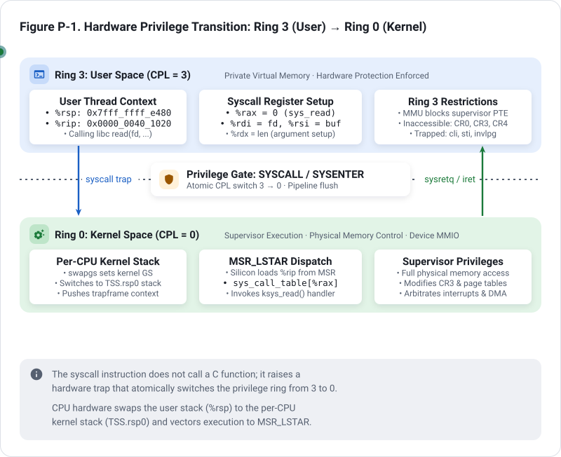
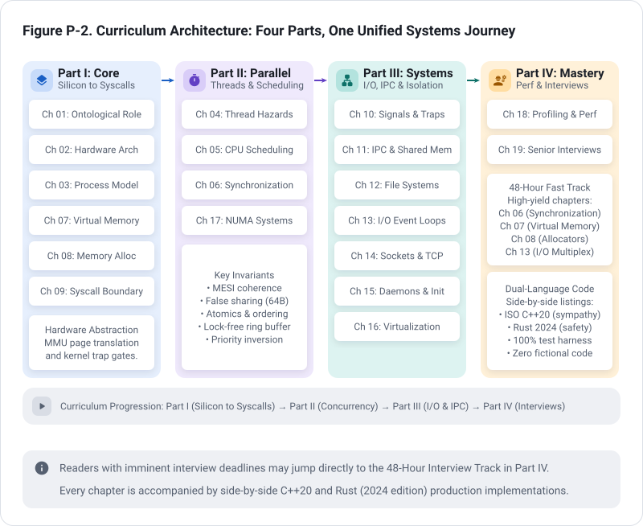

# Preface

> *"There are two ways of constructing a software design: One way is to make it so simple that there are obviously no deficiencies, and the other way is to make it so complicated that there are no obvious deficiencies. The first method is far more difficult."*
> — **C.A.R. Hoare**, The Emperor's Old Clothes (1980 Turing Award Lecture)

---

## The Philosophy of the Machine

Most software engineers spend their careers insulated inside runtime environments, garbage collectors, language virtual machines, and cloud abstractions. This insulation is a triumph of software engineering, but it breeds a dangerous illusion: the belief that computation, memory, and bandwidth are boundless, uniform, and isotropic.

In reality, computation is strictly governed by the physics of silicon and microarchitecture:
- CPU cores communicate across shared memory buses arbitrated by cache coherence protocols (MESI/MOESI), where uncoordinated concurrent writes across the same 64-byte cache line trigger catastrophic bus traffic through **false sharing**.
- Memory access latencies form a steep cliff: from sub-nanosecond L1 cache hits (4 cycles) to tens of nanoseconds for DRAM (hundreds of cycles), to hundreds of microseconds for NVMe storage devices.
- System calls are not benign function calls; they are hardware privilege transitions (Ring 3 &rarr; Ring 0) that flush CPU pipeline state, switch execution stacks, and trigger TLB and cache evictions.

The operating system is not merely a library of convenient helper functions. It is the supervisory software foundation that enforces hardware privilege boundaries, orchestrates virtual memory address translation, multiplexes finite CPU time among contending execution streams, and guarantees fault isolation. To write high-performance, fault-tolerant infrastructure, one must understand how the operating system and the hardware collaborate from first principles.

<figure>
  
</figure>

---

## The Dual-Language Paradigm: C++20 and Rust 2024

To truly master systems programming, one must transcend language dogma. This book deliberately pairs **ISO C++20** and **Rust (2024 edition)** across every chapter and reference implementation:

- **C++20** provides raw mechanical sympathy: explicit pointers, manual memory layout control, direct access to architectural instructions, unconstrained memory ordering, and direct POSIX system interfaces. It represents the historical and contemporary foundation of kernels, runtime engines, database storage managers, and high-frequency trading infrastructure.
- **Rust (2024 edition)** introduces mathematical rigor to systems engineering: affine type systems, compile-time data race freedom enforced by `Send` and `Sync`, deterministic destruction without exception hazards, and explicit demarcation of unsafe operations via strict invariant proofs.

By implementing every mechanism—from lock-free ring buffers and virtual memory allocators to pipeline orchestrators and kqueue supervisors—in both languages side-by-side, you learn to decouple abstract systems principles from language-specific idiosyncrasies. You will understand both the raw microarchitectural consequences of memory operations and the formal type-theoretic invariants required to prove their soundness.

---

## The Anatomy of a Systems Engineering Interview

Systems, infrastructure, kernel, and performance engineering interviews probe the boundary where software meets the operating system and the physical machine:

1. **Memory Ordering & Hardware Visibility:** Do you understand why sequentially consistent atomics (`seq_cst`) incur severe penalties on ARM64 architectures compared to acquire-release semantics (`memory_order_acquire` / `memory_order_release`)?
2. **Concurrency Invariants & Pitfalls:** Can you explain why a condition variable requires a predicate evaluation loop (`while` instead of `if`), why spurious wakeups occur in OS schedulers, and how to avoid the Thundering Herd penalty?
3. **Kernel Boundaries & Resource Lifecycles:** Do you know why a pipeline of child processes deadlocks if the parent fails to close its inherited write descriptor? Why must a `SIGCHLD` handler loop over `waitpid` with `WNOHANG`?
4. **Virtual Memory & Cache Coherence:** Can you derive how multi-level page tables conserve physical DRAM, what triggers a TLB shootdown across CPU sockets, and how allocator metadata alignment prevents internal and external fragmentation?

This text is engineered to equip you with the mental models, architectural proofs, and clean reference implementations to answer these questions with absolute confidence and rigor.

---

## Reading Pathways & Curriculum Structure

The chapters are organized progressively from hardware fundamentals upward into distributed runtime patterns, concluding with intensive interview derivations:

<figure>
  
</figure>

### Recommended Study Tracks

Depending on your immediate goals, consider following one of these curated pathways:

- **The 48-Hour Interview Track:** Focus on [Chapter 19 (Interview Problems)](ch19-interview-problems.md), supplemented by [Chapter 6 (Synchronization)](ch06-synchronization.md), [Chapter 7 (Virtual Memory)](ch07-virtual-memory.md), [Chapter 8 (Allocators)](ch08-allocation.md), and [Chapter 13 (I/O Multiplexing)](ch13-io-event-loops.md).
- **The Core Systems Track:** Read Chapters 1 through 9 sequentially to build an unbreakable mental foundation of processes, threads, virtual memory translation, and syscall mechanics.
- **The Concurrency & Performance Track:** Study Chapters 4, 6, 17, 18, and Section 19.4 to master atomics, lock-free algorithms, cache lines, false sharing, and profiling with hardware counters.

---

## Pedagogical Conventions

To maximize signal density and retention, each chapter incorporates standardized visual and typographical conventions:

> [!NOTE]
> **Key Idea:** Highlights core architectural principles, hardware invariants, and critical theoretical theorems.

> [!TIP]
> **Experiment:** Suggests concrete, hands-on micro-benchmarks or code modifications to verify kernel behavior on your local machine.

> [!CAUTION]
> **Common Pitfall:** Warns against subtle concurrency hazards, memory leaks, undefined behavior, or interviewer trap questions.

---

## The Verification Covenant

Every line of code in this book is non-fictional. Every listing is integrated into an automated verification harness ([`code/run_all.sh`](../code/run_all.sh)) that compiles under strict compiler configurations:
- **C++:** Clang with `-std=c++20 -Wall -Wextra -Wpedantic` on Apple Silicon and Linux.
- **Rust:** `rustc 2024` edition with zero compiler warnings and zero panicking `.unwrap()` calls in production execution paths.

All code listings are self-contained, deterministic, and accompanied by microarchitectural safety proofs. Approach the text with curiosity, verify every invariant on your machine, and build from first principles.
